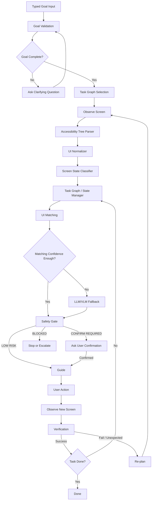

# AI Agent 전체 구조

## 1. 문서 목적

이 문서는 모바일 앱 사용 지원 AI Agent의 공통 구조와 런타임 흐름을 정의한다. 특정 Task 하나에 종속되지 않고, Android 설정 앱, 쿠팡, 정부24 등 여러 절차형 Task에 공통으로 적용되는 Agent 파이프라인을 설명한다.

Task별 State, Transition, UI 후보, 예외 처리는 별도 문서에서 관리한다.

- Task 상세 문서: [Android 설정 앱에서 글자 크기 확대](./tasks/font-size-increase.md)

## 2. Agent 목표

Agent는 사용자가 익숙하지 않은 모바일 앱에서 스스로 목적을 완료할 수 있도록 현재 화면을 이해하고 다음 행동을 단계별로 안내한다.

MVP의 기본 원칙은 Human-in-the-loop이다.

- Agent는 유형화된 Goal을 입력받는다.
- Agent는 Goal Type에 맞는 Task Graph를 선택한다.
- Agent는 현재 화면의 UI 요소를 분석한다.
- Agent는 다음에 눌러야 할 UI를 선택한다.
- Agent는 사용자가 직접 조작하도록 하이라이트와 문장으로 안내한다.
- Agent는 조작 이후 화면 변화를 확인한다.
- Agent는 예상과 다르면 재계획한다.
- Agent는 위험 행동을 자동 수행하지 않는다.

## 3. 입력 구조

Agent는 기본적으로 앞단에서 유형화된 Goal을 전달받는다고 가정한다.

```json
{
  "goal_type": "settings.font_size.increase",
  "target_app": "android_settings",
  "task_type": "settings_change",
  "slots": {
    "setting": "font_size",
    "direction": "increase"
  },
  "source_text": "글자 크기 키우고 싶어",
  "confidence": 0.93
}
```

Goal 유형화가 이미 완료된 경우 Agent는 LLM을 사용하지 않고 `goal_type`을 기준으로 Task Graph를 선택한다.

Raw 자연어만 들어오는 예외 상황에서는 LLM을 사용해 위 구조로 정규화할 수 있다. 즉, LLM은 Goal typing의 보조 수단이며, Agent의 UI 선택 단계에서 1차 판단기로 사용하지 않는다.

## 4. 핵심 설계 원칙

### 4.1 Goal 처리 원칙

Goal은 유형화된 입력으로 관리한다.

주요 필드:

- `goal_type`: 사용자의 목적을 표현하는 표준 타입
- `target_app`: 대상 앱 또는 앱 범주
- `task_type`: 구매형, 설정 변경형, 행정 서류 발급형 등 Task 패턴
- `slots`: 방향, 대상 설정, 상품, 문서 종류 등 Task별 파라미터
- `confidence`: Goal typing 신뢰도

Goal confidence가 낮거나 필수 slot이 비어 있으면 Agent는 Task를 시작하기 전에 사용자 확인을 요청한다.

### 4.2 UI 판단 원칙

UI 판단은 Accessibility Tree 기반의 keyword matching과 embedding matching을 우선한다.

우선순위:

1. Accessibility Tree 수집
2. UI Normalizer로 Node 정규화
3. keyword matching으로 명확한 후보 탐색
4. embedding similarity로 의미적으로 가까운 후보 탐색
5. confidence가 충분하면 Safety Gate로 전달
6. confidence가 낮으면 LLM/VLM fallback 또는 사용자 확인

### 4.3 LLM/VLM 사용 범위

LLM/VLM은 다음 상황에서 fallback으로만 사용한다.

- Goal이 유형화되지 않은 raw 자연어로 들어온 경우
- Goal Type confidence가 낮아 사용자 의도 확인이 필요한 경우
- Accessibility Tree에 label이 없거나 부정확한 경우
- 아이콘 중심 UI라 keyword matching이 실패한 경우
- 제조사/앱 버전 차이로 기존 Task Graph와 맞지 않는 경우
- 팝업, 권한 요청, 오류 화면 등 예외 화면이 등장한 경우
- embedding 및 keyword matching confidence가 낮은 경우

### 4.4 자동 조작 제한

MVP에서는 자동 클릭을 제공하지 않는다. Agent는 사용자가 눌러야 할 위치를 시각적으로 강조하고 설명하지만, 실제 조작은 사용자가 직접 수행한다.

## 5. 전체 런타임 루프

Agent의 기본 루프는 `Typed Goal -> Observe -> Normalize -> Classify -> Match -> Safety -> Guide -> Verify -> Re-plan`이다.



## 6. 시스템 계층 구조

| 계층 | 핵심 질문 | 담당 모듈 | 결과물 |
| --- | --- | --- | --- |
| Goal-level | 전달받은 Goal이 어떤 Task인가? | Goal Validator, Task Mapper | Task ID, slots |
| Task-level | 목표를 위해 어떤 State를 거쳐야 하는가? | Task Graph, State Manager | State, Transition |
| Screen-level | 현재 화면은 어떤 State인가? | Accessibility Tree Parser, UI Normalizer, Screen State Classifier | Current State |
| UI-level | 다음 State로 가기 위해 어떤 UI를 선택해야 하는가? | Keyword Matching, Embedding Matching | Target Node |
| Safety-level | 이 행동을 안내해도 되는가? | Rule-based Safety Gate | LOW RISK, CONFIRM_REQUIRED, BLOCKED |
| Guide-level | 사용자에게 어떻게 보여줄 것인가? | Overlay, Highlight, Cursor, Text Guide | 안내 UI |
| Verification-level | 의도한 화면 전이가 일어났는가? | Verifier, State Classifier | SUCCESS, DONE, REPLAN |
| Fallback-level | 규칙 기반 판단이 실패했는가? | LLM/VLM Fallback | 보조 판단 또는 사용자 확인 |

## 7. 모듈별 책임

### 7.1 Goal Validator / Task Mapper

앞단에서 전달된 typed Goal을 검증하고 Task Graph로 매핑한다.

역할:

- `goal_type` 존재 여부 확인
- 필수 slot 확인
- Goal confidence 확인
- 지원 가능한 Task인지 확인
- Task ID 선택

예시:

```json
{
  "goal_type": "settings.font_size.increase",
  "task_id": "MVP-01",
  "is_supported": true,
  "required_slots_filled": true,
  "needs_clarification": false
}
```

### 7.2 Task Graph / State Manager

Task별로 정의된 State와 Transition을 관리한다.

역할:

- 현재 Task의 시작 State와 완료 State 관리
- 현재 State에서 가능한 다음 Transition 조회
- 실패한 Transition 기록
- 대체 경로 탐색

Task Graph는 전체 구조 문서에 직접 넣지 않고 Task별 문서에서 관리한다.

### 7.3 Accessibility Tree Parser

Android Accessibility Service를 통해 현재 화면의 UI Tree를 수집한다.

수집 대상:

- `packageName`
- `className`
- `text`
- `contentDescription`
- `resourceId`
- `boundsInScreen`
- `clickable`
- `enabled`
- `selected`
- `scrollable`
- `checkable`

### 7.4 UI Normalizer

원본 Accessibility Node를 Agent가 비교하기 쉬운 정규화 Node로 변환한다.

정규화 기준:

- `text`와 `contentDescription`을 `label` 후보로 병합
- 버튼, 리스트 항목, 슬라이더, 토글 등 `role` 추론
- 화면 위치를 `top`, `middle`, `bottom` 등으로 변환
- 비활성, 숨김, 중복 Node 제거
- Task별 synonym dictionary 적용

### 7.5 Screen State Classifier

정규화 Node 목록과 Task Graph를 비교해 현재 화면 State를 판별한다.

판별 기준:

- 앱 패키지명
- 화면 제목
- 핵심 keyword 존재 여부
- 조작 가능한 UI role
- 이전 State에서 이동 가능한 State인지 여부

### 7.6 UI Matching

현재 State에서 다음 Transition을 수행하기 위한 Target Node를 선택한다.

1차 판단:

- keyword matching
- synonym matching
- resourceId matching
- role matching

2차 판단:

- normalized label embedding similarity
- 현재 State와 후보 Node의 semantic similarity
- Task goal과 후보 Node의 semantic similarity

fallback 조건:

- 후보가 없음
- 후보가 여러 개이고 score 차이가 작음
- 최고 후보 confidence가 threshold 미만
- 후보 Node가 실제로 clickable/actionable하지 않음

### 7.7 Safety Gate

Agent가 안내하려는 Action의 위험도를 판단한다.

위험 행동 기준:

- 금전적 결과가 발생하는가
- 개인정보 또는 민감정보가 관련되는가
- 법적/계약적 동의가 발생하는가
- 계정 또는 보안 상태가 변경되는가
- 사용자의 의도를 확신할 수 없는가

판정:

| 판정 | 의미 | 처리 |
| --- | --- | --- |
| `LOW_RISK` | 일반 탐색 또는 되돌릴 수 있는 설정 탐색 | 바로 안내 |
| `CONFIRM_REQUIRED` | 사용자의 설정, 개인정보, 계정 상태 등에 영향 가능 | 사용자 확인 후 안내 |
| `BLOCKED` | 결제, 송금, 계정 삭제, 인증번호 입력 등 고위험 | 안내 중단 또는 사람 확인 유도 |

### 7.8 Guide

Target Node의 위치를 사용자가 이해할 수 있도록 안내한다.

안내 방식:

- 버튼 또는 영역 윤곽선 강조
- 움직이는 커서 또는 포인터
- 짧은 텍스트 안내
- 필요 시 사용자 확인 문장

### 7.9 Verification

사용자 행동 이후 새 화면을 관찰해 목표 State로 이동했는지 확인한다.

결과:

| 결과 | 조건 | 다음 처리 |
| --- | --- | --- |
| `SUCCESS` | 예상 State로 이동 | 다음 Transition 진행 |
| `DONE` | 완료 State 도달 | 완료 안내 |
| `NO_CHANGE` | 화면 변화 없음 | 재안내 |
| `WRONG_STATE` | 예상과 다른 State | Re-plan |
| `UNKNOWN` | 화면 판별 실패 | fallback 검토 |

### 7.10 Re-plan

예상과 다른 화면이 나타났을 때 새로운 경로를 계산한다.

전략:

- 현재 State 재분류
- 직전 실패 Node 제외
- 대체 Transition 탐색
- 검색 기능 사용 가능 여부 확인
- 반복 실패 시 LLM/VLM fallback
- 사용자의 추가 설명 요청

## 8. 공통 데이터 구조

### 8.1 Typed Goal

```json
{
  "goal_type": "settings.font_size.increase",
  "target_app": "android_settings",
  "task_type": "settings_change",
  "slots": {
    "setting": "font_size",
    "direction": "increase"
  },
  "confidence": 0.93
}
```

### 8.2 Normalized Node

```json
{
  "node_id": "node_12",
  "label": "디스플레이",
  "role": "menu_item",
  "semantic_tags": ["display"],
  "bounds": [24, 320, 1056, 408],
  "clickable": true,
  "enabled": true,
  "embedding": "vector_ref"
}
```

## 9. 개발 항목

| 순서 | 개발 항목 | 결과물 |
| --- | --- | --- |
| 1 | MVP Task 정의 | Task별 문서 |
| 2 | Task Graph 설계 | State / Transition |
| 3 | Accessibility Tree 분석 | 실제 UI dataset |
| 4 | UI Normalizer | 정규화된 Node |
| 5 | Screen State Classifier | 현재 화면 판별 |
| 6 | UI Matching | keyword + embedding 기반 Target Node 선택 |
| 7 | Safety Gate | 위험 행동 판단 |
| 8 | Verification | State 전이 확인 |
| 9 | Re-plan | 예상 외 화면 처리 |
| 10 | LLM/VLM fallback | 실패 케이스 보완 |

## 10. MVP 성공 기준

- typed Goal이 적절한 Task로 매핑된다.
- Accessibility Tree 기반으로 현재 화면을 수집한다.
- UI Normalizer가 화면 Node를 일관된 구조로 변환한다.
- Screen State Classifier가 현재 State를 판별한다.
- UI Matching은 LLM 없이 keyword 및 embedding 기반으로 Target Node를 선택한다.
- confidence가 낮거나 예외 화면이면 LLM/VLM fallback으로 넘어간다.
- Safety Gate가 위험 Action을 차단하거나 사용자 확인을 요구한다.
- Guide는 사용자가 직접 조작할 수 있도록 한 단계씩 안내한다.
- Verification이 State 전이를 확인하고, 실패 시 Re-plan한다.
