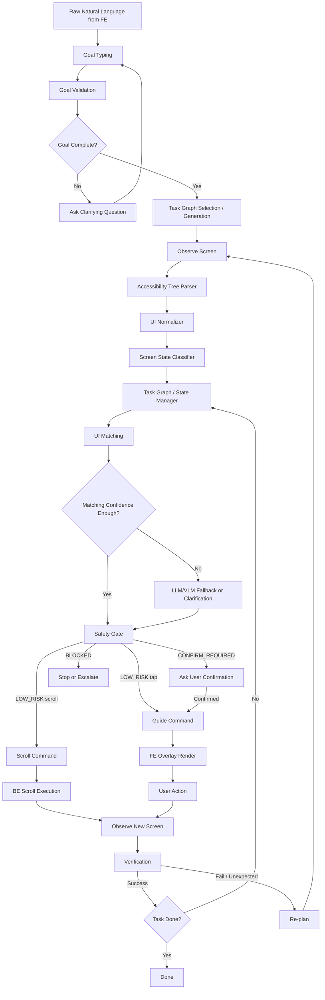

# AI Agent 전체 구조

## 1. 문서 목적

이 문서는 모바일 앱 사용 지원 AI Agent의 공통 구조와 런타임 흐름을 정의한다. 특정 Task 하나에 종속되지 않고, Android 설정 앱, 쿠팡, 정부24 등 여러 절차형 Task에 공통으로 적용되는 Agent 파이프라인을 설명한다.

Task별 State, Transition, UI 후보, 예외 처리는 별도 문서에서 관리한다.

- Task 상세 문서: [Android 설정 앱에서 글자 크기 확대](./tasks/font-size-increase.md)

## 2. Agent 목표

Agent는 사용자가 익숙하지 않은 모바일 앱에서 스스로 목적을 완료할 수 있도록 현재 화면을 이해하고 다음 행동을 단계별로 안내한다.

MVP의 기본 원칙은 Human-in-the-loop이다.

- Agent는 FE가 전달한 raw 자연어를 입력받는다.
- Agent는 FE가 전달한 raw 자연어를 분석해 Typed Goal을 생성한다.
- Agent는 Goal Type에 맞는 Task Graph를 선택하거나 Task Template로부터 생성한다.
- Agent는 현재 화면의 UI 요소를 분석한다.
- Agent는 다음에 눌러야 할 UI를 선택한다.
- Agent는 Guide Command를 생성한다.
- FE는 Guide Command를 받아 실제 Overlay, Highlight, 안내 문구를 렌더링한다.
- Agent는 조작 이후 화면 변화를 확인한다.
- Agent는 예상과 다르면 재계획한다.
- Agent는 tap을 자동 수행하지 않는다.
- Agent는 대상 UI 탐색을 위한 scroll만 제한적으로 허용한다.

## 3. 입력 구조

FE는 사용자의 raw 자연어를 Agent에 전달한다. Agent는 이 입력을 내부 Goal Typing 파이프라인으로 정규화한 뒤 Task Graph를 선택하거나 생성한다.

FE 입력 예시:

```json
{
  "source_text": "글자 크기 키우고 싶어",
  "locale": "ko-KR",
  "device_context": {
    "platform": "android",
    "foreground_app": null
  }
}
```

Agent가 생성하는 Typed Goal 예시:

```json
{
  "goal_type": "settings.font_size.increase",
  "target_app": "android_settings",
  "task_type": "settings_change",
  "slots": {
    "setting": "font_size",
    "direction": "increase"
  },
  "source_text": "글자 크기 키우고 싶어",
  "confidence": 0.93
}
```

MVP에서는 Goal Typing에 LLM을 기본 사용하지 않는다. Embedding 유사도, keyword/synonym matching, 규칙 기반 slot extraction, app/task prior를 우선 사용한다. LLM은 오프라인 평가에서 자체 Goal Typing 정확도가 기준 이하로 낮거나, 운영 중 low-confidence 비율이 높게 관찰될 때 fallback으로 도입을 검토한다.

## 4. 핵심 설계 원칙

### 4.1 Goal 처리 원칙

Goal은 raw 자연어에서 Agent가 생성한 typed 구조로 관리한다.

주요 필드:

- `goal_type`: 사용자의 목적을 표현하는 표준 타입
- `target_app`: 대상 앱 또는 앱 범주
- `task_type`: 구매형, 설정 변경형, 행정 서류 발급형 등 Task 패턴
- `slots`: 방향, 대상 설정, 상품, 문서 종류 등 Task별 파라미터
- `confidence`: Goal typing 신뢰도

Goal confidence가 낮거나 필수 slot이 비어 있으면 Agent는 Task를 시작하기 전에 사용자 확인을 요청한다.

Goal Typing은 아래 순서로 수행한다.

1. 입력 정규화
   - `source_text`의 공백, 구두점, 흔한 오타를 정리한다.
   - 한국어/영어 혼용 표현을 canonical token으로 변환한다.
   - 예: "폰트", "글씨", "글자" -> `font`; "키워", "크게", "확대" -> `increase`

2. App hint 추출
   - 사용자가 명시한 앱 이름, 현재 foreground app, OS 정보를 함께 본다.
   - "설정에서", "휴대폰 글자"처럼 시스템 설정 의도가 강하면 `android_settings` 후보에 prior를 준다.
   - 앱이 명확하지 않으면 `target_app`은 top candidate로 두되 confidence에 감점한다.

3. 후보 Goal 검색
   - Goal Catalog에는 각 `goal_type`별 대표 발화, 동의어, required slots, target app, task type이 등록되어 있다.
   - `source_text` embedding과 Goal Catalog의 대표 발화/template embedding을 비교해 top-k 후보를 찾는다.
   - 동일한 goal family 안에서는 slots까지 비교한다.

4. 규칙 기반 보조 점수 계산
   - keyword/synonym 일치 점수
   - 부정/취소/반대 방향 표현 점수
   - app hint 점수
   - required slot 채움 점수
   - 모호성 감점

5. Slot extraction
   - dictionary, regex, dependency keyword window를 사용해 slot을 추출한다.
   - 예: "글자 크기 키우고 싶어" -> `setting=font_size`, `direction=increase`
   - "화면 크게"처럼 `font_size`와 `display_size`가 모두 가능하면 ambiguous slot으로 표시한다.

6. Score fusion
   - 기본 confidence는 `embedding_score`, `keyword_score`, `slot_score`, `app_prior`를 가중 합산한다.
   - 초기 가중치 예: embedding 0.45, keyword/synonym 0.30, slot 0.20, app prior 0.05
   - top-1과 top-2의 score gap도 함께 기록한다.

7. 결정 기준
   - `confidence >= 0.80`, `score_gap >= 0.12`, required slots가 모두 채워짐: Typed Goal 확정
   - `0.60 <= confidence < 0.80` 또는 `score_gap < 0.12`: 사용자에게 짧게 확인
   - `confidence < 0.60`: 지원 Task 후보를 제시하거나 추가 설명 요청
   - 위험도가 높은 task family는 threshold를 더 높게 둔다.

8. Task Graph 생성
   - 확정된 `goal_type`이 등록 Task와 1:1 매핑되면 해당 Task Graph를 로드한다.
   - 같은 Task Template를 공유하는 경우 slots로 Graph를 parameterize한다.
   - 예: `settings.{setting}.{direction}` template + `setting=font_size`, `direction=increase`
   - Graph 생성 결과에는 start states, done state, transition 목록, safety rule, required dataset reference가 포함된다.

LLM fallback은 기본 비활성화한다. 단, 운영 지표상 Goal Typing 정확도 또는 task completion rate가 목표보다 낮은 경우, low-confidence 입력에 한해 LLM을 보조 분류기로 붙일 수 있다.

### 4.2 UI 판단 원칙

UI 판단은 Accessibility Tree 기반의 keyword matching과 embedding matching을 우선한다.

우선순위:

1. Accessibility Tree 수집
2. UI Normalizer로 Node 정규화
3. keyword matching으로 명확한 후보 탐색
4. embedding similarity로 의미적으로 가까운 후보 탐색
5. confidence가 충분하면 Safety Gate로 전달
6. confidence가 낮으면 LLM/VLM fallback 또는 사용자 확인

### 4.3 LLM/VLM 사용 범위

LLM/VLM은 다음 상황에서 fallback으로만 사용한다.

- Goal Type confidence가 낮아 사용자 의도 확인이 필요한 경우
- Accessibility Tree에 label이 없거나 부정확한 경우
- 아이콘 중심 UI라 keyword matching이 실패한 경우
- 제조사/앱 버전 차이로 기존 Task Graph와 맞지 않는 경우
- 팝업, 권한 요청, 오류 화면 등 예외 화면이 등장한 경우
- embedding 및 keyword matching confidence가 낮은 경우

### 4.4 자동 조작 제한

MVP에서는 자동 tap을 제공하지 않는다. Agent는 사용자가 눌러야 할 위치를 Guide Command로 만들고, FE는 이를 Overlay로 렌더링하지만, 실제 tap은 사용자가 직접 수행한다.

단, target UI가 현재 viewport에 없고 아래/위로 이동해야 발견될 가능성이 높은 경우 scroll은 제한적으로 허용한다.

- tap, long press, text input, submit, purchase, consent는 자동 수행하지 않는다.
- scroll은 탐색 목적의 LOW_RISK action으로만 허용한다.
- scroll 전후에는 Accessibility Tree를 재수집해 target UI 발견 여부를 검증한다.
- scroll 횟수와 방향은 Task Graph의 `scroll_policy`로 제한한다.
- scroll 중 사용자가 직접 조작하면 Agent는 즉시 재관찰 루프로 돌아간다.

## 5. 전체 런타임 루프

Agent의 기본 루프는 `Raw Goal -> Goal Typing -> Task Graph -> Observe -> Normalize -> Classify -> Match -> Safety -> Guide Command -> FE Overlay -> Verify -> Re-plan`이다.



## 6. 시스템 계층 구조

| 계층 | 핵심 질문 | 담당 모듈 | 결과물 |
| --- | --- | --- | --- |
| Goal-level | raw 자연어가 어떤 목적을 의미하는가? | Goal Typer, Goal Validator, Task Mapper | Typed Goal, Task ID, slots |
| Task-level | 목표를 위해 어떤 State를 거쳐야 하는가? | Task Graph, State Manager | State, Transition |
| Screen-level | 현재 화면은 어떤 State인가? | Accessibility Tree Parser, UI Normalizer, Screen State Classifier | Current State |
| UI-level | 다음 State로 가기 위해 어떤 UI를 선택해야 하는가? | Keyword Matching, Embedding Matching | Target Node |
| Safety-level | 이 행동을 안내해도 되는가? | Rule-based Safety Gate | LOW_RISK, CONFIRM_REQUIRED, BLOCKED |
| Guide-level | 사용자에게 무엇을 보여줄 것인가? | Guide Command Builder | Guide Command |
| Presentation-level | 안내를 실제 화면에 어떻게 렌더링할 것인가? | FE Overlay Renderer | Overlay, Highlight, Cursor, Text Guide |
| Execution-level | 허용된 자동 탐색 행동이 있는가? | BE Accessibility Action Executor | Scroll Result |
| Verification-level | 의도한 화면 전이가 일어났는가? | Verifier, State Classifier | SUCCESS, DONE, REPLAN |
| Fallback-level | 규칙 기반 판단이 실패했는가? | LLM/VLM Fallback | 보조 판단 또는 사용자 확인 |

### 6.1 L3 Agent 런타임 기준

MVP의 기본 UX는 Human-in-the-loop이지만, Agent 내부 구조는 L3 수준의 다중 단계 실행을 전제로 둔다. 여기서 L3는 사용자의 직접 조작을 유지하면서도 Agent가 목표, 현재 State, 실패 이력, 화면 변화, 사용자 행동 이벤트를 기억하고 다음 행동을 자율적으로 재선택하는 수준을 의미한다.

L3 Agent가 유지해야 하는 런타임 상태:

- `session_id` 기준의 Task 실행 상태
- 확정된 `TypedGoal`
- 선택된 `task_id`와 `TaskGraph`
- 현재 State와 직전 State
- 직전 Guide Command와 target node
- pending transition
- pending confirmation transition
- transition별 실패/재시도 횟수
- 실패한 node 목록
- 직전 화면 snapshot
- slider/progress 등 값 기반 설정 상태
- FE가 전달한 user action event

Session 저장소 원칙:

- Agent Engine은 `SessionStore` 인터페이스 뒤에서 session 상태를 읽고 쓴다.
- MVP local runtime은 `InMemorySessionStore`를 사용한다.
- BE 연동 후 서버 재시작, 멀티 프로세스, 여러 인스턴스를 고려해야 하면 Redis 또는 DB 기반 `SessionStore` 구현으로 교체한다.
- 저장소가 바뀌어도 `AgentTurnRequest -> AgentTurnResponse` 계약과 Agent Engine 흐름은 유지한다.

L3 Agent 분기 원칙:

- 첫 turn에는 `raw_goal`을 반드시 요구한다.
- follow-up turn은 같은 `session_id`가 기존 Agent session에 연결되어 있을 때만 `raw_goal` 없이 허용한다.
- 사용자 의도가 바뀌면 FE는 같은 session 또는 새 session으로 `raw_goal`을 다시 전달하고, Agent는 Goal Typing을 다시 수행한다.
- Agent는 매 turn마다 새 Accessibility Tree를 정규화하고 현재 State를 재판별한다.
- 직전 pending transition이 있으면 현재 State와 화면 snapshot을 비교해 전이 성공 여부를 검증한다.
- `NO_CHANGE`가 반복되면 같은 node를 실패 후보로 기록하고 다음 matching에서 제외한다.
- `WRONG_STATE`가 나오면 현재 State 기준으로 가능한 Transition을 다시 선택한다.
- slider/progress 값이 증가하면 화면 State가 그대로여도 설정 변경 성공으로 인정할 수 있다.
- `CONFIRM_REQUIRED` action은 사용자 확인 전에는 실제 조작 안내를 내보내지 않는다.
- 자동 tap, submit, consent, text input은 L3에서도 수행하지 않는다.

## 7. 모듈별 책임

### 7.1 Goal Typer / Goal Validator / Task Mapper

FE에서 전달된 raw 자연어를 Typed Goal로 변환하고 Task Graph로 매핑한다.

역할:

- raw 자연어 정규화
- embedding 기반 Goal 후보 검색
- keyword/synonym/rule 기반 점수 보정
- slots 추출
- `goal_type` 존재 여부 확인
- 필수 slot 확인
- Goal confidence 확인
- 지원 가능한 Task인지 확인
- Task ID 선택 또는 Task Graph 생성

예시:

```json
{
  "source_text": "글자 크기 키우고 싶어",
  "goal_type": "settings.font_size.increase",
  "target_app": "android_settings",
  "task_type": "settings_change",
  "slots": {
    "setting": "font_size",
    "direction": "increase"
  },
  "task_id": "MVP-01",
  "typing_method": "embedding+keyword+slot_rule",
  "is_supported": true,
  "required_slots_filled": true,
  "needs_clarification": false,
  "confidence": 0.91
}
```

### 7.2 Task Graph / State Manager

Task별로 정의된 State와 Transition을 관리한다.

역할:

- 현재 Task의 시작 State와 완료 State 관리
- 현재 State에서 가능한 다음 Transition 조회
- 실패한 Transition 기록
- 대체 경로 탐색
- scroll_policy 적용
- session별 `TypedGoal`, 현재 State, pending transition 저장
- 직전 Guide Command와 target node 저장
- transition별 retry count 저장
- 실패 node 목록 관리
- 직전 화면 snapshot과 slider/progress 값 저장
- 사용자 action event 저장

Task Graph는 전체 구조 문서에 직접 넣지 않고 Task별 문서에서 관리한다.

### 7.3 Accessibility Tree Parser

Android Accessibility Service를 통해 현재 화면의 UI Tree를 수집한다.

수집 대상:

- `packageName`
- `className`
- `text`
- `contentDescription`
- `resourceId`
- `boundsInScreen`
- `clickable`
- `enabled`
- `selected`
- `scrollable`
- `checkable`

### 7.4 UI Normalizer

원본 Accessibility Node를 Agent가 비교하기 쉬운 정규화 Node로 변환한다.

정규화 기준:

- `text`와 `contentDescription`을 `label` 후보로 병합
- 버튼, 리스트 항목, 슬라이더, 토글 등 `role` 추론
- 화면 위치를 `top`, `middle`, `bottom` 등으로 변환
- 비활성, 숨김, 중복 Node 제거
- Task별 synonym dictionary 적용
- `글꼴`, `폰트`, `글씨`, `font`, `text` 계열 표현을 canonical keyword인 `글자`로 정규화
- `글꼴 크기`, `폰트 크기`, `font size`, `text size` 계열 표현을 `글자 크기`로 정규화
- slider/progress/value 정보가 있으면 numeric value로 추출

예시:

```json
{
  "node_id": "node_12",
  "label": "디스플레이",
  "role": "menu_item",
  "semantic_tags": ["display", "screen"],
  "bounds": [24, 320, 1056, 408],
  "actionable": true,
  "value": null
}
```

### 7.5 Screen State Classifier

정규화 Node 목록과 Task Graph를 비교해 현재 화면 State를 판별한다.

판별 기준:

- 앱 패키지명
- 화면 제목
- 핵심 keyword 존재 여부
- 조작 가능한 UI role
- 이전 State에서 이동 가능한 State인지 여부

### 7.6 UI Matching

현재 State에서 다음 Transition을 수행하기 위한 Target Node를 선택한다.

1차 판단:

- keyword matching
- synonym matching
- resourceId matching
- role matching

2차 판단:

- normalized label embedding similarity
- 현재 State와 후보 Node의 semantic similarity
- Task goal과 후보 Node의 semantic similarity

fallback 조건:

- 후보가 없음
- 후보가 여러 개이고 score 차이가 작음
- 최고 후보 confidence가 threshold 미만
- 후보 Node가 실제로 clickable/actionable하지 않음
- Re-plan에서 실패 node로 기록된 후보는 matching 대상에서 제외

예시 출력:

```json
{
  "action_type": "tap",
  "target_node_id": "node_12",
  "target_label": "디스플레이",
  "match_method": "keyword+embedding",
  "confidence": 0.91
}
```

### 7.7 Safety Gate

Agent가 안내하려는 Action의 위험도를 판단한다.

위험 행동 기준:

- 금전적 결과가 발생하는가
- 개인정보 또는 민감정보가 관련되는가
- 법적/계약적 동의가 발생하는가
- 계정 또는 보안 상태가 변경되는가
- 사용자의 의도를 확신할 수 없는가

판정:

| 판정 | 의미 | 처리 |
| --- | --- | --- |
| `LOW_RISK` | 일반 탐색 또는 되돌릴 수 있는 설정 탐색 | 바로 안내 |
| `CONFIRM_REQUIRED` | 사용자의 설정, 개인정보, 계정 상태 등에 영향 가능 | 사용자 확인 후 안내 |
| `BLOCKED` | 결제, 송금, 계정 삭제, 인증번호 입력 등 고위험 | 안내 중단 또는 사람 확인 유도 |

### 7.8 Guide

Agent는 Target Node의 위치와 다음 행동을 Guide Command로 생성한다. FE는 이 명령을 받아 실제 Overlay를 렌더링한다.

Agent가 생성하는 정보:

- `command_type`: `highlight`, `gesture_hint`, `confirmation`, `done`, `blocked`
- `action_type`: `tap`, `drag`, `scroll`, `observe_only`
- `target_node_id`
- `target_bounds`
- `message`
- `safety_level`
- `requires_user_action`
- `expires_at` 또는 `ttl_ms`

FE 책임:

- 버튼 또는 영역 윤곽선 강조 렌더링
- 움직이는 커서 또는 포인터 렌더링
- 짧은 텍스트 안내 렌더링
- 필요 시 사용자 확인 UI 렌더링
- Overlay가 대상 UI를 가리지 않도록 위치 조정
- 실제 tap 수행 금지

원칙:

- 한 번에 하나의 행동만 안내
- 화면 위 Target Node와 안내 문장이 서로 충돌하지 않도록 배치
- 자동 tap 없이 사용자가 직접 조작
- Agent는 렌더링 좌표와 안내 의도를 전달하고, FE가 디바이스 해상도/밀도/안전영역을 반영해 최종 위치를 계산한다.

### 7.9 Scroll Handling

scroll은 target UI를 찾기 위한 탐색 행동으로만 허용한다. 자동 tap은 금지하지만, 화면 아래나 위에 있을 수 있는 버튼/메뉴를 찾기 위해 제한된 자동 scroll은 허용한다.

scroll 결정 조건:

- 현재 State에서 필요한 target keyword가 viewport에 없음
- 현재 화면에 `scrollable=true`인 container가 있음
- Task Graph의 현재 Transition이 `allow_scroll=true`임
- target이 아래/위에 존재할 가능성을 나타내는 근거가 있음
  - 같은 메뉴 목록의 정렬상 target이 아래에 있을 가능성
  - 화면 하단에 잘린 항목 존재
  - 이전 scroll history상 아직 끝에 도달하지 않음
- Safety Gate가 `LOW_RISK`로 판정함

Agent가 FE에 전달하는 정보:

- `guide_command_id`
- `action_type: "scroll"`
- `direction`: `down` 또는 `up`
- `message`: 예: "아래쪽에 글자 크기 메뉴가 있는지 찾아볼게요."
- `visual_hint`: 스크롤 방향 화살표, 탐색 중 상태, target keyword 표시
- `target_hint`: 찾고 있는 label/keyword
- `manual_override_allowed: true`

Agent가 BE에 전달하는 정보:

- `scroll_command_id`
- `session_id`, `task_id`, `state_id`, `transition_id`
- `scrollable_node_id` 또는 scrollable container bounds
- `direction`
- `scroll_amount`: `page`, `half_page`, 또는 normalized ratio
- `max_attempts`
- `stop_condition`: target keyword, target embedding threshold, target state, end-of-list
- `safety_level: "LOW_RISK"`

BE 처리:

- Accessibility action으로 scroll을 수행한다.
- scroll 후 새 Accessibility Tree, viewport bounds, scroll 가능 여부, 실제 이동 여부를 Agent에 반환한다.
- target이 발견되면 Agent는 tap을 실행하지 않고 Guide Command를 생성해 FE Overlay로 안내한다.
- `max_attempts` 도달, end-of-list, 화면 변화 없음이 반복되면 Re-plan으로 넘긴다.

### 7.10 Verification

사용자 행동 이후 새 화면을 관찰해 목표 State로 이동했는지 확인한다.

검증 입력:

- 직전 State
- 현재 State
- pending transition
- 직전 화면 snapshot
- 현재 화면 snapshot
- slider/progress value 변화
- 사용자 action event

결과:

| 결과 | 조건 | 다음 처리 |
| --- | --- | --- |
| `SUCCESS` | 예상 State로 이동 | 다음 Transition 진행 |
| `DONE` | 완료 State 도달 | 완료 안내 |
| `NO_CHANGE` | 화면 변화 없음 | 재안내 |
| `WRONG_STATE` | 예상과 다른 State | Re-plan |
| `UNKNOWN` | 화면 판별 실패 | fallback 검토 |

값 기반 검증:

- 글자 크기 확대처럼 설정 값 변경이 목표인 Task는 slider/progress 값이 이전보다 증가했는지 확인한다.
- 값이 증가했다면 화면 State가 `S4_FONT_SIZE_CONTROL`에 머물러 있어도 확대 조작은 성공으로 판단할 수 있다.
- 값 비교를 위해 FE는 Accessibility Node의 `extras.value`, `extras.progress`, `extras.current`, `extras.range_current`, `extras.percent` 중 가능한 값을 전달한다.

### 7.11 Re-plan

예상과 다른 화면이 나타났을 때 새로운 경로를 계산한다.

전략:

- 현재 State 재분류
- 직전 실패 Node 제외
- 대체 Transition 탐색
- 검색 기능 사용 가능 여부 확인
- 허용된 scroll 범위 안에서 추가 탐색 가능 여부 확인
- 반복 실패 시 LLM/VLM fallback
- 사용자의 추가 설명 요청

MVP L3 Re-plan 최소 구현:

- `NO_CHANGE`: 같은 State가 유지되면 직전 transition을 재시도한다.
- `NO_CHANGE`가 동일 transition에서 2회 이상 반복되면 직전 target node를 `failed_node_ids`에 추가하고 다음 UI Matching에서 제외한다.
- `WRONG_STATE`: 현재 관찰된 State를 기준으로 Task Graph의 가능한 Transition을 다시 조회한다.
- `UNKNOWN`: fallback 안내를 생성하고, 이후 Gemini similarity 또는 LLM/VLM fallback 후보로 넘긴다.
- `SUCCESS`: transition retry count를 초기화하고 다음 State의 Transition으로 진행한다.
- `DONE`: 완료 Guide Command를 반환하고 session을 완료 처리할 수 있다.

### 7.12 LLM/VLM Fallback

LLM/VLM은 기본 UI 판단 흐름이 실패했을 때만 보조적으로 사용한다.

사용 조건:

- Accessibility Tree에 의미 있는 label이 없음
- keyword 및 embedding matching이 실패함
- 화면이 기존 State Graph와 맞지 않음
- 예외 팝업 또는 앱 업데이트 화면이 등장함

개인정보 보호 원칙:

- 화면 이미지는 사용자 동의 후 사용
- 외부 모델 전송 전 개인정보 마스킹
- 마스킹되지 않은 원본 화면은 외부 모델로 전송하지 않음

## 8. 공통 데이터 구조

### 8.1 Raw Goal Input

```json
{
  "source_text": "글자 크기 키우고 싶어",
  "locale": "ko-KR",
  "device_context": {
    "platform": "android",
    "foreground_app": null
  }
}
```

### 8.2 Typed Goal

```json
{
  "goal_type": "settings.font_size.increase",
  "target_app": "android_settings",
  "task_type": "settings_change",
  "slots": {
    "setting": "font_size",
    "direction": "increase"
  },
  "confidence": 0.93
}
```

### 8.3 Task Definition

```json
{
  "task_id": "MVP-01",
  "goal_type": "settings.font_size.increase",
  "name": "Android 설정 앱에서 글자 크기 확대",
  "target_app": "android_settings",
  "type": "settings_change",
  "start_states": ["S0_UNKNOWN", "S1_SETTINGS_HOME"],
  "done_state": "S_DONE"
}
```

### 8.4 State Definition

```json
{
  "state_id": "S1_SETTINGS_HOME",
  "name": "설정 홈",
  "required_keywords": ["설정"],
  "optional_keywords": ["디스플레이", "접근성", "연결"],
  "package_candidates": ["com.android.settings"],
  "confidence_threshold": 0.75
}
```

### 8.5 Transition Definition

```json
{
  "from": "S1_SETTINGS_HOME",
  "to": "S2_DISPLAY_MENU",
  "action_type": "tap",
  "target_keywords": ["디스플레이", "화면", "Display"],
  "target_role": "menu_item",
  "safety_level": "LOW_RISK",
  "allow_scroll": true
}
```

### 8.6 Normalized Node

```json
{
  "node_id": "node_12",
  "label": "디스플레이",
  "role": "menu_item",
  "semantic_tags": ["display"],
  "bounds": [24, 320, 1056, 408],
  "clickable": true,
  "enabled": true,
  "value": null,
  "embedding": "vector_ref"
}
```

### 8.7 Agent Turn Request

FE는 매 관찰 주기마다 Agent에 `AgentTurnRequest`를 전달한다.

첫 turn에서는 `raw_goal`이 필수다. follow-up turn에서는 동일한 `session_id`가 기존 Agent session에 연결되어 있을 때만 `raw_goal` 없이 요청할 수 있다.

```json
{
  "request_id": "req_001",
  "session_id": "session_001",
  "raw_goal": {
    "source_text": "글자 크기 키우고 싶어",
    "locale": "ko-KR",
    "device_context": {
      "platform": "android",
      "foreground_app": null,
      "app_package": "com.android.settings",
      "screen_bounds": [0, 0, 1080, 2400]
    }
  },
  "accessibility_tree": [],
  "previous_state_id": null,
  "previous_guide_command_id": null,
  "user_confirmation": null,
  "user_action_event": null
}
```

### 8.8 User Action Event

FE는 사용자가 Agent 안내 이후 실제로 어떤 조작을 했는지 가능한 범위에서 전달한다.

```json
{
  "action_type": "tap_completed",
  "guide_command_id": "guide_session_001_S1_TO_S2_DISPLAY_MENU",
  "target_node_id": "node_12",
  "target_bounds": [24, 320, 1056, 408],
  "occurred_at_ms": 1798617600000
}
```

허용 값:

- `tap_completed`
- `drag_completed`
- `back_navigated`
- `manual_override`
- `observe_only`

### 8.9 Guide Command

```json
{
  "guide_command_id": "guide_001",
  "command_type": "highlight",
  "action_type": "tap",
  "target_node_id": "node_12",
  "target_bounds": [24, 320, 1056, 408],
  "message": "디스플레이를 눌러주세요.",
  "safety_level": "LOW_RISK",
  "requires_user_action": true,
  "render_policy": {
    "avoid_covering_target": true,
    "preferred_position": "below_target"
  }
}
```

### 8.10 Agent Session State

Agent는 `session_id` 기준으로 아래 상태를 저장한다. 내장 MVP 구현은 `InMemorySessionStore`를 사용하지만, BE 연동 시 같은 `SessionStore` 인터페이스를 구현하는 Redis 또는 DB 저장소로 교체할 수 있다.

```json
{
  "session_id": "session_001",
  "task_id": "MVP-01",
  "typed_goal": {
    "goal_type": "settings.font_size.increase",
    "target_app": "android_settings",
    "task_type": "settings_change",
    "slots": {
      "setting": "font_size",
      "direction": "increase"
    },
    "confidence": 0.85
  },
  "current_state_id": "S1_SETTINGS_HOME",
  "pending_transition_id": "S1_TO_S2_DISPLAY_MENU",
  "pending_confirmation_transition_id": null,
  "last_guide_command_id": "guide_session_001_S1_TO_S2_DISPLAY_MENU",
  "last_target_node_id": "node_12",
  "failed_node_ids": [],
  "transition_attempts": {
    "S1_TO_S2_DISPLAY_MENU": 1
  },
  "last_snapshot": {
    "state_id": "S1_SETTINGS_HOME",
    "fingerprint": "stable screen fingerprint",
    "slider_values": {}
  },
  "last_user_action_event": null
}
```

### 8.11 Screen Snapshot

화면 snapshot은 화면 변화 여부와 값 기반 검증을 위해 저장한다.

```json
{
  "state_id": "S4_FONT_SIZE_CONTROL",
  "fingerprint": "node labels, roles, bounds, selection, values",
  "slider_values": {
    "font_slider": 3
  }
}
```

### 8.12 Replan Decision

Re-plan 모듈은 검증 결과와 세션 이력을 보고 다음 matching에 반영할 결정을 만든다.

```json
{
  "should_replan": true,
  "reason": "same_screen_retry_limit_reached",
  "excluded_node_ids": ["node_12"],
  "prefer_current_state": true
}
```

### 8.13 Agent Turn Response

Agent는 매 turn마다 FE가 바로 렌더링할 수 있는 `GuideCommand`를 포함해 응답한다. `debug`는 초기 연동과 QA를 위한 필드이며, 프로덕션에서 사용자에게 직접 노출하지 않는다.

```json
{
  "request_id": "req_001",
  "session_id": "session_001",
  "task_id": "MVP-01",
  "typed_goal": {
    "goal_type": "settings.font_size.increase",
    "target_app": "android_settings",
    "task_type": "settings_change",
    "slots": {
      "setting": "font_size",
      "direction": "increase"
    },
    "confidence": 0.85
  },
  "current_state_id": "S1_SETTINGS_HOME",
  "guide_command": {
    "guide_command_id": "guide_session_001_S1_TO_S2_DISPLAY_MENU",
    "command_type": "highlight",
    "action_type": "tap",
    "target_node_id": "node_12",
    "target_label": "디스플레이",
    "target_bounds": [24, 320, 1056, 408],
    "message": "디스플레이를 눌러주세요.",
    "safety_level": "LOW_RISK",
    "requires_user_action": true
  },
  "match_result": {},
  "verification_result": null,
  "debug": {
    "session_stateful": true,
    "similarity_provider": "not_configured",
    "replan_decision": {
      "should_replan": false
    }
  }
}
```

### 8.14 Scroll Command

```json
{
  "scroll_command_id": "scroll_001",
  "task_id": "MVP-01",
  "state_id": "S1_SETTINGS_HOME",
  "transition_id": "S1_TO_S2_DISPLAY",
  "scrollable_node_id": "node_list_01",
  "direction": "down",
  "scroll_amount": "half_page",
  "max_attempts": 3,
  "target_hint": {
    "keywords": ["디스플레이", "화면", "Display"],
    "embedding_threshold": 0.78
  },
  "stop_condition": ["target_found", "end_of_list", "max_attempts"]
}
```

## 9. 개발 항목

| 순서 | 개발 항목 | 결과물 |
| --- | --- | --- |
| 1 | Goal Catalog / Goal Typing | raw 자연어 -> Typed Goal |
| 2 | MVP Task 정의 | Task별 문서 |
| 3 | Task Graph 설계 | State / Transition |
| 4 | Accessibility Tree 분석 | 실제 UI dataset |
| 5 | UI Normalizer | 정규화된 Node |
| 6 | Screen State Classifier | 현재 화면 판별 |
| 7 | UI Matching | keyword + embedding 기반 Target Node 선택 |
| 8 | Safety Gate | 위험 행동 판단 |
| 9 | Guide Command Builder | FE Overlay 렌더링용 명령 |
| 10 | Session State Manager | session별 goal/state/pending transition/failure history 저장 |
| 11 | User Action Event 연동 | FE 사용자 조작 이벤트 수집 |
| 12 | Screen Snapshot | 화면 변화와 slider/progress 값 추적 |
| 13 | Verification | State 전이 및 값 변화 확인 |
| 14 | Re-plan | 예상 외 화면, 화면 미변화, 반복 실패 처리 |
| 15 | Scroll Executor 연동 | 허용된 자동 scroll 실행 및 결과 |
| 16 | Gemini Similarity Scorer | keyword matching 보조 similarity |
| 17 | LLM/VLM fallback | 실패 케이스 보완 |

## 10. Task 문서 작성 규칙

Task별 문서는 다음 항목을 포함한다.

- Task ID와 사용자 목표
- 연결되는 `goal_type`
- raw 자연어 Goal Typing 기준
- 사용자 발화 예시
- 완료 조건
- State 목록
- Transition 목록
- scroll 허용 여부와 scroll policy
- keyword/synonym dictionary
- UI Matching 기준
- Safety 판정
- Guide Command 예시
- Verification 기준
- 예외 흐름 및 Re-plan 전략
- 필요한 Accessibility Tree dataset

## 11. MVP 성공 기준

- raw 자연어가 LLM 없이 적절한 Typed Goal과 Task로 매핑된다.
- Accessibility Tree 기반으로 현재 화면을 수집한다.
- UI Normalizer가 화면 Node를 일관된 구조로 변환한다.
- Screen State Classifier가 현재 State를 판별한다.
- UI Matching은 LLM 없이 keyword 및 embedding 기반으로 Target Node를 선택한다.
- confidence가 낮거나 예외 화면이면 사용자 확인 또는 LLM/VLM fallback 검토로 넘어간다.
- Safety Gate가 위험 Action을 차단하거나 사용자 확인을 요구한다.
- Agent는 Guide Command를 생성하고 FE는 Overlay를 렌더링한다.
- 자동 tap은 수행하지 않고, 허용된 범위의 scroll만 target 탐색 목적으로 수행한다.
- Verification이 State 전이를 확인하고, 실패 시 Re-plan한다.
- L3 Agent는 `session_id` 기준으로 Task 상태, pending transition, 실패 node, retry count, 화면 snapshot을 유지한다.
- 사용자의 tap/drag/back/manual override 이벤트를 받아 다음 관찰 결과와 함께 검증한다.
- 동일 transition에서 `NO_CHANGE`가 반복되면 직전 target node를 제외하고 대체 후보를 탐색한다.
- slider/progress 값이 증가하면 화면 State가 동일해도 설정 변경 성공으로 판단할 수 있다.
