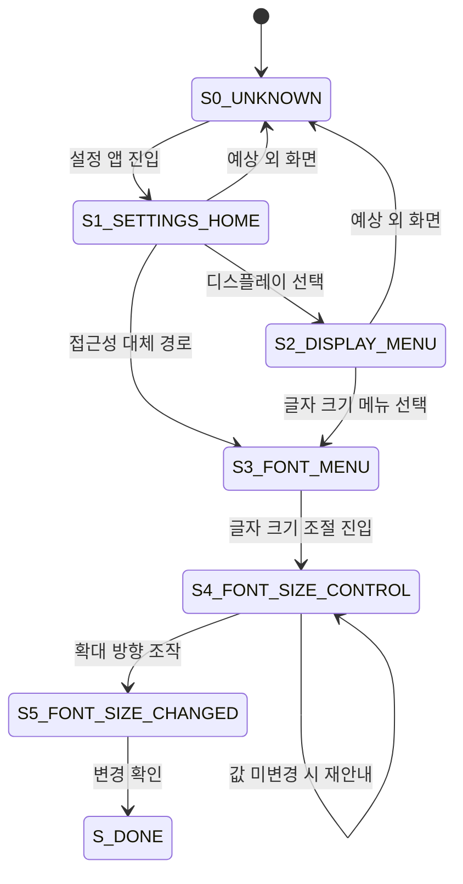
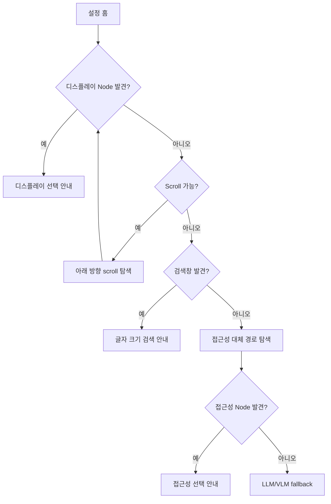

# Task: Android 설정 앱에서 글자 크기 확대

2026-10-10: 이 파일은 기존 설계의 보조 사본이다. 현재 실행 정책·완료 근거·미해결 UI 문제는 [루트 Task 문서](../../../docs/tasks/font-size-increase.md), [UI 재검증](../../../docs/reviews/2026-10-10-ui-highlight-revalidation.md), [품질·gold 기준](../../../docs/ai-quality-evaluation.md)을 따른다.

상세 설계의 기준은 [루트 Task 문서](../../../docs/tasks/font-size-increase.md)다. FE는 Goal/Command, Backend는 DB graph 선택·전달, AI1은 전달 graph 실행을 맡는다. 아래 UI·scroll 예시는 목표 설계이며 현재 MVP의 자동 scroll은 비활성이다.

2026-09-20 이후 완료 근거·자체 gold 수집 기준은 [루트 문서의 완료 조건](../../../docs/tasks/font-size-increase.md#4-완료-조건)과 [정답 데이터 계획](../../../docs/task-graph-data-plan.md)을 따른다. ColorBench·MobiFlow와 아래 예시를 실기기 정답으로 간주하지 않는다.

## 1. Task 정의

| 항목 | 내용 |
| --- | --- |
| Task ID | `MVP-01` |
| 연결 Goal Type | `settings.font_size.increase` |
| Task 이름 | Android 설정 앱에서 글자 크기 확대 |
| 사용자 목표 | 휴대폰 글자가 작아서 더 크게 보고 싶다 |
| 대상 앱 | Android 설정 앱 |
| Task 유형 | 설정 변경형 |
| Agent 역할 | 설정 앱에서 글자 크기 조절 화면까지 안내하고, 사용자가 직접 글자 크기를 확대하도록 돕는다 |
| 자동 클릭 여부 | 없음 |
| 자동 스크롤 여부 | 허용. 대상 메뉴 탐색 목적의 제한적 scroll만 가능 |

## 2. FE Goal·Command 입력과 Graph 연결

Goal Typing과 Command Typing은 FE가 담당한다. 실제 발화 예시, 필수 slots, 분류·clarification,
전체 요청 JSON은 [FE Goal·Command 계약](../../../docs/fe-goal-command-contract.md)에서 관리한다.
Backend는 `start_task` 또는 `replace_task`의 확정 Goal로 DB에서 다음 매핑에 맞는 graph를 선택한다. AI1은 graph 본문·reference·목표·실행 상태를 받아 이 Task의 안내·검증·Re-plan을 수행한다.

| FE 입력 | 값 |
| --- | --- |
| `goal.goal_type` | `settings.font_size.increase` |
| `goal.target_app` | `android_settings` |
| `goal.slots` | `setting=font_size`, `direction=increase` |
| Backend DB 선택 결과 | `task_id=MVP-01`, `task_type=settings_change` |

AI1은 원문을 분류하거나 graph를 선택·수정하지 않는다. 감소 목적을 확대 graph로 바꾸지 않는다. 후속 `observe`·`resume_task`에서는 Backend가 저장된 Goal과 고정 graph·실행 상태를 복원해 AI1에 전달한다. graph에 없는 경로가 필요하면 AI1은 Backend에 재선택/지원 불가 처리를 요청한다. [Graph 전달 계약](../../../docs/backend-task-graph-dispatch.md)을 따른다. 새 typed 입력은 설계 계약이며 현재 v1 raw-goal
코드 전환은 별도 작업이다.

## 3. 사용자 발화와 Goal 분류 참조

이 Task를 요청하는 대표 발화는 “글자 크기 키우고 싶어”다. “화면 크게”처럼 글자 크기와
화면 배율이 모호하면 FE에서 먼저 확인한다. 발화 목록·canonical enum·필수값의 기준은
[FE 계약의 실제 Goal 목록](../../../docs/fe-goal-command-contract.md#3-실제-goal-type-목록)이다.

## 4. 완료 조건

Agent는 다음 조건을 만족하면 Task를 완료로 판단한다.

- 현재 화면이 글자 크기 조절 화면이거나 글자 크기 설정 변경 후 상태이다.
- 사용자가 원하는 방향이 확대였고, 슬라이더 또는 옵션 값이 이전보다 큰 방향으로 이동했다.
- 변경 후 화면을 재관찰했을 때 글자 크기 관련 설정 화면이 유지된다.
- 사용자에게 완료 안내를 제공한다.

완료 안내 예시:

- "글자 크기가 더 크게 변경되었어요."
- "설정이 적용된 것 같아요. 화면 글자가 커졌는지 확인해보세요."

## 5. State 정의

| State ID | State 이름 | 화면 특징 | 주요 판별 근거 |
| --- | --- | --- | --- |
| `S0_UNKNOWN` | 알 수 없는 화면 | 설정 앱이 아니거나 현재 화면 판단 실패 | package mismatch, keyword 부족 |
| `S1_SETTINGS_HOME` | 설정 홈 | 설정 카테고리 목록 | "설정", "디스플레이", "접근성", "연결" |
| `S2_DISPLAY_MENU` | 디스플레이 메뉴 | 화면/밝기/글자 관련 메뉴 | "디스플레이", "밝기", "글자 크기", "화면 크기" |
| `S3_FONT_MENU` | 글자 관련 메뉴 | 글자 크기 또는 글꼴 항목 | "글자 크기와 스타일", "글꼴 크기", "Font size" |
| `S4_FONT_SIZE_CONTROL` | 글자 크기 조절 화면 | 슬라이더, 단계 옵션, 미리보기 | "글자 크기", slider role, preview text |
| `S5_FONT_SIZE_CHANGED` | 글자 크기 변경됨 | 조절 값이 확대 방향으로 변경됨 | slider value 증가, 큰 단계 선택 |
| `S_DONE` | 완료 | 변경 확인 완료 | verifier done |

## 6. Transition 정의

| From | Action | Target UI 후보 | To | Safety | Scroll |
| --- | --- | --- | --- | --- | --- |
| `S0_UNKNOWN` | 설정 앱 열기 안내 | "설정" 앱 아이콘 또는 앱 검색 결과 | `S1_SETTINGS_HOME` | LOW_RISK | 불필요 |
| `S1_SETTINGS_HOME` | 디스플레이 메뉴 진입 | "디스플레이", "화면", "Display" | `S2_DISPLAY_MENU` | LOW_RISK | 허용 |
| `S1_SETTINGS_HOME` | 접근성 대체 경로 진입 | "접근성", "시인성 향상" | `S3_FONT_MENU` | LOW_RISK | 허용 |
| `S2_DISPLAY_MENU` | 글자 크기 메뉴 진입 | "글자 크기와 스타일", "글꼴 크기", "Font size" | `S3_FONT_MENU` | LOW_RISK | 허용 |
| `S3_FONT_MENU` | 조절 화면 진입 | "글자 크기", "글꼴 크기", slider area | `S4_FONT_SIZE_CONTROL` | LOW_RISK | 허용 |
| `S4_FONT_SIZE_CONTROL` | 확대 방향 조작 안내 | 슬라이더 오른쪽, 큰 단계 옵션 | `S5_FONT_SIZE_CHANGED` | CONFIRM_REQUIRED | 불필요 |
| `S5_FONT_SIZE_CHANGED` | 변경 확인 | 미리보기 텍스트, slider value | `S_DONE` | LOW_RISK | 불필요 |



## 7. Keyword / Synonym Dictionary

### 7.1 State 판별 키워드

| State | Required | Optional |
| --- | --- | --- |
| `S1_SETTINGS_HOME` | 설정 | 디스플레이, 접근성, 연결, 알림, 배터리 |
| `S2_DISPLAY_MENU` | 디스플레이 | 밝기, 글자 크기, 화면 크기, 다크 모드 |
| `S3_FONT_MENU` | 글자 또는 글꼴 | 스타일, 크기, 폰트, Font |
| `S4_FONT_SIZE_CONTROL` | 글자 크기 또는 글꼴 크기 | slider, 미리보기, 작게, 크게 |

### 7.2 UI Matching 동의어

| 개념 | 동의어 |
| --- | --- |
| display | 디스플레이, 화면, Display, screen |
| accessibility | 접근성, 시인성, 보기 편하게, visibility |
| font_size | 글자 크기, 글꼴 크기, 폰트 크기, Font size, text size |
| increase | 크게, 확대, 키우기, 오른쪽, 큰 글자 |

## 8. UI Matching 전략

UI Matching은 LLM을 기본으로 사용하지 않는다.

우선순위:

1. 현재 State의 Transition 후보 조회
2. target keyword와 normalized node label 비교
3. synonym dictionary 적용
4. resourceId 또는 className 보조 확인
5. label embedding similarity 계산
6. role과 actionable 여부 확인
7. confidence 산출
8. target이 없고 scrollable container가 있으면 scroll 탐색 후보 생성

Target Node 예시:

```json
{
  "state": "S1_SETTINGS_HOME",
  "next_state": "S2_DISPLAY_MENU",
  "action_type": "tap",
  "target_node_id": "node_12",
  "target_label": "디스플레이",
  "match_method": "keyword+embedding",
  "confidence": 0.91
}
```

Fallback 조건:

- `confidence < 0.7`
- 후보 Node가 0개
- 상위 후보 2개의 score 차이가 `0.1` 미만
- Node label이 비어 있음
- slider 조작 방향을 판단할 수 없음

Scroll 탐색 조건:

- 현재 Transition의 `Scroll` 값이 허용
- 현재 viewport에서 target keyword/embedding 후보가 발견되지 않음
- `scrollable=true`인 list/container가 발견됨
- 화면 하단 또는 상단에 잘린 item이 있어 추가 항목 가능성이 있음
- 동일 방향 scroll 횟수가 `max_attempts` 미만
- Safety Gate 결과가 `LOW_RISK`

Scroll 탐색은 target을 찾기 위한 행동일 뿐이다. target 발견 후에도 Agent는 자동 tap을 하지 않고 FE에 Guide Command를 보내 사용자가 직접 누르게 한다.

## 9. Safety Gate

`MVP-01`은 대부분 낮은 위험도이지만, 실제 설정 값을 바꾸는 순간에는 사용자 확인을 요구한다.

| Action | 판정 | 처리 |
| --- | --- | --- |
| 설정 앱 열기 | LOW_RISK | 바로 안내 |
| 디스플레이 메뉴 선택 | LOW_RISK | 바로 안내 |
| 글자 크기 메뉴 선택 | LOW_RISK | 바로 안내 |
| 메뉴 탐색 scroll | LOW_RISK | 제한 횟수 내 자동 scroll 가능 |
| 글자 크기 확대 | CONFIRM_REQUIRED | 확인 후 안내 |
| 설정 초기화 | BLOCKED | 안내 중단 |
| 접근성 고급 설정 변경 | CONFIRM_REQUIRED | 확인 후 안내 |

확인 문장 예시:

- "글자 크기 설정이 바뀔 수 있어요. 계속 크게 조정할까요?"

## 10. Guide Command / FE Overlay

Agent는 Guide Command를 생성하고, FE는 실제 Overlay를 렌더링한다. Agent는 렌더링 의도와 좌표를 전달할 뿐이며 tap은 수행하지 않는다.

| State | 안내 문구 |
| --- | --- |
| `S0_UNKNOWN` | "설정 앱을 열어주세요." |
| `S1_SETTINGS_HOME` | "디스플레이를 눌러주세요." |
| `S2_DISPLAY_MENU` | "글자 크기와 스타일을 눌러주세요." |
| `S3_FONT_MENU` | "글자 크기를 눌러주세요." |
| `S4_FONT_SIZE_CONTROL` | "글자를 크게 하려면 슬라이더를 오른쪽으로 움직여주세요." |
| `S5_FONT_SIZE_CHANGED` | "글자 크기가 더 크게 변경되었어요." |

Tap Guide Command 예시:

```json
{
  "guide_command_id": "guide_display_001",
  "command_type": "highlight",
  "action_type": "tap",
  "target_node_id": "node_12",
  "target_label": "디스플레이",
  "target_bounds": [24, 320, 1056, 408],
  "message": "디스플레이를 눌러주세요.",
  "requires_user_action": true,
  "safety_level": "LOW_RISK",
  "render_policy": {
    "avoid_covering_target": true,
    "preferred_position": "below_target"
  }
}
```

Scroll Guide Command 예시:

```json
{
  "guide_command_id": "guide_scroll_001",
  "command_type": "gesture_hint",
  "action_type": "scroll",
  "direction": "down",
  "message": "아래쪽에서 글자 크기 메뉴를 찾아볼게요.",
  "target_hint": {
    "keywords": ["글자 크기와 스타일", "글꼴 크기", "Font size"]
  },
  "manual_override_allowed": true,
  "safety_level": "LOW_RISK"
}
```

FE Overlay 책임:

- `target_bounds` 기준 highlight를 렌더링한다.
- 안내 문구가 target UI를 가리지 않도록 배치한다.
- `action_type=tap`일 때 실제 tap을 실행하지 않는다.
- `action_type=scroll`일 때 탐색 중 상태와 방향 cue를 보여준다.
- 사용자가 직접 조작하면 Overlay를 유지하되 Agent의 다음 Observe 결과에 따라 갱신한다.

BE Scroll Command 예시:

```json
{
  "scroll_command_id": "scroll_font_menu_001",
  "task_id": "MVP-01",
  "state_id": "S2_DISPLAY_MENU",
  "transition_id": "S2_TO_S3_FONT_MENU",
  "scrollable_node_id": "node_list_01",
  "direction": "down",
  "scroll_amount": "half_page",
  "max_attempts": 3,
  "stop_condition": ["target_found", "end_of_list", "max_attempts"],
  "target_hint": {
    "keywords": ["글자 크기와 스타일", "글꼴 크기", "Font size"],
    "embedding_threshold": 0.78
  }
}
```

BE Scroll 결과:

```json
{
  "scroll_command_id": "scroll_font_menu_001",
  "success": true,
  "attempt": 1,
  "moved": true,
  "end_of_list": false,
  "accessibility_tree_ref": "tree_after_scroll_001"
}
```

## 11. Verification

검증은 사용자 행동 이후 새 Accessibility Tree를 다시 수집해 수행한다.

| 단계 | 성공 조건 | 실패 처리 |
| --- | --- | --- |
| 설정 앱 진입 | package가 설정 앱 | 설정 앱 열기 재안내 |
| 디스플레이 진입 | `S2_DISPLAY_MENU` 판별 | 접근성 또는 검색 경로 탐색 |
| 글자 메뉴 진입 | `S3_FONT_MENU` 판별 | 후보 Node 재매칭 |
| 조절 화면 진입 | slider 또는 글자 크기 preview 발견 | VLM fallback 검토 |
| 메뉴 탐색 scroll | 새 후보 Node 발견 또는 list 위치 변화 | 반대 방향 또는 검색 경로 탐색 |
| 크기 확대 | slider value 증가 또는 큰 옵션 선택 | 조작 방향 재안내 |
| 완료 | 변경 상태 유지 | 재관찰 또는 사용자 확인 |

검증 결과 enum:

- `SUCCESS`
- `DONE`
- `NO_CHANGE`
- `WRONG_STATE`
- `UNKNOWN`

## 12. Re-plan 전략

### 12.1 디스플레이 메뉴가 없는 경우

1. 현재 화면의 scrollable container 탐색
2. scroll이 가능하면 `max_attempts=3` 범위에서 아래 방향 탐색
3. 그래도 없으면 설정 앱 검색창 탐색
4. 검색창이 있으면 "글자 크기" 검색 안내
5. 검색창이 없으면 "접근성" 경로 탐색
6. 접근성 경로도 없으면 LLM/VLM fallback 또는 사용자 확인



### 12.2 화면 변화가 없는 경우

- 같은 Target Node를 다시 강조
- 사용자가 누른 위치와 Target Node bounds 차이 확인
- 2회 실패 시 다른 후보 Node 선택

### 12.3 예상 외 팝업이 등장한 경우

- 팝업 텍스트를 Accessibility Tree로 분석
- 닫기/뒤로가기/확인 버튼의 위험도 판단
- 설정 변경과 무관한 팝업이면 닫기 안내
- 위험하거나 의미가 불명확하면 사용자 확인 요청

### 12.4 Scroll 실패 또는 끝 도달

- `moved=false`가 2회 반복되면 해당 방향 탐색을 중단한다.
- `end_of_list=true`이면 반대 방향 탐색 또는 검색 경로로 전환한다.
- scroll 후 같은 State가 유지되고 후보가 없으면 다음 대체 Transition을 선택한다.
- scroll 중 target 후보가 발견되면 즉시 자동 tap 없이 Guide Command를 생성한다.

## 13. 필요한 Accessibility Tree Dataset

| Dataset | 목적 |
| --- | --- |
| 설정 앱 홈 | `S1_SETTINGS_HOME` 판별 |
| 설정 앱 홈 스크롤 후 화면 | off-screen 메뉴 탐색 검증 |
| 디스플레이 메뉴 | `S2_DISPLAY_MENU` 판별 |
| 디스플레이 메뉴 스크롤 후 화면 | 글자 메뉴 off-screen 탐색 검증 |
| 글자 크기와 스타일 화면 | `S3_FONT_MENU` 판별 |
| 글자 크기 조절 화면 | `S4_FONT_SIZE_CONTROL` 판별 |
| 슬라이더 조작 전 화면 | baseline value 저장 |
| 슬라이더 조작 후 화면 | 확대 여부 검증 |
| 설정 앱 검색 화면 | 대체 경로 검증 |
| 접근성 메뉴 화면 | 대체 경로 검증 |
| 예외 팝업 화면 | Re-plan/fallback 검증 |

## 14. 성공 기준

- raw 자연어가 LLM 없이 `settings.font_size.increase` Typed Goal과 `MVP-01`로 매핑된다.
- Accessibility Tree로 현재 설정 화면을 수집한다.
- UI Normalizer가 label, role, bounds를 안정적으로 정규화한다.
- Screen State Classifier가 `S1`부터 `S4`까지 판별한다.
- UI Matching이 keyword 및 embedding 기반으로 Target Node를 선택한다.
- 글자 크기 변경 전 Safety Gate가 사용자 확인을 요구한다.
- Agent가 Guide Command를 생성하고 FE가 하이라이트와 짧은 문장 Overlay를 렌더링한다.
- 자동 tap은 수행하지 않는다.
- target이 viewport 밖에 있으면 허용된 범위에서 scroll 탐색 후 재관찰한다.
- Verification이 글자 크기 확대 결과를 확인한다.
- 실패 시 Re-plan이 scroll, 검색 또는 접근성 대체 경로를 제시한다.
