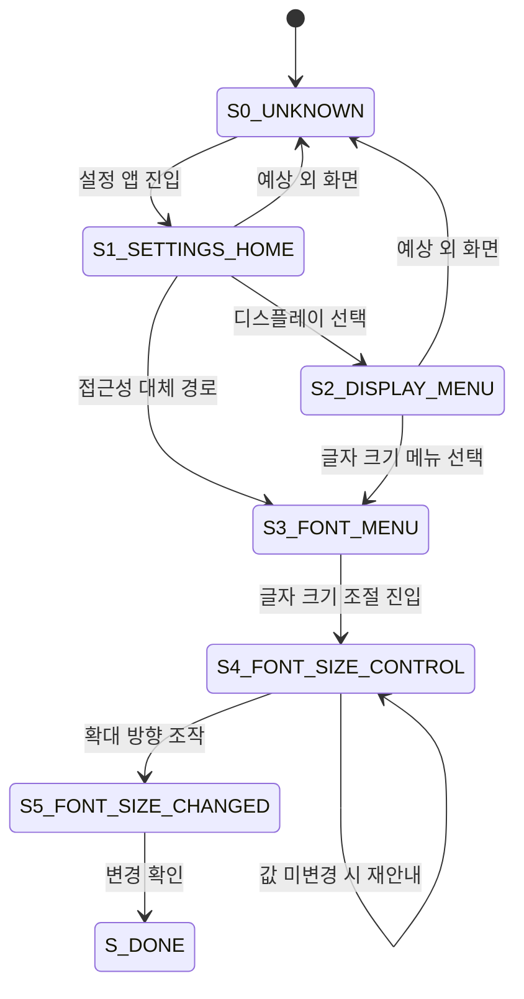
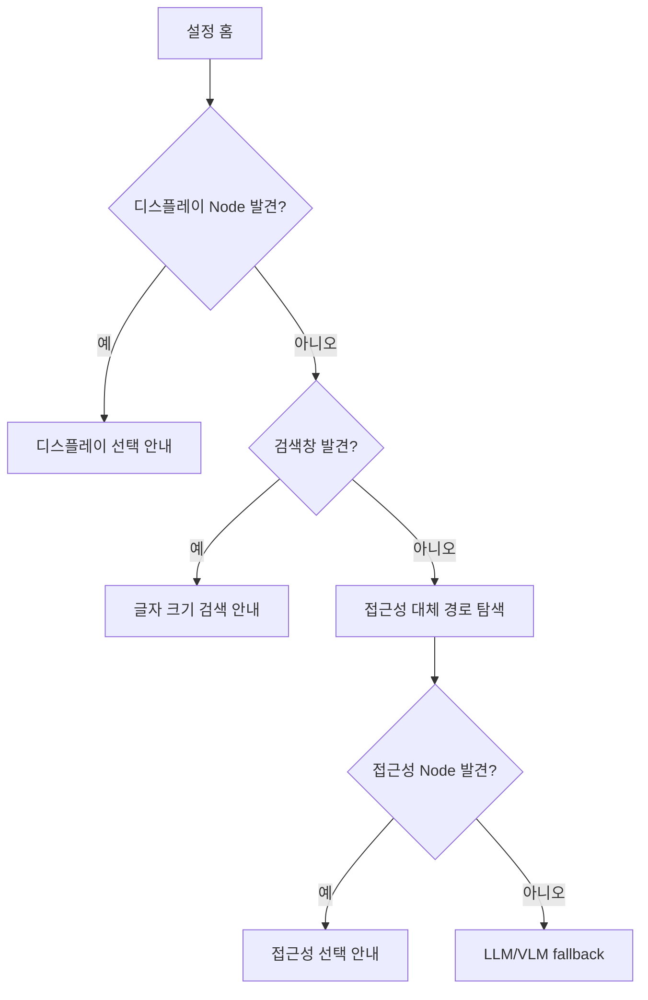

# Task: Android 설정 앱에서 글자 크기 확대

## 1. Task 정의

| 항목 | 내용 |
| --- | --- |
| Task ID | `MVP-01` |
| 연결 Goal Type | `settings.font_size.increase` |
| Task 이름 | Android 설정 앱에서 글자 크기 확대 |
| 사용자 목표 | 휴대폰 글자가 작아서 더 크게 보고 싶다 |
| 대상 앱 | Android 설정 앱 |
| Task 유형 | 설정 변경형 |
| Agent 역할 | 설정 앱에서 글자 크기 조절 화면까지 안내하고, 사용자가 직접 글자 크기를 확대하도록 돕는다 |
| 자동 클릭 여부 | 없음 |

## 2. Typed Goal 입력 예시

Agent는 앞단에서 아래처럼 유형화된 Goal을 전달받는다고 가정한다.

```json
{
  "goal_type": "settings.font_size.increase",
  "target_app": "android_settings",
  "task_type": "settings_change",
  "slots": {
    "setting": "font_size",
    "direction": "increase"
  },
  "source_text": "글자 크기 키우고 싶어",
  "confidence": 0.93
}
```

필수 slot:

- `setting`: `font_size`
- `direction`: `increase`

## 3. 사용자 발화 예시

아래 발화는 앞단 Goal typing 모듈에서 `settings.font_size.increase`로 분류될 수 있다.

- "글자가 너무 작아."
- "글자 크기 키우고 싶어."
- "휴대폰 글씨를 크게 보고 싶어."
- "설정에서 글자 크기 어디서 바꿔?"
- "폰트가 작아서 크게 하고 싶어."

## 4. 완료 조건

Agent는 다음 조건을 만족하면 Task를 완료로 판단한다.

- 현재 화면이 글자 크기 조절 화면이거나 글자 크기 설정 변경 후 상태이다.
- 사용자가 원하는 방향이 확대였고, 슬라이더 또는 옵션 값이 이전보다 큰 방향으로 이동했다.
- 변경 후 화면을 재관찰했을 때 글자 크기 관련 설정 화면이 유지된다.
- 사용자에게 완료 안내를 제공한다.

## 5. State 정의

| State ID | State 이름 | 화면 특징 | 주요 판별 근거 |
| --- | --- | --- | --- |
| `S0_UNKNOWN` | 알 수 없는 화면 | 설정 앱이 아니거나 현재 화면 판단 실패 | package mismatch, keyword 부족 |
| `S1_SETTINGS_HOME` | 설정 홈 | 설정 카테고리 목록 | "설정", "디스플레이", "접근성", "연결" |
| `S2_DISPLAY_MENU` | 디스플레이 메뉴 | 화면/밝기/글자 관련 메뉴 | "디스플레이", "밝기", "글자 크기", "화면 크기" |
| `S3_FONT_MENU` | 글자 관련 메뉴 | 글자 크기 또는 글꼴 항목 | "글자 크기와 스타일", "글꼴 크기", "Font size" |
| `S4_FONT_SIZE_CONTROL` | 글자 크기 조절 화면 | 슬라이더, 단계 옵션, 미리보기 | "글자 크기", slider role, preview text |
| `S5_FONT_SIZE_CHANGED` | 글자 크기 변경됨 | 조절 값이 확대 방향으로 변경됨 | slider value 증가, 큰 단계 선택 |
| `S_DONE` | 완료 | 변경 확인 완료 | verifier done |

## 6. Transition 정의

| From | Action | Target UI 후보 | To | Safety |
| --- | --- | --- | --- | --- |
| `S0_UNKNOWN` | 설정 앱 열기 안내 | "설정" 앱 아이콘 또는 앱 검색 결과 | `S1_SETTINGS_HOME` | LOW_RISK |
| `S1_SETTINGS_HOME` | 디스플레이 메뉴 진입 | "디스플레이", "화면", "Display" | `S2_DISPLAY_MENU` | LOW_RISK |
| `S1_SETTINGS_HOME` | 접근성 대체 경로 진입 | "접근성", "시인성 향상" | `S3_FONT_MENU` | LOW_RISK |
| `S2_DISPLAY_MENU` | 글자 크기 메뉴 진입 | "글자 크기와 스타일", "글꼴 크기", "Font size" | `S3_FONT_MENU` | LOW_RISK |
| `S3_FONT_MENU` | 조절 화면 진입 | "글자 크기", "글꼴 크기", slider area | `S4_FONT_SIZE_CONTROL` | LOW_RISK |
| `S4_FONT_SIZE_CONTROL` | 확대 방향 조작 안내 | 슬라이더 오른쪽, 큰 단계 옵션 | `S5_FONT_SIZE_CHANGED` | CONFIRM_REQUIRED |
| `S5_FONT_SIZE_CHANGED` | 변경 확인 | 미리보기 텍스트, slider value | `S_DONE` | LOW_RISK |



## 7. Keyword / Synonym Dictionary

| 개념 | 동의어 |
| --- | --- |
| display | 디스플레이, 화면, Display, screen |
| accessibility | 접근성, 시인성, 보기 편하게, visibility |
| font_size | 글자 크기, 글꼴 크기, 폰트 크기, Font size, text size |
| increase | 크게, 확대, 키우기, 오른쪽, 큰 글자 |

## 8. UI Matching 전략

UI Matching은 LLM을 기본으로 사용하지 않는다.

우선순위:

1. 현재 State의 Transition 후보 조회
2. target keyword와 normalized node label 비교
3. synonym dictionary 적용
4. resourceId 또는 className 보조 확인
5. label embedding similarity 계산
6. role과 actionable 여부 확인
7. confidence 산출

Fallback 조건:

- `confidence < 0.7`
- 후보 Node가 0개
- 상위 후보 2개의 score 차이가 `0.1` 미만
- Node label이 비어 있음
- slider 조작 방향을 판단할 수 없음

## 9. Safety Gate

`MVP-01`은 대부분 낮은 위험도이지만, 실제 설정 값을 바꾸는 순간에는 사용자 확인을 요구한다.

| Action | 판정 | 처리 |
| --- | --- | --- |
| 설정 앱 열기 | LOW_RISK | 바로 안내 |
| 디스플레이 메뉴 선택 | LOW_RISK | 바로 안내 |
| 글자 크기 메뉴 선택 | LOW_RISK | 바로 안내 |
| 글자 크기 확대 | CONFIRM_REQUIRED | 확인 후 안내 |
| 설정 초기화 | BLOCKED | 안내 중단 |
| 접근성 고급 설정 변경 | CONFIRM_REQUIRED | 확인 후 안내 |

확인 문장 예시:

- "글자 크기 설정이 바뀔 수 있어요. 계속 크게 조정할까요?"

## 10. Guide 문구

| State | 안내 문구 |
| --- | --- |
| `S0_UNKNOWN` | "설정 앱을 열어주세요." |
| `S1_SETTINGS_HOME` | "디스플레이를 눌러주세요." |
| `S2_DISPLAY_MENU` | "글자 크기와 스타일을 눌러주세요." |
| `S3_FONT_MENU` | "글자 크기를 눌러주세요." |
| `S4_FONT_SIZE_CONTROL` | "글자를 크게 하려면 슬라이더를 오른쪽으로 움직여주세요." |
| `S5_FONT_SIZE_CHANGED` | "글자 크기가 더 크게 변경되었어요." |

## 11. Verification

검증은 사용자 행동 이후 새 Accessibility Tree를 다시 수집해 수행한다.

| 단계 | 성공 조건 | 실패 처리 |
| --- | --- | --- |
| 설정 앱 진입 | package가 설정 앱 | 설정 앱 열기 재안내 |
| 디스플레이 진입 | `S2_DISPLAY_MENU` 판별 | 접근성 또는 검색 경로 탐색 |
| 글자 메뉴 진입 | `S3_FONT_MENU` 판별 | 후보 Node 재매칭 |
| 조절 화면 진입 | slider 또는 글자 크기 preview 발견 | VLM fallback 검토 |
| 크기 확대 | slider value 증가 또는 큰 옵션 선택 | 조작 방향 재안내 |
| 완료 | 변경 상태 유지 | 재관찰 또는 사용자 확인 |

## 12. Re-plan 전략

### 12.1 디스플레이 메뉴가 없는 경우

1. 설정 앱 검색창 탐색
2. 검색창이 있으면 "글자 크기" 검색 안내
3. 검색창이 없으면 "접근성" 경로 탐색
4. 접근성 경로도 없으면 LLM/VLM fallback



## 13. 필요한 Accessibility Tree Dataset

| Dataset | 목적 |
| --- | --- |
| 설정 앱 홈 | `S1_SETTINGS_HOME` 판별 |
| 디스플레이 메뉴 | `S2_DISPLAY_MENU` 판별 |
| 글자 크기와 스타일 화면 | `S3_FONT_MENU` 판별 |
| 글자 크기 조절 화면 | `S4_FONT_SIZE_CONTROL` 판별 |
| 슬라이더 조작 전 화면 | baseline value 저장 |
| 슬라이더 조작 후 화면 | 확대 여부 검증 |
| 설정 앱 검색 화면 | 대체 경로 검증 |
| 접근성 메뉴 화면 | 대체 경로 검증 |
| 예외 팝업 화면 | Re-plan/fallback 검증 |

## 14. 성공 기준

- typed Goal이 `MVP-01`로 매핑된다.
- Accessibility Tree로 현재 설정 화면을 수집한다.
- UI Normalizer가 label, role, bounds를 안정적으로 정규화한다.
- Screen State Classifier가 `S1`부터 `S4`까지 판별한다.
- UI Matching이 keyword 및 embedding 기반으로 Target Node를 선택한다.
- 글자 크기 변경 전 Safety Gate가 사용자 확인을 요구한다.
- Guide가 하이라이트와 짧은 문장으로 한 단계씩 안내한다.
- Verification이 글자 크기 확대 결과를 확인한다.
- 실패 시 Re-plan이 검색 또는 접근성 대체 경로를 제시한다.
