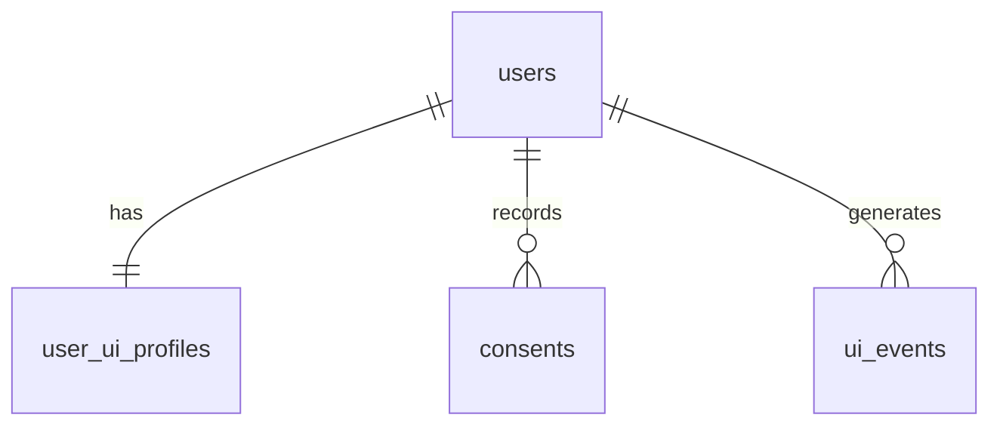

# DB Schema

**Task Graph 저장 설계:** 실행 가능한 graph 본문·Goal 연결·불변 version/hash·승인/활성 상태·환경·선택 우선순위는 DB가 기준이다. Backend가 조회·선택해 AI1에 전달하고 AI2의 평가·승인된 업데이트는 새 DB version으로 게시한다. 아래 세션/개인화 테이블과 graph 후보 저장은 실행 graph 선택 파이프라인과 별개다. [Graph 저장·전달 계약](../../docs/backend-task-graph-dispatch.md#6-db-저장ai2-업데이트버전-관리)을 따른다. 이 문서 변경은 graph 테이블 migration을 추가하지 않는다.

**Current backend implementation:** [AI-independent backend completion](backend-completion.md) supersedes historical planning below. Approval IDs, history/feedback, account recovery, consent withdrawal and operations tooling are now implemented; real AI/device/cloud verification remains outstanding.

**3주 차 갱신:** migration `20260911_03`에 agent_sessions·agent_turns·agent_checkpoints를 구현했다. 아래 영속화 설계안의 실제 필드·lease·시간 정책은 [3주 차 계약](week3.md)이 기준이다. safety_confirmations와 task_feedback은 아직 미구현이다.

**2주 차 갱신:** accounts·auth_sessions를 migration `20260911_02`로 추가했다. PostgreSQL metadata JSON/JSONB 차이도 이 migration에서 해소한다. [현재 인증 스키마](week2.md)를 함께 본다. 아래 개인화 4개 테이블과 영속 안내 세션 설계는 유지한다.

## 현재 구현

모델: `app/models/personalization.py`. Migration: `20260830_01_personalization`.

| 테이블 | 핵심 컬럼 | 제약·설명 |
|---|---|---|
| users | id, age_group, occupation_category, created_at | id: UUID 문자열 PK. 실명·비밀번호 없음 |
| user_ui_profiles | user_id, comprehension_level, explanation_depth, prefers_step_by_step, confidence_score, evidence_count, updated_at | user_id PK/FK, 사용자당 하나. confidence_score는 확률이 아니라 현재 -10~10 가중 점수 |
| consents | id, user_id, purpose, consented, policy_version, recorded_at | user_id 인덱스, 목적별 이력 append. 최신 동의 사용 |
| ui_events | id, user_id, session_id, event_type, screen_name, metadata, created_at | user_id/session_id/event_type 인덱스. session_id는 현재 FK 아님 |

관계는 사용자 삭제 시 CASCADE다. SQLite에서도 FK를 활성화한다. JSON 필드는 ORM에서 PostgreSQL JSONB variant를 사용하지만 기존 migration은 JSON으로 생성한다. 형식을 통일하려면 별도 migration을 작성해야 한다.

`app/models/session.py`의 GuidanceSession은 dataclass이며 DB 테이블이 아니다. runtime 세션과 응답 캐시도 영속화되지 않는다.

## 영속 세션 설계안 — 이번에 테이블을 생성하지 않음

| 테이블 후보 | 필수 컬럼·제약 | 목적 |
|---|---|---|
| agent_sessions | id PK, user_id FK, task_id, graph_version, status, current_state_id, version, created_at, updated_at, expires_at | 세션 소유권·낙관적 잠금·만료 |
| agent_turns | id PK, session_id FK, request_id, request_hash, sequence, response_json, created_at, expires_at | UNIQUE(session_id, request_id), 재전송 결과. 본문 해시 비교 |
| agent_checkpoints | session_id PK/FK, schema_version, state_json, updated_at | 최소 runtime 복구 상태; 원본 화면은 저장하지 않음 |
| safety_confirmations | id PK, session_id FK, guide_command_id, decision, expires_at, consumed_at | 승인과 안내 대상 결합·단회 사용 |
| task_feedback | id PK, session_id FK, rating, reason_code, created_at | 자유 텍스트 없이 피드백 수집 제안 |

`state_json`에는 task·전이·실패 노드 ID·시도 횟수·슬라이더 기준값처럼 재개에 필요한 최소값을 버전 관리해 저장한다. 현 runtime의 last_snapshot을 그대로 직렬화하면 화면 개인정보가 저장되므로 그대로 옮기지 않는다. 재시작 후 fresh tree를 받아 안내를 재계산한다.

## 트랜잭션·삭제 원칙

- 세션 소유권 확인 → version 잠금 → 동일 request 해시 비교 → 상태 갱신·응답 저장을 원자적으로 완료하는 구조를 구현한다.
- 긴 외부 호출 중 DB 잠금 유지 여부는 별도 설계한다. 호출 전 version 확보와 호출 후 compare-and-swap으로 경합을 감지하는 방향을 제안한다.
- 세션·응답의 TTL과 결과 이력 보존 기간은 정책 확정 후 설정값으로 둔다. 확정되지 않은 기간을 migration에 고정하지 않는다.
- 사용자 삭제는 DB 관계뿐 아니라 응답 캐시·runtime 상태·trace까지 포함해야 한다. 현재는 개인화 DB 관계만 삭제된다.
- 마이그레이션은 개발용 새 DB에서 upgrade → downgrade → upgrade를 검증한 후 실제 PostgreSQL에서도 확인한다.
