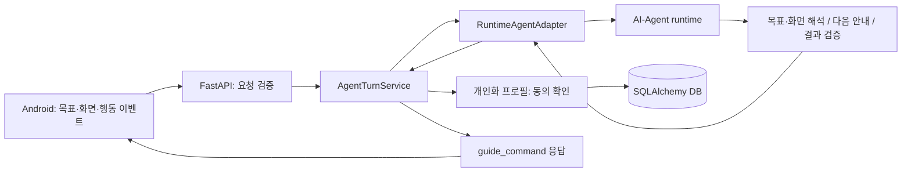
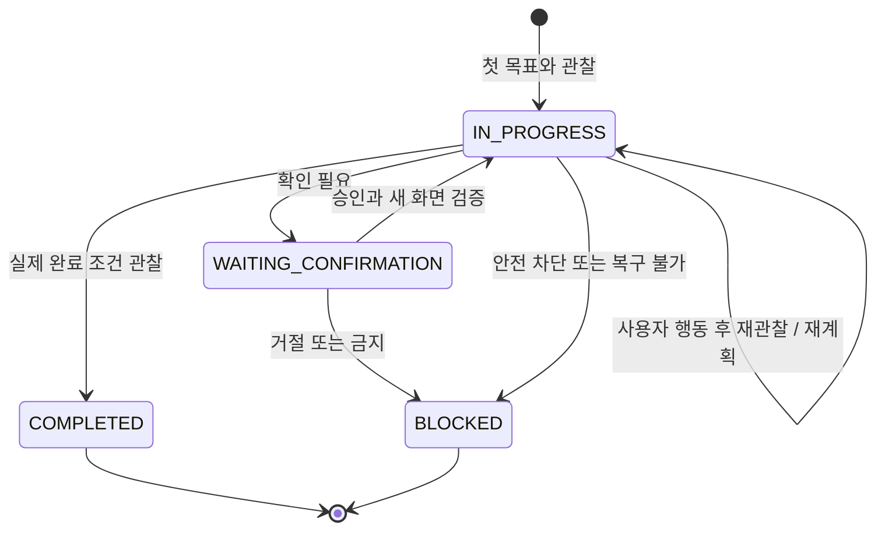

# System Architecture

**Week 4:** isolated runtime execution is bounded to four concurrent tasks per process; the request commits only timely results. Input/privacy boundaries and provider fallback are described in [week4.md](week4.md).

3주 차 이후 신규 turn은 DB 세션·lease·checkpoint와 요청별 독립 runtime을 사용한다. 아래 메모리 구조 설명은 초기 기준이다. 현재 실행 흐름과 원자적 결과 저장은 [3주 차 구조](week3.md)를 따른다.

## 현재 구조와 개발 방향

현재 AI-Agent는 별도 HTTP 서버가 아니라 Python 모듈로 같은 프로세스에서 호출된다. 화면 관찰마다 한 turn을 동기 처리한다. 서버가 전체 휴대전화 조작을 일괄 실행하는 구조가 아니다.

`app/api`는 HTTP 상태, `schemas`는 입출력, `services`는 처리 조율, `repositories`는 저장, `clients`는 runtime 변환을 담당한다. 사용자 DB는 SQLAlchemy이고 안내 세션·응답 캐시·runtime trace는 현재 프로세스 메모리다.

## 상태 계약

현재 `/agent/turn`의 공개 상태는 다음 네 개다. 내부 화면 상태인 `state_id`와 혼동하지 않는다.

그림은 목표 상태 정책이다. 현재 terminal 상태 이후 요청 차단과 승인-명령 결합은 추가 검증·구현이 필요하다. 취소·만료는 영속 세션 상태로 추가할 설계이며 현재 enum에는 없다. 계약 변경 시 Android DTO와 같이 반영한다.

## 요청 생명주기

1. FE가 최초 `raw_goal`, `session_id`, `request_id`, 관찰을 전송한다.
2. 서버가 스키마를 검증하고 중복 요청 캐시를 확인한다.
3. runtime이 목표와 현재 화면을 해석하고 안내·확인·완료·차단을 결정한다.
4. 서버가 동의된 개인화 프로필로 안내 표현을 조절한다.
5. FE가 표시하고 사용자 행동 후 새 관찰과 이벤트를 전송한다.

최종 서버에서는 2번에 인증·소유권·입력 제한·마스킹을, 3~4번 경계에 영속 세션 트랜잭션과 안전 검증을 추가한다. 이들은 현재 완성된 기능이 아니다.

## 기술 결정

| 선택 | 근거 | 제약 |
|---|---|---|
| 기존 FastAPI 유지 | 구현된 Pydantic 계약·테스트 재사용 | 설치 버전은 검증 기록 참조 |
| PostgreSQL + Alembic | 기존 개인화 스키마와 migration 존재 | 실제 PostgreSQL 검증은 별도로 필요 |
| 로컬 SQLite 파일 | 외부 설치 없이 개발 재현·데이터 유지 | DB 엔진별 차이 검증을 대체하지 않음 |
| HTTP turn 유지 | 기존 Android Gateway와 일치 | 긴 AI 요청은 timeout·동시성 보강 필요 |
| health/ready 분리 | 프로세스와 DB 준비 상태를 각각 확인 | ready는 전체 기능·AI 가용성 보장이 아님 |

`GET /ready`는 SELECT 1과 현재 모델의 테이블 존재를 검사한다. 컬럼·migration revision 일치까지 검사하지 않는다. 종료 시 SQLAlchemy engine을 dispose한다.
