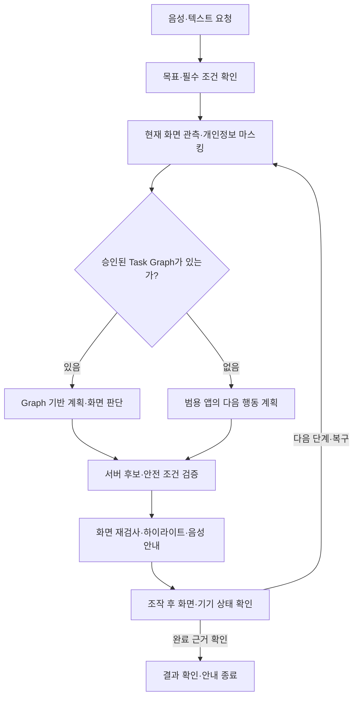

# Click

### 중장년층을 위한 실시간 화면 안내 AI 에이전트

Click은 낯선 모바일 앱에서 **무엇을 눌러야 할지 모르는 사용자에게, 지금 화면을 기준으로 다음 행동을 안내하는 Android 서비스**입니다. 사용자가 원하는 일을 말하거나 입력하면 누를 곳을 화면 위에 표시하고 음성으로 설명합니다. 조작 후에는 바뀐 화면과 확인 가능한 기기 상태를 살펴 다음 단계로 이어갑니다.

기본은 사용자가 직접 조작하는 안내 방식입니다. 사용자가 자동 모드를 켠 경우에는 메뉴 이동·스크롤 등 허용된 동작을 보조합니다. 개인정보 입력이나 인증·결제처럼 사용자의 판단이 필요한 단계는 직접 진행하도록 합니다.

상상챌린지 14팀 **배이리**가 개발했습니다.

## 프로젝트 배경

“지금 어떤 화면이 보여?” 가족에게 스마트폰 사용법을 설명할 때 반복하는 질문에서 시작했습니다. 글이나 영상의 설명을 찾더라도 현재 앱 화면과 다르면 따라 하기 어렵고, 한 번 배운 기능도 화면이 바뀌거나 시간이 지나면 다시 도움이 필요합니다.

중장년층 사용자 **4명**, 가족의 스마트폰 사용을 도운 사람 **4명**을 인터뷰해 다음 세 가지 요구를 정리했습니다. 소규모 정성 인터뷰의 발견이며 전체 사용자에 대한 통계는 아닙니다.

| 사용자 요구 | Click의 접근 |
| --- | --- |
| **찾기**: 지금 무엇을 눌러야 할까? | 현재 화면의 버튼·메뉴를 읽고 누를 위치를 하이라이트 |
| **판단하기**: 이 버튼을 눌러도 될까? | 다음 행동을 설명하고, 확인이 필요한 단계에서는 사용자에게 질문 |
| **완료하기**: 이제 원하는 일이 끝났을까? | 변경된 화면·기기 상태를 확인하고, 자동 확인이 어려우면 사용자에게 결과 확인 |

## 주요 기능

- **음성·텍스트 요청**: 일상적인 문장으로 작업을 요청합니다. 뜻이 모호하거나 필요한 값이 빠지면 먼저 질문하고, 여러 요청은 순서대로 안내합니다.
- **실시간 화면 안내**: Accessibility Tree로 현재 화면을 읽고, 조작할 영역을 가리지 않도록 오버레이와 음성 안내를 표시합니다. 화면이 바뀌면 다시 관측합니다.
- **작업 경로 선택과 복구**: 승인된 Task Graph를 우선 사용하고, 해당 경로가 없는 요청은 범용 앱 계획 경로에서 다음 행동을 판단합니다. 진행이 어긋나면 현재 상태를 확인해 경로를 다시 찾습니다.
- **결과 확인**: 화면 도착과 실제 작업 완료를 구분합니다. 관측만으로 결과를 확정할 수 없을 때는 사용자의 확인을 받습니다.
- **접근성을 고려한 UI**: 가입 전 글자 크기 선택, 단계별 권한 안내, 직접 눌러보는 튜토리얼, 글자 크기·안내창 투명도 조절을 제공합니다.
- **반복 사용 지원**: 즐겨찾기와 최근 질문으로 자주 하는 작업을 다시 찾고, 안내가 불편했던 부분을 피드백으로 남깁니다.

### 사용 흐름

1. 편한 글자 크기를 선택하고 가입·로그인합니다.
2. 접근성·다른 앱 위 표시 등 필요한 권한을 확인하고 튜토리얼을 진행합니다.
3. “와이파이 설정 열어줘”처럼 원하는 일을 말하거나 입력합니다.
4. 현재 화면에서 강조한 항목과 음성 안내를 따라 작업을 진행합니다.
5. 기기에서 확인한 결과 또는 사용자의 응답을 바탕으로 안내를 마치거나 이어갑니다.

## 시스템 구조

한 모델이 화면 판단부터 실행까지 모두 결정하는 대신, **경로·계획·판단·기기 검증을 나눴습니다.** AI가 제안한 동작도 서버의 허용 후보와 안전 조건을 통과하고, Android가 실행 직전 화면을 다시 확인해야 안내·조작에 사용됩니다.



| 구성 요소 | 역할 |
| --- | --- |
| **Android 앱** | 요청 입력, 접근성 화면 관측, 하이라이트·TTS, 허용된 자동 조작, 실행 직전 재검사와 결과 전달 |
| **Backend** | 인증·세션·대기열, 목표 확정, 승인 Graph 선택·버전 고정, 후보·안전 검증과 실행 기록 관리 |
| **Task Graph** | 검토한 화면 상태·이동 경로·완료 조건을 정의하고 승인본을 버전과 해시로 고정 |
| **Qwen3.8-Flash** | 허용된 하위 목표의 순서를 계획하고, 범용 앱에서는 서버가 제시한 후보 중 다음 동작 선택 |
| **Jev 1.14.0** | 요청의 목표 분류와 현재 페이지·조작 대상 판단. 신뢰도 기준 미달 시 자동 진행 보류 |
| **AI-Agent(2)** | 실행 기록을 분석해 경로 개선 후보를 만들고, 평가·승인·버전 배포를 거쳐 반영하는 파이프라인 |

### 응답 지연과 반복 호출 줄이기

검증된 경로를 우선 활용하고, 모델에는 필요한 화면 정보와 허용 후보만 전달합니다. 범용 앱 계획 응답은 후보 ID로 제한해 목록 밖의 응답을 서버에서 거절합니다. 성공 경로 재사용과 목적지 중심의 완료 확인으로 불필요한 재계획·재호출을 줄이는 방향으로 개선하고 있습니다.

## 평가 결과

아래는 **최종보고서(2026-11-23)의 평가 집계**입니다. 운영 서버와 Galaxy Note20(Android 13) 1대에서 설정 26개·범용 앱 10개, 총 **36개 과제**를 측정했습니다. 진단 빌드·과제당 1회·스크립트 승인 조건의 기술 평가이며, 인터뷰 참여자를 대상으로 한 사용성 시험의 성공률은 아닙니다.

| 지표 | 결과 | 해석·측정 범위 |
| --- | ---: | --- |
| 작업 완료 | **23/36 (약 64%)** | 목표 도착과 기기 완료 확인을 모두 충족. 설정 21/26, 범용 앱 2/10 |
| 목표 도착 | **29/36 (약 81%)** | 목표 화면 또는 값 변경을 관측. 보고서의 Chrome 2건 보류 기준 |
| 첫 안내 버튼 정확도 | **25/25** | 설정 과제의 첫 안내 대상. 전체 작업 완료율과 구분 |
| 첫 유효 안내까지 | **중앙값 11.4초** | 요청 입력부터 첫 유효 안내까지. 설정 과제에서 측정 |
| Qwen 계획 호출 | **중앙값 1.15초** | 범용 앱 계획 호출 11회. 요청 전체 처리 시간과 구분 |
| 범용 앱 도착 후 완료 인정 | **2/7** | 목표에 도착한 과제 중 제품이 완료까지 확인한 비율 |
| 범용 앱 거짓 완료 | **0/10** | 해당 10개 시행에서 관측한 결과 |

목표 화면에 도착했어도 완료 근거를 확인하지 못하는 사례가 있었습니다. 특히 범용 앱에서는 도착한 7개 과제 중 2개만 완료로 인정되어, **도착과 완료를 구분하는 판단**이 주요 개선 과제로 남았습니다. 기기·OS·앱 버전 전반의 성능으로 일반화하지 않습니다.

보고서 집계와 개별 실험의 초기 집계는 구분합니다. 측정 환경·도구와 원시 시행 기록은 [운영 서버 실기기 측정](experiments/task-success/2026-11-23-production/README.md), 추가 실험 설계는 [결과 확인 가능 화면 평가](experiments/task-success/2026-11-23/README.md)를 참고하세요.

## 개인정보와 실행 안전

- 접근성 정보를 기본으로 사용하고, 서버로 보낼 텍스트와 화면 정보는 개인정보 패턴을 마스킹하고 필요한 항목으로 제한합니다.
- 음성 입력은 지원 기기의 온디바이스 한국어 인식을 사용합니다. 기기 내 인식을 사용할 수 없으면 글 입력을 안내합니다.
- 접근성 정보가 부족할 때의 OCR은 동의 후 기기 안에서 처리하며, 해당 경로의 원본 이미지를 외부로 전송하지 않습니다.
- 로그인·인증·결제·비밀번호 등 민감한 단계에서는 안내·자동 진행을 제한하고 사용자가 직접 처리하도록 합니다.
- 설정 변경 전 확인, 실행 직전 화면 재검사, 모델 신뢰도 기준을 적용합니다. Jev의 기본 신뢰도 기준 0.8은 실행 정책이며 정확도 80%를 뜻하지 않습니다.
- 실행 기록에서 만든 후보가 운영 경로를 바로 바꾸지 않도록 승인·버전 관리 절차를 둡니다.

자세한 전송 범위와 설정은 [Jev 연결](Backend/inference/jev.md), [화면 정보 최소화](Backend/docs/jev-screen-privacy.md), [Vision fallback](docs/ai-agent-vision-fallback.md)을 참고하세요.

## 기술 스택

| 영역 | 기술 |
| --- | --- |
| Android | Java, AccessibilityService, Overlay, 온디바이스 SpeechRecognizer, TTS, ML Kit 한국어 OCR, Kakao 로그인 |
| 지원 SDK | minSdk 26 / targetSdk 36 |
| Backend | Python 3.11+, FastAPI, SQLAlchemy, Alembic, PostgreSQL |
| AI | Task Graph 런타임, Qwen3.8-Flash, Jev 1.14.0, 경로 개선·평가 파이프라인 |
| 운영 | Docker Compose, Render |

## 개발 환경

Python 3.11 이상, Android Studio와 Android SDK가 필요합니다. API 키와 DB·암호화 설정은 `.env.example`을 참고해 로컬 `.env`에 준비하고 Git에 올리지 않습니다. 모델·서버 연결 설정은 [Backend 안내](Backend/README.md)를 따릅니다.

```bash
git clone https://github.com/Bae-iri/Click.git
cd Click/Backend
python -m venv .venv
source .venv/bin/activate
python -m pip install -e ".[test]"
cp .env.example .env
```

`.env`에 필요한 키와 설정을 채운 후, 저장소의 개발 프로필로 서버를 준비합니다.

```bash
python scripts/validation.py prepare --env-file .env --profile jev --gov24 --port 8001
python scripts/validation.py serve
```

Android Studio에서 `Frontend/`를 열어 개발합니다. 위에서 준비한 검증 서버와 같은 환경을 쓰는 APK는 별도 터미널에서 저장소 루트를 기준으로 빌드합니다.

```bash
cd Frontend
sh ./gradlew :app:assembleValidation
```

일반 디버그 빌드는 `:app:assembleDebug`를 사용합니다. 실제 모델 연결에는 별도 API 키가 필요합니다. 가상환경 활성화 명령은 macOS/Linux 기준이며, Windows 실행과 기기 연결·검증 빌드는 영역별 안내를 참고하세요.

## 저장소 구성

```text
Click/
├── Frontend/       # Android 앱·오버레이·기기 관측·UI 테스트
├── Backend/        # API·세션·Graph 전달·모델 연동·실행 검증
├── AI-Agent/       # Graph 기반 런타임·개선 후보·평가·release
├── docs/           # 아키텍처·입출력 계약·개발 문서
├── experiments/    # 실험 설계·시행 기록·측정 결과
└── infra/          # 운영 구성
```

- 영역별 개발: [Frontend](Frontend/README.md) · [Backend](Backend/README.md) · [AI-Agent](AI-Agent/README.md)
- 구조와 계약: [전체 구조](docs/ai-agent-architecture.md) · [Graph 전달](docs/backend-task-graph-dispatch.md) · [AI-Agent(1)](docs/ai-agent-1-runtime.md)
- 경로 개선: [AI-Agent(2)](docs/ai-agent-2-graph-proposal.md) · [구현·실행 안내](AI-Agent/src/ai_agent/graph_proposal/README.md)

## 남은 과제와 확장 방향

- **처음 보는 화면**: 검증 경로가 없는 앱에서의 성공률을 높이고, 성공한 경로를 검수·재사용하는 범위를 넓힙니다.
- **제조사·앱별 차이**: 다른 메뉴 이름과 화면 구조에서도 안내가 이어지도록 기기·OS·앱 버전별 검증을 늘립니다.
- **완료 판정**: 목적지 화면과 관측 가능한 설정값을 함께 비교합니다. 사용자 확인이 필요한 결과는 기기에서 검증한 결과와 구분합니다.
- **적용 범위**: 병원 접수·키오스크, 디지털 교육 현장, 다국어 안내와 다른 디바이스로의 확장을 검토합니다. 현재 구현·평가 범위는 Android입니다.
