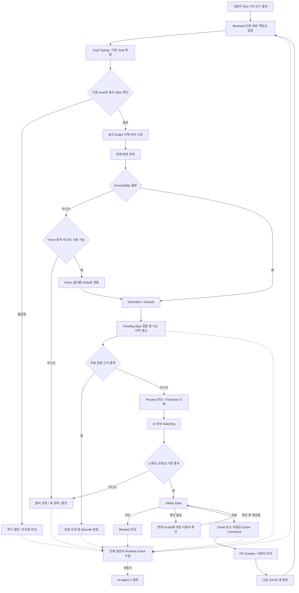

# AI-Agent(1): 사용자 작업 수행 Runtime Agent

## 1. 문서 목적

이 문서는 **AI-Agent(1)**의 목표 아키텍처와 런타임 흐름을 정의한다. AI-Agent(1)은 실제 사용자의 요구를 텍스트로 받고, Typed Goal로 변환하고, 현재 화면을 읽어 guide/action을 결정하며, 새 관측으로 결과를 검증하고 Re-plan하는 사용자용 에이전트다. 특정 Task 하나에 종속되지 않고, Android 설정 앱, 커머스 앱, 공공 서비스 앱 등 여러 절차형 Task에 공통으로 적용되는 Agent 파이프라인을 설명한다.

이 문서에서 `Agent`는 별도 표시가 없으면 AI-Agent(1)을 뜻한다. AI-Agent(2)는 수집된 runtime 데이터에 success/fail 등 결과 라벨을 붙이고, 내부 데이터셋과 Task Graph 추가·업데이트 후보를 만드는 별도 에이전트다.

- [두 에이전트의 전체 구조와 책임 경계](./ai-agent-architecture.md)
- [AI-Agent(2): Runtime Data / Graph Proposal Agent](./ai-agent-2-graph-proposal.md)

Task별 State, Transition, UI 후보, 예외 처리는 별도 문서에서 관리한다.

- Task 상세 문서: [Android 설정 앱에서 글자 크기 확대](./tasks/font-size-increase.md)

이 문서는 “현재 코드가 전부 완성했다”는 의미가 아니라, 우리가 목표로 삼는 이상적인 AI Agent 구조를 기준으로 삼는다. 단, 현재 코드에 이미 들어온 런타임 단계는 별도로 표시해 앞으로의 구조에 흡수한다. 코드 확인 기준은 2026-09-12의 `a0d3609` 커밋이다. JSON은 명시적으로 현재 형식이라고 적은 경우를 제외하면 설계 예시이며, 실제 HTTP 계약은 `Backend/app/schemas/agent_turn.py`, runtime 타입은 `AI-Agent/src/ai_agent/runtime/types.py`를 기준으로 한다. 예시 confidence와 threshold는 운영 측정값 또는 확정 성능 목표가 아니다.

## 2. Agent 목표

Agent는 사용자가 익숙하지 않은 모바일 앱에서 스스로 목적을 완료할 수 있도록 현재 화면을 이해하고 다음 행동을 단계별로 안내한다.

MVP와 초기 제품의 기본 원칙은 Human-in-the-loop이다.

- Agent는 FE가 음성 입력을 STT로 변환하거나 텍스트 입력에서 수집한 raw 자연어를 입력받는다.
- Agent는 raw 자연어 의도를 분석해 `goal_type`, `target_app`, `task_type`, `slots`를 생성한다.
- Agent는 Typed Goal에 맞는 승인된 Task Graph를 선택하거나 승인된 Task Template에 slots를 대입한다.
- Agent는 현재 화면의 UI 요소를 분석한다.
- Agent는 현재 화면이 Task Graph의 어느 State인지 판단한다.
- Agent는 다음 State로 가기 위해 눌러야 할 UI 또는 조작해야 할 UI를 선택한다.
- Agent는 Safety Gate를 통해 안내 가능한 행동인지 판단한다.
- Agent는 Guide Command를 생성한다.
- FE는 Guide Command를 받아 Overlay, Highlight, 안내 문구를 렌더링하고 TTS 음성을 출력한다.
- 사용자는 실제 tap, drag, 입력, 확인을 직접 수행한다.
- Agent는 조작 이후 화면 변화를 확인한다.
- Agent는 예상과 다르면 재계획한다.
- Agent는 대상 UI 탐색을 위한 scroll만 제한적으로 허용할 수 있다.
- Agent는 전체 실행 과정의 trace와 실시간 verification 결과를 남긴다. 데이터 라벨 확정, Task Graph 추가·수정 후보 생성, dataset 생성은 AI-Agent(2)가 담당한다.

현재 코드에서 추가된 중요한 방향:

- Agent는 `session_id`를 기준으로 task 진행 상태를 유지한다.
- Agent는 이전 Guide Command와 pending transition을 저장해 다음 observation에서 성공/실패를 검증한다.
- Agent는 같은 target이 반복 실패하면 해당 node를 제외하고 다시 matching한다.
- Accessibility Tree가 비어 있거나 target matching이 실패하면 동의 기반 Vision fallback을 사용할 수 있다.
- Backend는 DB에 저장한 요청 결과로 같은 요청의 중복 실행을 막는다. 재전송 시 personalization 동의는 다시 평가하므로 최종 안내 문구까지 항상 동일하다는 뜻은 아니다.
- 사용자 personalization 동의가 있으면 안내 문구를 사용자 이해 수준에 맞게 조정할 수 있다.

## 3. 입력 구조

FE는 음성 입력을 STT 모델로 raw 텍스트로 변환하거나 사용자의 텍스트 입력을 그대로 Agent에 전달한다. STT는 음성을 텍스트로 바꾸는 데까지만 담당하며 사용자 의도나 Task 유형을 판단하지 않는다.

Agent는 raw 자연어를 내부 Goal Typing 파이프라인으로 정규화한 뒤 승인된 Task Graph를 선택하거나 승인된 Template를 slots로 구체화한다.

FE 입력 예시:

```json
{
  "request_id": "req_001",
  "session_id": "session_001",
  "source_text": "글자 크기 키우고 싶어",
  "locale": "ko-KR",
  "device_context": {
    "platform": "android",
    "foreground_app": null,
    "app_package": null,
    "manufacturer": "samsung",
    "os_version": "15",
    "screen_bounds": [0, 0, 1080, 2400]
  }
}
```

Agent가 생성하는 Typed Goal 예시:

```json
{
  "goal_type": "settings.font_size.increase",
  "target_app": "android_settings",
  "task_type": "settings_change",
  "slots": {
    "setting": "font_size",
    "direction": "increase"
  },
  "source_text": "글자 크기 키우고 싶어",
  "confidence": 0.93,
  "task_id": "MVP-01",
  "typing_method": "embedding+keyword+slot_rule",
  "is_supported": true,
  "required_slots_filled": true,
  "needs_clarification": false
}
```

MVP에서는 Goal Typing에 LLM을 기본 사용하지 않는다. Embedding 유사도, keyword/synonym matching, 규칙 기반 slot extraction, app/task prior를 우선 사용한다. LLM은 오프라인 평가에서 자체 Goal Typing 정확도가 기준 이하로 낮거나, 운영 중 low-confidence 비율이 높게 관찰될 때 fallback으로 도입한다.

## 4. 핵심 설계 원칙

### 4.1 Goal 처리 원칙

Goal은 raw 자연어에서 Agent가 생성한 typed 구조로 관리한다.

주요 필드:

- `goal_type`: 사용자의 목적을 표현하는 표준 타입
- `target_app`: 대상 앱 또는 앱 범주
- `task_type`: 구매형, 설정 변경형, 행정 서류 발급형 등 Task 패턴
- `slots`: 방향, 대상 설정, 상품, 문서 종류 등 Task별 파라미터
- `confidence`: Goal typing 신뢰도
- `task_id`: 선택된 Task Graph 또는 Task Template
- `typing_method`: goal typing에 사용한 방식

Goal confidence가 낮거나 필수 slot이 비어 있으면 Agent는 Task를 시작하기 전에 사용자 확인을 요청한다.

Goal Typing은 아래 순서로 수행한다.

1. 입력 정규화
   - `source_text`의 공백, 구두점, 흔한 오타를 정리한다.
   - 한국어/영어 혼용 표현을 canonical token으로 변환한다.
   - 예: "폰트", "글씨", "글자" -> `font`; "키워", "크게", "확대" -> `increase`

2. App hint 추출
   - 사용자가 명시한 앱 이름, 현재 foreground app, OS 정보를 함께 본다.
   - "설정에서", "휴대폰 글자"처럼 시스템 설정 의도가 강하면 `android_settings` 후보에 prior를 준다.
   - 앱이 명확하지 않으면 `target_app`은 top candidate로 두되 confidence에 감점한다.

3. 후보 Goal 검색
   - Goal Catalog에는 각 `goal_type`별 대표 발화, 동의어, required slots, target app, task type이 등록되어 있다.
   - `source_text` embedding과 Goal Catalog의 대표 발화/template embedding을 비교해 top-k 후보를 찾는다.
   - 동일한 goal family 안에서는 slots까지 비교한다.

4. 규칙 기반 보조 점수 계산
   - keyword/synonym 일치 점수
   - 부정/취소/반대 방향 표현 점수
   - app hint 점수
   - required slot 채움 점수
   - 모호성 감점

5. Slot extraction
   - dictionary, regex, dependency keyword window를 사용해 slot을 추출한다.
   - 예: "글자 크기 키우고 싶어" -> `setting=font_size`, `direction=increase`
   - "화면 크게"처럼 `font_size`와 `display_size`가 모두 가능하면 ambiguous slot으로 표시한다.

6. Score fusion
   - 기본 confidence는 `embedding_score`, `keyword_score`, `slot_score`, `app_prior`를 가중 합산한다.
   - 초기 가중치 예: embedding 0.45, keyword/synonym 0.30, slot 0.20, app prior 0.05
   - top-1과 top-2의 score gap도 함께 기록한다.

7. 결정 기준
   - `confidence >= 0.80`, `score_gap >= 0.12`, required slots가 모두 채워짐: Typed Goal 확정
   - `0.60 <= confidence < 0.80` 또는 `score_gap < 0.12`: 사용자에게 짧게 확인
   - `confidence < 0.60`: 지원 Task 후보를 제시하거나 추가 설명 요청
   - 위험도가 높은 task family는 threshold를 더 높게 둔다.

8. 승인 Task Graph 선택 또는 Template 구체화
   - 확정된 `goal_type`이 등록 Task와 1:1 매핑되면 호환되는 승인 Task Graph를 로드한다.
   - 같은 승인 Task Template를 공유하는 경우 slots로 Graph를 parameterize한다.
   - 구체화한 Graph에는 start states, done state, transition 목록, safety rule, required dataset reference가 포함된다.
   - 지원 graph가 없으면 미지원 또는 추가 질문으로 응답하고, 신규 graph 수요는 trace를 통해 AI-Agent(2)에 전달한다.

현재 코드 반영:

- `AI-Agent/src/ai_agent/runtime/goal_typing.py`는 `MVP-01` 전용 rule-based goal typing을 구현한다.
- 현재 runtime은 아직 catalog/embedding 기반 Goal Typer를 주 경로로 사용하지 않는다.
- 장기 목표는 `goal_catalog/mvp_goals.json` 및 `goal_typing/*` 구조를 runtime의 canonical Goal Typing으로 연결하는 것이다.

### 4.2 UI 판단 원칙

UI 판단은 Accessibility Tree 기반의 keyword matching과 embedding matching을 우선한다.

우선순위:

1. Accessibility Tree 수집
2. UI Normalizer로 Node 정규화
3. Screen State Classifier로 현재 State 판단
4. Task Graph / State Manager로 가능한 Transition 조회
5. keyword matching으로 명확한 후보 탐색
6. resourceId, role, bounds, enabled/actionable 상태로 후보 보정
7. embedding similarity로 의미적으로 가까운 후보 탐색
8. top-1 confidence와 top-2 gap 확인
9. confidence가 충분하면 Safety Gate로 전달
10. confidence가 낮으면 LLM/VLM fallback 또는 사용자 확인

현재 코드 반영:

- `normalize_accessibility_tree()`는 label 병합, role 추론, semantic tag 생성, position hint, slider value 추출을 수행한다.
- `classify_screen_state()`는 required keyword group, optional keyword, role hint, package, previous state continuity로 State를 고른다.
- `match_next_ui()`는 keyword, similarity, semantic tag, role, actionable score를 합산한다.
- 현재 matcher는 top-2 gap 기반 ambiguity 처리가 없으므로 이상 구조에는 반드시 추가해야 한다.

### 4.3 LLM/VLM 사용 범위

LLM/VLM은 다음 상황에서 fallback으로만 사용한다.

- Goal Type confidence가 낮아 사용자 의도 확인이 필요한 경우
- Accessibility Tree에 label이 없거나 부정확한 경우
- 아이콘 중심 UI라 keyword matching이 실패한 경우
- 제조사/앱 버전 차이로 기존 Task Graph와 맞지 않는 경우
- 팝업, 권한 요청, 오류 화면 등 예외 화면이 등장한 경우
- embedding 및 keyword matching confidence가 낮은 경우

현재 구현된 Vision fallback의 runtime 위치:

1. FE가 Accessibility Tree를 수집하지 못하면 `vision_snapshot`을 보낸다.
2. `vision_snapshot.user_consented`가 false면 Agent는 화면 이미지 분석 동의 요청 command를 반환한다.
3. 동의된 `vision_snapshot.elements` 또는 OCR 결과는 `vision:{element_id}` synthetic node로 변환한다.
4. 변환된 node는 기존 `Normalize -> Classify -> Match -> Guide` 흐름에 합류한다.
5. `sanitize_request()`는 screenshot 원문을 제거하고, 동의된 OCR/element text를 redaction한 뒤 사용한다. trace/debug에는 allowlist에 있는 상태와 수치만 남긴다.
6. 서버 이미지 redaction이 준비되지 않아 원본 screenshot의 외부 VLM 호출은 차단되어 있다. 동의 flag만으로 이미지 전송을 허용하지 않는다.

Vision fallback status:

- `not_requested`: vision fallback을 사용하지 않음
- `consent_required`: 외부 화면 이미지 분석 동의 필요
- `used`: vision payload를 Agent 판단에 사용함
- `not_configured`: provider 또는 입력 정보 부족
- `provider_error`: 외부 provider 호출 실패
- `no_signal`: 화면 분석 결과에서 유효한 UI signal 없음

Fallback 연결 규칙:

- Agent 응답은 `metadata.debug.observation`에 실제 수신한 Accessibility/Vision 입력 요약을 남긴다.
- engine 내부 debug는 fallback 이유와 복구 정보를 구성하지만 Backend `safe_response()`는 debug를 허용된 enum·수치만으로 축소한다. 클라이언트가 필요한 복구 동작은 별도 guide/render policy 계약으로 전달해야 한다.
- `accessibility_tree.nodes`가 빈 경우는 관측 실패로 보고, vision snapshot이 없으면 정보 부족 fallback command로 응답한다.
- `render_policy.recovery_action`은 FE가 사용자 활성화 기반으로 설정 앱 열기 또는 앱스 화면 이동을 제공해야 하는 경우 사용한다.
- `render_policy.fallback_action.type=request_fresh_observation`은 현재 viewport에서 target을 찾지 못했으니 fresh tree와 필요 시 vision snapshot을 다시 보내라는 의미다.
- 같은 logical state로 분류되더라도 화면 fingerprint가 바뀌었으면 `NO_CHANGE`가 아니라 `UNKNOWN`으로 기록해 스와이프, 앱스 화면 이동, 수동 이동을 단순 실패로 오판하지 않는다.
- 현재 runtime trace는 허용된 진단 상태·수치만 보존한다. training/evaluation에 필요한 observation·action·verification 연결과 snapshot은 별도의 개인정보 정책을 갖춘 event 저장 계약으로 추가해야 한다.

비판적 기준:

- LLM/VLM은 core planner가 아니라 fallback/annotation layer여야 한다.
- 외부 image provider를 다시 연결할 경우 graph transition과 target selector를 context로 제공하고 서버 측 이미지 redaction을 먼저 갖춰야 한다.
- screenshot redaction은 “FE가 해주면 좋다”가 아니라 contract 수준에서 강제해야 한다.

### 4.4 자동 조작 제한

MVP에서는 자동 tap을 제공하지 않는다. Agent는 사용자가 눌러야 할 위치를 Guide Command로 만들고, FE는 이를 Overlay로 렌더링하지만, 실제 tap은 사용자가 직접 수행한다.

단, target UI가 현재 viewport에 없고 아래/위로 이동해야 발견될 가능성이 높은 경우 architecture 차원에서는 scroll을 제한적으로 허용할 수 있다.

- tap, long press, text input, submit, purchase, consent는 자동 수행하지 않는다.
- scroll은 탐색 목적의 LOW_RISK action으로만 허용한다.
- scroll 전후에는 Accessibility Tree를 재수집해 target UI 발견 여부를 검증한다.
- scroll 횟수와 방향은 Task Graph의 `scroll_policy`로 제한한다.
- scroll 중 사용자가 직접 조작하면 Agent는 즉시 재관찰 루프로 돌아간다.
- scroll은 FE의 Android Accessibility Service가 실행하고, FE는 실행 중 상태를 시각적으로 표시한다.
- 결제·동의·개인정보 입력 등 민감 화면에서는 자동 scroll도 중단한다.

현재 코드 반영:

- `ActionType.SCROLL`과 matcher의 scroll fallback branch는 존재한다.
- 현재 MVP-01 Task Graph의 모든 transition은 `allow_scroll=False`다.
- `runtime/contracts.py`의 현재 allowed guide actions에는 scroll이 제외되어 있다.
- 따라서 현재 제품 기준에서는 scroll이 “목표 아키텍처에 포함된 단계”이지 “완성된 기능”은 아니다.

### 4.5 AI-Agent(2)와의 책임 경계

AI-Agent(1)은 승인된 graph를 읽어 현재 사용자 세션의 경로를 선택한다. 이미 승인된 template에 slots를 대입하는 것은 허용되지만, 미등록 목표에 대해 새 graph를 즉석 생성해 실행하지 않는다.

| 작업 | 담당 |
| --- | --- |
| 현재 화면 판단, 다음 guide/action 결정 | AI-Agent(1) |
| 직전 행동 결과 검증 및 세션 내부 Re-plan | AI-Agent(1) |
| 관측·후보·안내·행동·검증·중단·오류 trace 생산 | AI-Agent(1), FE, Backend |
| 세션 전체 재구성, step/task 단위 success/fail 라벨링 | AI-Agent(2) |
| 신규 Task Graph, State, Transition 및 selector 개선 후보 | AI-Agent(2) |
| dataset, 평가 보고서, graph release candidate | AI-Agent(2) |
| 승인 정책 집행, artifact 게시와 rollback | 내부 승인·배포 경계 |

AI-Agent(1)의 Re-plan은 **현재 세션의 선택을 바꾸는 작업**이다. AI-Agent(2)의 Graph Update는 **이후 세션들이 사용할 versioned graph를 바꾸는 작업**이다. Re-plan이 발생했다는 사실 자체는 task 실패 라벨이 아니다.

AI-Agent(2)가 지연되거나 중단되어도 AI-Agent(1)은 마지막으로 승인된 호환 graph로 동작해야 한다. 단, trace 저장 실패는 기록하고 재처리할 수 있어야 하며, 데이터 유실을 수집 성공으로 보고하지 않는다.

## 5. 사용자 작업 수행 루프

한 번의 HTTP turn은 다음 안내 하나를 반환한다. 사용자의 조작을 기다린 뒤 **다음 turn의 새 화면으로 직전 안내를 검증**한다. 하나의 관측을 두 번 성공 처리하지 않는다.

`Text → Session/Request 검증 → Goal Typing → 승인 Graph 선택 → Observe → Normalize → Classify → 직전 Step Verify → 완료 확인 또는 Re-plan → Transition 선택 → UI Match → Safety → Guide/허용 Action → 새 관측`



이 다이어그램의 승인 graph 버전 고정, 모든 경로의 영속 event 기록, 명시적인 observation/step 연결은 목표 계약이다. 현재는 Python graph registry, DB checkpoint 호환성 검사, 일부 경로의 메모리 trace가 구현되어 있다.

Vision을 matching 실패 후 다시 시도하더라도 동의·마스킹 경계를 동일하게 적용한다. 확인을 받은 경우에도 현재 transition, 화면 시각, target 유효성을 다시 검사하며, 거절은 추가 조작을 허용하지 않는다.

## 6. 시스템 계층 구조

| 계층 | 핵심 질문 | 담당 모듈 | 결과물 |
| --- | --- | --- | --- |
| Request-level | 같은 요청이 재시도인가? 세션이 유효한가? | Backend AgentTurnService, Session Store | Idempotent Response, Session State |
| Goal-level | raw 자연어가 어떤 목적을 의미하는가? | Goal Typer, Goal Validator, Task Mapper | Typed Goal, Task ID, slots |
| Task-level | 목표를 위해 어떤 State를 거쳐야 하는가? | Task Graph, Graph Registry, State Manager | State, Transition, Graph Version |
| Screen-level | 현재 화면은 어떤 State인가? | Accessibility Tree Parser, UI Normalizer, Screen State Classifier | Current State, State Confidence |
| Verification-level | 직전 안내 이후 의도한 화면 전이가 일어났는가? | Verifier, Snapshot Fingerprint | SUCCESS, DONE, NO_CHANGE, WRONG_STATE, UNKNOWN |
| Replanning-level | 실패한 target/transition을 어떻게 처리할 것인가? | Replanner, Attempt Tracker | Excluded Nodes, Alternate Transition |
| UI-level | 다음 State로 가기 위해 어떤 UI를 선택해야 하는가? | Keyword Matching, Embedding Matching, Ranker | Target Node, Match Confidence |
| Safety-level | 이 행동을 안내하거나 실행해도 되는가? | Rule-based Safety Gate, Policy Engine | LOW_RISK, CONFIRM_REQUIRED, BLOCKED |
| Guide-level | 사용자에게 무엇을 보여줄 것인가? | Guide Command Builder, Personalization | Guide Command |
| Presentation-level | 안내를 실제 화면에 어떻게 렌더링할 것인가? | FE Overlay Renderer | Overlay, Highlight, Cursor, Text Guide |
| Execution-level | 허용된 자동 탐색 행동이 있는가? | FE Accessibility Service | Scroll Result |
| Fallback-level | 규칙 기반 판단이 실패했는가? | LLM/VLM Fallback, Recovery Action | 보조 판단, 동의 요청, 관측 요청 |
| Trace-level | 이번 turn의 사실과 판단 근거를 어떻게 남기는가? | Trace Producer, Backend Event Store | AI-Agent(2)에 전달할 Runtime Event |

## 7. 모듈별 책임

### 7.1 Request / Session / Idempotency

Agent는 turn 단위로 호출되지만, 사용자의 task는 여러 turn에 걸쳐 진행된다. 따라서 request와 session을 분리해야 한다.

역할:

- `request_id` 중복 호출을 감지해 저장된 기본 응답을 재사용하고 personalization 동의를 다시 적용한다.
- `session_id`를 기준으로 typed goal, task id, graph version, current state를 유지한다.
- follow-up turn에서 `raw_goal`이 없어도 기존 session의 typed goal을 재사용한다.
- 알 수 없는 session에서 raw goal 없이 들어온 follow-up은 contract violation으로 처리한다.
- 사용자가 목표를 바꾸면 같은 session이라도 raw goal을 다시 typing한다.

현재 코드 반영:

- Backend `AgentSessionRepository`가 DB 기반 turn claim, 응답 저장, session version, lease를 관리한다.
- `AgentTurnService`는 저장된 checkpoint를 복원해 turn별 runtime을 만들고 처리 후 checkpoint를 저장한다.
- `ClickAgentEngine` 자체는 `InMemorySessionStore`를 사용하지만 Backend 경로는 이 상태를 DB에 checkpoint한다.
- checkpoint에는 schema version과 graph 내용 hash가 저장된다. 불일치 시 `CHECKPOINT_INCOMPATIBLE`로 거부하며, 과거 graph artifact를 찾아 계속 실행하는 다중 버전 registry는 아직 연결되어 있지 않다.
- 영속 checkpoint와 replay 가능한 전체 runtime trace 저장은 서로 다른 요구사항이다.

### 7.2 Goal Typer / Goal Validator / Task Mapper

FE에서 전달된 raw 자연어를 Typed Goal로 변환하고 Task Graph로 매핑한다.

역할:

- raw 자연어 정규화
- embedding 기반 Goal 후보 검색
- keyword/synonym/rule 기반 점수 보정
- slots 추출
- `goal_type` 존재 여부 확인
- 필수 slot 확인
- Goal confidence 확인
- 지원 가능한 Task인지 확인
- Task ID 선택 또는 승인된 Task Template의 세션별 구체화

예시:

```json
{
  "source_text": "글자 크기 키우고 싶어",
  "goal_type": "settings.font_size.increase",
  "target_app": "android_settings",
  "task_type": "settings_change",
  "slots": {
    "setting": "font_size",
    "direction": "increase"
  },
  "task_id": "MVP-01",
  "typing_method": "embedding+keyword+slot_rule",
  "is_supported": true,
  "required_slots_filled": true,
  "needs_clarification": false,
  "confidence": 0.91
}
```

현재 코드의 한계:

- 실제 runtime은 `MVP-01` 전용 keyword/slot rule을 사용한다.
- Goal Catalog와 runtime Goal Typer가 아직 통합되어 있지 않다.
- top-k 후보와 score gap을 외부 API에 노출하지 않는다.

### 7.3 Task Graph / Graph Registry / State Manager

Task별로 정의된 State와 Transition을 관리한다.

역할:

- 현재 Task의 시작 State와 완료 State 관리
- 현재 State에서 가능한 다음 Transition 조회
- graph version 고정
- 실패한 Transition 기록
- failed target node 제외
- 대체 경로 탐색
- `scroll_policy` 적용
- experiment variant 기록

Task Graph는 전체 구조 문서에 직접 상세 정의하지 않고 Task별 문서에서 관리한다.

현재 코드 반영:

- `MVP_01_TASK_GRAPH`는 Python dataclass로 정의되어 있다.
- 같은 graph가 `MVP-01`과 `settings.font_size.increase` key로 registry에 등록된다.
- session에는 `pending_transition_id`, `pending_confirmation_transition_id`, `last_target_node_id`, `failed_node_ids`, `transition_attempts`, `last_snapshot`이 저장된다.

개선 필요:

- Python graph와 JSON graph 중 하나를 source of truth로 정해야 한다.
- graph version은 runtime object에 명시되어야 한다. engine의 trace 입력에는 `mvp-01.v1` 상수가 있지만 실제 진단 저장에서는 제외된다. Backend checkpoint의 graph hash와 함께 영속 event/artifact version으로 연결해야 한다.
- session 시작 시 graph version을 고정해야 한다.

### 7.4 Accessibility Tree Parser

FE의 Android Accessibility Service가 수집·직렬화한 Screen Snapshot을 전달받아 원본 UI Tree를 파싱한다. Android 프레임워크를 통한 실제 수집은 FE가 담당한다.

수집 대상:

- `package_name`
- `class_name`
- `text`
- `content_description`
- `resource_id`
- `bounds_in_screen`
- `clickable`
- `enabled`
- `selected`
- `scrollable`
- `checkable`
- `extras`

현재 코드 반영:

- Backend API는 `AccessibilityTree`와 `AccessibilityNode` Pydantic schema로 입력을 검증한다.
- Runtime adapter가 Backend schema를 runtime dataclass로 변환한다.
- tree-level package name이 없으면 node package에서 추론한다.

### 7.5 UI Normalizer

FE가 원본 속성을 유지해 직렬화한 Accessibility Node를 Agent가 비교하기 쉬운 정규화 Node로 변환한다. label 병합, role 추론, semantic tag 생성 등 의미 기반 정규화는 Agent가 담당한다.

정규화 기준:

- `text`와 `contentDescription`을 `label` 후보로 병합
- 버튼, 리스트 항목, 슬라이더, 토글 등 `role` 추론
- 화면 위치를 `top`, `middle`, `bottom` 등으로 변환
- 비활성, 숨김, 중복 Node 제거
- slider/range value 추출
- Task별 synonym dictionary 적용

예시:

```json
{
  "node_id": "node_12",
  "label": "디스플레이",
  "role": "menu_item",
  "semantic_tags": ["display", "screen"],
  "bounds": [24, 320, 1056, 408],
  "actionable": true,
  "position_hint": "middle",
  "value": null
}
```

비판적 기준:

- Normalizer는 공통 normalization과 task-specific semantic tagging을 분리해야 한다.
- 현재처럼 font/display/accessibility tag가 normalizer 안에 고정되면 다른 task로 확장할 때 오염된다.

### 7.6 Screen State Classifier

정규화 Node 목록과 Task Graph를 비교해 현재 화면 State를 판별한다.

판별 기준:

- 앱 패키지명
- 화면 제목
- 핵심 keyword 존재 여부
- 조작 가능한 UI role
- 이전 State에서 이동 가능한 State인지 여부
- screen fingerprint
- 제조사/OS/app version context

이상적인 출력:

```json
{
  "state_id": "S1_SETTINGS_HOME",
  "confidence": 0.87,
  "evidence": {
    "required_keyword_groups": ["설정"],
    "optional_keywords": ["디스플레이", "접근성"],
    "package_match": true,
    "continuity_bonus": false
  }
}
```

현재 코드 반영:

- `classify_screen_state()`는 state id만 반환한다.
- Backend response의 `state_confidence`는 실제 state confidence가 아니라 match confidence를 사용하고 있다.

개선 필요:

- classifier는 반드시 `state_id + confidence + evidence`를 반환해야 한다.
- `state_confidence`와 `match_confidence`를 분리해야 한다.
- 제목 node, 본문 node, menu item을 같은 weight로 합치면 안 된다.

### 7.7 Verification

사용자 행동 이후 새 화면을 관찰해 목표 State로 이동했는지 확인한다. Verification은 Guide 이후에만 동작하는 별도 단계가 아니라, 매 turn 초반에 pending transition을 보고 수행되는 핵심 runtime 단계다.

결과:

| 결과 | 조건 | 다음 처리 |
| --- | --- | --- |
| `SUCCESS` | 예상 State로 이동 또는 값 변화 성공 | 다음 Transition 진행 |
| `DONE` | 완료 State 도달 | 완료 안내 |
| `NO_CHANGE` | 화면 fingerprint가 변하지 않음 | 재안내 또는 target 제외 |
| `WRONG_STATE` | 예상과 다른 State | Re-plan |
| `UNKNOWN` | 화면은 바뀌었지만 State 판별 실패 | fallback 또는 재계획 |

현재 코드 반영:

- pending transition의 `to_state`와 현재 state를 비교한다.
- 이전 snapshot과 현재 snapshot의 fingerprint가 같으면 `NO_CHANGE`로 본다.
- 같은 logical state라도 fingerprint가 달라지면 `UNKNOWN`으로 본다.
- slider value가 증가하면 `S5_FONT_SIZE_CHANGED` 성공으로 본다.

비판적 기준:

- Verification은 state classifier에 강하게 의존하므로 classifier confidence와 evidence가 필요하다.
- 값 변경 task는 가능하면 OS/system setting signal로도 검증해야 한다.
- slider node id가 바뀌거나 이미 최대값인 경우를 별도로 처리해야 한다.
- 현재 `verify_transition()`은 pending transition의 목적지가 done state이면 실제 현재 state와 비교하기 전에 `DONE`을 반환하는 분기가 있다. 목표 설계에서는 완료 predicate의 관측 근거 없이 terminal transition 정의만으로 완료를 선언하지 않아야 한다.
- runtime의 `SUCCESS`/`DONE`은 온라인 판단 결과다. AI-Agent(2)의 정답 라벨로 그대로 복사하지 않으며, 후속 관측과 검증 근거로 재평가한다.

### 7.8 Re-plan

예상과 다른 화면이 나타났을 때 새로운 경로를 계산한다.

전략:

- 현재 State 재분류
- 직전 실패 Node 제외
- 대체 Transition 탐색
- 검색 기능 사용 가능 여부 확인
- 허용된 scroll 범위 안에서 추가 탐색 가능 여부 확인
- 반복 실패 시 LLM/VLM fallback
- 사용자의 추가 설명 요청

현재 코드 반영:

- `NO_CHANGE`, `WRONG_STATE`, `UNKNOWN`이면 replan decision을 만든다.
- 같은 transition이 `RETRY_LIMIT_BEFORE_EXCLUSION = 2` 이상 실패하면 마지막 target node를 제외한다.
- 이후 matcher가 같은 transition의 다른 node를 선택할 수 있다.

비판적 기준:

- 현재 구현은 “진짜 graph-level replanning”이라기보다 retry exclusion이다.
- 이상적인 Re-plan은 alternate transition ranking, recovery action, user-corrected path capture를 포함해야 한다.

### 7.9 UI Matching

현재 State에서 다음 Transition을 수행하기 위한 Target Node를 선택한다.

1차 판단:

- keyword matching
- synonym matching
- resourceId matching
- role matching
- enabled/actionable check

2차 판단:

- normalized label embedding similarity
- 현재 State와 후보 Node의 semantic similarity
- Task goal과 후보 Node의 semantic similarity
- bounds/position pattern
- top-1/top-2 score gap

fallback 조건:

- 후보가 없음
- 후보가 여러 개이고 score 차이가 작음
- 최고 후보 confidence가 threshold 미만
- 후보 Node가 실제로 clickable/actionable하지 않음

예시 출력:

```json
{
  "state_id": "S1_SETTINGS_HOME",
  "next_state_id": "S2_DISPLAY_MENU",
  "action_type": "tap",
  "target_node_id": "node_12",
  "target_label": "디스플레이",
  "target_bounds": [24, 320, 1056, 408],
  "match_method": "keyword+embedding+role",
  "confidence": 0.91,
  "transition_id": "S1_TO_S2_DISPLAY_MENU",
  "fallback_reason": null
}
```

현재 코드 반영:

- keyword match, similarity score, semantic tag, role, actionable score를 합산한다.
- 현재 match threshold는 `0.7`이다.
- Gemini API key가 없으면 similarity는 keyword-only Jaccard fallback이다.

개선 필요:

- top-k 후보와 score breakdown을 response/debug에 남겨야 한다.
- top-2 gap이 낮으면 바로 안내하지 말고 사용자 확인 또는 후보 선택을 해야 한다.
- resourceId selector를 transition spec에 명시적으로 포함해야 한다.

### 7.10 Safety Gate

Agent가 안내하려는 Action의 위험도를 판단한다.

위험 행동 기준:

- 금전적 결과가 발생하는가
- 개인정보 또는 민감정보가 관련되는가
- 법적/계약적 동의가 발생하는가
- 계정 또는 보안 상태가 변경되는가
- 기기 설정이 되돌리기 어렵거나 사용자에게 큰 영향을 주는가
- 사용자의 의도를 확신할 수 없는가

판정:

| 판정 | 의미 | 처리 |
| --- | --- | --- |
| `LOW_RISK` | 일반 탐색 또는 되돌릴 수 있는 설정 탐색 | 바로 안내 |
| `CONFIRM_REQUIRED` | 사용자 설정, 개인정보, 계정 상태 등에 영향 가능 | 사용자 확인 후 안내 |
| `BLOCKED` | 결제, 송금, 계정 삭제, 인증번호 입력 등 고위험 | 안내 중단 또는 사람 확인 유도 |

현재 코드 반영:

- runtime `guide.py`는 transition의 `safety_level`을 처리한다. Backend에는 별도 `services/safety.py`가 추가되어 confirmation ID·session version·만료·화면 hash 및 승인된 target/action을 검증한다.
- `S4_TO_S5_INCREASE_FONT_SIZE`는 `CONFIRM_REQUIRED`이고 confirmation 전에는 drag guide를 내지 않는다.
- `user_confirmation=rejected`면 blocked command를 반환한다.

개선 필요:

- Safety Gate는 Guide Builder에서 분리해야 한다.
- Backend의 confirmation 결합 검증을 유지하면서 runtime 단독 경로에서도 같은 policy 계약을 적용할 수 있도록 분리한다.
- graph의 safety level만 믿지 말고 action type, app category, current screen signal도 함께 봐야 한다.

### 7.11 Guide

Agent는 Target Node의 위치와 다음 행동을 Guide Command로 생성한다. FE는 이 명령을 받아 실제 Overlay를 렌더링하고, 안내 문장과 질문을 TTS 모델로 음성 변환해 재생할 수 있다.

Agent가 생성하는 정보:

- `guide_command_id`
- `command_type`: `highlight`, `gesture_hint`, `confirmation`, `done`, `blocked`
- `action_type`: `tap`, `drag`, `scroll`, `observe_only`
- `target_node_id`
- `target_label`
- `target_bounds`
- `message`
- `safety_level`
- `requires_user_action`
- `render_policy`
- `ttl_ms`

FE 책임:

- 버튼 또는 영역 윤곽선 강조 렌더링
- 움직이는 커서 또는 포인터 렌더링
- 짧은 텍스트 안내 렌더링
- 필요 시 사용자 확인 UI 렌더링
- 마이크 상태가 켜져 있으면 안내 문장과 질문을 TTS로 출력
- Overlay가 대상 UI를 가리지 않도록 위치 조정
- 실제 tap 수행 금지

현재 코드 반영:

- match fallback 시 `request_fresh_observation` fallback action을 render policy에 담는다.
- settings app icon을 찾지 못하면 `open_android_settings_or_show_app_drawer` recovery action을 담는다.
- vision fallback이 필요하면 `vision_fallback` render policy를 담는다.
- Backend personalization layer가 guide message 앞에 “천천히 한 단계씩 진행할게요.” 같은 문구를 붙이거나 concise하게 줄일 수 있다.

원칙:

- 한 번에 하나의 행동만 안내한다.
- 화면 위 Target Node와 안내 문장이 서로 충돌하지 않도록 배치한다.
- 자동 tap 없이 사용자가 직접 조작한다.
- Agent는 렌더링 좌표와 안내 의도를 전달하고, FE가 디바이스 해상도/밀도/안전영역을 반영해 최종 위치를 계산한다.

### 7.12 Scroll Handling

scroll은 target UI를 찾기 위한 탐색 행동으로만 허용한다. 자동 tap은 금지하지만, 화면 아래나 위에 있을 수 있는 버튼/메뉴를 찾기 위해 제한된 자동 scroll은 허용할 수 있다.

scroll 결정 조건:

- 현재 State에서 필요한 target keyword가 viewport에 없음
- 현재 화면에 `scrollable=true`인 container가 있음
- Task Graph의 현재 Transition이 `allow_scroll=true`임
- target이 아래/위에 존재할 가능성을 나타내는 근거가 있음
  - 같은 메뉴 목록의 정렬상 target이 아래에 있을 가능성
  - 화면 하단에 잘린 항목 존재
  - 이전 scroll history상 아직 끝에 도달하지 않음
- Safety Gate가 `LOW_RISK`로 판정함

Agent가 FE에 전달하는 정보:

- `guide_command_id`
- `action_type: "scroll"`
- `direction`: `down` 또는 `up`
- `message`
- `visual_hint`
- `target_hint`
- `manual_override_allowed: true`

Backend는 Scroll Command와 실행 결과를 Agent와 FE 사이에서 중계하며 Android Accessibility action을 직접 실행하지 않는다.

현재 코드 반영:

- scroll action type은 존재하지만 현재 FE contract allowed actions와 MVP-01 graph에서는 비활성화되어 있다.
- 따라서 이 섹션은 목표 구조이며, 기능화하려면 contract, graph, FE service, verifier, tests를 함께 추가해야 한다.

### 7.13 Fallback / Recovery

Fallback은 Agent가 확신할 수 없을 때 무리하게 다음 행동을 안내하지 않기 위한 안전 장치다.

Fallback 종류:

| 유형 | 조건 | 처리 |
| --- | --- | --- |
| Clarification | goal이 모호함 | 사용자에게 짧게 확인 |
| Fresh Observation | target이 viewport에 없음 또는 tree가 낡음 | FE에 새 Accessibility Tree 요청 |
| Vision Consent | Accessibility signal이 부족하고 screenshot/OCR 필요 | 화면 이미지 분석 동의 요청 |
| Vision Augmented Match | OCR/VLM element가 target 후보를 제공 | synthetic node로 기존 pipeline에 합류 |
| Recovery Action | 앱이 잘못 열려 있거나 설정 앱을 찾아야 함 | FE가 설정 앱 열기 또는 앱스 화면 이동 제공 |
| Blocked | 정보 부족 또는 고위험 action | 안내 중단 |

현재 코드 반영:

- 내부 debug와 외부 응답은 다르다. Backend는 debug를 진단 allowlist로 축소하므로 상세 reason/recovery 문자열의 응답 노출을 전제로 구현하지 않는다.
- empty tree + no vision은 blocked/vision fallback 계열로 처리한다.
- empty tree + unconsented screenshot은 vision consent command로 처리한다.


### 7.14 Session / Episode / Step 상태

아래는 두 에이전트 사이의 데이터 연결까지 고려한 목표 세션 계약이다. 현재 코드에 모든 필드가 존재하지는 않는다.

| 상태 | 내용 | 유지·초기화 시점 |
| --- | --- | --- |
| Session identity | session ID, 사용자 소유권, session version | Backend 생성·검증·만료 |
| Goal episode | episode ID, Typed Goal, 초기 완료 기준값 | 새 목표가 확정되면 생성 |
| Graph reference | task ID, graph version/hash, template parameters | episode 시작 시 고정 |
| Environment | package, app version, OS, 제조사, locale, FE capability | 관측마다 변경 여부 확인 |
| Current state | 관측된 state, confidence, evidence | 유효한 새 관측으로 갱신 |
| Pending step | step/attempt/transition/guide ID, expected predicate | 안내 발행 시 설정, 결과 확정 시 해제 |
| Pending confirmation | 확인 대상 guide·transition·관측 ID, 유효 기간 | 응답·만료·화면 변경 시 재검증 |
| Previous observation | snapshot, observation ID, 시각, fingerprint, 관련 값 | 검증 기준으로 보존 |
| Retry / recovery | 시도 수, 제외 node, 대체 전이, 남은 예산 | 실패·state 변경·episode 종료 |
| Terminal status | completed, cancelled, expired, failed 등 이유 | 종료 후 새 action 발행 중단 |

세션은 여러 목표를 포함할 수 있으므로 `episode_id`를 따로 둔다. 사용자가 목표를 바꾸면 이전 episode의 종료 사유를 기록하고, 이전 pending transition·confirmation·실패 node·기준값을 새 목표에 재사용하지 않는다. 단순 clarification 응답은 같은 목표를 보완하는 것인지 먼저 구분한다.

current state는 관측된 사실이고 expected state는 계획이다. 다음 state를 안내했다는 이유로 current state를 먼저 이동시키지 않는다. 사용자 취소·Backend 만료 시 pending guide를 무효화하고 Agent(2)가 확인할 종료 event를 남긴다.

현재 `AgentSessionState`는 typed goal, current state, pending transition/confirmation, last guide/target, failed nodes, attempts, snapshot, action event를 관리한다. 명시적인 episode/step/observation ID 및 versioned graph reference는 추가할 계약이다.

### 7.15 Turn 처리와 정합성

목표 알고리즘은 다음과 같다. 실제 Python 구현을 그대로 옮긴 코드는 아니다.

```text
handle_turn(request):
    validate_identity_ownership_and_request(request)
    return_saved_result_if_same_request(request)
    claim_session_version_and_restore_checkpoint()
    resolve_goal_or_start_new_episode()
    load_pinned_approved_graph()
    validate_observation_freshness_and_environment()
    normalize_and_classify_current_screen()
    if pending_step exists:
        correlate_guide_action_and_new_observation()
        verify_pending_step_without_assuming_success()
        update_attempt_outcome_once()
    if goal_completion_predicate_is_satisfied():
        close_episode_and_build_done_command()
    else:
        decide_retry_recovery_or_alternate_transition()
        rank_current_screen_targets()
        apply_safety_confirmation_and_capability_policy()
        issue_one_guide_or_allowed_action()
    persist_checkpoint_response_and_event_delivery_record()
    return_current_response()
```

중복 요청은 이미 수행한 판단이나 허용된 action을 다시 실행하지 않는다. 동일 request ID의 payload가 다르면 충돌이며, 재전송과 새로운 follow-up을 구분한다. 동일 세션의 동시 요청은 session version/lease로 직렬화하거나 충돌 처리한다.

FE에 전달한 command는 guide ID와 TTL을 가진다. 화면 전환, 새 guide, 취소, 만료 시 이전 좌표를 폐기한다. node ID는 화면마다 바뀔 수 있으므로 이전 화면의 node ID를 새 화면의 같은 ID와 무조건 동일 객체로 취급하지 않는다.

### 7.16 Verification과 Re-plan의 경계 사례

| 상황 | 온라인 판단 원칙 | 다음 처리 |
| --- | --- | --- |
| 안내 직후, 사용자 미조작 | 실패로 등록하지 않음 | 대기 또는 새 관측 |
| action event만 있고 새 화면 없음 | 성공으로 확정하지 않음 | 결과 관측 요청 |
| 같은 화면이나 stale한 관측 | 실제 결과로 사용하지 않음 | 최신 관측 요청 |
| 유효한 action 이후 충분히 기다려도 변화 없음 | 해당 attempt의 NO_CHANGE 가능 | 재안내·target 재선택·복구 |
| 예상 화면으로 이동 | state evidence와 전이 predicate 확인 | step 성공 후 다음 단계 |
| 같은 logical state에서 설정값만 변경 | Task 값 predicate 사용 | 값 변경 성공 여부 판단 |
| 사용자가 다른 경로로 이동 | 현재 화면을 다시 해석 | 승인 경로에서 이어가기, 우회 event |
| graph 밖 화면·앱 업데이트·권한 popup | 과거 state를 강제로 적용하지 않음 | fallback·복구·중단 |
| 초기부터 목표를 만족 | already-satisfied 의미 명시 | 불필요한 조작 없이 완료 가능 |
| 더 증가 요청이나 이미 최대값 | 증가 성공을 선언하지 않음 | 제약 설명·대안 질문 |

값 변경은 Task별 기준이 필요하다. `increase`는 episode 시작 기준값과의 비교, 특정 값 설정은 목표값·허용 오차·단위 일치, 메뉴 이동은 목적 화면과 핵심 요소 확인을 사용한다. 설정 반영에 지연이 있으면 제한된 관측 대기 정책을 둔다.

Re-plan은 최신 화면 재확인, 같은 transition의 다른 유효 target, 승인된 대체 transition, 복구 action, 동의된 fallback, 사용자 추가 설명 또는 중단을 선택한다. graph에 없는 위험 action을 임의 생성하지 않는다.

시도 횟수는 guide 생성 횟수와 구분한다. action이 확인되지 않은 observe-only 요청까지 실패로 누적하지 않는다. 실패 node 제외는 해당 state·관측 context에 한정하고 새 화면에서 ID가 재사용되었을 때 영구 제외하지 않는다.

현재 구현은 같은 transition의 반복 실패 후 node 제외가 중심이다. 이후 step별 retry, episode 전체 step 수, fallback 호출, scroll 횟수, 경과 시간의 상한을 정책으로 관리한다. 현재는 `runtime/budget.py`와 Backend `turn_executor.py`가 turn deadline과 동시 실행 상한을 적용한다. episode 전체의 retry·복구 예산은 추가할 정책이며, 예산 소진 시 이유와 가능한 복구 방법을 안내하고 종료한다.

### 7.17 Trace 생산 계약

AI-Agent(1)은 데이터 label을 확정하지 않아도 AI-Agent(2)가 재평가할 수 있는 증거를 남겨야 한다.

- guide/action, before/after observation, 검증 대상 step을 명시적으로 연결한다.
- Goal·State·Match confidence와 검증 evidence를 서로 다른 필드로 기록한다.
- 선택 target뿐 아니라 privacy 정책상 허용된 후보 집합과 score breakdown을 보존한다.
- 관측 state, 예상 state, runtime verification, terminal 이유를 분리한다.
- clarification·미지원 goal·동의 거절·fallback·오류·취소·만료도 수집 경로에 포함한다.
- screenshot 원문을 기본 저장하지 않고, text·OCR·guide 등 민감 필드도 정책에 따라 제거한다.
- Backend의 DB checkpoint 저장과 학습 event 저장을 별도로 모니터링한다.
- event 전송 장애 시 실패와 재처리 위치를 남긴다.

현재 engine의 정상 반환 trace 외에 FE와 Backend 수명주기 event가 필요하다. request trace를 단순 복사한 데이터만으로 전체 runtime 라벨링이 완성되지 않는다.

## 8. Runtime 데이터 구조

아래는 모듈 간 의미를 설명하는 설계 예시다. HTTP DTO와 runtime dataclass의 필드명을 혼용해 그대로 요청으로 보내지 않는다. 자동 scroll 예시는 향후 계약이며 현재 MVP-01의 기능이 아니다.

### 8.1 Raw Goal Input

```json
{
  "source_text": "글자 크기 키우고 싶어",
  "locale": "ko-KR",
  "device_context": {
    "platform": "android",
    "foreground_app": null
  }
}
```

### 8.2 Agent Turn Request

```json
{
  "request_id": "req_001",
  "session_id": "session_001",
  "raw_goal": "글자 크기 키우고 싶어",
  "accessibility_tree": {
    "package_name": "com.android.settings",
    "screen_width": 1080,
    "screen_height": 2400,
    "nodes": []
  },
  "vision_snapshot": null,
  "user_confirmation": null,
  "user_action_event": null
}
```

### 8.3 Typed Goal

```json
{
  "goal_type": "settings.font_size.increase",
  "target_app": "android_settings",
  "task_type": "settings_change",
  "slots": {
    "setting": "font_size",
    "direction": "increase"
  },
  "confidence": 0.93,
  "task_id": "MVP-01"
}
```

### 8.4 Task Definition

```json
{
  "task_id": "MVP-01",
  "goal_type": "settings.font_size.increase",
  "name": "Android 설정 앱에서 글자 크기 확대",
  "target_app": "android_settings",
  "type": "settings_change",
  "start_states": ["S0_UNKNOWN", "S1_SETTINGS_HOME"],
  "done_state": "S_DONE",
  "graph_version": "1.0.0"
}
```

### 8.5 State Definition

```json
{
  "state_id": "S1_SETTINGS_HOME",
  "name": "설정 홈",
  "required_keywords": ["설정"],
  "optional_keywords": ["디스플레이", "접근성", "연결"],
  "package_candidates": ["com.android.settings"],
  "role_hints": ["menu_item", "list"],
  "confidence_threshold": 0.75
}
```

### 8.6 Transition Definition

```json
{
  "transition_id": "S1_TO_S2_DISPLAY",
  "from": "S1_SETTINGS_HOME",
  "to": "S2_DISPLAY_MENU",
  "action_type": "tap",
  "target_keywords": ["디스플레이", "화면", "Display"],
  "target_role": "menu_item",
  "safety_level": "LOW_RISK",
  "allow_scroll": false
}
```

### 8.7 Normalized Node

```json
{
  "node_id": "node_12",
  "label": "디스플레이",
  "role": "menu_item",
  "semantic_tags": ["display"],
  "bounds": [24, 320, 1056, 408],
  "clickable": true,
  "enabled": true,
  "actionable": true,
  "position_hint": "middle",
  "similarity_ref": "node_embedding_ref"
}
```

### 8.8 Match Result

```json
{
  "state_id": "S1_SETTINGS_HOME",
  "next_state_id": "S2_DISPLAY_MENU",
  "action_type": "tap",
  "target_node_id": "node_12",
  "target_label": "디스플레이",
  "target_bounds": [24, 320, 1056, 408],
  "match_method": "keyword+embedding+role",
  "confidence": 0.91,
  "transition_id": "S1_TO_S2_DISPLAY",
  "fallback_reason": null
}
```

### 8.9 Guide Command

```json
{
  "guide_command_id": "guide_001",
  "command_type": "highlight",
  "action_type": "tap",
  "target_node_id": "node_12",
  "target_label": "디스플레이",
  "target_bounds": [24, 320, 1056, 408],
  "message": "디스플레이를 눌러주세요.",
  "safety_level": "LOW_RISK",
  "requires_user_action": true,
  "render_policy": {
    "avoid_covering_target": true,
    "preferred_position": "below_target"
  },
  "ttl_ms": 10000
}
```

### 8.10 User Action Event

```json
{
  "action_type": "tap_completed",
  "guide_command_id": "guide_001",
  "target_node_id": "node_12",
  "target_bounds": [24, 320, 1056, 408],
  "occurred_at_ms": 1788840000000
}
```

### 8.11 Verification Result

```json
{
  "status": "SUCCESS",
  "current_state_id": "S2_DISPLAY_MENU",
  "expected_state_id": "S2_DISPLAY_MENU",
  "message": "Expected screen transition succeeded."
}
```

### 8.12 Vision Snapshot

```json
{
  "user_consented": true,
  "redaction_applied": true,
  "provider": "frontend_ocr",
  "screenshot_base64": null,
  "ocr_text": null,
  "elements": [
    {
      "element_id": "display",
      "text": "디스플레이",
      "bounds_in_screen": [24, 320, 1056, 408],
      "role": "menu_item",
      "confidence": 0.94,
      "actionable": true
    }
  ]
}
```

### 8.13 Scroll Command

```json
{
  "scroll_command_id": "scroll_001",
  "task_id": "MVP-01",
  "state_id": "S1_SETTINGS_HOME",
  "transition_id": "S1_TO_S2_DISPLAY",
  "scrollable_node_id": "node_list_01",
  "direction": "down",
  "scroll_amount": "half_page",
  "max_attempts": 3,
  "target_hint": {
    "keywords": ["디스플레이", "화면", "Display"],
    "embedding_threshold": 0.78
  },
  "stop_condition": ["target_found", "end_of_list", "max_attempts"]
}
```

### 8.14 Runtime Trace와 데이터 라벨의 구분

현재 `TraceLogger`는 `agent-runtime-trace.v1`의 진단 dict를 메모리에 저장하며 기본 100개·900초의 개수/TTL 제한이 있다. `diagnostic_payload()`는 허용된 container·enum·수치만 남긴다. engine이 record 호출에 넣은 request/session/task ID, graph version, raw text, node label, action 상세가 그대로 저장되는 구조가 아니다.

주의할 점은 같은 record 안의 `verification`이 **직전 안내**를 평가하고, `guide`는 **현재 turn에서 새로 생성한 안내**라는 것이다. AI-Agent(2)는 record 안의 두 필드를 곧바로 정답 pair로 연결하면 안 된다.

현재 trace에는 request/session 연결을 포함한 안정적인 식별자, `episode_id/step_id`, normalized candidate snapshot, 검증 대상 guide ID가 보존되지 않는다. `label_sample`도 진단 allowlist에서 제외된다. 이 진단 로그만으로 전체 UI ranking replay나 episode 재구성을 수행할 수 없다.

또한 미지원·모호한 Goal은 `handle_turn()`의 조기 return으로 빠져 일반 trace 기록에 도달하지 않는다. API 검증 실패, timeout, 사용자 취소, 세션 만료도 engine의 정상 반환 trace만으로는 포착할 수 없다.

전체 event 계약과 필수 필드는 [AI-Agent(2)의 입력 및 라벨 계약](./ai-agent-2-graph-proposal.md)에 정의한다. AI-Agent(1)은 사실과 실시간 판단을 기록하고, AI-Agent(2)가 버전이 있는 학습 라벨을 별도로 생성한다.

## 9. 개발 항목

| 순서 | 개발 항목 | 결과물 | 현재 코드 반영 |
| --- | --- | --- | --- |
| 1 | Request / Session / Idempotency | 안정적인 turn 처리 | Backend DB claim/checkpoint 구현, runtime 단독은 메모리 |
| 2 | Goal Catalog / Goal Typing | raw 자연어 -> Typed Goal | MVP-01 rule 구현 |
| 3 | MVP Task 정의 | Task별 문서 | 구현 |
| 4 | Task Graph 설계 | State / Transition | Python graph 구현 |
| 5 | Graph Registry / Versioning 소비 | 승인 graph 선택, 세션 버전 고정, 호환성 | registry 일부, version 미흡 |
| 6 | Accessibility Tree 분석 | 실제 UI dataset | 입력 contract 구현 |
| 7 | UI Normalizer | 정규화된 Node | 구현 |
| 8 | Screen State Classifier | 현재 화면 판별 | rule 구현, confidence 미흡 |
| 9 | Verification | State 전이 확인 | 구현 |
| 10 | Re-plan | 예상 외 화면 처리 | retry exclusion 구현 |
| 11 | UI Matching | keyword + embedding 기반 Target Node 선택 | 구현, ambiguity 미흡 |
| 12 | Safety Gate | 위험 행동 판단 | runtime guide 처리 + Backend confirmation·출력 검증 |
| 13 | Guide Command Builder | FE Overlay 렌더링용 명령 | 구현 |
| 14 | Personalization | 사용자별 안내 문구 조정 | Backend 일부 구현 |
| 15 | Scroll Executor 연동 | 허용된 자동 scroll 실행 및 결과 | 구조만 있음 |
| 16 | LLM/VLM fallback | 실패 케이스 보완 | vision fallback 일부 구현 |
| 17 | Trace Logger | task 실행 이력 저장 | allowlist·TTL·개수 제한 진단 로그, 영속 학습 event 미구현 |

데이터 라벨링, dataset 생성, Graph Learner/Validator, graph release 및 model training은 AI-Agent(2)의 개발 항목이다. 두 에이전트를 나누기 위해 먼저 저장소나 배포 서비스를 물리적으로 두 개 만들 필요는 없다.

## 10. Task 문서 작성 규칙

Task별 문서는 다음 항목을 포함한다.

- Task ID와 사용자 목표
- 연결되는 `goal_type`
- raw 자연어 Goal Typing 기준
- 사용자 발화 예시
- 완료 조건
- State 목록
- Transition 목록
- scroll 허용 여부와 scroll policy
- keyword/synonym dictionary
- UI Matching 기준
- Safety 판정
- Guide Command 예시
- Verification 기준
- 예외 흐름 및 Re-plan 전략
- Fallback/Recovery 전략
- AI-Agent(2)에 전달할 Task별 완료 근거, 학습/업데이트 기준
- 필요한 Accessibility Tree dataset
- 제조사/OS/app version별 known variant

## 11. AI Agent 레벨 평가

### 11.1 레벨 정의

다음은 기존 문서에서 사용한 제품 전체의 내부 성숙도 용어이며 외부 표준이나 측정 점수가 아니다. 분리 이후 graph 학습 능력은 AI-Agent(2)에 귀속하므로 AI-Agent(1)의 단일 성숙도 점수로 두 역할을 평가하지 않는다.

| Level | 정의 | 대표 능력 |
| --- | --- | --- |
| `L0` | 정적 매뉴얼 | 화면을 보지 않고 절차만 설명 |
| `L1` | 화면 기반 안내 | 현재 화면에서 target UI를 찾아 highlight |
| `L2` | 상태 기반 Task Agent | session, state graph, verification, retry를 통해 여러 step 안내 |
| `L3` | 데이터 기반 개선 루프가 연결된 제품 | AI-Agent(2)가 graph 후보를 검증하고 AI-Agent(1)이 승인 graph를 소비 |
| `L4` | 감독형 실행 Agent | low-risk scroll 등 일부 실행을 policy 하에 수행 |
| `L5` | 범용 모바일 Agent | 여러 앱/목표를 동적으로 계획하고 안정적으로 수행 |

### 11.2 현재 코드 기준 평가

현재 AI-Agent(1)에는 `L2`의 핵심 구성 요소가 있으나 일반화와 검증 근거를 보강해야 한다. 정량 평가 데이터 없이 소수점 수준의 레벨을 성능 점수처럼 확정하지 않는다.

근거:

- 화면을 읽고 target UI를 찾으므로 L1은 넘었다.
- session state, pending transition, verification, retry exclusion이 있으므로 L2 요소가 있다.
- 하지만 Task가 `MVP-01` 하나에 고정되어 있고, graph-level replanning은 약하다.
- AI-Agent(2) 영역의 trace learning과 graph proposal은 placeholder다. 이 항목은 AI-Agent(1)의 실행 책임에 포함하지 않는다.
- 자동 실행은 없고, scroll도 현재 contract에서는 제외되어 있다.
- 따라서 “범용 AI Agent”라기보다 “AI-assisted stateful guide agent”라고 부르는 편이 정확하다.

### 11.3 목표 레벨

단기 목표는 `L2` 완성이다.

- 여러 turn 동안 안정적으로 같은 task를 이어간다.
- state confidence와 match confidence를 분리한다.
- verification과 replan이 실제 사용자 행동을 잘 반영한다.
- manufacturer/app version variation을 dataset replay로 견딘다.
- fallback이 사용자에게 과도한 부담을 주지 않는다.

중기에는 AI-Agent(2)와 연결해 제품 전체의 `L3` 개선 루프를 완성한다. 아래 학습·승인·배포는 AI-Agent(2) 및 내부 배포 경계가 담당한다.

- 운영 trace를 persistent하게 수집한다.
- 반복 실패, user-corrected path, unknown state를 graph proposal로 전환한다.
- offline replay와 human review를 거쳐 graph version을 올린다.
- selector/synonym/transition priority가 데이터로 개선된다.

`L4` 이상은 지금 목표로 잡기 이르다. 자동 tap, 자동 submit, 민감 정보 입력은 제품 신뢰와 정책이 충분히 쌓인 뒤에도 매우 제한적으로만 검토해야 한다.

## 12. 객관적/비판적 피드백

### 12.1 전체 흐름에 대한 피드백

현재 이상 구조의 큰 방향은 좋다. Accessibility-first, Human-in-the-loop, Task Graph, Verification, Trace Learning은 모바일 조작 지원 Agent에 맞는 안전한 접근이다.

하지만 문서와 코드 사이의 간극을 관리해야 한다. 문서는 L3 이상까지 상상하고 있고, 코드는 L2 초입이다. 이 차이를 숨기면 안 된다. 대신 “목표 구조”와 “현재 코드 반영 상태”를 계속 나란히 관리해야 한다.

### 12.2 불필요하거나 줄여야 할 것

1. 모듈 중복

   `runtime/*`와 상위 `goal_typing/*`, `matching/*`, `task_graph/*`가 같은 개념을 중복 표현한다. 장기적으로 하나를 canonical path로 정해야 한다.

2. AI-Agent(2)의 선행 데이터 기반

   AI-Agent(2)는 이번 분리의 독립 개발 대상이다. 내부 구현 순서는 trace persistence와 결과 라벨링, replay evaluator, graph proposal 순으로 두고, 모델 재학습은 별도 후속 범위로 둔다.

3. Scroll을 현재 기능처럼 말하는 것

   Scroll은 목표 구조에는 필요하지만 현재 구현에서는 꺼져 있다. FE contract, graph, verifier가 준비되기 전까지는 “지원 예정”으로 표현해야 한다.

4. LLM/VLM 과신

   Vision fallback은 보조 수단이다. Accessibility Tree 품질과 graph selector가 약한 상태에서 VLM으로 덮으면 디버깅이 어려워진다.

5. Safety를 Guide에 묶어두는 것

   Backend에는 독립 confirmation·출력 검증이 추가되어 있다. runtime의 guide 내부 판정도 공통 Safety policy 경계로 분리해야 한다.

### 12.3 코드/로직별 피드백

| 영역 | 피드백 |
| --- | --- |
| Goal Typing | 현재는 hard-coded rule이다. Goal Catalog와 통합해야 확장 가능하다. |
| Task Graph | Python graph와 JSON graph가 함께 있으면 drift가 생긴다. source of truth를 정해야 한다. |
| State Classification | state id만 반환한다. confidence와 evidence가 필요하다. |
| UI Matching | top-2 ambiguity 처리가 없다. 후보가 비슷하면 확인해야 한다. |
| Verification | slider value 증가만으로 완료 판단하는 것은 약하다. system setting 또는 value boundary 처리가 필요하다. |
| Replan | 현재는 node exclusion이다. alternate transition ranking이 필요하다. |
| Vision Fallback | 동의된 OCR/element는 활용하며 원본 screenshot 외부 호출은 차단한다. 이미지 fallback 활성화에는 서버 redaction과 graph context가 필요하다. |
| Trace | in-memory라 학습 자산이 되기 어렵다. persistent trace store가 필요하다. |
| Backend | DB 기반 session·turn·checkpoint는 구현되어 있다. graph artifact 버전 고정과 영속 학습 trace 연계는 추가해야 한다. |
| Personalization | 시작은 좋지만 guide wording layer와 결합해야 일관성이 생긴다. |

### 12.4 가장 먼저 고쳐야 할 P0

1. `state_confidence`와 `match_confidence` 분리

   현재 Backend 응답의 `state_confidence`가 match confidence를 사용한다. 의미가 다르므로 반드시 분리해야 한다.

2. canonical runtime 구조 결정

   `ai_agent.runtime`을 임시 MVP runtime으로 둘 것인지, 상위 모듈들을 canonical architecture로 삼고 runtime을 흡수할 것인지 정해야 한다.

3. Task Graph source of truth 결정

   Python dataclass graph와 JSON graph 중 하나를 중심으로 삼아야 한다.

4. DB checkpoint와 영속 trace의 분리

   Backend가 session checkpoint를 DB에 저장하더라도 engine의 trace는 메모리에 머문다. 전체 runtime event를 별도 영속 저장하고 checkpoint의 graph hash와 연결해야 한다.

5. Safety Gate 분리

   guide builder 안의 safety 처리를 별도 policy layer로 분리해야 한다.

## 13. MVP 성공 기준

MVP 성공 기준은 이상 구조 전체가 아니라 `L2` 완성에 맞춰 잡는다.

- raw 자연어가 LLM 없이 적절한 Typed Goal과 Task로 매핑된다.
- Accessibility Tree 기반으로 현재 화면을 수집한다.
- UI Normalizer가 화면 Node를 일관된 구조로 변환한다.
- Screen State Classifier가 현재 State와 confidence를 반환한다.
- UI Matching은 keyword, resourceId, role, embedding 기반으로 Target Node를 선택한다.
- top-2 ambiguity가 있으면 무리하게 안내하지 않는다.
- Safety Gate가 위험 Action을 차단하거나 사용자 확인을 요구한다.
- Agent는 Guide Command를 생성하고 FE는 Overlay를 렌더링한다.
- 자동 tap은 수행하지 않는다.
- scroll 활성화 시 계약·FE 실행·검증을 함께 갖추고 허용된 target 탐색에만 사용한다. 현재 MVP-01은 비활성 상태를 유지한다.
- Verification이 State 전이를 확인하고, 실패 시 Re-plan한다.
- runtime trace를 persistent하게 저장한다.
- AI-Agent(2)가 생산한 승인 graph artifact를 검증하고 세션 시작 시 버전을 고정한다.
- AI-Agent(2)의 처리 실패가 현재 guide 응답 경로를 막지 않는다.

## 14. 구현 파일과 책임 매핑

| 현재 파일 | AI-Agent(1)의 책임 | 추가할 부분 |
| --- | --- | --- |
| `AI-Agent/src/ai_agent/runtime/engine.py` | turn orchestration | 모든 종료 경로 event, 검증 대상 step 명시 |
| `runtime/goal_typing.py` | raw text를 Typed Goal로 해석 | catalog 통합, top-k와 ambiguity |
| `runtime/normalizer.py`, `classifier.py` | UI 정규화 및 State 판단 | evidence, confidence 분리 |
| `runtime/matcher.py`, `similarity.py` | UI 후보 선택 | 후보별 점수, selector, top-2 gap |
| `runtime/verification.py`, `state_manager.py` | 이전 관측과 결과 비교 | 완료 predicate, 지연 관측, action 귀속 |
| `runtime/replanner.py` | 실패 이력과 node 제외 | 대체 transition, 재시도·복구 예산 |
| `runtime/guide.py`, `contracts.py` | guide와 허용 action 계약 | 독립 Safety Gate, 실행 capability 확인 |
| `runtime/session.py` | turn 중 세션 상태 | 승인 artifact version과 episode 연결 |
| `learning/trace_logger.py` | 현재 runtime에서 호출하는 trace producer | 공통 telemetry 경계로 분리할 후보 |
| `Backend/app/clients/runtime_agent.py` | HTTP/runtime 변환, graph 경로 기반 progress | State/Match confidence 분리 |
| `Backend/app/services/agent_turn.py` | DB checkpoint 복원·저장 및 응답 조정 | event outbox 또는 동등한 전달 보장 |
| `Backend/app/repositories/agent_sessions.py` | DB session·turn claim·멱등성 | 학습 event와의 식별자 연계 |

`runtime/*`를 현재 실행 경로의 기준으로 삼는다. 상위 `goal_typing/*`, `observation/*`, `matching/*`, `workflows/*`의 구조가 존재한다는 이유만으로 현재 제품에 연결된 기능으로 표시하지 않는다. 이번 변경은 문서 책임 분리이며 실제 Python 패키지 이동은 후속 구현에서 진행한다.

## 15. 대표 시나리오와 평가 기준

### 15.1 정상 작업과 복구

글자 크기 확대의 첫 turn에서 Agent(1)은 목표를 해석하고 현재 설정 홈의 디스플레이 메뉴를 안내한다. 다음 turn에서 디스플레이 화면이 확인되면 직전 step을 검증하고 글자 크기 메뉴를 안내한다. 설정 변경 확인 후 사용자가 slider를 조작하면 기준값 대비 증가를 검증해 완료한다.

메뉴 이름이 달라 target을 찾지 못하면 graph의 synonym·selector 후보를 검사하고 새 관측 또는 동의 기반 Vision을 요청한다. 다른 승인 경로가 있으면 Re-plan한다. 새 화면·우회 경로는 trace에 남기고, 여러 세션에 적용할 graph 변경은 Agent(2)가 처리한다.

### 15.2 인수 시나리오

| 검증 시나리오 | 기대 결과 |
| --- | --- |
| raw text 첫 요청 | Typed Goal·task 선택 또는 추가 질문 |
| raw goal 없는 유효 follow-up | 같은 목표와 graph reference 유지 |
| 없는 session의 follow-up | 계약 오류 또는 재시작 안내 |
| 중복 request 및 session 동시 요청 | 중복 실행 방지와 version 일관성 |
| 모호한 목표·미지원 목표 | 잘못된 Task를 시작하지 않고 관련 event 기록 |
| 빈 tree·동의 없는 Vision | 무근거 target 없이 정보·동의 요청 |
| State는 높고 Match는 낮은 신뢰도 | 두 값을 구분하고 matching fallback |
| 사용자 조작 전 같은 화면 | 곧바로 반복 실패로 누적하지 않음 |
| 예상과 다른 화면 | 현재 관측 기준 복구·Re-plan |
| 잘못된 guide의 확인 응답 | 현재 action을 허용하지 않음 |
| slider 값 증가·최대값·node ID 변경 | Task predicate에 따른 서로 다른 처리 |
| 새 graph release 중 진행 세션 | 고정 graph 유지 또는 명시적 호환성 실패 |
| 사용자 취소·만료 | 오래된 guide 폐기, 종료 event |
| Agent(2) 장애 | 사용자 runtime은 승인 graph로 지속 |

### 15.3 품질 지표

Goal 정답률, State 정답률, Target 정확도, 검증된 task 완료율, false-DONE 비율, 잘못된 화면 안내, 반복 실패·replan·fallback 빈도, 사용자 취소, 응답 시간과 외부 호출 비용을 측정한다. 제조사·OS·앱 버전별 결과를 나눠 본다.

완료율은 관측 가능한 결과의 success/(success+fail)과 전체 접수 대비 확인된 완료 비율을 구분하며, unknown·cancelled·미지원의 분모 정책을 표시한다. 자동화 수준이나 LLM 사용량을 사용자 작업 품질의 대체 지표로 삼지 않는다. 라벨 정확도·graph proposal 품질은 Agent(2)의 지표로 별도 관리한다.
