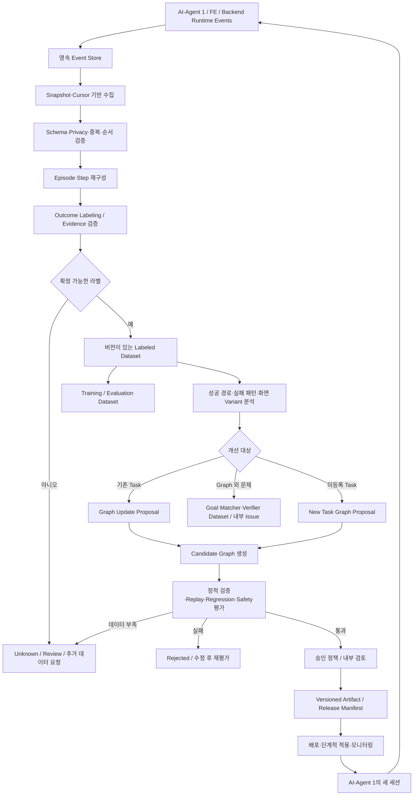

# AI-Agent(2): Runtime Data / Graph Proposal Agent

## 1. 목적과 범위

AI-Agent(2)는 **전체 runtime 데이터를 분석해 success/fail 결과 라벨과 내부 데이터셋을 만들고, Task Graph를 추가·업데이트하는 내부용 에이전트**다. 기존의 `graph-proposal`을 이 에이전트의 책임으로 분리한다.

사용자는 개발·데이터·운영 팀이다. 입력은 실제 사용자의 새 요청이 아니라 AI-Agent(1), Frontend, Backend가 남긴 실행 기록이다. 출력은 화면 조작 명령이 아니라 근거를 추적할 수 있는 라벨, 데이터셋, graph 변경안, 평가 보고서, 승인 가능한 graph artifact다.

- [전체 구조와 두 에이전트의 경계](./ai-agent-architecture.md)
- [AI-Agent(1): 사용자 작업 수행 Runtime Agent](./ai-agent-1-runtime.md)
- [MVP-01: 글자 크기 확대](./tasks/font-size-increase.md)

이 문서는 2026-09-12의 `a0d3609`에서 확인한 기능 상태와 새 목표 설계를 구분하며, 파일 경로는 이번 `graph_proposal/` 패키지 분리를 반영한다. 아래 pipeline, event 계약, 저장 테이블, job 및 승인 상태는 **구현할 설계**다. 현재 `GraphLearner.generate_proposals()`는 빈 목록을 반환한다. 코드 파일이 있다는 이유로 라벨링·학습·배포가 완성된 것으로 보지 않는다.

예시 ID, 버전, confidence, 표본 수, metric은 이해를 돕기 위한 가상 값이며 실측 결과나 확정된 운영 기준이 아니다. 새 API endpoint, scheduler 제품, queue 제품, 보존 기간은 이 문서로 확정하지 않는다.

## 2. 책임과 완료해야 할 결과물

### 2.1 핵심 책임

1. 실행 중 발생한 관측, 판단, 안내, 사용자 행동, 검증, 오류, 취소, 만료 기록을 빠짐없이 처리 대상에 포함한다.
2. 흩어진 turn을 같은 목표 수행 단위로 연결하고 실행 순서와 누락을 확인한다.
3. step, transition, task 수준에서 성공과 실패를 판정하고 판단 근거를 저장한다.
4. 미확정 결과, 사용자 중단, 동의 거절, 정보 부족을 별도 상태로 관리한다.
5. 성공 경로, 반복 실패, 사용자 우회 성공, 미지원 목표, 화면 variant를 분석한다.
6. 기존 graph의 selector, synonym, state, transition, 분기 및 우선순위 변경을 제안한다.
7. 기존 graph로 표현할 수 없는 반복 Task는 신규 Task Graph 후보로 만든다.
8. 모델 학습용 데이터, 평가용 데이터, 재현 fixture, 오류 분석 자료를 생성한다.
9. 변경안을 정적 검증·offline 평가하고 승인에 필요한 diff와 근거를 제공한다.
10. 승인된 후보를 versioned artifact로 준비하고 배포 결과를 다음 분석에 반영한다.

### 2.2 책임 밖의 작업

| 작업 | 실제 담당 |
| --- | --- |
| 실사용자 자연어를 받아 현재 작업을 시작 | AI-Agent(1) |
| 현재 화면에서 다음 UI target을 결정 | AI-Agent(1) |
| 사용자에게 guide/confirmation/action command를 반환 | AI-Agent(1) → Backend → FE |
| 지금 진행 중인 세션을 Re-plan | AI-Agent(1) |
| Android Accessibility 수집과 기기 조작 | FE |
| 인증, 세션 소유권, 요청 멱등성, 저장 인프라 | Backend |
| 검증 없이 production graph를 덮어쓰기 | 허용하지 않음 |
| 데이터만 보고 자동 tap·결제·인증 정책을 변경 | 허용하지 않음 |

AI-Agent(2)가 graph를 업데이트한다는 말은 `candidate 생성 → 검증 → 승인 → 새 version 게시` 전체 수명주기를 담당한다는 뜻이다. 사용 중인 graph 객체를 실시간으로 수정한다는 뜻은 아니다.

### 2.3 산출물

| 산출물 | 사용 목적 | 최소 내용 |
| --- | --- | --- |
| Labeled Step / Episode | 실행 결과와 실패 원인 분석 | 대상 ID, label, 근거, labeling version |
| Failure Cluster Report | 반복 문제의 원인 분류 | 환경 cohort, 빈도, 독립 세션 수, 대표·반례 |
| Dataset Manifest | 학습·평가 재현 | source snapshot, split, label policy, 제외 기준 |
| Training / Evaluation Samples | Goal·State·UI·Verifier 개선 | 입력, 정답, 근거와 데이터 계보 |
| Graph Update Proposal | 기존 graph 변경 검토 | base version, patch, scope, evidence |
| New Task Graph Proposal | 지원 Task 확장 검토 | goal schema, graph, 완료 조건, fixture |
| Offline Evaluation Report | baseline/candidate 비교 | 조건, 표본, metric, 회귀, 판정 |
| Graph Release Candidate | AI-Agent(1)이 읽을 새 graph | artifact hash, version, 호환성, 평가·승인 참조 |
| Data Collection Request | 증거 부족 해소 | 필요한 환경·화면·행동·확인 질문 |

모델 가중치 재학습은 후속 확장이다. 초기 목표인 라벨링, graph 개선, dataset 생산은 규칙과 통계 기반으로 먼저 완성할 수 있다.

## 3. 전체 처리 흐름



AI-Agent(1)의 응답은 이 pipeline의 완료를 기다리지 않는다. 이벤트 전달과 분석은 분리하고, 분석 실패는 job 재시도 및 검토 대기 상태로 처리한다.

초기는 명시적으로 실행하는 batch job으로 시작할 수 있다. 이후 주기 실행, 데이터량 기준 실행, 실패율 상승 시 실행을 추가한다. 실행 간격과 제안 최소 표본 수는 데이터량 및 품질을 보고 정한다.

## 4. 입력 범위: 전체 runtime 데이터

### 4.1 전체의 의미

전체 runtime은 성공적으로 끝난 turn뿐 아니라 서비스가 접수한 작업의 전체 수명주기다. 개인정보 원문을 전부 저장한다는 의미는 아니다.

| 데이터 범주 | 포함해야 하는 기록 | 주요 용도 |
| --- | --- | --- |
| 요청·목표 | 시작, raw text의 허용된 표현, Typed Goal, 후보, slots, clarification | Goal 오류·미지원 수요 |
| 환경 | package, app version, OS, 제조사, locale, 화면 크기, capability | 환경별 graph 범위 |
| 관측 | screen ID, 관측 시각, 정규화 node, state 후보·근거, fingerprint | State·selector 평가 |
| 계획 | graph version/hash, transition 후보, 선택 이유, replan | 경로 개선 |
| 매칭 | candidate 집합, 순위, 점수 요소, 선택 target | UI ranker 평가 |
| 안전 | policy version, 판정, confirmation 요청·응답 연결 | 안전 정책 검증 |
| 안내·실행 | guide ID, 내용 template, 렌더링 확인, 사용자 행동 또는 허용된 자동 action | 실제 시도 여부 |
| 결과 | 새 화면, 검증 대상 step, verification과 완료 근거 | success/fail 라벨 |
| 복구 | 반복 시도, 사용자 수동 우회, fallback, provider 상태 | 대체 경로·장애 분류 |
| 종료 | 완료, 취소, 만료, 지원 불가, 목표 변경, 오류 | task 단위 outcome |
| 시스템 | 입력 거절, timeout, API 오류, event 전송 실패 | 데이터 누락·인프라 장애 |

사용자 요청 이전의 모든 휴대폰 활동을 수집하는 구조는 아니다. 허용된 작업 세션과 필요한 관측 범위에 한정한다.

### 4.2 권장 Event 종류

아래 이름은 새 내부 계약의 제안이며 현재 구현된 enum이 아니다.

| Event | 기록 주체 | 의미 |
| --- | --- | --- |
| `episode_started`, `goal_interpreted`, `clarification_requested` | Agent(1) / Backend | 목표 및 수행 단위 |
| `observation_received`, `state_classified` | FE → Backend / Agent(1) | 화면 원천과 해석 분리 |
| `transition_selected`, `target_matched` | Agent(1) | 계획 및 선택 근거 |
| `guide_issued`, `guide_rendered` | Agent(1) / FE | 생성과 실제 표시 구분 |
| `confirmation_requested`, `confirmation_responded` | Agent(1) / FE | 확인 대상과 응답 |
| `user_action_observed`, `action_execution_result` | FE | 사용자 행동 또는 자동 실행 결과 |
| `step_verified`, `replan_decided`, `fallback_used` | Agent(1) | 온라인 판단 결과 |
| `episode_completed`, `episode_cancelled`, `episode_expired` | Agent(1) / Backend | 종료 원인 |
| `goal_changed`, `request_rejected`, `runtime_error` | Backend / Agent(1) | 변경·비정상 경로 |

`request_rejected`가 유효한 episode를 갖지 못하는 경우 `episode_id=null`로 시스템 품질 통계에 남긴다. 인증에 실패한 payload를 학습 데이터로 그대로 보관하지 않는다.

### 4.3 공통 Event Envelope

```json
{
  "schema_version": "agent-runtime-event.v2",
  "event_id": "evt_000042",
  "event_type": "step_verified",
  "producer": "ai-agent-1",
  "request_id": "req_006",
  "session_id": "session_001",
  "episode_id": "episode_001",
  "turn_index": 6,
  "step_id": "step_005",
  "attempt_id": "attempt_005_1",
  "event_sequence": 42,
  "occurred_at": "2026-09-12T01:10:04Z",
  "ingested_at": "2026-09-12T01:10:05Z",
  "task_id": "MVP-01",
  "goal_type": "settings.font_size.increase",
  "graph_version": "1.0.0",
  "graph_hash": "example_graph_hash",
  "runtime_version": "example_runtime_revision",
  "policy_version": "example_policy_revision",
  "privacy_policy_version": "example_redaction_revision",
  "data_use_scope": ["runtime_quality", "graph_improvement"],
  "environment": {
    "app_package": "com.android.settings",
    "app_version": "example_app_build",
    "manufacturer": "samsung",
    "os_version": "15",
    "locale": "ko-KR"
  },
  "payload": {
    "evaluated_guide_command_id": "guide_005",
    "transition_id": "S4_TO_S5_INCREASE_FONT_SIZE",
    "before_observation_id": "obs_005",
    "after_observation_id": "obs_006",
    "action_event_id": "evt_000041",
    "runtime_verification_status": "SUCCESS",
    "predicate_id": "font_size_increased_from_baseline",
    "evidence": {
      "control_semantic_id": "font_size",
      "before_value": 1.0,
      "after_value": 1.15,
      "unit": "normalized_font_scale",
      "source": "accessibility_range",
      "observation_quality": "sufficient"
    }
  }
}
```

`agent-runtime-event.v2`는 현재 `agent-runtime-trace.v1`을 자동 대체한 상태가 아니다. 도입 시 converter와 schema validator를 만들고 일정 기간 양쪽 형식을 읽는다. 예시 `normalized_font_scale`는 정규화된 가상 값이다. 실제 수집한 slider 단계와 OS font scale을 변환 정의 없이 같은 단위로 비교하지 않는다.

### 4.4 식별자와 인과관계

| 식별자 | 단위 | 규칙 |
| --- | --- | --- |
| `session_id` | 사용자 상호작용 세션 | 같은 세션 안에서 목표가 바뀔 수 있음 |
| `episode_id` | 하나의 확정된 목표 수행 | 목표가 바뀌면 새 episode |
| `request_id` | 한 번의 논리 요청 | 네트워크 재전송으로 새 실행을 만들지 않음 |
| `turn_index` | 확정된 순차 처리 | 도착 시각 대신 서버의 처리 순서 기준 |
| `step_id` | 하나의 의도된 논리 행동 | 단순 재시도와 새로운 전이를 구분 |
| `attempt_id` | step의 실제 시도 | 재안내·실제 재시도를 각각 추적 |
| `guide_command_id` | 사용자에게 발행한 안내 | 행동과 확인 응답의 대상 |
| `observation_id` | 하나의 화면 관측 | 생성 시각과 app context 포함 |
| `event_id` | 개별 이벤트 | 재전송된 동일 이벤트의 중복 제거 기준 |

하나의 record 안에 있는 모든 값이 같은 step을 설명한다고 가정하지 않는다. 현재 runtime trace의 `verification`은 직전 guide, `guide`는 다음 guide일 수 있으므로 명시적 연결이 없으면 시퀀스와 checkpoint를 검토한다. 연결을 확정할 수 없는 과거 trace는 `unknown`으로 남긴다.

### 4.5 수집 정합성

1. 서버가 수락한 session version/turn 순서를 기준으로 이벤트를 조립한다.
2. event ID 기준 전달 중복을 제거한다. 같은 화면 fingerprint라는 이유로 서로 다른 실제 시도를 지우지 않는다.
3. 동일 request ID에 다른 payload가 있으면 충돌로 분류한다.
4. FE의 관측 시각, 사용자 행동 시각, 서버 수신 시각을 보존한다. clock skew를 고려하고 단순 timestamp 정렬만으로 인과관계를 만들지 않는다.
5. step의 before 화면은 안내 근거, after 화면은 해당 행동 이후의 관측이어야 한다.
6. 누락된 이벤트와 관측은 데이터 품질 플래그로 남긴다.
7. 지연 이벤트는 label revision을 만들 수 있다. 기존 label을 조용히 덮어쓰지 않는다.
8. graph, runtime, matcher/model, safety policy, label policy 버전을 구분해 저장한다.

## 5. Episode와 Step 재구성

### 5.1 재구성 순서

1. 분석 대상 source snapshot 또는 ingestion cursor 범위를 고정한다.
2. privacy 정책과 data-use scope에 따라 분석 가능한 event를 고른다.
3. schema 검사·중복 제거 후 session별로 묶는다.
4. 목표의 시작·변경·종료를 기준으로 episode를 나눈다.
5. 안내 ID, action ID, observation ID를 연결해 step과 attempt를 만든다.
6. 안내만 있고 행동이 없는 attempt, 행동은 있지만 결과가 없는 attempt를 표시한다.
7. runtime verification과 실제 전후 관측을 서로 다른 열에 보존한다.
8. terminal event와 목표 predicate를 확인해 episode 결과를 판정한다.

### 5.2 연결하지 말아야 할 경우

- 사용자가 수동으로 여러 화면을 건너뛰었고 중간 관측이 없다면 관측되지 않은 edge를 만들지 않는다.
- app이 바뀌었고 귀환 과정이 없으면 이전 target과 새 화면을 자동 연결하지 않는다.
- 오래된 guide에 대한 action이 늦게 도착하면 현재 pending step의 성공으로 처리하지 않는다.
- 지원되지 않는 goal에 대해 clarification만 했으면 UI 실행 step을 만들어내지 않는다.
- 반복된 observe-only turn은 화면 관측이지 실제 행동 시도가 아니다.
- 같은 session에서 goal이 바뀌면 이전 실패와 새 목표 성공을 하나의 task 결과로 합치지 않는다.

### 5.3 재구성 산출물

각 episode는 `goal_context`, `environment`, `graph_reference`, `ordered_steps`, `terminal_event`, `completeness`, `source_event_ids`를 가진다. step에는 `planned_transition`, `chosen_target`, `displayed_guide`, `action_evidence`, `before/after_observation`, `runtime_verification`, `missing_fields`가 들어간다.

`completeness`는 결과와 별개다. task 성공 근거가 있어도 중간 행동이 누락되었다면 task 성공 통계에는 사용할 수 있지만 transition 학습에는 쓰지 못할 수 있다.

## 6. Success / Fail 라벨 정책

### 6.1 라벨링 단위

| 단위 | 판정 질문 | 예시 |
| --- | --- | --- |
| Goal interpretation | 요청 의도를 맞게 해석했는가 | 글자 크기와 화면 크기 구별 |
| State observation | 화면을 올바른 state로 분류했는가 | 설정 홈과 검색 결과 구별 |
| Target selection | 의도한 행동을 위한 UI를 골랐는가 | 글자 크기 slider와 화면 확대 slider 구별 |
| Attempt / Step | 실제 시도 후 예상 결과가 생겼는가 | 해당 메뉴에 도달, 값 증가 |
| Transition | 정의된 환경에서 edge가 유효한가 | selector/action이 before→after와 연결됨 |
| Episode / Task | 사용자가 의도한 최종 목적을 달성했는가 | 최종 글자 크기 증가 확인 |
| Recovery | 실패 이후 복구가 성공했는가 | 대체 경로로 최종 목적 달성 |

task가 성공했다고 모든 step과 선택 target을 positive로 만들지 않는다. 중간 실패 후 사용자가 우회한 경우 `step=fail`, `task=success`, `completion_actor=user_recovery`가 함께 존재할 수 있다.

### 6.2 결과 상태

주요 확정 라벨은 `success`, `fail`이다. 모든 runtime을 처리하되 근거가 부족한 항목까지 이진 라벨로 강제하지 않는다.

| `outcome_label` | 정의 | 이진 dataset 기본 포함 |
| --- | --- | --- |
| `success` | 판정 단위의 목표 predicate를 충분한 근거로 충족 | 가능 |
| `fail` | 유효한 시도와 결과 근거가 있고 목표 predicate를 충족하지 못함 | 실패 유형별로 가능 |
| `unknown` | 결과 관측 누락, 근거 부족, 판정 상충 | 제외, 검토 큐 |
| `cancelled` | 사용자가 수행을 중단하거나 목표를 변경 | 기본 제외, 중단 분석에는 포함 |
| `not_applicable` | clarification, 동의 거절, 정책 차단 등 UI 수행 결과 판정 대상 아님 | 제외, 정책·서비스 평가에는 포함 |

`pending`은 outcome이 아니라 후속 관측을 기다리는 `label_status`다. `label_status`는 `pending`, `provisional`, `final`, `superseded`로 분리한다. `unknown`을 확정할 수도 있으며, 이 경우 `outcome_label=unknown`, `label_status=final`이다.

명시적인 실패 완료 event와 충분한 근거가 있는 timeout은 task `fail`이 될 수 있다. 아무 후속 기록이 없어서 만료된 세션은 원칙적으로 `unknown`이다. 사용자 취소와 시스템 장애를 모두 UI target 실패로 처리하지 않는다.

### 6.3 증거 우선순위와 신뢰도

1. Task에 정의된 완료 predicate를 만족하는 직접 관측값 또는 검증 가능한 시스템 상태.
2. 동작 대상과 before/after가 연결된 화면 증거 및 충분한 State 판별 근거.
3. 대상 goal을 명시적으로 확인한 사용자 응답과 일치하는 보조 관측.
4. AI-Agent(1)의 verification 결과 및 후속 상태의 일관성.
5. guide 문구, 모델 confidence, 단순 버튼 클릭 event, 에러가 없었다는 사실.

아래 항목만으로 성공을 확정하지 않는다: guide를 생성함, 사용자가 눌렀다고 보고함, 최종 state를 모델이 높은 confidence로 예측함, terminal transition이 정의되어 있음.

위 순위는 일률적 truth 규칙이 아니다. stale한 시스템 값과 최신 화면이 충돌하면 freshness와 Task predicate를 함께 검토한다. `label_confidence`는 evidence 품질에 대한 별도 값이며 runtime의 match confidence를 복사하지 않는다.

### 6.4 온라인 Verification → 오프라인 라벨

| AI-Agent(1) 결과 | 추가로 확인할 조건 | AI-Agent(2) 처리 |
| --- | --- | --- |
| `SUCCESS` | 해당 step의 fresh after 관측과 predicate 충족 | step success 후보 |
| `DONE` | 초기 Goal에 맞는 최종 완료 근거 | task success 후보 |
| `NO_CHANGE` | guide가 표시되고 행동이 실제로 발생했으며 결과 대기 시간이 충분 | step fail 가능 |
| `NO_CHANGE` | 사용자가 아직 조작하지 않음 또는 stale 관측 | pending / unknown |
| `WRONG_STATE` | before/action/after 연결 및 실제 도착 state 확실 | 해당 step fail, 원인 분류 |
| `WRONG_STATE` | 사용자가 다른 성공 경로로 수동 이동 | planned step과 recovery를 분리 |
| `UNKNOWN` | 화면은 바뀌었으나 state 미등록 | unknown, state cluster 후보 |
| verification 없음 | 첫 turn / clarification / 후속 관측 누락 | not_applicable 또는 pending/unknown |
| `BLOCKED` command | 정책상 금지 또는 동의 거절 | 실행 실패로 단정하지 않고 차단 사유 기록 |

초기 자동 라벨은 rule-based weak label임을 `label_method`로 표시한다. 사람이 검토한 gold label과 구별하고, 동일 runtime verifier의 출력을 정답으로 사용해 그 verifier의 정확도를 다시 평가하지 않는다.

### 6.5 실패 원인과 책임 귀속

결과 라벨, 실패 이유, 어느 구성요소의 문제인지, 실제 완료 주체를 별도 필드로 저장한다.

| `failure_category` 예시 | 내용 | 기본 개선 경로 |
| --- | --- | --- |
| `goal_mismatch`, `missing_slot` | 의도 해석·질문 실패 | Goal dataset / catalog |
| `observation_missing`, `stale_observation` | 입력 화면 없음·오래됨 | FE/Backend 수집 개선 |
| `state_misclassified`, `unknown_state` | 잘못된 state·새 화면 | State dataset / graph 후보 |
| `target_not_found`, `wrong_target`, `ambiguous_target` | selector·ranking 문제 | Graph selector / UI dataset |
| `action_not_observed` | 실제 시도 확인 불가 | 보통 unknown, event 계약 개선 |
| `transition_no_effect`, `unexpected_state` | 유효 시도 후 예상 결과 불발 | 전이·환경 검토 |
| `verification_error`, `false_done` | 성공·실패 검증 자체 오류 | Verifier dataset / 내부 Issue |
| `policy_blocked`, `confirmation_rejected` | 의도된 정책 차단 | 정책 준수 분석 |
| `provider_error`, `backend_error`, `network_timeout` | 인프라·외부 도구 오류 | 운영 Issue, graph 수정 근거 아님 |
| `user_cancelled`, `goal_changed` | 사용자 중단·목표 변경 | completion funnel 분석 |

`attribution`은 `agent`, `frontend`, `backend`, `provider`, `environment`, `user`, `mixed`, `undetermined` 중 근거에 따라 기록한다. 원인이 확정되지 않으면 `undetermined`로 둔다. `completion_actor`는 `agent_guided_user`, `user_recovery`, `allowed_automation`, `undetermined` 등을 사용한다.

### 6.6 Label Record 예시

```json
{
  "label_id": "label_step_005_r2",
  "label_schema_version": "outcome-label.v1",
  "unit_type": "step",
  "unit_id": "step_005",
  "episode_id": "episode_001",
  "outcome_label": "success",
  "label_status": "final",
  "label_method": "predicate_rule_with_observation",
  "label_confidence": 0.95,
  "label_policy_version": "label-policy.v1",
  "labeler_version": "labeler-example-revision",
  "runtime_verification_status": "SUCCESS",
  "completion_actor": "agent_guided_user",
  "attribution": "undetermined",
  "failure_category": null,
  "evidence_event_ids": ["evt_000041", "evt_000042"],
  "evidence_observation_ids": ["obs_005", "obs_006"],
  "predicate_id": "font_size_increased_from_baseline",
  "review_status": "not_reviewed",
  "supersedes_label_id": "label_step_005_r1",
  "created_at": "2026-09-12T01:15:00Z"
}
```

라벨을 수정하면 이를 사용한 dataset/proposal/evaluation을 lineage로 찾아 재검토하거나 재생성한다. 과거 평가를 새 라벨로 실행한 것처럼 기록하지 않는다.

## 7. 라벨링을 수행하는 내부 루프

AI-Agent(2)는 명시적인 목표와 검증 루프를 갖는 job으로 설계한다. LLM 호출 횟수가 에이전트 여부를 결정하지 않는다.

`분석 범위 설정 → 증거 수집 → Episode 재구성 → 라벨 후보 → 규칙·반례 검증 → 확정 또는 검토 요청 → 데이터 생성 → 후보 평가 → 수정 또는 종료`

1. 작업 대상 task, 환경, 기간, source snapshot을 고정한다.
2. 알려진 schema와 policy로 데이터를 정제한다.
3. deterministic predicate로 라벨 후보를 만든다.
4. 온라인 검증과 관측이 불일치하는 사례를 검토 큐에 보낸다.
5. 신뢰 가능한 label과 pending/unknown을 분리해 coverage를 계산한다.
6. 오류·우회 경로를 분석하고 가능한 개선 작업을 계획한다.
7. 후보 artifact를 검증 도구로 검사한다.
8. 근거 부족이면 임의 patch를 반복 생성하지 않고 `NEEDS_DATA`로 종료한다.

LLM/VLM은 마스킹된 unknown 화면의 설명, 유사 state cluster 해석, label 검토 보조, proposal 설명 작성에 사용할 수 있다. 출력은 구조화하고 evidence ID를 요구한다. 모델이 말한 성공, 새 edge, 안전 수준은 검증 없이 사실로 승격하지 않는다.

허용 도구는 event/dataset 조회, 통계·clustering·mining, graph parser/validator, replay runner, artifact writer 등 내부 데이터 도구다. 사용자 기기를 조작하는 FE 실행 경로와 production artifact를 직접 덮어쓰는 권한은 분리한다.

## 8. 실패·성공 패턴 분석

### 8.1 Cohort와 지표 집계

같은 goal family만으로 모든 세션을 합치지 않는다. `task_id`, graph version, app package/version, 제조사, OS, locale, runtime/model version으로 비교 가능한 cohort를 만든다.

각 cohort에 처리 episode 수, 독립된 세션/사용자 그룹 수, label coverage, step/task success rate, unknown/cancel 비율, 실패 이유, 평균·분위수 step 수, replan/fallback 빈도, 사용자 우회 비율을 저장한다.

소수 cohort는 그대로 보존하고 `NEEDS_DATA`로 표시할 수 있다. 전체 평균이 좋아졌다는 이유로 특정 제조사·언어의 악화를 숨기지 않는다.

### 8.2 성공 경로와 우회 경로 Mining

- task success가 확인된 episode에서 실제 관측된 state/action 순서를 추출한다.
- 기존 graph와 일치한 경로, 기존 graph의 대체 경로, 미등록 경로를 구분한다.
- before/action/after가 연결된 edge만 transition 후보로 사용한다.
- 한 사용자가 같은 경로를 반복한 데이터와 여러 독립 세션에서 재현된 데이터를 구분한다.
- 최종 성공이 있어도 중간 action이 누락되면 그 부분은 edge 대신 `path_fragment`로 보관한다.
- 사용자 수동 복구로 성공한 경로를 AI-Agent(1)이 안내해 성공한 것처럼 집계하지 않는다.

### 8.3 State Clustering

clustering 특징은 package, 화면 제목, 정규화 label set, role 분포, resource ID 패턴, 앞뒤 state context, 환경 정보다. 주민 이름·상품명 같은 사용자별 값과 절대 좌표에 과도하게 의존하지 않는다.

기존 state와 목적·완료 의미가 같고 표시명만 다르면 synonym 또는 variant 후보가 적합하다. 새로운 사용자 조작이나 새로운 검증 predicate가 필요한 화면이면 새 state를 검토한다.

여기서 synonym은 **화면에 표시된 UI label의 동의어**다. 같은 기능을 가리키는 “글자 크기”와 “폰트 크기”는 동의어 후보가 될 수 있지만, 단어가 비슷한 “글자 크기”와 “화면 크기”는 조작 대상과 결과가 다르므로 합치지 않는다. 실제 반영하려면 UI의 목적, role, resource ID, 상위 영역, 앞뒤 화면 문맥과 조작 결과로 기능의 동일성을 확인하고, 혼동하기 쉬운 다른 UI를 반례로 평가한다.

예를 들어 제목 유사도, node-set Jaccard, package 일치, role 분포, 전이 문맥을 가중 결합할 수 있다. 가중치는 평가로 정하며 단일 cluster score를 새 state의 증거로 확정하지 않는다.

### 8.4 실패가 곧 Graph 변경은 아니다

- network timeout이 반복되면 운영 장애 보고서를 만든다.
- 완료 verifier가 잘못된 DONE을 내면 verifier 개선 대상으로 보낸다.
- 화면 수집이 비어 있으면 FE 관측 경로를 점검한다.
- graph selector가 유효한 화면을 놓친 경우에 selector 후보를 만든다.

분석 결과가 `no_graph_change_needed`여도 유효한 산출물이다. 제안 개수 자체를 성공 지표로 두지 않는다.

### 8.5 관측 패턴에 따른 변경 범위 결정

AI-Agent(2)는 성공률과 함께 **화면 UI의 의미·구조, 실제 실행 경로, 환경 차이, 완료 조건**을 분석해 변경 범위를 결정한다. 기존 graph 안에서 표현할 수 있는 차이는 해당 graph의 최소 변경으로 처리한다.

| 발견한 패턴 | 확인할 근거 | 변경 방향 |
| --- | --- | --- |
| UI 표시명은 다르지만 기능과 조작 결과가 같음 | 같은 UI 목적·role·화면 문맥, 연결된 조작 결과, 혼동 UI 반례 | 기존 graph에 UI 동의어 추가 (`add_synonym`) |
| 비슷한 이름의 UI를 혼동하거나 잘못 선택함 | 실제 정답 target과 오선택 target, resource ID·상위 영역 등의 구별 근거 | selector 개선 (`update_selector`) |
| 같은 작업에서 새로운 중간 화면이 등장함 | 화면 의미, 진입·이탈 관측, 기존 state와의 차이 | state 추가 또는 화면 식별 조건 보강 (`add_state`, `update_state_signature`) |
| 같은 목표에 도달하는 다른 경로가 확인됨 | 각 edge의 before/action/after 연결과 최종 완료 근거 | transition·대체 경로 추가 (`add_transition`) |
| 제조사·OS·앱 버전별로 UI나 경로가 다름 | 환경 metadata와 해당 환경의 재현 사례 | 환경별 variant 추가 (`add_environment_variant`) |
| 기존 graph로 표현하기 어려운 새로운 목적·완료 조건이 필요함 | 확정된 목표·필수 slots, 기존 graph/template의 한계, 새 경로와 완료 근거 | 신규 Task Graph 검토; 실제 등록은 10장의 조건 적용 |
| 실패 원인이 통신·화면 수집·완료 검증 오류임 | 오류 기록, 누락·오래된 관측, 판정과 실제 결과의 불일치 | 해당 구성요소 개선; graph 변경 필요성은 별도 판단 |

UI 단어 유사성은 변경 후보를 찾는 신호다. 같은 기능과 결과라는 근거가 있어야 동의어로 반영한다. 최종 task가 성공했어도 중간 행동·화면이 누락되면 그 부분을 새 transition의 근거로 사용하지 않는다.

## 9. 기존 Task Graph 업데이트

### 9.1 Proposal 유형

| 유형 | 변경 내용 | 필요한 근거 |
| --- | --- | --- |
| `add_synonym` | 같은 UI 목적의 다른 label | 성공한 selector/전이와 의미 일치, 반례 |
| `update_selector` | resource ID, role, parent context 보강 | 전후 관측과 실제 target |
| `update_state_signature` | State 식별 조건 보강 | 해당 state와 혼동 state의 정답 fixture |
| `add_state` | 미등록 화면 추가 | 반복 cluster, 의미, 진입·이탈 근거 |
| `add_transition` | 새 edge 또는 대체 경로 | 연결된 before/action/after와 재현 |
| `update_transition_priority` | 환경별 경로 우선순위 | 비교 가능한 경로 결과, safety 고정 |
| `add_environment_variant` | 제조사·app version별 분기 | 범위를 분리할 수 있는 metadata |
| `deprecate_transition` | 유효하지 않은 경로 단계적 폐기 | 충분한 실패 근거, 대체 경로 및 rollback |
| `update_scroll_policy` | 탐색 방향·횟수·중단 조건 | 실행 capability와 실제 scroll 결과 |
| `update_completion_predicate` | 완료 판단 수정 | 독립 검증 근거, false-DONE 회귀 평가 |

matching weight, model 변경은 graph patch와 같은 proposal 안에 숨기지 않는다. 별도 artifact 유형 또는 명시적 dependency로 분리해 무엇이 결과를 바꿨는지 추적한다.

### 9.2 후보 생성 절차

1. 개선 대상 failure cluster 또는 성공 우회 path를 선택한다.
2. 변경의 base graph version/hash와 적용 환경을 고정한다.
3. 한 가지 원인을 설명하는 최소 patch를 생성한다.
4. patch의 positive evidence와 반례, 데이터가 없는 범위를 함께 기록한다.
5. 현재 task의 safety 및 완료 조건을 보존하는지 검사한다.
6. base graph에 patch를 적용해 candidate artifact를 생성한다.
7. 정적 검사와 replay를 실행한다.
8. 개선 근거가 부족하면 `NEEDS_DATA`, 실패하면 수정 또는 `REJECTED`로 남긴다.
9. 통과하면 평가 보고서와 함께 검토 가능한 proposal을 확정한다.

proposal draft는 검증 전에 만들 수 있다. production 적용 가능한 후보가 되는 것은 평가를 통과한 이후다.

### 9.3 후보 점수와 최소 근거

우선순위는 문제 빈도, 실패 영향, 독립 재현 수, evidence 품질, 예상 회귀 범위, 수정 비용으로 정한다. `proposal_confidence`는 검토 우선순위 보조 정보이며 승인 조건이 아니다.

안전 제한은 가중 점수에서 상쇄할 항목이 아니라 필수 통과 조건이다. 성공률이 높아도 자동 tap을 허용하거나 confirmation을 제거하는 patch는 통과시키지 않는다.

표본 수가 작으면 성공률만 제시하지 않고 `success_count/eligible_attempt_count`와 독립 세션 수를 표시한다. 후보를 발견한 데이터에서 측정한 개선율을 holdout 평가 결과로 쓰지 않는다.

발생 횟수, UI 유사도, 성공률의 고정 임계값은 아직 정하지 않았다. 실제 baseline과 검토된 평가 사례를 확보한 뒤 변경 유형·지원 환경별 기준을 정하고 버전 관리한다. 빈도나 유사도 점수가 높아도 기능의 동일성, 실제 경로, 완료 근거를 대신할 수 없다.

### 9.4 Proposal 예시

```json
{
  "schema_version": "graph-proposal.v1",
  "proposal_id": "proposal_mvp01_selector_001",
  "proposal_revision": 1,
  "proposal_type": "add_synonym",
  "task_id": "MVP-01",
  "base_graph_version": "1.0.0",
  "base_graph_hash": "example_base_hash",
  "candidate_graph_version": "1.0.1-candidate.1",
  "scope": {
    "app_package": "com.android.settings",
    "manufacturer": "samsung",
    "os_versions": ["15"],
    "app_versions": ["example_app_build"],
    "locale": "ko-KR"
  },
  "change": {
    "transition_id": "S2_TO_S3_FONT_MENU",
    "field": "target_keywords",
    "before": ["글자 크기", "글자 크기와 스타일"],
    "add": ["글자 및 화면 스타일"],
    "remove": []
  },
  "evidence": {
    "dataset_version": "graph-evidence-example-v1",
    "label_policy_version": "label-policy.v1",
    "positive_episode_ids": ["episode_101", "episode_202"],
    "counterexample_case_ids": ["case_display_size_not_font"],
    "independent_session_count": 2,
    "known_limitations": ["추가 기기 환경 검증 필요"]
  },
  "safety_invariants": {
    "automatic_tap_enabled": false,
    "confirmation_removed": false,
    "risk_level_reduced": false
  },
  "evaluation_report_id": null,
  "status": "DRAFT",
  "requires_human_review": true,
  "rollback_target": "1.0.0"
}
```

위 예시는 낮은 표본 수의 draft다. 문법이 올바르다는 이유로 승인 대상이 되지 않는다. `before`는 실제 base artifact와 같아야 하며 적용 시 hash/precondition으로 검증한다.

### 9.5 충돌과 재평가

두 proposal이 같은 base graph에서 생성될 수 있다. 먼저 하나가 승인되어 base가 바뀌면 다른 proposal을 그대로 적용하지 않는다. 최신 base에 재적용하고 새 candidate hash를 만든 뒤 전체 관련 평가를 다시 수행한다.

서로 다른 selector 변경도 후보 순위에 상호 영향을 줄 수 있다. 개별 patch가 통과했더라도 합쳐진 artifact를 평가한다. 검토 후 patch가 수정되면 기존 approval과 평가를 재사용하지 않는다.

## 10. 신규 Task Graph 추가

### 10.1 신규 Graph가 필요한 경우

신규 graph는 **후보로 제안하는 시점**과 **실제 지원 Task로 등록하는 시점**을 구분한다. 기존 Task의 다른 경로라면 state/transition/variant를 확장한다. 확정된 최종 목적, 필수 slots, 완료 predicate가 달라 기존 graph 또는 승인 template로 표현하기 어렵다면 신규 graph 후보를 검토한다.

입력 후보는 FE가 전달한 미지원 목표 정보의 반복 패턴, 팀이 정의한 작업과 시범 수행 trace, 명시적으로 관측된 사용자 수동 완료 기록이다. 미지원 목표의 수요만으로는 UI 경로가 증명되지 않으므로 이 단계의 결과는 데이터 수집 요청일 수 있다.

실제 신규 Task Graph 등록에는 다음 조건을 모두 충족해야 한다.

1. **신규 작업의 필요성:** 기존 graph의 state·transition·variant 확장이나 승인 template의 slots 구체화로 처리하기 어려운 목표이며 지원 범위가 명확하다.
2. **실행 경로 근거:** 지원할 경로의 화면과 각 행동에 대한 before/action/after 연결이 있고 재현할 수 있다. 관측되지 않은 edge를 추정해 실행 경로에 넣지 않는다.
3. **검증 가능한 완료 조건:** 최종 목적 달성을 확인할 predicate, 필요한 관측값, 실패·중단 조건이 정의되어 있다.
4. **독립 평가와 검토:** 후보 생성에 사용하지 않은 정상·실패·예외·취소·복구 사례로 평가하고, 유사한 다른 작업과의 혼동 및 안전 정책 준수를 확인한 뒤 사람의 검토를 통과한다.

필요한 근거가 부족하면 `NEEDS_DATA`로 남기고 부족한 화면·행동·환경의 자료를 요청한다. 위 조건을 충족한 graph만 10.4의 절차에 따라 등록·배포한다.

### 10.2 필요한 데이터

- FE가 전달한 구조화된 목표·slots 또는 팀이 확정한 작업 명세.
- 대상 앱 package, 지원 환경, 전제 조건.
- 실제 시작 화면과 주요 경유 화면의 마스킹된 snapshot.
- 각 edge의 before/action/after 연결.
- 최종 목적 달성 여부를 검증할 수 있는 완료 predicate.
- 잘못된 경로, 유사하지만 다른 목표, 권한·로그인·오류 화면의 반례.
- 정책 검토가 필요한 조작과 자동 실행 capability 범위.

관측되지 않은 중간 화면이나 눌러야 할 버튼을 LLM이 상상해 채우지 않는다. 빠진 부분을 `missing_evidence`로 표시해 검증된 데모·fixture를 추가로 확보한다.

### 10.3 신규 Graph 후보 구성

```text
NewTaskGraphProposal
  task_id / goal_type / name / description
  goal_schema: required_slots, optional_slots, clarification_rules
  supported_environment: package, app_version, OS, manufacturer, locale
  prerequisites: permissions, login_state, entry_conditions
  start_states / states / transitions
  completion_predicates / failure_conditions / recovery_paths
  safety_policy_refs / required_capabilities
  evidence_dataset / independent_validation_cases
  goal_catalog_change / graph_artifact / task_document_change
  evaluation_report / approval_requirements / rollback_plan
```

graph ID가 새로 생기므로 `base_graph_version=null`일 수 있다. 대신 기반 template가 있다면 template version/hash를 기록한다.

### 10.4 생성·검증·등록 절차

1. 확정된 목표·필수 slots·완료 조건을 기존 graph/template으로 처리할 수 있는지 확인한다.
2. 지원할 목표와 완료 predicate를 정리한다.
3. 관측 경로에서 state와 edge를 추출하고 ID를 부여한다.
4. selector, action, safety, expected outcome을 명시한다.
5. state/edge 누락, 순환, 도달 불가, 위험 전이 등을 검사한다.
6. 정상·예외·취소·실패 fixture로 graph를 평가한다.
7. 기존 goal catalog와의 혼동도 평가한다.
8. 신규 Task 범위와 안전성을 사람이 검토한다.
9. graph와 goal catalog, required capability, task 문서를 하나의 호환 release로 게시한다.
10. AI-Agent(1)은 새 세션에서 지원 조건이 맞을 때만 새 graph를 선택한다.

goal catalog만 먼저 배포해 실행 graph가 없는 task를 지원한다고 답하지 않는다. 새 graph를 rollback하면 해당 catalog entry도 호환되는 상태로 되돌린다.

## 11. 내부 데이터셋 생성

### 11.1 데이터 종류와 라벨 출처

| Dataset | 입력 → 출력 | 정답 근거와 주의점 |
| --- | --- | --- |
| FE Goal/Command Typing | FE 입력·context → goal type, slots, command type | FE clarification·검토 정답; FE 분류 개선용 데이터이며 Agent(1)의 분류 책임이 아님. task 성공만으로 의도 정답 추정 금지 |
| State Classification | normalized screen + 환경 → state | 검토된 화면 의미; runtime classifier 출력은 weak label |
| UI Target Ranking | transition + 전체 후보 → target relevance | 실제 올바른 target과 전후 결과 |
| Transition Verification | before/action/after → predicate 결과 | 독립 evidence 기반 판정 |
| Re-plan | 실패 context + 가능한 경로 → 복구 선택 | 실제 관측된 복구 결과, 미실행 경로 결과는 unknown |
| Graph Evidence | state/path/환경 → graph 변경 근거 | 재현된 path와 실패 cluster |
| Safety Evaluation | action context → 허용·확인·차단 | 검토된 policy 판정; safety 자동 완화 학습 금지 |
| Runtime Evaluation | episode 입력 + 기대 결과 | 검토된 holdout replay fixture |

성공 target 이외의 모든 node를 negative로 만들지 않는다. 동일한 기능을 수행하는 여러 UI가 있을 수 있다. 미선택 후보는 기본적으로 unjudged이며, 확인된 오답만 negative로 사용한다.

### 11.2 Training Sample 예시

```json
{
  "sample_id": "ui_rank_sample_001",
  "sample_type": "ui_target_ranking",
  "task_id": "MVP-01",
  "graph_version": "1.0.0",
  "input": {
    "observation_ref": "obs_fixture_001",
    "state_id": "S2_DISPLAY_MENU",
    "transition_id": "S2_TO_S3_FONT_MENU",
    "candidate_node_ids": ["node_font", "node_display", "node_other"]
  },
  "label": {
    "positive_node_ids": ["node_font"],
    "negative_node_ids": ["node_display"],
    "unjudged_node_ids": ["node_other"]
  },
  "source": {
    "episode_id": "episode_101",
    "label_ids": ["label_target_101_r1"],
    "label_method": "human_review_with_observation"
  },
  "split": "train"
}
```

### 11.3 Split과 누출 방지

- 같은 episode의 step은 모두 같은 split에 둔다.
- 동일 사용자·동일 demo의 복제본·유사 화면 fixture가 train/test에 나뉘지 않도록 grouping한다.
- 개인정보를 직접 식별하지 않는 내부 grouping key로 중복과 상관관계를 관리한다.
- 최신 환경 일반화를 보려면 time holdout과 app/OS/device holdout을 별도로 둔다.
- proposal을 생성한 evidence set과 검증하는 holdout set을 구분한다.
- 모델 학습, threshold 조정, proposal 수정에 사용한 test set은 더 이상 순수한 최종 holdout으로 보고하지 않는다.
- 낮은 신뢰도 weak label과 human-reviewed gold label은 출처와 평가를 분리한다.

### 11.4 Dataset Manifest

```json
{
  "dataset_id": "ui_target_ranking",
  "dataset_version": "example-v1",
  "source_snapshot_id": "event-snapshot-example-001",
  "builder_version": "dataset-builder-example-revision",
  "label_policy_version": "label-policy.v1",
  "privacy_policy_version": "example_redaction_revision",
  "allowed_data_use_scope": ["graph_improvement"],
  "split_strategy": "episode_and_subject_grouped_with_time_holdout",
  "included_label_statuses": ["final"],
  "excluded_outcomes": ["unknown", "cancelled", "not_applicable"],
  "sample_count": 120,
  "excluded_count": 18,
  "content_hash": "example_dataset_hash",
  "lineage_ref": "example_dataset_lineage"
}
```

실제 생성 시 train/validation/test별 수와 cohort별 수, 제외 사유, 원천 기간도 포함한다. `graph_improvement` 목적만 허용된 데이터는 일반 모델 학습 용도로 자동 확대하지 않는다.

### 11.5 모델 관련 후속 확장

Goal Retriever, Slot Extractor, State Classifier, UI Ranker, State Clusterer, Transition Proposal Scorer를 데이터가 갖춰진 순서대로 검토한다. Scroll/Re-plan 학습 정책은 초기에는 통계와 규칙으로 충분하며 별도 모델이 필수는 아니다.

모델을 학습하면 model type/version, dataset version, 학습 코드 version, 평가 결과, 호환 runtime, fallback policy를 artifact metadata에 기록한다. graph version과 model version을 같은 필드로 합치지 않는다.

## 12. Graph 평가와 검증

### 12.1 정적 Graph 검증

- ID가 유일하고 start/done state, edge의 from/to가 실제 존재한다.
- 모든 지원 start state에서 의도한 완료 또는 명시적 중단 경로에 도달할 수 있다.
- 무한 loop, retry 상한 없는 recovery, 도달 불가능한 새 state를 검토한다.
- selector 필드, role, coordinate 가정, environment scope가 schema에 맞는다.
- action type이 runtime과 FE capability에서 허용된다.
- confirmation과 safety invariant를 유지한다.
- 완료 predicate가 단순 안내 문구나 terminal node 이름에 의존하지 않는다.
- graph/template/catalog 의존성과 최소 runtime version이 만족된다.

### 12.2 Replay의 범위

| 평가 방법 | 확인 가능한 것 | 한계 |
| --- | --- | --- |
| Snapshot replay | 같은 화면에서 state·target·safety 판단 | 선택한 action의 실제 다음 화면을 생성하지 못함 |
| Recorded episode replay | 관측된 경로의 검증·replan 일관성 | 기록되지 않은 대체 action의 결과는 알 수 없음 |
| 검증된 Simulator / 기기 시나리오 | 실제 전이와 최종 완료 여부 | 제공된 환경과 시나리오 범위에 한정 |
| 제한된 배포 관찰 | 실제 사용자 환경에서 결과 변화 | traffic 구성과 선택 편향을 통제해야 함 |

candidate가 과거에 선택되지 않은 버튼을 고르면 recorded trace의 다음 화면을 그 버튼의 결과로 취급하지 않는다. 해당 edge는 `unsupported_counterfactual`로 표시하고 추가 fixture나 기기 재현을 요구한다.

### 12.3 평가 지표

| 지표 | 정의와 보고 기준 |
| --- | --- |
| Label coverage | 판정 가능한 eligible 단위 중 success/fail 확정 비율; unknown도 함께 표시 |
| Label precision / agreement | 검토된 gold subset과 자동 label의 일치, positive/negative별 분리 |
| State accuracy | 검토된 화면에서 state 정답 일치 |
| Target accuracy | 정답 후보가 있는 화면에서 valid target 선택 |
| Step success rate | eligible한 success / (success + fail), unknown/cancel 별도 |
| Verified task success rate | eligible한 task success / (success + fail), 종료·미확정 분포 별도 |
| Observed completion rate | 접수된 episode 중 완료 근거가 확인된 비율, window와 제외 정책 명시 |
| False DONE rate | 완료 선언 중 목표 predicate를 실제 충족하지 않은 비율 |
| Fallback / Re-plan rate | 실제 대상 turn 또는 step을 분모로 사용 |
| 평균·p95 step 수 | 성공 episode 기준 지표와 전체 시도 비용을 따로 표시 |
| Safety violations | 금지 action, confirmation 우회, 정책 위반 case 수 |
| Cohort regression | 제조사·앱 버전·언어 등 subgroup별 baseline 대비 악화 |

분모와 관측 기간 없이 success rate만 제시하지 않는다. cancelled/unknown을 제외해 높아진 성공률과 전체 접수 대비 완료율을 함께 보아야 한다.

### 12.4 평가 판정

- `PASS`: 필요한 증거와 호환성·안전·회귀 기준을 만족.
- `FAIL`: 재현 가능한 회귀, 안전 위반 또는 필수 조건 불충족.
- `NEEDS_DATA`: 표본·환경·action 결과가 부족해 판정 불가.
- `ERROR`: 평가 도구나 입력 처리 오류. candidate 실패와 별도로 재시도 가능.

공통 필수 기준은 safety invariant 위반 0건, 검토된 필수 regression fixture 통과, 변경 대상 환경에 대한 결과 근거다. 정확도 개선 폭, 최소 표본, latency 허용 범위는 baseline을 확보한 후 metric policy로 버전 관리한다. 측정 사례의 위반 0건을 모든 환경의 안전성 증명으로 표현하지 않는다.

### 12.5 Evaluation Report 예시

```json
{
  "eval_id": "eval_graph_example_001",
  "proposal_id": "proposal_mvp01_selector_001",
  "proposal_revision": 1,
  "base_graph_hash": "example_base_hash",
  "candidate_graph_hash": "example_candidate_hash",
  "dataset_version": "graph-holdout-example-v1",
  "evaluator_version": "graph-evaluator-example-revision",
  "metric_policy_version": "metric-policy.v1",
  "evaluation_mode": "snapshot_replay",
  "case_count": 40,
  "metrics": {
    "target_accuracy": {"baseline": 0.8, "candidate": 0.9},
    "safety_violations": {"baseline": 0, "candidate": 0},
    "verified_task_success_rate": null
  },
  "regression_case_ids": [],
  "unsupported_counterfactual_case_ids": ["case_new_path_001"],
  "missing_evidence": ["새 경로의 실제 전이 결과"],
  "decision": "NEEDS_DATA"
}
```

snapshot target 정확도가 높아져도 task 완료율은 측정할 수 없어 `null`로 둔 예시다. 평가 보고서가 없는 candidate는 승인 가능한 release가 아니다.

## 13. Proposal 승인과 배포

### 13.1 상태 관리

```text
DRAFT → VALIDATING → READY_FOR_REVIEW → APPROVED
                  ↘ NEEDS_DATA
                  ↘ REJECTED

APPROVED → PUBLISHED → CANARY → ACTIVE → ROLLED_BACK / RETIRED
```

검토 중 데이터가 부족하면 `NEEDS_DATA`, 근거가 잘못되면 `REJECTED`로 전환할 수 있다. 수정한 proposal은 새 revision으로 다시 `VALIDATING`을 거친다. graph 내용 변경 없이 release 전달만 실패했다면 같은 immutable artifact로 재시도하고 승인 기록을 유지한다.

proposal 상태와 release 상태는 저장 모델에서 분리한다. 하나의 승인 proposal에 대한 artifact가 게시되어도 traffic을 받기 전까지 배포 완료로 표시하지 않는다.

### 13.2 승인 정책

| 변경 | 초기 승인 경로 | 후속 자동화 가능 범위 |
| --- | --- | --- |
| synonym·selector 보강 | 평가 통과 후 내부 검토 | 승인된 환경·필드 allowlist에서 별도 정책 마련 시 가능 |
| state signature·경로 우선순위 | 회귀·환경 검토 | 충분한 기준 확보 후 제한적으로 검토 |
| 새 State / Transition / Task Graph | 사람 검토 | 초기 자동 승인 없음 |
| 기존 transition 폐기 | 영향 범위·대체 경로·rollback 검토 | 별도 정책 필요 |
| 완료 predicate 변경 | false-DONE 평가 및 사람 검토 | 초기 자동 승인 없음 |
| safety·confirmation·action capability 변경 | 제품 정책 담당 검토 및 별도 release | graph score에 의한 자동 완화 금지 |
| 모델 가중치 변경 | 모델 평가·호환성 검토 | graph 승인과 별도 |

기존 문서에 있던 low-risk synonym/selector 자동 승인 가능성은 장기 확장 옵션으로 유지한다. 현재 승인 자동화가 구현되었다는 의미는 아니다.

### 13.3 Graph Artifact 계약

```json
{
  "artifact_type": "task_graph",
  "task_id": "MVP-01",
  "graph_version": "1.0.1",
  "graph_schema_version": "task-graph.v1",
  "content_hash": "example_release_hash",
  "parent_graph_version": "1.0.0",
  "proposal_id": "proposal_mvp01_selector_001",
  "proposal_revision": 2,
  "evaluation_report_id": "eval_graph_example_002",
  "approval_ref": "approval_example_001",
  "required_runtime_contract": "agent-runtime-example-v1",
  "required_capabilities": ["user_tap_guide", "user_drag_guide"],
  "goal_catalog_version": "goal-catalog-example-v2",
  "supported_environment_ref": "environment-manifest-example",
  "previous_release_ref": "graph-release-example-1.0.0",
  "release_status": "candidate"
}
```

Graph schema version, graph 내용 version, runtime contract, content hash를 구분한다. artifact는 불변이며 변경 시 새 version/hash를 만든다. Python executable code를 graph artifact에 삽입해 실행하지 않고 선언적 schema를 사용한다.

### 13.4 배포·버전 고정·Rollback

1. approved artifact와 평가·승인 참조를 release storage에 게시한다.
2. loader가 hash, schema, 지원 환경, capability를 검증한다.
3. 제한된 새 세션에만 candidate를 할당한다.
4. step/task 결과, false DONE, fallback, unknown, 중단, subgroup 회귀를 관찰한다.
5. 기준 통과 시 단계적으로 적용 범위를 늘린다.
6. 문제 발생 시 새 세션의 할당을 이전 호환 release로 되돌린다.

진행 중인 세션은 시작 시 고정한 graph version을 계속 사용한다. 심각한 안전 문제가 발견된 버전은 revoke하여 관련 세션을 안전하게 중단·재시작할 수 있어야 한다. pending transition이 있는 세션에 새 graph를 조용히 갈아 끼우지 않는다.

현재 Backend는 checkpoint graph hash와 현재 코드 hash가 다르면 거부한다. 위의 버전별 loader·기존 세션 유지·canary는 후속 구현이며 현재 배포 방식으로 이미 제공되지 않는다.

## 14. 저장 구조와 Job 운영

### 14.1 논리 저장소

아래는 설계 단위다. `graph_proposals`, `evaluation_reports`는 기존 `click` Postgres에 최소 스키마로 만들어졌다(`Backend/app/models/graph_proposal.py`, 마이그레이션 `20260912_06`). 필드는 현재 코드의 `GraphUpdateProposal` dataclass와 `GraphValidator.validate()` 반환값만 반영하며, `status`·`revision` 등 이 문서의 lifecycle 필드는 아직 없다 — ingestion/labeling/승인 로직이 실제로 구현될 때 추가한다. 나머지 테이블은 아직 존재하지 않는다.

| 저장 대상 | 주요 key | 보존할 정보 |
| --- | --- | --- |
| `runtime_events` | event ID | 원천 event, schema, 시각, privacy scope |
| `runtime_observations` | observation ID | 허용된 normalized snapshot, hash |
| `episodes`, `steps`, `attempts` | 각 단위 ID | 실행 순서, 연결, 누락, 종료 |
| `outcome_labels` | label ID/revision | 결과, 근거, 정책, supersedes |
| `review_items` | review ID | 충돌·미확정 사례와 검토 결과 |
| `dataset_manifests`, `dataset_samples` | dataset version/sample ID | split, 원천, label lineage |
| `graph_proposals` (구현됨) | proposal ID | patch, base hash, evidence |
| `evaluation_reports` (구현됨) | eval ID | proposal 참조, decision, regression |
| `graph_releases` | task/version/hash | artifact, 호환성, 승인, rollout |
| `pipeline_jobs` | job ID | 입력 snapshot, 단계, cursor, 재시도 |

메타데이터와 작은 record는 DB, 큰 snapshot·dataset·artifact는 접근 통제된 object/file storage를 고려할 수 있다. 제품 선정은 후속 구현에서 정하되 artifact와 metadata의 참조 정합성은 보장한다.

### 14.2 Job 입력과 출력

```json
{
  "job_id": "graph_job_example_001",
  "job_type": "label_and_propose",
  "source_snapshot_id": "event-snapshot-example-001",
  "task_ids": ["MVP-01"],
  "label_policy_version": "label-policy.v1",
  "pipeline_version": "graph-pipeline-example-revision",
  "base_graph_refs": ["MVP-01:1.0.0"],
  "limits": {
    "max_candidate_count": 10,
    "max_refinement_rounds": 2
  }
}
```

실행 결과는 processed/invalid/duplicate/pending/final-label/excluded 수, dataset version, proposal IDs, evaluation IDs, failure reason을 반환한다. 위 실행 상한은 예시이며 운영 예산으로 설정한다.

### 14.3 멱등성·실패 복구

- job 입력 snapshot, pipeline version, label policy, base hash의 조합을 재실행 key로 사용한다.
- 이벤트 전달은 중복이 가능하다고 가정하고 consumer를 멱등하게 만든다.
- ingestion, labeling, dataset build, evaluation을 단계별 checkpoint로 재시작한다.
- cursor는 산출물이 정상 저장된 이후 이동한다.
- 잘못된 schema event는 quarantine하고 나머지 유효 event는 처리한다.
- artifact를 완성·검증한 후 registry metadata가 참조하도록 게시한다.
- 동일 evidence와 patch의 proposal을 중복 발행하지 않되 새 반례와 revision은 보존한다.
- 외부 모델 timeout은 재시도 상한 뒤 `NEEDS_REVIEW` 또는 도구 오류로 종료한다.
- 자동 수정 반복 횟수와 처리 예산을 제한하고, 근거 부족을 prompt 반복으로 해결하려 하지 않는다.

Backend의 turn 저장과 event 전달 사이의 누락을 줄이기 위해 transactional outbox 또는 동등한 내구성 있는 전달 방식을 검토한다. 단순한 메모리 fire-and-forget을 전체 수집 보장으로 표현하지 않는다.

## 15. 개인정보와 데이터 사용 경계

전체 runtime 처리와 데이터 최소화는 함께 충족해야 한다. 모든 실행 단계의 존재·상태는 기록하되 분석에 필요 없는 개인 원문은 제외한다.

- 사용자 raw text, UI text, OCR 결과, guide message, extras, provider 오류 문자열은 모두 민감정보가 들어갈 수 있는 필드다.
- screenshot을 지우는 것만으로 text 개인정보가 제거되지는 않는다.
- 전송·저장 전 allowlist, masking, 정규화를 적용하고 redaction policy version을 남긴다.
- hash는 낮은 엔트로피 개인값을 안전하게 익명화한다는 보장이 없으므로 만능 대체 수단으로 쓰지 않는다.
- snapshot은 고정 앱 label, role, 구조, 필요한 값 등 재현에 필요한 최소 정보로 구성한다.
- 이미지 분석 동의, personalization 동의, 품질 분석·graph 개선·모델 학습의 데이터 사용 범위를 구분한다.
- 동의 없는 screenshot/OCR을 agent2의 offline VLM 입력으로 재사용하지 않는다.
- 로그/문서/오류 메시지에 포함된 지시문은 학습·분석할 데이터이며 도구 실행 지시로 따르지 않는다.
- label·dataset·proposal·release에서 source lineage를 유지해 삭제 또는 사용 범위 변경의 영향을 추적한다.
- 보존 기간, 재학습 데이터 삭제 방식, 운영자 접근 범위는 별도 정책으로 정하고 manifest가 그 정책을 참조하도록 한다.

현재 `TraceLogger`는 임의 text와 식별자를 제거하고 allowlist의 enum·수치만 보존하며, 기본 100개·900초의 개수/TTL 제한을 적용한다. runtime `sanitize_request()`는 text redaction, 민감 입력 node 비활성화, extras 제한, screenshot 제거를 수행한다. Backend `safe_response()`도 debug를 축소한다. 이 진단용 보호 경계를 완화해 학습 데이터를 모으지 말고, 필요한 evidence와 식별자를 별도 data-use scope·schema·접근 통제 아래 저장해야 한다.

## 16. MVP-01 적용 예시

아래 시나리오는 설계 설명용이며 해당 trace가 실제 수집되었다는 뜻은 아니다.

### 16.1 정상 성공

1. 사용자 목표는 글자 크기 증가다.
2. 설정 홈 → 디스플레이 → 글자 크기 화면에서 각 action과 후속 화면이 확인된다.
3. 사용자가 크기 변경 확인 후 slider를 조작한다.
4. 동일 의미의 font-size control 또는 시스템 신호에서 기준값 대비 증가가 확인된다.
5. navigation step은 각각 `success`, 최종 value-change step과 task도 `success`로 라벨링한다.
6. 기존 graph와 완전히 맞으면 graph를 억지로 변경하지 않고 baseline dataset을 보강한다.

### 16.2 안내 실패 후 사용자 우회 성공

1. Agent(1)이 디스플레이 메뉴의 잘못된 target을 안내했다.
2. action과 충분한 후속 관측이 있어 해당 step의 실패를 확인했다.
3. 사용자가 접근성 → 시인성 향상 → 글자 크기 경로로 직접 이동했다.
4. 중간 action/관측과 최종 값 증가가 확인되었다.
5. 첫 step은 `fail`, 우회 경로는 관측된 edge별 결과, task는 `success`로 기록한다.
6. `completion_actor=user_recovery`, `user_corrected_path=true`를 남긴다.
7. 기존 graph에 없는 edge라면 `add_transition` 또는 필요한 `add_state` 후보를 만든다.

중간 화면 기록이 없으면 “접근성에서 글자 크기 화면으로 도착했다”는 path fragment만 남긴다. 관측하지 않은 모든 중간 edge를 생성하지 않는다.

### 16.3 최종 화면만 보이고 값 변화는 없음

글자 크기 조절 화면에 도달했어도 값이 바뀌지 않았고 사용자 완료 확인도 없다면 task success를 부여하지 않는다. 시도가 확인되었다면 step 결과를 따로 판단하고, task 완료 증거가 없다면 `unknown` 또는 아직 진행 중인 pending으로 둔다.

### 16.4 이미 최대값인 경우

현재 값이 최대라 더 키울 수 없다면 “증가가 발생했다”는 success를 만들지 않는다. 목표 semantics에 따라 추가 설명 또는 대안 안내로 종료하고 `goal_unachievable_in_current_context` 같은 reason을 남긴다. 이미 목표를 만족한 상태를 성공으로 볼 Task라면 `already_satisfied`를 별도 표시해 action 성공 통계에서 분리한다.

### 16.5 사용자가 화면 분석에 동의하지 않음

동의 거절은 `not_applicable` 또는 사용자 종료 상황에 따른 `cancelled`로 기록하고 `confirmation_rejected` 등 명확한 사유를 남긴다. selector 실패 negative로 쓰지 않고, 동의 없이 수집할 수 있는 대안 데이터만 사용한다.

## 17. 현재 코드와 역할별 파일 구조

AI-Agent(2)는 `AI-Agent/src/ai_agent/graph_proposal/`에 독립 패키지로 구획했다. 기존 `learning/`을 제거하고 후보·dataset·평가·모델·release 모듈을 실제로 이동했다. 각 모듈의 기존 동작은 유지하며 자동 라벨링·학습을 새로 구현한 것으로 표시하지 않는다.

| 현재 파일 (`src/ai_agent/` 기준) | 현재 동작 | 확장할 내용 |
| --- | --- | --- |
| `graph_proposal/schemas.py` | 기존 `GraphUpdateProposal` 정의 | evidence·revision·승인 계약 확장 |
| `graph_proposal/ingestion/__init__.py` | 수집 책임만 구획, 미구현 | 영속 event·schema·privacy 검사 |
| `graph_proposal/reconstruction/__init__.py` | 재구성 책임만 구획, 미구현 | episode·step·attempt 연결 |
| `graph_proposal/labeling/__init__.py` | 라벨링 책임만 구획, 미구현 | step/task outcome·근거·revision |
| `graph_proposal/analysis/__init__.py` | 분석 책임만 구획, 미구현 | failure cluster·성공 경로 mining |
| `graph_proposal/proposals/graph_learner.py` | `generate_proposals()`가 `[]` 반환 | labeled episode 기반 후보 생성 |
| `graph_proposal/evaluation/graph_validator.py` | 항상 `NEEDS_DATA` 반환 | schema·safety·replay·regression 평가 |
| `graph_proposal/datasets/dataset_builder.py` | 빈 samples 목록을 가진 구조 반환 | evidence·label·split 기반 sample 생성 |
| `graph_proposal/models/model_trainer.py` | candidate metadata 반환 | 실제 학습은 후속 범위 |
| `graph_proposal/models/model_registry.py` | 메모리 dict register/get | artifact·dataset lineage·호환성 |
| `graph_proposal/releases/versioning.py` | task/version 문자열 반환 | 실제 promotion·rollback workflow |
| `graph_proposal/workflows/__init__.py` | offline job 책임만 구획, 미구현 | 단계별 orchestration·retry·checkpoint |

사용자용 producer인 `TraceLogger`는 Agent(2)에 두지 않는다. 공통 `telemetry/trace_logger.py`로 이동하고 Agent(1)과 Backend는 이 경로에서 import한다. 관측 요약 계약 `RuntimeTrace`는 `telemetry/schemas.py`에 정의한다. 진단 dict와 이 dataclass는 서로 다른 형식이므로 현재 진단 로그만으로 자동 변환·라벨링할 수 없다.

공통 `task_graph/`는 graph 구조와 registry를 제공한다. 사용자 실패 state를 관리하는 기존 `StateManager`는 `replanning/state_manager.py`, graph 승격·rollback은 Agent(2)의 `releases/versioning.py`에 둔다. graph 조회·세션 상태·배포 역할을 분리한다.

```text
AI-Agent/src/ai_agent/
  runtime/                    # AI-Agent(1)의 실행 경로
  telemetry/                  # 공통 진단 producer·관측 요약 계약
    trace_logger.py
    schemas.py
  graph_proposal/             # AI-Agent(2) 전용 패키지
    schemas.py
    ingestion/
    reconstruction/
    labeling/
    analysis/
    proposals/
    datasets/
    evaluation/
    models/
    releases/
    workflows/
  task_graph/                 # 공통 선언적 graph 구조·registry
  replanning/                 # 기존 Agent(1) 컴포넌트와 StateManager
```

`graph_proposal`은 `runtime`, 사용자 Goal/UI/Guide 모듈, Backend를 import하지 않는다. 사용자 실행 경로도 `graph_proposal`을 import하지 않는다. import 경계와 두 패키지의 독립 로딩은 `AI-Agent/tests/test_agent_boundaries.py`로 검사한다. 이전 `learning.*` 경로로의 재export를 유지하지 않으므로 신규 구현은 위 경로를 사용한다.

산출물 경로도 `AI-Agent/data/graph_proposal/`로 옮겼다. 원천 runtime과 공통 fixture는 각각 `data/runtime/`, `data/fixtures/`에 둔다. 실제 파일 목록과 역할은 [Agent(2) 패키지 README](../AI-Agent/src/ai_agent/graph_proposal/README.md), [데이터 README](../AI-Agent/data/README.md)를 참고한다.

## 18. 구현 순서와 인수 기준

### 18.1 단계별 구현

| 단계 | 작업 | 완료 조건 |
| --- | --- | --- |
| 1 | event·episode·label 계약 | 모든 종료 경로, 단위 ID, 버전, privacy 범위 정의 |
| 2 | 영속 수집과 재구성 | 재전송·누락·지연·목표 변경을 재현 가능하게 처리 |
| 3 | Rule-based Labeler | step/task 분리, success/fail/unknown/cancel 구별 |
| 4 | 검토 dataset과 quality metric | gold subset, label coverage·오류 분석 |
| 5 | 기존 graph selector proposal | 근거와 반례, 정확한 diff, base hash 포함 |
| 6 | Validator와 replay | baseline/candidate 비교, 회귀·NEEDS_DATA 구분 |
| 7 | 승인·artifact·version loader 연계 | 승인 candidate만 게시, 세션 version 고정 |
| 8 | 새 State/Transition 및 신규 Task | 관측 근거, catalog 연동, 완료·안전 검증 |
| 9 | 모델별 dataset 및 선택적 학습 | split·lineage·독립 평가와 모델 호환성 |

### 18.2 필수 검증 시나리오

| 시나리오 | 기대 결과 |
| --- | --- |
| 첫 turn에서 guide만 발행 | step 성공 확정 없음 |
| guide A 검증과 guide B 생성이 같은 trace | 결과는 A에만 연결 |
| 행동 event 없이 동일 화면 반복 | 무조건 fail로 처리하지 않음 |
| 실패 두 번 후 최종 성공 | 실패 step 유지, task success |
| runtime DONE이나 완료 증거 없음 | label unknown / false-DONE 검토 |
| 사용자 수동 복구, 중간 화면 누락 | task 결과와 미확정 edge 분리 |
| 취소·만료·동의 거절 | 구별된 outcome/reason, UI negative 오염 없음 |
| 같은 event/request 재전송 | 통계·dataset·proposal 중복 없음 |
| 늦은 결과 도착 | 새 label revision, 영향받은 산출물 추적 |
| 같은 session에서 goal 변경 | episode 분리 |
| UI 표시명은 다르지만 같은 기능·결과가 확인됨 | UI 동의어 후보로 평가; 신규 Task Graph를 만들지 않음 |
| 단어가 비슷하지만 다른 UI 기능·결과임 | 동의어로 합치지 않음; selector 구별 근거와 반례 평가 |
| 같은 목표의 새로운 경로가 완전히 관측됨 | 기존 graph의 state/transition/variant 확장으로 평가 |
| 신규 목표 수요는 있으나 실행 경로나 완료 근거가 부족함 | `NEEDS_DATA`와 추가 수집 요청; 지원 Task로 등록하지 않음 |
| 특정 제조사에서만 개선 | 해당 scope로 제한, 다른 cohort 회귀 검사 |
| snapshot replay에서 새 action 선택 | 실제 전이 성공률을 만들어내지 않음 |
| base graph가 평가 후 변경 | stale proposal 거부, 재평가 |
| safety level 완화 patch | 빈도·성공률에 관계없이 정책 검증 실패 |
| Agent(2) job 중단 | Agent(1) 기존 승인 graph 실행 지속 |
| release rollback | 신규 세션 할당 복원, 기존 세션 version 일관성 |
| 학습 동의·사용 범위 변경 | 원천·dataset lineage 따라 제외·재검토 |

### 18.3 AI-Agent(2) MVP 완료 조건

- 하나 이상의 실제 Task에서 전체 실행 수명주기를 영속 수집하고 입력 snapshot으로 재처리할 수 있다.
- step/task 결과를 근거와 함께 라벨링하며 미확정 항목을 이진 정답에 섞지 않는다.
- 동일 입력·정책·코드 버전으로 실행할 때 동일한 논리 산출물과 lineage를 재현한다.
- 최소한 selector/synonym 변경안 하나를 실제 데이터에서 생성하고 반례까지 평가한다.
- graph 변경이 필요 없는 실패를 내부 분석 또는 데이터 개선 대상으로 보낼 수 있다.
- 승인자가 candidate diff, 근거, 회귀 결과, 적용 범위, rollback 대상을 확인할 수 있다.
- 승인된 artifact만 AI-Agent(1)이 소비하고 기존 세션의 버전을 유지한다.
- 신규 Task Graph 생성은 위 기반 이후 완료 predicate와 실제 경로 증거를 갖춰 추가한다.
