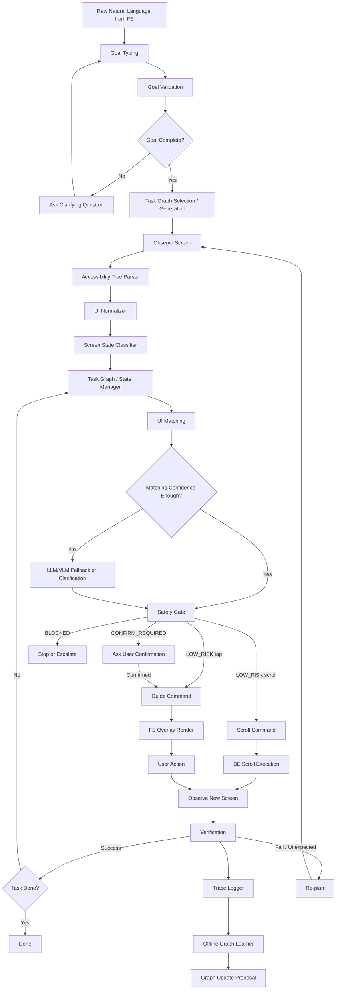

# AI Agent 전체 구조

## 1. 문서 목적

이 문서는 모바일 앱 사용 지원 AI Agent의 공통 구조와 런타임 흐름을 정의한다. 특정 Task 하나에 종속되지 않고, Android 설정 앱, 쿠팡, 정부24 등 여러 절차형 Task에 공통으로 적용되는 Agent 파이프라인을 설명한다.

Task별 State, Transition, UI 후보, 예외 처리는 별도 문서에서 관리한다.

- Task 상세 문서: [Android 설정 앱에서 글자 크기 확대](./tasks/font-size-increase.md)

## 2. Agent 목표

Agent는 사용자가 익숙하지 않은 모바일 앱에서 스스로 목적을 완료할 수 있도록 현재 화면을 이해하고 다음 행동을 단계별로 안내한다.

MVP의 기본 원칙은 Human-in-the-loop이다.

- Agent는 FE가 전달한 raw 자연어를 입력받는다.
- Agent는 raw 자연어 의도를 분석해 `goal_type`, `target_app`, `task_type`, `slots`를 생성한다.
- Agent는 Typed Goal에 맞는 Task Graph를 선택하거나 Task Template로부터 생성한다.
- Agent는 현재 화면의 UI 요소를 분석한다.
- Agent는 다음에 눌러야 할 UI를 선택한다.
- Agent는 Guide Command를 생성한다.
- FE는 Guide Command를 받아 실제 Overlay, Highlight, 안내 문구를 렌더링한다.
- Agent는 조작 이후 화면 변화를 확인한다.
- Agent는 예상과 다르면 재계획한다.
- Agent는 tap을 자동 수행하지 않는다.
- Agent는 대상 UI 탐색을 위한 scroll만 제한적으로 허용한다.
- Agent는 실행 trace를 수집해 Task Graph 개선 후보를 만든다.

## 3. 입력 구조

FE는 사용자의 raw 자연어를 Agent에 전달한다. Agent는 이 입력을 내부 Goal Typing 파이프라인으로 정규화한 뒤 Task Graph를 선택하거나 생성한다.

FE 입력 예시:

```json
{
  "source_text": "글자 크기 키우고 싶어",
  "locale": "ko-KR",
  "device_context": {
    "platform": "android",
    "foreground_app": null
  }
}
```

Agent가 생성하는 Typed Goal 예시:

```json
{
  "goal_type": "settings.font_size.increase",
  "target_app": "android_settings",
  "task_type": "settings_change",
  "slots": {
    "setting": "font_size",
    "direction": "increase"
  },
  "source_text": "글자 크기 키우고 싶어",
  "confidence": 0.93
}
```

MVP에서는 Goal Typing에 LLM을 기본 사용하지 않는다. Embedding 유사도, keyword/synonym matching, 규칙 기반 slot extraction, app/task prior를 우선 사용한다. LLM은 오프라인 평가에서 자체 Goal Typing 정확도가 기준 이하로 낮거나, 운영 중 low-confidence 비율이 높게 관찰될 때 fallback으로 도입을 검토한다.

## 4. 핵심 설계 원칙

### 4.1 Goal 처리 원칙

Goal은 raw 자연어에서 Agent가 생성한 typed 구조로 관리한다.

주요 필드:

- `goal_type`: 사용자의 목적을 표현하는 표준 타입
- `target_app`: 대상 앱 또는 앱 범주
- `task_type`: 구매형, 설정 변경형, 행정 서류 발급형 등 Task 패턴
- `slots`: 방향, 대상 설정, 상품, 문서 종류 등 Task별 파라미터
- `confidence`: Goal typing 신뢰도

Goal confidence가 낮거나 필수 slot이 비어 있으면 Agent는 Task를 시작하기 전에 사용자 확인을 요청한다.

Goal Typing은 아래 순서로 수행한다.

1. 입력 정규화
   - `source_text`의 공백, 구두점, 흔한 오타를 정리한다.
   - 한국어/영어 혼용 표현을 canonical token으로 변환한다.
   - 예: "폰트", "글씨", "글자" -> `font`; "키워", "크게", "확대" -> `increase`

2. App hint 추출
   - 사용자가 명시한 앱 이름, 현재 foreground app, OS 정보를 함께 본다.
   - "설정에서", "휴대폰 글자"처럼 시스템 설정 의도가 강하면 `android_settings` 후보에 prior를 준다.
   - 앱이 명확하지 않으면 `target_app`은 top candidate로 두되 confidence에 감점한다.

3. 후보 Goal 검색
   - Goal Catalog에는 각 `goal_type`별 대표 발화, 동의어, required slots, target app, task type이 등록되어 있다.
   - `source_text` embedding과 Goal Catalog의 대표 발화/template embedding을 비교해 top-k 후보를 찾는다.
   - 동일한 goal family 안에서는 slots까지 비교한다.

4. 규칙 기반 보조 점수 계산
   - keyword/synonym 일치 점수
   - 부정/취소/반대 방향 표현 점수
   - app hint 점수
   - required slot 채움 점수
   - 모호성 감점

5. Slot extraction
   - dictionary, regex, dependency keyword window를 사용해 slot을 추출한다.
   - 예: "글자 크기 키우고 싶어" -> `setting=font_size`, `direction=increase`
   - "화면 크게"처럼 `font_size`와 `display_size`가 모두 가능하면 ambiguous slot으로 표시한다.

6. Score fusion
   - 기본 confidence는 `embedding_score`, `keyword_score`, `slot_score`, `app_prior`를 가중 합산한다.
   - 초기 가중치 예: embedding 0.45, keyword/synonym 0.30, slot 0.20, app prior 0.05
   - top-1과 top-2의 score gap도 함께 기록한다.

7. 결정 기준
   - `confidence >= 0.80`, `score_gap >= 0.12`, required slots가 모두 채워짐: Typed Goal 확정
   - `0.60 <= confidence < 0.80` 또는 `score_gap < 0.12`: 사용자에게 짧게 확인
   - `confidence < 0.60`: 지원 Task 후보를 제시하거나 추가 설명 요청
   - 위험도가 높은 task family는 threshold를 더 높게 둔다.

8. Task Graph 생성
   - 확정된 `goal_type`이 등록 Task와 1:1 매핑되면 해당 Task Graph를 로드한다.
   - 같은 Task Template를 공유하는 경우 slots로 Graph를 parameterize한다.
   - 예: `settings.{setting}.{direction}` template + `setting=font_size`, `direction=increase`
   - Graph 생성 결과에는 start states, done state, transition 목록, safety rule, required dataset reference가 포함된다.

LLM fallback은 기본 비활성화한다. 단, 운영 지표상 Goal Typing 정확도 또는 task completion rate가 목표보다 낮은 경우, low-confidence 입력에 한해 LLM을 보조 분류기로 붙일 수 있다.

### 4.2 UI 판단 원칙

UI 판단은 Accessibility Tree 기반의 keyword matching과 embedding matching을 우선한다.

우선순위:

1. Accessibility Tree 수집
2. UI Normalizer로 Node 정규화
3. keyword matching으로 명확한 후보 탐색
4. embedding similarity로 의미적으로 가까운 후보 탐색
5. confidence가 충분하면 Safety Gate로 전달
6. confidence가 낮으면 LLM/VLM fallback 또는 사용자 확인

### 4.3 LLM/VLM 사용 범위

LLM/VLM은 다음 상황에서 fallback으로만 사용한다.

- Goal Type confidence가 낮아 사용자 의도 확인이 필요한 경우
- Accessibility Tree에 label이 없거나 부정확한 경우
- 아이콘 중심 UI라 keyword matching이 실패한 경우
- 제조사/앱 버전 차이로 기존 Task Graph와 맞지 않는 경우
- 팝업, 권한 요청, 오류 화면 등 예외 화면이 등장한 경우
- embedding 및 keyword matching confidence가 낮은 경우

### 4.4 자동 조작 제한

MVP에서는 자동 tap을 제공하지 않는다. Agent는 사용자가 눌러야 할 위치를 Guide Command로 만들고, FE는 이를 Overlay로 렌더링하지만, 실제 tap은 사용자가 직접 수행한다.

단, target UI가 현재 viewport에 없고 아래/위로 이동해야 발견될 가능성이 높은 경우 scroll은 제한적으로 허용한다.

- tap, long press, text input, submit, purchase, consent는 자동 수행하지 않는다.
- scroll은 탐색 목적의 LOW_RISK action으로만 허용한다.
- scroll 전후에는 Accessibility Tree를 재수집해 target UI 발견 여부를 검증한다.
- scroll 횟수와 방향은 Task Graph의 `scroll_policy`로 제한한다.
- scroll 중 사용자가 직접 조작하면 Agent는 즉시 재관찰 루프로 돌아간다.

### 4.5 Task Graph 학습 원칙

Task Graph는 사람이 처음 seed를 만들되, 운영 중에는 Agent가 실행 trace를 통해 개선 후보를 자동 생성한다. 단, 런타임 중 production graph를 즉시 자기 수정하지 않는다.

원칙:

- runtime graph는 안정 버전만 사용한다.
- Agent는 실패, 우회 성공, 반복 scroll, 사용자 직접 조작 결과를 trace로 저장한다.
- Graph Learner는 trace를 분석해 State, Transition, synonym, selector, scroll policy 수정 후보를 만든다.
- 후보 graph는 offline validation과 회귀 테스트를 통과해야 한다.
- high-risk task나 safety rule 변경은 사람 승인을 거쳐야 한다.
- 승인된 후보만 versioned Task Graph로 배포한다.

## 5. 전체 런타임 루프

Agent의 기본 루프는 `Raw Goal -> Goal Typing -> Task Graph -> Observe -> Normalize -> Classify -> Match -> Safety -> Guide Command -> FE Overlay -> Verify -> Re-plan -> Trace`이다.



## 6. 시스템 계층 구조

| 계층 | 핵심 질문 | 담당 모듈 | 결과물 |
| --- | --- | --- | --- |
| Goal-level | raw 자연어가 어떤 목적을 의미하는가? | Goal Typer, Goal Validator, Task Mapper | Typed Goal, Task ID, slots |
| Task-level | 목표를 위해 어떤 State를 거쳐야 하는가? | Task Graph, State Manager | State, Transition |
| Screen-level | 현재 화면은 어떤 State인가? | Accessibility Tree Parser, UI Normalizer, Screen State Classifier | Current State |
| UI-level | 다음 State로 가기 위해 어떤 UI를 선택해야 하는가? | Keyword Matching, Embedding Matching | Target Node |
| Safety-level | 이 행동을 안내해도 되는가? | Rule-based Safety Gate | LOW_RISK, CONFIRM_REQUIRED, BLOCKED |
| Guide-level | 사용자에게 무엇을 보여줄 것인가? | Guide Command Builder | Guide Command |
| Presentation-level | 안내를 실제 화면에 어떻게 렌더링할 것인가? | FE Overlay Renderer | Overlay, Highlight, Cursor, Text Guide |
| Execution-level | 허용된 자동 탐색 행동이 있는가? | BE Accessibility Action Executor | Scroll Result |
| Verification-level | 의도한 화면 전이가 일어났는가? | Verifier, State Classifier | SUCCESS, DONE, REPLAN |
| Learning-level | Task Graph를 어떻게 개선할 것인가? | Trace Logger, Graph Learner, Graph Validator | Graph Update Proposal |
| Fallback-level | 규칙 기반 판단이 실패했는가? | LLM/VLM Fallback | 보조 판단 또는 사용자 확인 |

## 7. 모듈별 책임

### 7.1 Goal Typer / Goal Validator / Task Mapper

FE에서 전달된 raw 자연어를 Typed Goal로 변환하고 Task Graph로 매핑한다.

역할:

- raw 자연어 정규화
- embedding 기반 Goal 후보 검색
- keyword/synonym/rule 기반 점수 보정
- slots 추출
- `goal_type` 존재 여부 확인
- 필수 slot 확인
- Goal confidence 확인
- 지원 가능한 Task인지 확인
- Task ID 선택 또는 Task Graph 생성

예시:

```json
{
  "source_text": "글자 크기 키우고 싶어",
  "goal_type": "settings.font_size.increase",
  "target_app": "android_settings",
  "task_type": "settings_change",
  "slots": {
    "setting": "font_size",
    "direction": "increase"
  },
  "task_id": "MVP-01",
  "typing_method": "embedding+keyword+slot_rule",
  "is_supported": true,
  "required_slots_filled": true,
  "needs_clarification": false,
  "confidence": 0.91
}
```

### 7.2 Task Graph / State Manager

Task별로 정의된 State와 Transition을 관리한다.

역할:

- 현재 Task의 시작 State와 완료 State 관리
- 현재 State에서 가능한 다음 Transition 조회
- 실패한 Transition 기록
- 대체 경로 탐색
- `scroll_policy` 적용
- graph version과 experiment variant 기록

Task Graph는 전체 구조 문서에 직접 넣지 않고 Task별 문서에서 관리한다.

### 7.3 Accessibility Tree Parser

Android Accessibility Service를 통해 현재 화면의 UI Tree를 수집한다.

수집 대상:

- `packageName`
- `className`
- `text`
- `contentDescription`
- `resourceId`
- `boundsInScreen`
- `clickable`
- `enabled`
- `selected`
- `scrollable`
- `checkable`

### 7.4 UI Normalizer

원본 Accessibility Node를 Agent가 비교하기 쉬운 정규화 Node로 변환한다.

정규화 기준:

- `text`와 `contentDescription`을 `label` 후보로 병합
- 버튼, 리스트 항목, 슬라이더, 토글 등 `role` 추론
- 화면 위치를 `top`, `middle`, `bottom` 등으로 변환
- 비활성, 숨김, 중복 Node 제거
- Task별 synonym dictionary 적용

예시:

```json
{
  "node_id": "node_12",
  "label": "디스플레이",
  "role": "menu_item",
  "semantic_tags": ["display", "screen"],
  "bounds": [24, 320, 1056, 408],
  "actionable": true
}
```

### 7.5 Screen State Classifier

정규화 Node 목록과 Task Graph를 비교해 현재 화면 State를 판별한다.

판별 기준:

- 앱 패키지명
- 화면 제목
- 핵심 keyword 존재 여부
- 조작 가능한 UI role
- 이전 State에서 이동 가능한 State인지 여부

### 7.6 UI Matching

현재 State에서 다음 Transition을 수행하기 위한 Target Node를 선택한다.

1차 판단:

- keyword matching
- synonym matching
- resourceId matching
- role matching

2차 판단:

- normalized label embedding similarity
- 현재 State와 후보 Node의 semantic similarity
- Task goal과 후보 Node의 semantic similarity

fallback 조건:

- 후보가 없음
- 후보가 여러 개이고 score 차이가 작음
- 최고 후보 confidence가 threshold 미만
- 후보 Node가 실제로 clickable/actionable하지 않음

예시 출력:

```json
{
  "action_type": "tap",
  "target_node_id": "node_12",
  "target_label": "디스플레이",
  "match_method": "keyword+embedding",
  "confidence": 0.91
}
```

### 7.7 Safety Gate

Agent가 안내하려는 Action의 위험도를 판단한다.

위험 행동 기준:

- 금전적 결과가 발생하는가
- 개인정보 또는 민감정보가 관련되는가
- 법적/계약적 동의가 발생하는가
- 계정 또는 보안 상태가 변경되는가
- 사용자의 의도를 확신할 수 없는가

판정:

| 판정 | 의미 | 처리 |
| --- | --- | --- |
| `LOW_RISK` | 일반 탐색 또는 되돌릴 수 있는 설정 탐색 | 바로 안내 |
| `CONFIRM_REQUIRED` | 사용자의 설정, 개인정보, 계정 상태 등에 영향 가능 | 사용자 확인 후 안내 |
| `BLOCKED` | 결제, 송금, 계정 삭제, 인증번호 입력 등 고위험 | 안내 중단 또는 사람 확인 유도 |

### 7.8 Guide

Agent는 Target Node의 위치와 다음 행동을 Guide Command로 생성한다. FE는 이 명령을 받아 실제 Overlay를 렌더링한다.

Agent가 생성하는 정보:

- `command_type`: `highlight`, `gesture_hint`, `confirmation`, `done`, `blocked`
- `action_type`: `tap`, `drag`, `scroll`, `observe_only`
- `target_node_id`
- `target_bounds`
- `message`
- `safety_level`
- `requires_user_action`
- `expires_at` 또는 `ttl_ms`

FE 책임:

- 버튼 또는 영역 윤곽선 강조 렌더링
- 움직이는 커서 또는 포인터 렌더링
- 짧은 텍스트 안내 렌더링
- 필요 시 사용자 확인 UI 렌더링
- Overlay가 대상 UI를 가리지 않도록 위치 조정
- 실제 tap 수행 금지

원칙:

- 한 번에 하나의 행동만 안내
- 화면 위 Target Node와 안내 문장이 서로 충돌하지 않도록 배치
- 자동 tap 없이 사용자가 직접 조작
- Agent는 렌더링 좌표와 안내 의도를 전달하고, FE가 디바이스 해상도/밀도/안전영역을 반영해 최종 위치를 계산한다.

### 7.9 Scroll Handling

scroll은 target UI를 찾기 위한 탐색 행동으로만 허용한다. 자동 tap은 금지하지만, 화면 아래나 위에 있을 수 있는 버튼/메뉴를 찾기 위해 제한된 자동 scroll은 허용한다.

scroll 결정 조건:

- 현재 State에서 필요한 target keyword가 viewport에 없음
- 현재 화면에 `scrollable=true`인 container가 있음
- Task Graph의 현재 Transition이 `allow_scroll=true`임
- target이 아래/위에 존재할 가능성을 나타내는 근거가 있음
  - 같은 메뉴 목록의 정렬상 target이 아래에 있을 가능성
  - 화면 하단에 잘린 항목 존재
  - 이전 scroll history상 아직 끝에 도달하지 않음
- Safety Gate가 `LOW_RISK`로 판정함

Agent가 FE에 전달하는 정보:

- `guide_command_id`
- `action_type: "scroll"`
- `direction`: `down` 또는 `up`
- `message`: 예: "아래쪽에 글자 크기 메뉴가 있는지 찾아볼게요."
- `visual_hint`: 스크롤 방향 화살표, 탐색 중 상태, target keyword 표시
- `target_hint`: 찾고 있는 label/keyword
- `manual_override_allowed: true`

Agent가 BE에 전달하는 정보:

- `scroll_command_id`
- `session_id`, `task_id`, `state_id`, `transition_id`
- `scrollable_node_id` 또는 scrollable container bounds
- `direction`
- `scroll_amount`: `page`, `half_page`, 또는 normalized ratio
- `max_attempts`
- `stop_condition`: target keyword, target embedding threshold, target state, end-of-list
- `safety_level: "LOW_RISK"`

BE 처리:

- Accessibility action으로 scroll을 수행한다.
- scroll 후 새 Accessibility Tree, viewport bounds, scroll 가능 여부, 실제 이동 여부를 Agent에 반환한다.
- target이 발견되면 Agent는 tap을 실행하지 않고 Guide Command를 생성해 FE Overlay로 안내한다.
- `max_attempts` 도달, end-of-list, 화면 변화 없음이 반복되면 Re-plan으로 넘긴다.

### 7.10 Verification

사용자 행동 이후 새 화면을 관찰해 목표 State로 이동했는지 확인한다.

결과:

| 결과 | 조건 | 다음 처리 |
| --- | --- | --- |
| `SUCCESS` | 예상 State로 이동 | 다음 Transition 진행 |
| `DONE` | 완료 State 도달 | 완료 안내 |
| `NO_CHANGE` | 화면 변화 없음 | 재안내 |
| `WRONG_STATE` | 예상과 다른 State | Re-plan |
| `UNKNOWN` | 화면 판별 실패 | fallback 검토 |

### 7.11 Re-plan

예상과 다른 화면이 나타났을 때 새로운 경로를 계산한다.

전략:

- 현재 State 재분류
- 직전 실패 Node 제외
- 대체 Transition 탐색
- 검색 기능 사용 가능 여부 확인
- 허용된 scroll 범위 안에서 추가 탐색 가능 여부 확인
- 반복 실패 시 LLM/VLM fallback
- 사용자의 추가 설명 요청

### 7.12 Task Graph Learning / Update

Task Graph Learning은 사용자가 매번 직접 Task Graph를 수정하지 않아도 되도록 운영 trace에서 개선 후보를 만드는 비동기 파이프라인이다. 이 모듈은 runtime decision path와 분리한다.

핵심 전제:

- 초기 Task Graph는 사람이 seed로 만든다.
- runtime Agent는 승인된 graph version만 사용한다.
- runtime Agent가 현재 세션 중 production graph를 직접 수정하지 않는다.
- Graph Learner는 trace를 학습해 update proposal을 만든다.
- 검증과 승인 이후에만 새 graph version이 배포된다.
- LLM은 graph update의 기본 엔진이 아니다. label이 거의 없거나 cluster 해석이 어려운 경우에만 보조 annotation 도구로 검토한다.

학습/업데이트 대상:

- 새 State 후보
- 새 Transition 후보
- 기존 Transition의 target keyword, synonym, selector 보강
- 제조사/OS/app version별 분기
- scroll 방향, scroll 횟수, stop condition
- Goal Typing 대표 발화와 slot extraction rule
- confidence threshold와 score weight
- 예외 팝업 처리 rule

### 7.12.1 Runtime Trace 수집

Agent는 매 step마다 학습 가능한 최소 정보를 남긴다. 원본 화면 전체를 무조건 저장하지 않고, 개인정보를 줄인 normalized summary를 기본 저장 단위로 사용한다.

수집 필드:

| 필드 | 목적 |
| --- | --- |
| `source_text` | Goal Typing 개선 |
| Typed Goal, confidence, top-k candidates | goal 분류 오류 분석 |
| `graph_version` | 어떤 graph에서 성공/실패했는지 추적 |
| app package, app version, OS version, 제조사 | 환경별 분기 학습 |
| screen state candidate와 confidence | State Classifier 개선 |
| normalized node summary | keyword, synonym, selector 학습 |
| target candidate list와 score breakdown | UI Matching weight 조정 |
| Guide Command | 어떤 안내가 나갔는지 재현 |
| user action result | 안내 후 실제 성공 여부 판단 |
| scroll command/result | scroll policy 조정 |
| verifier result | 완료/실패 ground truth |
| user-corrected path | 기존 graph에 없는 성공 경로 발견 |
| failure reason | 업데이트 후보 유형 결정 |

Trace 저장 원칙:

- 개인정보가 들어갈 수 있는 text field는 hashing, masking 또는 allowlist 기반 filtering을 적용한다.
- raw screenshot은 기본 저장하지 않는다.
- VLM fallback이나 화면 이미지 저장이 필요한 경우 별도 사용자 동의와 마스킹을 거친다.
- trace는 session 단위와 step 단위로 모두 조회 가능해야 한다.

### 7.12.2 Graph Update 후보 생성 로직

1. Trace aggregation
   - 같은 `goal_type`, `target_app`, app version, device family별 trace를 묶는다.
   - 성공 path와 실패 path를 분리한다.
   - graph version별 success rate, average steps, re-plan count, scroll count를 계산한다.

2. Frequent path mining
   - 사용자가 직접 성공시킨 화면 이동 경로를 State/Transition 후보로 추출한다.
   - 기존 Graph에 없는 반복 path가 일정 빈도 이상이면 candidate transition으로 만든다.
   - 예: 기존 graph는 `디스플레이 -> 글자 크기`인데, 실제 사용자가 `접근성 -> 시인성 향상 -> 글자 크기`로 자주 성공하면 대체 transition 후보를 만든다.

3. State clustering
   - normalized node set, title keyword, packageName, embedding signature로 화면을 clustering한다.
   - 기존 State와 충분히 다르면 new state candidate로 둔다.
   - 기존 State와 유사하지만 label만 다른 경우 synonym/selector update 후보로 둔다.
   - clustering 기준 예: title embedding 0.35, node label set Jaccard 0.30, package match 0.15, role distribution 0.10, transition context 0.10

4. Transition inference
   - `before_state`, user action target, `after_state`를 묶어 transition 후보를 만든다.
   - 사용자가 누른 node label, resourceId, role, bounds pattern을 target selector 후보로 저장한다.
   - 같은 before/after pair가 반복되고 verifier 성공률이 높으면 transition confidence를 올린다.

5. Scoring
   - 성공률, 반복 빈도, 기존 graph 대비 개선율, safety level, 재현성을 기준으로 proposal confidence를 계산한다.
   - 예: `proposal_confidence = success_rate * 0.4 + frequency_score * 0.25 + verification_score * 0.25 + safety_score * 0.1`
   - proposal confidence가 낮으면 바로 graph 변경을 제안하지 않고 dataset 보강 대상으로 남긴다.

6. Guardrail check
   - `BLOCKED` 또는 `CONFIRM_REQUIRED` action을 자동 `LOW_RISK`로 낮추지 않는다.
   - tap 자동화 policy를 바꾸지 않는다.
   - 개인정보, 결제, 인증, 계정 변경 관련 transition은 사람 승인 대상으로 고정한다.

7. Offline validation
   - 저장된 Accessibility Tree dataset으로 candidate graph를 replay한다.
   - 기존 성공 케이스 회귀가 없는지 확인한다.
   - top-1 match confidence와 top-2 gap이 기준을 넘는지 확인한다.

8. Proposal 생성
   - 통과한 후보는 `GraphUpdateProposal`로 저장한다.
   - proposal에는 diff, 근거 trace, 예상 개선 지표, rollback plan을 포함한다.

9. 승인 및 배포
   - low-risk synonym/selector 보강은 자동 승인 가능하다.
   - State/Transition 추가, safety 변경, high-risk task 변경은 human review가 필요하다.
   - 승인된 Graph는 version을 올려 배포하고 기존 version으로 rollback 가능해야 한다.

운영 중 runtime Agent는 approved graph만 사용한다. Graph Learner가 만든 proposal은 바로 사용자 세션에 적용하지 않는다.

### 7.12.3 어디서 학습이 필요한가

학습이 필요한 지점은 세 단계로 나눈다.

| 위치 | 학습 대상 | 필요한 이유 | 1차 방식 | 모델 구현 필요성 |
| --- | --- | --- | --- | --- |
| Goal Typing | raw 자연어 -> `goal_type`, slots | 사용자의 표현이 다양함 | embedding retrieval + rule | 필요 |
| State Classification | 화면 -> State | 제조사/버전마다 화면 구성이 다름 | keyword + node signature | 필요 |
| UI Matching | State 내 target node 선택 | label, 위치, role이 앱마다 다름 | keyword + embedding + ranker | 필요 |
| Scroll Policy | target 탐색 방향/횟수 | target이 viewport 밖에 있을 수 있음 | rule + trace statistics | 초기엔 불필요, 이후 가능 |
| Re-plan Policy | 실패 후 대체 경로 선택 | 예상 경로가 깨지는 경우 많음 | graph search + bandit | 이후 필요 |
| Graph Update | trace -> graph proposal | 사람이 계속 md를 고칠 수 없음 | mining + clustering + validator | 일부 필요 |
| Safety Classification | action 위험도 판정 | 자동화/안내 경계를 지켜야 함 | rule first | 고위험은 모델 단독 금지 |
| Guide Wording | 사용자 안내 문구 개선 | 짧고 명확한 문구 필요 | template | 선택적 |

### 7.12.4 모델 구현이 필요한 부분

초기 MVP는 규칙과 embedding 중심으로 시작하되, 아래 모델 컴포넌트는 별도 모듈로 설계한다.

1. Goal Embedding Retriever
   - 입력: `source_text`
   - 출력: top-k `goal_type` 후보와 embedding score
   - 구현: sentence embedding model + vector index
   - 학습 데이터: 사용자 발화, 선택된 goal, clarification 결과, 완료 여부

2. Slot Extractor
   - 입력: `source_text`, top-k goal candidates
   - 출력: `slots`, slot confidence, ambiguous slots
   - 구현: dictionary/rule 기반으로 시작하고, 데이터가 쌓이면 sequence labeling 또는 lightweight classifier 검토
   - 학습 데이터: 발화와 정답 slots

3. Screen State Classifier
   - 입력: normalized node list, packageName, previous state
   - 출력: current state, confidence
   - 구현: rule score + node embedding classifier
   - 학습 데이터: Accessibility Tree snapshot과 정답 state

4. UI Target Ranker
   - 입력: transition spec, normalized candidate nodes
   - 출력: target node ranking과 score breakdown
   - 구현: keyword/embedding score fusion으로 시작하고, 이후 learning-to-rank 모델 검토
   - 학습 데이터: Agent 후보, 사용자가 실제 누른 node, verifier 결과

5. State Clusterer
   - 입력: unknown 또는 low-confidence screen summaries
   - 출력: existing state match 또는 new state candidate
   - 구현: embedding clustering + rule-based merge
   - 학습 데이터: unknown screen trace, human labeling, user-corrected path

6. Transition Miner
   - 입력: before/after state, user action target, verifier result
   - 출력: candidate transition
   - 구현: frequent sequence mining, graph differencing
   - 학습 데이터: 성공 trace와 우회 성공 trace

7. Policy Optimizer
   - 입력: graph version별 success rate, step count, fallback rate
   - 출력: threshold, score weight, transition priority 추천
   - 구현: offline evaluation + contextual bandit 후보
   - 학습 데이터: replay 결과, 운영 성공률

LLM/VLM fallback은 위 모델을 대체하지 않는다. LLM/VLM은 unknown screen 설명, unlabeled icon 해석, proposal 설명 생성 같은 보조 annotation에만 제한적으로 사용한다.

### 7.12.5 학습 데이터 생성 흐름

1. Online trace logging
   - 모든 세션에서 step trace를 수집한다.
   - 민감정보는 저장 전 마스킹한다.

2. Auto labeling
   - verifier가 `DONE`을 반환한 trace는 positive path로 자동 라벨링한다.
   - `WRONG_STATE`, `NO_CHANGE`, `UNKNOWN`은 negative 또는 uncertain sample로 라벨링한다.
   - 사용자가 Agent 안내와 다른 node를 눌러 성공하면 user-corrected positive로 라벨링한다.

3. Human review queue
   - new state, new transition, safety 변경 후보는 review queue에 넣는다.
   - reviewer는 State 이름, Transition 의미, safety level, selector를 확정한다.

4. Training dataset build
   - Goal dataset: `source_text -> goal_type/slots`
   - State dataset: `normalized tree -> state_id`
   - UI matching dataset: `(transition, candidate nodes) -> selected target`
   - Re-plan dataset: `(failure context) -> recovery transition`

5. Offline train/eval
   - 모델을 학습하거나 score weight를 재추정한다.
   - 기존 graph replay suite에서 regression을 확인한다.
   - device/app variant별 성능을 따로 측정한다.

6. Graph proposal generation
   - 모델이 직접 graph를 배포하지 않고 `GraphUpdateProposal`만 생성한다.
   - proposal은 diff와 evidence를 포함한다.

7. Deployment
   - 승인된 proposal을 graph registry에 새 version으로 저장한다.
   - 일부 사용자에게 canary 배포 후 success rate와 rollback signal을 본다.

### 7.12.6 Graph Update 자동화 범위

| 변경 유형 | 자동 제안 | 자동 승인 | 사람 승인 |
| --- | --- | --- | --- |
| synonym 추가 | 가능 | low-risk면 가능 | 선택 |
| target keyword 추가 | 가능 | low-risk면 가능 | 선택 |
| resourceId selector 추가 | 가능 | 검증 통과 시 가능 | 선택 |
| scroll `max_attempts` 조정 | 가능 | 제한 범위 내 가능 | 선택 |
| 새 State 추가 | 가능 | 불가 | 필요 |
| 새 Transition 추가 | 가능 | 불가 | 필요 |
| Transition 삭제 | 가능 | 불가 | 필요 |
| safety level 완화 | 가능 | 불가 | 필요 |
| 자동 tap 허용 | 불가 | 불가 | 정책상 금지 |

### 7.12.7 배포와 rollback

- 모든 graph는 `graph_version`을 가진다.
- Agent는 session 시작 시 graph version을 고정한다.
- 배포는 canary -> staged rollout -> full rollout 순서로 진행한다.
- 새 version의 `task_success_rate`, `fallback_rate`, `wrong_state_rate`, `avg_step_count`, `user_cancel_rate`를 모니터링한다.
- 지표가 악화되면 즉시 이전 graph version으로 rollback한다.
- rollback 이후 해당 proposal은 blocked 상태로 전환하고 근거 trace를 다시 검토한다.

### 7.13 LLM/VLM Fallback

LLM/VLM은 기본 UI 판단 흐름이 실패했을 때만 보조적으로 사용한다.

사용 조건:

- Accessibility Tree에 의미 있는 label이 없음
- keyword 및 embedding matching이 실패함
- 화면이 기존 State Graph와 맞지 않음
- 예외 팝업 또는 앱 업데이트 화면이 등장함

개인정보 보호 원칙:

- 화면 이미지는 사용자 동의 후 사용
- 외부 모델 전송 전 개인정보 마스킹
- 마스킹되지 않은 원본 화면은 외부 모델로 전송하지 않음

## 8. 공통 데이터 구조

### 8.1 Raw Goal Input

```json
{
  "source_text": "글자 크기 키우고 싶어",
  "locale": "ko-KR",
  "device_context": {
    "platform": "android",
    "foreground_app": null
  }
}
```

### 8.2 Typed Goal

```json
{
  "goal_type": "settings.font_size.increase",
  "target_app": "android_settings",
  "task_type": "settings_change",
  "slots": {
    "setting": "font_size",
    "direction": "increase"
  },
  "confidence": 0.93
}
```

### 8.3 Task Definition

```json
{
  "task_id": "MVP-01",
  "goal_type": "settings.font_size.increase",
  "name": "Android 설정 앱에서 글자 크기 확대",
  "target_app": "android_settings",
  "type": "settings_change",
  "start_states": ["S0_UNKNOWN", "S1_SETTINGS_HOME"],
  "done_state": "S_DONE",
  "graph_version": "1.0.0"
}
```

### 8.4 State Definition

```json
{
  "state_id": "S1_SETTINGS_HOME",
  "name": "설정 홈",
  "required_keywords": ["설정"],
  "optional_keywords": ["디스플레이", "접근성", "연결"],
  "package_candidates": ["com.android.settings"],
  "confidence_threshold": 0.75
}
```

### 8.5 Transition Definition

```json
{
  "transition_id": "S1_TO_S2_DISPLAY",
  "from": "S1_SETTINGS_HOME",
  "to": "S2_DISPLAY_MENU",
  "action_type": "tap",
  "target_keywords": ["디스플레이", "화면", "Display"],
  "target_role": "menu_item",
  "safety_level": "LOW_RISK",
  "allow_scroll": true
}
```

### 8.6 Normalized Node

```json
{
  "node_id": "node_12",
  "label": "디스플레이",
  "role": "menu_item",
  "semantic_tags": ["display"],
  "bounds": [24, 320, 1056, 408],
  "clickable": true,
  "enabled": true,
  "embedding": "vector_ref"
}
```

### 8.7 Guide Command

```json
{
  "guide_command_id": "guide_001",
  "command_type": "highlight",
  "action_type": "tap",
  "target_node_id": "node_12",
  "target_bounds": [24, 320, 1056, 408],
  "message": "디스플레이를 눌러주세요.",
  "safety_level": "LOW_RISK",
  "requires_user_action": true,
  "render_policy": {
    "avoid_covering_target": true,
    "preferred_position": "below_target"
  }
}
```

### 8.8 Scroll Command

```json
{
  "scroll_command_id": "scroll_001",
  "task_id": "MVP-01",
  "state_id": "S1_SETTINGS_HOME",
  "transition_id": "S1_TO_S2_DISPLAY",
  "scrollable_node_id": "node_list_01",
  "direction": "down",
  "scroll_amount": "half_page",
  "max_attempts": 3,
  "target_hint": {
    "keywords": ["디스플레이", "화면", "Display"],
    "embedding_threshold": 0.78
  },
  "stop_condition": ["target_found", "end_of_list", "max_attempts"]
}
```

### 8.9 Runtime Trace

```json
{
  "trace_id": "trace_001",
  "task_id": "MVP-01",
  "graph_version": "1.0.0",
  "goal_type": "settings.font_size.increase",
  "state_sequence": ["S1_SETTINGS_HOME", "S2_DISPLAY_MENU", "S3_FONT_MENU"],
  "transition_sequence": ["S1_TO_S2_DISPLAY", "S2_TO_S3_FONT_MENU"],
  "result": "SUCCESS",
  "failure_reason": null,
  "user_corrected_path": false
}
```

### 8.10 Graph Update Proposal

```json
{
  "proposal_id": "graph_proposal_001",
  "task_id": "MVP-01",
  "base_graph_version": "1.0.0",
  "proposal_type": "add_synonym",
  "target": {
    "transition_id": "S2_TO_S3_FONT_MENU",
    "field": "target_keywords"
  },
  "change": {
    "add": ["글자 및 화면 스타일"]
  },
  "evidence": {
    "trace_count": 42,
    "success_rate_after_user_correction": 0.86
  },
  "proposal_confidence": 0.88,
  "requires_human_review": false
}
```

### 8.11 Training Sample

```json
{
  "sample_id": "sample_ui_rank_001",
  "sample_type": "ui_target_ranking",
  "task_id": "MVP-01",
  "graph_version": "1.0.0",
  "input": {
    "state_id": "S2_DISPLAY_MENU",
    "transition_id": "S2_TO_S3_FONT_MENU",
    "candidate_node_ids": ["node_10", "node_11", "node_12"]
  },
  "label": {
    "selected_node_id": "node_12",
    "result": "SUCCESS"
  },
  "source": {
    "trace_id": "trace_001",
    "label_method": "verifier_positive"
  }
}
```

### 8.12 Offline Evaluation Report

```json
{
  "eval_id": "eval_graph_001",
  "task_id": "MVP-01",
  "base_graph_version": "1.0.0",
  "candidate_graph_version": "1.1.0-candidate",
  "metrics": {
    "task_success_rate": 0.91,
    "target_match_accuracy": 0.88,
    "wrong_state_rate": 0.04,
    "fallback_rate": 0.08,
    "avg_step_count": 4.2
  },
  "regression": {
    "has_regression": false,
    "failed_cases": []
  },
  "decision": "PASS"
}
```

### 8.13 Model Artifact

```json
{
  "model_id": "ui_target_ranker_v3",
  "model_type": "ui_target_ranker",
  "trained_on": "2026-08-26",
  "training_dataset_version": "ui_rank_dataset_2026_08_26",
  "metrics": {
    "top1_accuracy": 0.89,
    "top3_accuracy": 0.96
  },
  "deployment_status": "candidate",
  "fallback_policy": "rule_score_fusion"
}
```

## 9. 개발 항목

| 순서 | 개발 항목 | 결과물 |
| --- | --- | --- |
| 1 | Goal Catalog / Goal Typing | raw 자연어 -> Typed Goal |
| 2 | MVP Task 정의 | Task별 문서 |
| 3 | Task Graph 설계 | State / Transition |
| 4 | Accessibility Tree 분석 | 실제 UI dataset |
| 5 | UI Normalizer | 정규화된 Node |
| 6 | Screen State Classifier | 현재 화면 판별 |
| 7 | UI Matching | keyword + embedding 기반 Target Node 선택 |
| 8 | Safety Gate | 위험 행동 판단 |
| 9 | Guide Command Builder | FE Overlay 렌더링용 명령 |
| 10 | Scroll Executor 연동 | 허용된 자동 scroll 실행 및 결과 |
| 11 | Trace Logger | task 실행 이력 저장 |
| 12 | Graph Learner | Task Graph 개선 후보 생성 |
| 13 | Graph Validator | offline replay 및 회귀 검증 |
| 14 | Graph Version Manager | 승인, 배포, rollback |
| 15 | Training Dataset Builder | trace를 모델별 dataset으로 변환 |
| 16 | Model Trainer / Evaluator | Goal, State, UI ranker 모델 학습/평가 |
| 17 | Model Registry | model version, metric, fallback policy 관리 |
| 18 | Verification | State 전이 확인 |
| 19 | Re-plan | 예상 외 화면 처리 |
| 20 | LLM/VLM fallback | 실패 케이스 보완 |

## 10. Task 문서 작성 규칙

Task별 문서는 다음 항목을 포함한다.

- Task ID와 사용자 목표
- 연결되는 `goal_type`
- raw 자연어 Goal Typing 기준
- 사용자 발화 예시
- 완료 조건
- State 목록
- Transition 목록
- scroll 허용 여부와 scroll policy
- keyword/synonym dictionary
- UI Matching 기준
- Safety 판정
- Guide Command 예시
- Verification 기준
- 예외 흐름 및 Re-plan 전략
- Task Graph 학습/업데이트 기준
- 필요한 Accessibility Tree dataset

## 11. MVP 성공 기준

- raw 자연어가 LLM 없이 적절한 Typed Goal과 Task로 매핑된다.
- Accessibility Tree 기반으로 현재 화면을 수집한다.
- UI Normalizer가 화면 Node를 일관된 구조로 변환한다.
- Screen State Classifier가 현재 State를 판별한다.
- UI Matching은 LLM 없이 keyword 및 embedding 기반으로 Target Node를 선택한다.
- confidence가 낮거나 예외 화면이면 사용자 확인 또는 LLM/VLM fallback 검토로 넘어간다.
- Safety Gate가 위험 Action을 차단하거나 사용자 확인을 요구한다.
- Agent는 Guide Command를 생성하고 FE는 Overlay를 렌더링한다.
- 자동 tap은 수행하지 않고, 허용된 범위의 scroll만 target 탐색 목적으로 수행한다.
- Verification이 State 전이를 확인하고, 실패 시 Re-plan한다.
- runtime trace를 기반으로 Task Graph 개선 proposal을 생성한다.
- 승인된 proposal만 versioned Task Graph로 배포한다.
