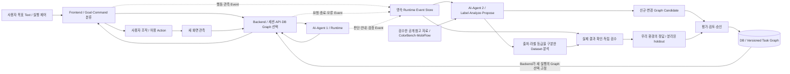

# AI-Agent 전체 구조: 사용자 Runtime과 Graph Proposal 분리

Vision fallback의 매 사용 동의, FE·BE 필드, 개인정보 마스킹 및 실패 대응은 [실행 계약](./ai-agent-vision-fallback.md)을 따른다.

## 1. 회의 결정과 문서 안내

AI-Agent를 아래 두 역할로 분리한다.

1. **AI-Agent(1): 사용자 작업 수행 Runtime Agent** — Backend가 DB에서 선택·복원해 전달한 Task Graph와 확정 목표를 받아 실행하며, 현재 화면을 읽어 guide/action을 결정한다. 이후 관측으로 결과를 검증하고 필요하면 Re-plan한다.
2. **AI-Agent(2): Runtime Data / Graph Proposal Agent** — 실제 실행 데이터를 수집·재구성해 근거가 있는 라벨과 내부 데이터셋을 만들고, Task Graph 추가·업데이트 후보를 생성·검증한다. 자동 라벨과 후보는 독립 검수를 거친 제품 정답과 구분한다.

FE는 Goal/Command를 확정하고, Backend는 DB의 graph를 선택·전달한다. 기존 `graph-proposal` 및 trace 기반 graph 개선과 승인된 새 버전의 DB 반영 workflow는 AI-Agent(2)의 책임이다. AI-Agent(1)은 실행 trace를 생산하고 승인된 graph를 소비한다.

| 문서 | 내용 |
| --- | --- |
| [Task Graph 정답 데이터·개발 계획](./task-graph-data-plan.md) | 공개 참고 자료의 채택 범위, 제품 gold 구축, 선택·경로·완료 평가, 단계별 산출물 |
| [FE Goal·Command 계약](./fe-goal-command-contract.md) | FE 소유 분류, 실제 Goal 목록, slots, Command별 요청·제어 상태·구현 전환 |
| [Backend Graph 선택·전달](./backend-task-graph-dispatch.md) | DB 조회·선택·버전 고정·복원, AI1 내부 실행 입력 |
| [AI-Agent(1) 상세 설계](./ai-agent-1-runtime.md) | 전달 graph·목표·실행 상태 검증, 화면 해석, Guide/Action, Verification, Re-plan, 세션 및 trace |
| [AI-Agent(2) 상세 설계](./ai-agent-2-graph-proposal.md) | 전체 runtime 수집, 결과 라벨링, 데이터셋, 신규·기존 graph 제안, 검증·승인·배포 |
| [MVP-01: 글자 크기 확대](./tasks/font-size-increase.md) | Task별 State, Transition, 완료 조건과 개선 사례 |
| [Frontend·Backend 계약](./frontend-backend-contract.md) | 사용자 입력, 화면 수집, guide와 행동 결과 전달 |

이 문서는 두 에이전트의 관계를 설명하는 공통 진입점이다. 기존 전체 구조 문서의 실행 상세와 구현 평가를 AI-Agent(1)에 옮기고, learning/proposal 영역을 AI-Agent(2)로 분리·확장했다. 상세 설계의 기준 경로는 루트 `docs/`이며 `AI-Agent/docs/`에서는 이 문서들로 연결한다.

초기 설계는 2026-09-12 기준이며 현재 구현은 2026-10-27에 갱신했다. Backend DB graph 고정·복원, AI1 안내·검증·복구, AI2 오프라인 처리·후보·평가·승인/롤백이 구현되어 있다. Backend·AI-Agent 로컬 회귀 1,020개가 통과했지만 실제 UI 정확도·제품 gold·기기 검증 완료를 뜻하지 않는다. [AI2 구현](../AI-Agent/src/ai_agent/graph_proposal/README.md), [품질 기준](./ai-quality-evaluation.md)을 따른다.

## 2. 두 에이전트 비교

| 구분 | AI-Agent(1) | AI-Agent(2) |
| --- | --- | --- |
| 대상 | 실제 앱 사용자 | 내부 개발·데이터·운영 팀 |
| 목표 | 지금 사용자의 목적 완료를 지원 | 운영 데이터를 개선에 사용할 수 있는 데이터·graph로 변환 |
| 입력 | Backend가 전달한 graph·확정 목표·명령·화면·행동·실행 상태 | 전체 runtime event/trace, graph, 검토된 정답·fixture |
| 실행 단위 | turn, step, 사용자 episode | 분석 job, dataset snapshot, proposal |
| 실행 방식 | 사용자 응답 경로에서 동작 | 비동기·offline 분석, 필요 시 주기 실행 |
| 핵심 루프 | Observe → Decide → Guide/Action → Verify → Re-plan | Reconstruct → Label → Analyze → Propose → Validate → Revise |
| 주요 출력 | 고정 graph 내 실행 상태, guide/action, 온라인 verification, 복구 요청, trace | 라벨, 데이터셋, graph diff, 신규 graph, 평가·release artifact |
| Graph 접근 | Backend가 전달한 고정 version 읽기; DB 선택·수정 없음 | candidate 작성, 평가 후 승인·배포 경계에 전달 |
| 변경의 범위 | 현재 세션의 경로·target 선택 | 이후 세션에 적용할 versioned graph |
| 실패 시 처리 | 재관측, 질문, 복구, 재계획 또는 중단 | 재처리, 라벨 검토, 추가 데이터 요청, 후보 기각 |
| 품질 평가 | 실제 목표 완료, false DONE, 잘못된 안내, 복구·응답 품질 | 라벨 정확도·coverage, 재현성, graph 개선·회귀, 데이터 품질 |

에이전트를 둘로 나눈다는 것은 먼저 목표·입출력·상태·평가·권한을 분리한다는 뜻이다. 별도 repository, 별도 서버, 별도 LLM 두 개를 반드시 사용한다는 결정은 아니다.

## 3. 전체 연결 구조



Agent(2)의 분석이 완료될 때까지 사용자 guide 응답을 기다리지 않는다. Agent(2) 장애 시 Backend는 사용 가능한 승인 graph를 전달하고 Agent(1)은 고정 graph 실행을 이어간다. trace 전달 실패는 별도 장애로 기록하고 복구한다.

### 2026-11-11 실행 일관성 보완: 우선 항목 3·4·7·8

동일 작업은 `session_id → episode_id → request_id → attempt_id/guide_command_id`로 연결한다. 서버는 확정 목표·고정 graph·승인·작업 버전의 기준이며, 기기는 실제 조작 발행과 관측의 기준이다. AI의 제안과 HTTP 응답 수신만으로 기기 조작 성공이나 사용자 만족을 확정하지 않는다. UI는 이 상태를 표시하며 독립적으로 실행 성공을 추측하지 않는다.

| 우선 항목 | 적용한 동작 | 주요 구현 |
| --- | --- | --- |
| 3. 작업 자체가 연결을 끊는 경우 | Wi-Fi·데이터·비행기 모드 등은 시작 전 최소 진행 계획을 암호화 저장한다. 개인정보 필터를 통과한 관측/사용자 결과만 계정·세션별 outbox에 원래 요청 그대로 보관한다. 재연결은 기록 전송과 서버 상태 조회만 수행하며 안내 조작·승인 재생을 금지한다. | `DeviceTaskJournal`, `LocalTaskReceipt`, `ReceiptReconciliationGate`, `AgentTurnGateway` |
| 4. 끝나지 않는 실행 | 클라이언트 큐·인증·계약 조회·통신을 하나의 단조 시간 예산에 넣는다. 서버 기본 runtime은 별도 spawn 프로세스에서 실행하고 만료 시 종료·회수한다. DB 쓰기는 부모의 기존 버전·lease 검사를 통과한 결과만 허용한다. | `RequestBudget`, `runtime_work.py`, `runtime_process.py`, `request_budget` |
| 7. 서로 다른 상태와 관측 기준 | 접근성 이벤트는 300ms 조용한 구간을 기다리되 최대 1초 안에 캡처한다. 복구 원인을 관측·환경·네트워크·결과 미확정으로 구분하고, 화면 변화로 네트워크/결과 미확정 상태를 해제하지 않는다. 재시도와 재개는 새 관측부터 시작한다. | `SnapshotCaptureScheduler`, `TaskExecutionController` |
| 8. 사람 개입과 승인 출처 | 조절 위임은 기본 미선택이다. 사용자가 선택한 목표에 한해 5분·1회·전체 범위 20% 이내만 허용한다. 직접 승인과 목표 위임을 구분해 서버에 남기며 일시정지·취소·새 작업·기한 만료 시 폐기한다. 구형 클라이언트의 출처 누락은 `legacy_unspecified`로 보존한다. | `AdjustmentDelegation`, `ApprovalProvenance`, `safety.py`, native slider 경계 검사 |

조작은 실행 전에 기기 기록에 남긴다. 응답 유실이나 앱 재생성 후에도 미확정 조작을 자동 반복하지 않으며, 일치하는 episode와 attempt의 검증 성공으로만 다음 조작을 허용한다. 이전 서버 응답에 attempt가 없는 경우에만 원래 행동 이벤트의 guide ID로 확인한다. 계정 전환은 기존 journal 인스턴스를 무효화하고, 작업 교체는 이전 세션의 미전송 결과를 덮어쓰지 않는다.

오프라인 UI는 기기에서 확인한 상태와 서버 검증·사용자 만족을 구분한다. 예를 들어 Wi-Fi 전원이 꺼졌다는 로컬 관측은 인터넷 연결 단절의 원인이 될 수 있으나 서버의 목표 완료 판정과 같지 않다. 재연결 시 버전 충돌은 원래 이벤트를 현재 버전에 맞춰 다시 쓰지 않고 서버 상태부터 조회한다. 늦게 도착한 응답은 일시정지를 해제하거나 조작을 재개할 수 없다.

검증은 Backend 전체 회귀, AI-Agent 전체 회귀, Android JVM/Robolectric 전체 회귀와 Android 생성 요청의 API 계약 재생으로 수행한다. 일반 provider 모의 테스트는 제어 가능한 in-process 경계를 사용하며, `process_runtime` 테스트가 실제 spawn 프로세스의 종료·용량 회수와 실제 runtime 왕복을 별도로 검증한다. 이 결과는 실제 기기에서의 통신 단절·OS 종료·접근성 권한 해제 검증을 대체하지 않는다. 서버 배포와 APK 설치는 별도 적용 단계다.

## 4. 책임 경계

| 기능 | 책임 주체 | 경계 |
| --- | --- | --- |
| STT·Goal Typing·Command Typing | FE | 모호성 확인 후 canonical Goal·slots·실행 제어 전달 |
| 화면·사용자 행동 수집 | FE | 필요한 관측과 실제 발생한 행동 전달 |
| 인증·소유권·멱등성·세션 저장 | Backend | Agent 호출 전후의 요청 정합성 |
| typed 입력 검증·Command 분기·DB Graph 선택 | Backend | FE 의도 재분류 없이 승인 graph 선택·복원·parameter 확정 |
| 전달 Graph·목표·실행 상태 검증 | Agent(1) | 본문/reference/goal/checkpoint 정합성 확인; Graph 재선택 없음 |
| Normalize·Classify·Match | Agent(1) | 현재 화면 근거로 다음 target 결정 |
| Safety·Guide·온라인 Verify·Re-plan | Agent(1), Backend/FE의 계약 집행 | 현재 사용자 작업에 대한 판단 |
| Runtime event 생산 | Agent(1), Backend, FE | 사실과 온라인 판단을 기록 |
| Event 영속 저장·전달 기반 | Backend / 데이터 저장 경계 | Agent(2)의 입력 내구성 |
| Episode 재구성·success/fail 라벨링 | Agent(2) | step/task 구분, evidence·label version 관리 |
| 공개 자료 반입·변환 | Agent(2) | 출처·revision·hash·적용 범위·수정/제외 이력 유지 |
| 제품용 gold 확정 | 독립 검수 경계, Agent(2)의 검수 workflow | 실제 대상 환경의 근거 확인; 자동 라벨·candidate의 자기 승인 없음 |
| Task Graph 신규 추가·업데이트 | Agent(2) | 근거를 갖춘 candidate 생성 |
| Dataset·offline 평가 | Agent(2) | 학습/평가 분리, 회귀와 한계 기록 |
| 운영 graph 승인·게시·rollback | 내부 승인·배포 경계, Agent(2)의 release workflow | 검증·권한·호환성 정책 집행 |

## 5. 혼동하지 말아야 할 개념

### 5.1 Online Verification과 데이터 Labeling

Agent(1)의 Verification은 **지금 다음 안내를 이어가도 되는가**를 판단한다. Agent(2)의 Labeling은 **실행 데이터를 어떤 근거로 성공/실패 사례로 사용할 수 있는가**를 판단한다.

runtime `SUCCESS` 또는 `DONE`은 라벨의 입력 신호다. 정답으로 자동 복사하지 않는다. 후속 화면, 완료 predicate, 사용자 수동 우회, 누락된 이벤트를 검토한다.

중간 안내가 실패했어도 최종 task는 성공할 수 있다. 따라서 step 결과와 task 결과를 따로 기록한다. 관측이 없으면 `unknown`, 사용자 중단은 `cancelled`, 실행 대상이 아닌 동의 거절·정책 차단은 `not_applicable` 등으로 구분한다. 전체 runtime을 처리하되 모든 항목을 억지로 success/fail 중 하나로 정하지 않는다.

### 5.2 Re-plan과 Graph Update

Re-plan은 Backend가 전달한 graph의 다른 transition, 다른 target, 재관측 또는 복구를 선택하는 것이다. 실패 이력은 현재 세션 상태에 반영한다. graph 내 해결이 불가능하면 AI1은 사유를 Backend에 반환해 재선택/재시작 또는 지원 불가 처리를 요청하며, 직접 DB를 조회하거나 graph를 수정하지 않는다.

Graph Update는 여러 실행에서 모은 증거로 graph 정의 자체를 바꾸는 것이다. candidate를 검증·승인하고 version을 올린 뒤 이후 세션에 적용한다. 실행 중인 세션에 새 graph를 조용히 주입하지 않는다.

### 5.3 Graph 선택·구체화와 신규 Graph 생성

Backend는 DB에서 등록된 Goal에 맞는 승인 graph를 고르고 승인 template의 parameters를 확정한다. Agent(1)은 그 결과를 받아 실행한다. 미지원 목표에 대해 검증되지 않은 새 graph를 만들어 사용자에게 실행시키지 않는다.

Agent(2)는 미지원 목표 수요와 시범 수행·실행 데이터를 분석해 신규 Task Graph를 제안한다. 시작 화면, 실제 edge, 완료 predicate, 안전 정책, 평가 fixture, Goal Catalog 연결을 갖춰야 새 지원 Task로 등록한다.

### 5.4 Guide의 Action과 자동 실행

guide의 `action_type=tap`은 사용자가 해야 할 행동을 나타낼 수 있다. 자동 tap을 의미하지 않는다. 기존 정책상 자동 tap은 금지하고 현재 MVP-01은 자동 scroll도 비활성이다.

제한적 scroll은 목표 설계에 포함하되 FE capability, API 계약, graph 허용 조건, Safety Gate, 결과 검증이 모두 준비되어야 한다. graph proposal만으로 실행 권한을 넓히지 않는다.

### 5.5 공개 참고 자료·제품 정답·Graph 후보

ColorBench는 검수한 화면 전이·경로·복구 실험의 보조 기준, MobiAgent의 MobiFlow는 의존관계·분기·완료 규칙 설계의 참고 자료다. 두 자료를 그대로 우리 graph 선택 정답이나 실제 설정 변경 완료 판정기로 사용하지 않는다. 확인 근거와 미검증 범위는 [적합성 감사](./reviews/2026-09-20-task-graph-gold-fitness-audit.md)에 있다.

우리 gold는 목표·기기/앱 환경·후보 graph·실행 결과를 실제 근거로 검수해 만든다. 선택용 정답, graph 내부 경로 정답, 실행·완료 정답을 따로 구성한다. AI2의 자동 라벨은 weak label이고 graph 출력은 candidate다. `label_status=final`이나 운영 graph의 `approved` 표시만으로 데이터가 gold가 되지 않는다.

AI2는 graph 파일을 모으는 역할에 한정하지 않는다. 실제 실행과 통제된 시연을 수집·재구성하고, 데이터 부족을 드러내며, 검수 자료·graph 변경안·회귀 평가를 생산한다. 공개 자료를 도입해도 이 역할은 유지한다.

## 6. 두 에이전트가 공유하는 계약

| 계약 | 생산 → 소비 | 핵심 조건 |
| --- | --- | --- |
| Runtime Event | Agent(1)/FE/BE → Agent(2) | episode·step·guide·observation 연결, 전체 종료 경로, 개인정보 최소화 |
| Outcome Label | Agent(2) → dataset/evaluation | success/fail의 판정 단위, unknown 처리, evidence, revision |
| Dataset / Gold Manifest | Agent(2)·검수 경계 → 평가 | 원본/파생·합성/실측·weak/gold 구분, 독립 근거, 환경·catalog·정책 version, split |
| Graph Proposal | Agent(2) → validator/reviewer | base hash, 적용 범위, patch, 근거, 반례 |
| Graph Artifact | AI2 승인·release 경계 → DB → Backend | 불변 version/hash, schema·runtime·환경 호환성 |
| Runtime Graph Input | Backend → Agent(1) | 선택 본문·reference·goal·실행 상태·현재 관측 |
| Release Feedback | runtime/운영 → Agent(2) | graph version별 결과, subgroup 회귀, rollback 사유 |

공통 ID와 schema version은 먼저 합의해야 한다. 현재 한 turn trace에는 직전 guide의 verification과 이번 turn의 새 guide가 함께 있으므로, field가 같은 record에 있다는 이유로 같은 step으로 연결하면 안 된다.

상세 JSON과 수집·라벨·artifact 계약은 [Agent(2) 문서](./ai-agent-2-graph-proposal.md), 사용자 응답 의미와 런타임 계약은 [Agent(1) 문서](./ai-agent-1-runtime.md)에 둔다.

## 7. 현재 구현 상태와 우선순위

| 영역 | 확인된 현재 상태 | 다음 작업 |
| --- | --- | --- |
| Agent(1) 실행 | MVP-01/02·DB 선택 graph 주입·검증·복구 구현; UI 부분 문자열 오선택 및 legacy 경로 잔존 | 주입 계약 완성, 실제 행동·결과 수집과 제품 gold 기반 검증 |
| Safety·실행 제한 | Backend confirmation·화면·출력 검증, turn deadline·동시 실행 상한 | runtime 공통 policy와 episode 복구 예산 |
| 세션 영속성 | DB claim·응답·checkpoint·고정 graph 복원, 로컬 재시작/재전송 검증 | 실제 PostgreSQL·기기 환경 검증 |
| Graph 선택·호환성 | DB 본문 decode·hash 검사·고정 version 복원 구현 | 전체 환경 조건·선택 gold 평가 |
| Trace | 제한된 진단과 영속 runtime_events·동의 기반 AI2 처리 구현 | 실제 기기 증거 수집·누락 검수 |
| Agent(2) | 재구성·분석·manifest/dataset·기존 경로 후보·실제 replay·CPU baseline 구현 | 실제 기록·독립 gold/holdout·신규 경로 증거 |
| 외부 참고·제품 gold | 공개 자료 구조·함수 수준 감사 완료; 제품 gold 수집·검수는 미완료 | ColorBench subset/MobiFlow rule 참고 실험과 자체 gold 구축을 별도 진행 |
| Graph release | 평가 hash·검토 결합, 불변 DB 승인/활성·audit·rollback 구현 | 실제 독립 기기 평가를 통과한 release |

공통 선행 과제는 평가 계약과 replay 가능한 실제 증거다. [데이터 계획 P0~P2](./task-graph-data-plan.md#6-개발-순서와-완료-조건)에 따라 선택·경로·완료 gold와 baseline을 먼저 만든 뒤 첫 graph 개선과 회귀 평가로 진행한다. 공개 참고 실험 R1은 수집과 병행하고 모델 가중치 학습은 이 기반 이후로 둔다.

## 8. 실제 코드 의존성과 공통 경계

```text
사용자 API → ai_agent.runtime             # Agent(1)
                   ↓
         ai_agent.telemetry               # 진단 producer·관측 요약

ai_agent.graph_proposal                   # Agent(2)
        ↓               ↓
     telemetry       task_graph           # 공통 계약·graph 구조
```

`runtime`과 Backend의 사용자 응답 경로는 `graph_proposal`을 import하지 않는다. `graph_proposal`은 사용자 runtime·Guide·Backend 세션을 직접 호출하지 않는다. `telemetry`와 공통 `task_graph`는 에이전트를 실행하지 않는다.

`GraphUpdateProposal`은 `graph_proposal/schemas.py`, 관측 요약인 `RuntimeTrace`는 `telemetry/schemas.py`에 한 번만 정의한다. graph 승격·rollback은 Agent(2)의 `releases/versioning.py`, 사용자 관측·시도 상태 갱신과 복구는 Agent(1)의 `runtime/state_manager.py`·`runtime/replanner.py`가 담당한다. 호출되지 않던 상위 `replanning/` 등 초기 골격은 제거했다. OCR 보조 기능은 `runtime/vision.py`에 있다.

실제 실행 이벤트·동의된 분석은 Backend DB에 저장하고, 공통 합성 fixture는 `data/fixtures/`, 재생성 가능한 로컬 출력은 Git에서 제외한 `data/local/`·`data/graph_proposal/`로 구분한다. 오래된 생성 결과를 현재 성능 근거로 사용하지 않는다. [데이터 구분](../AI-Agent/data/README.md)과 [파일별 책임](../AI-Agent/README.md)을 기준으로 개발한다.

## 9. 제품 전체 성숙도 용어

기존 문서의 내부 용어를 제품 전체에서만 사용한다. 외부 표준이나 측정 점수가 아니며 Agent(1)과 Agent(2)의 책임을 합쳐서 한 에이전트의 기능으로 표시하지 않는다.

| Level | 정의 | 대표 능력 |
| --- | --- | --- |
| `L0` | 정적 매뉴얼 | 화면을 보지 않고 절차만 설명 |
| `L1` | 화면 기반 안내 | 현재 화면에서 target UI를 찾아 highlight |
| `L2` | 상태 기반 Task Agent | session, state graph, verification, retry를 통해 여러 step 안내 |
| `L3` | 데이터 기반 개선 루프가 연결된 제품 | AI-Agent(2)가 graph 후보를 검증하고 AI-Agent(1)이 승인 graph를 소비 |
| `L4` | 감독형 실행 Agent | low-risk scroll 등 일부 실행을 policy 하에 수행 |
| `L5` | 범용 모바일 Agent | 여러 앱/목표를 동적으로 계획하고 안정적으로 수행 |

Agent(1)의 단기 목표는 여러 turn의 관측·검증·복구를 안정화하는 L2다. 제품의 L3 개선 루프는 Agent(1)이 기록한 증거를 Agent(2)가 라벨링·평가하고 승인된 새 graph를 DB에 게시하면 Backend가 선택해 AI1에 전달하는 구조다. Agent(2)의 모델·graph 학습 구현은 Agent(1)의 실행 코드에 추가하지 않는다.


### 공통 실행 상태 통합 후속 작업

준비부터 결과 응답까지의 `execution-state.v1` 계약과 Android 작업 상태 소유권을 연결했다. 현재 계약·구현 위치·구형 소비자 제한·배포 조건은 [실패·복구 계약의 공통 실행 상태 절](./failure-recovery-contract.md#공통-실행-상태-계약-2026-11-11)을 따른다. 운영 배포와 기기 검증 여부는 해당 실행의 검증 기록을 확인한다.
