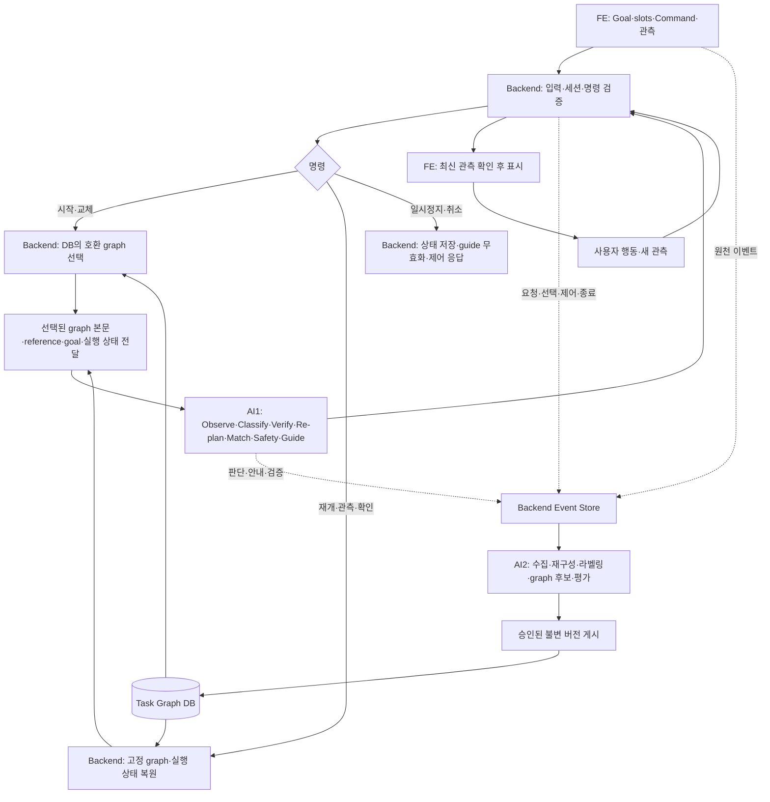

# Backend Task Graph 선택과 AI-Agent(1) 실행 전달 계약

## 1. 확정한 책임 경계

**Task Graph는 DB에 저장한다. Backend가 FE의 확정된 사용자 요구에 맞는 graph를 판단·선택해 AI-Agent(1)에 전달한다. AI-Agent(1)은 전달받은 graph에 따라 화면을 판단하고 Guide/Action → Verification → Re-plan을 수행한다.**

| 주체 | 책임 |
| --- | --- |
| FE | Goal Type·slots·Command Type 확정, 모호성 질문, 화면·사용자 행동 수집, 안내 렌더링 |
| Backend | FE 계약·인증·세션 검증, DB graph 조회·선택·버전 고정·복원, 실행 입력 조립, 제어 상태와 결과 저장 |
| AI-Agent(1) | 전달된 graph와 실행 입력의 정합성 검사, 현재 state 판단, transition/target 선택, Guide/Action, 결과 검증, graph 내부 Re-plan |
| AI-Agent(2) | runtime 데이터 수집·재구성·라벨링, Task Graph 추가·업데이트 후보 및 평가, 승인된 새 버전의 DB 반영 workflow |

FE 분류 계약은 [FE Goal·Command 계약](./fe-goal-command-contract.md), runtime 실행은 [AI-Agent(1)](./ai-agent-1-runtime.md), graph 개선은 [AI-Agent(2)](./ai-agent-2-graph-proposal.md)가 기준이다. 이 문서는 **Backend → AI1의 내부 실행 경계**를 정의한다. FE의 typed 요청을 그대로 AI1 입력으로 사용하는 계약과 구분한다.

역할과 DB 저장은 확정한 설계 전제다. 2026-09-19 기준 승인 graph release 테이블·selector·episode reference 고정과 typed runtime 주입 경로가 구현됐다. `runtime/tasks`는 MVP seed/fixture와 legacy 경로에 남아 있으며, 신규 typed 경로의 선택 기준은 DB release다.

## 2. 선택·실행·업데이트 흐름

AI1의 완료 응답은 실제 목표 완료 근거를 확인한 결과다. 다음 state를 선택하거나 guide를 발행했다는 이유로 완료를 선언하지 않는다. AI2 분석은 사용자 응답의 동기 호출 경로에 넣지 않는다.

## 3. Backend의 graph 선택 기준

1. FE가 전달한 계약 버전, canonical `goal_type`, `target_app`, 필수 slots와 허용값을 검증한다. 자연어를 재분류하거나 가까운 다른 Goal로 바꾸지 않는다.
2. `start_task`/`replace_task` 또는 5절의 명시적인 재선택 절차에서만 새 graph를 선택한다. `pause_task`/`cancel_task`는 graph 선택·화면 해석 없이 처리한다.
3. DB에서 해당 Goal에 연결된 승인·활성 graph 후보를 찾는다. 앱/OS/locale, runtime schema, FE 실행 capability 등 실행 조건으로 후보를 좁힌다.
4. 여러 variant가 있으면 명시적 우선순위를 적용한다. 조건·우선순위가 같아 결정할 수 없으면 모호성을 반환하고 실행하지 않는다.
5. 승인된 template라면 검증된 slots로 parameter를 확정한다. 새로운 state/transition이나 허용되지 않은 action을 생성하지 않는다.
6. 선택한 `task_id`, `graph_id`, version/hash, 검증된 goal과 parameters를 episode에 고정한다. 선택 근거는 Backend 이벤트로 남긴다.
7. graph 본문과 현재 실행 상태를 AI1에 전달한다. FE가 보낸 임의 graph ID를 신뢰하거나 AI1에게 검색을 위임하지 않는다.

현재 실행 매핑은 확대 Goal + `direction=increase` → `MVP-01`, 축소 Goal + `direction=decrease` → `MVP-02`다. 그래프 정의는 Backend의 `app/task_graphs/`에서 관리하고, DB 본문을 역직렬화해 AI1에 주입한다. 나머지 Android 설정 87개 Goal의 초안은 비승인·비활성 상태로 등록한다. 실제 graph variant와 version은 DB가 관리하는 reference로 결정한다. FE catalog version과 graph version, 세션의 낙관적 잠금 version은 서로 다르다. [현재 구현과 초안 검증 절차](./backend-owned-task-graphs.md)를 참고한다.

`resume_task`/`observe`/`respond_confirmation`은 FE 요청에 새 goal이 없어도 Backend가 저장된 목표·graph·checkpoint를 복원해 AI1 입력을 완성한다. 재개에는 새 관측을 요구하며 이전 좌표를 그대로 재출력하지 않는다. `replace_task`는 새 선택과 검증이 성공했을 때만 기존 episode를 교체한다.

## 4. Backend → AI1 실행 입력

기본 전달 방식은 **완전한 선언적 graph 본문을 함께 주입**하는 것이다. 같은 프로세스라면 타입이 있는 객체로 전달할 수 있으며 별도 HTTP 서버가 필수는 아니다. ID만 전달해 AI1이 DB를 검색하게 하지 않는다.

| 필드 | 의미와 조건 |
| --- | --- |
| `runtime_contract_version` | Backend/AI1 내부 DTO의 schema version. FE 계약 version과 별개 |
| `request_id`, `session_id`, `episode_id`, `session_version` | Backend가 검증·복원한 이번 실행 식별자와 상태 version |
| `command_type` | Backend가 허용한 실행 명령. pause/cancel은 Backend 제어 경로에서 처리 |
| `goal` | FE에서 확정하고 Backend가 검증한 goal type, target app, catalog version, slots. 후속 실행에서도 복원해 전달 |
| `graph_ref` | `graph_id`, `task_id`, `graph_version`, `graph_hash`, `graph_schema_version`. Backend가 DB에서 결정 |
| `task_graph` | 선택된 graph의 완전한 definition, states, transitions, selector, 안전·완료·복구 정책. reference와 내용이 일치해야 함 |
| `resolved_parameters` | Backend가 확정한 template parameter. 필요한 경우에만 사용하며 graph의 허용 schema와 일치 |
| `execution_state` | 신규 실행은 초기 상태, 후속은 current state·pending step·이전 관측 기준·시도 이력 등 복원한 상태 |
| `observation` | observation ID·capture time·좌표계·화면 크기·package/window와 tree 또는 사용 가능한 동의된 Vision 입력 |
| `user_action_event`, `confirmation_context` | 발생한 행동 및 Backend가 검증한 승인 범위. 해당하는 경우에만 전달 |
| `device_context`, `capabilities` | 호환성 판단에 사용한 환경과 허용된 FE 행동 capability |

hash는 schema가 정한 canonical graph 내용으로 검증한다. parameter는 허용된 binding으로 별도 관리하고 episode에 고정한다. graph를 구체화해 본문 자체를 바꾸는 방식이라면 실제 전달 본문에 대한 hash도 일치시켜야 한다. 원문 Goal은 실행 선택의 필수 입력이 아니다.

AI1의 입력 검사는 **선택을 다시 하는 것**이 아니다. 전달 graph의 schema/reference/hash, goal·parameter 적합성, checkpoint의 graph 일치, 지원 action과 관측 최신성을 검사한다. 오류를 원문 재분류나 임의 graph 대체로 보정하지 않는다.

## 5. AI1의 출력과 Re-plan 범위

| 출력 | 용도 |
| --- | --- |
| 실행 결과 | current state, guide/action, target, 온라인 verification, pending step, 갱신할 실행 상태 |
| 근거 | 사용한 observation/step/graph reference, target 선택 근거, 완료·실패·불확실성 판단 |
| 복구 요청 | fresh observation, 사용자 추가 확인, 또는 Backend graph 재선택 요청과 사유 |

AI1은 **전달받은 graph 내부**에서 현재 위치 재판정, 다른 UI 후보, 대체 transition, 명시된 복구 경로, 허용된 탐색을 선택한다. DB의 graph 정의를 수정하거나, 다른 Task Graph를 직접 검색하거나, graph에 없는 경로를 임의 생성해 실행하지 않는다.

graph에 맞는 상태·경로가 없으면 먼저 일시적인 관측 부족과 graph 부적합을 구분한다. 전자는 재관측하고 후자는 `GRAPH_RESELECTION_REQUIRED` 등의 구조화된 사유를 Backend에 반환한다. 이는 제안 응답이며 현재 공개 `task_status` enum에 추가된 상태가 아니다.

Backend는 같은 확정 Goal에 대해 호환 graph가 있는지 판단한다. 교체가 필요하면 기존 pending guide/confirmation을 무효화하고 명시적인 실행 재시작/새 episode로 처리한다. 기존 step을 새 graph에 조용히 이어 붙이지 않는다. 대안이 없으면 지원 불가 또는 데이터 수집 필요 결과로 종료한다. 현재 화면이 예상과 다르다는 이유만으로 사용자 목표를 바꾸지 않는다.

## 6. DB 저장·AI2 업데이트·버전 관리

DB는 실행 가능한 graph 내용과 선택 metadata의 기준 저장소다. 저장해야 할 개념은 graph ID/task/goal 연결, 불변 version/hash와 선언적 본문, 승인/활성 상태, 환경·capability 조건, 선택 우선순위, template parameter schema, release/evaluation reference다. 실제 테이블명과 migration은 별도 구현 계약으로 확정한다.

AI2는 `실행 데이터 수집 → episode 재구성 → 근거 기반 success/fail/unknown 등 라벨 → 변경 후보 → 독립 평가 → 승인 정책 → 새 graph 버전 DB 반영`을 담당한다. 운영 중 graph 행의 내용을 덮어쓰기보다 새 불변 버전을 게시하고 활성 선택 대상을 갱신한다. Backend가 이후 새 실행에 반영한다.

진행 중 episode는 고정한 버전을 계속 사용한다. rollback은 새 선택의 대상 버전을 돌리는 작업이며, 위험 버전의 기존 세션은 별도 revoke/중단 정책으로 다룬다. AI2는 사용자 세션 상태나 guide를 직접 변경하지 않는다. 원천 화면·행동은 FE, 요청·선택·제어는 Backend, 판단·안내·검증은 AI1이 생산하고 AI2가 이 이벤트를 수집한다.

최근 추가된 `graph_proposals`·`evaluation_reports` 저장 모델은 AI2의 후보/평가 저장이며, 실행 graph의 DB 선택·주입이 연결됐다는 뜻은 아니다. [AI2 저장 구조](./ai-agent-2-graph-proposal.md#14-저장-구조와-job-운영)를 함께 본다.

## 7. 구현 전환과 인수 기준

1. FE typed 계약, Backend 선택 DTO, AI1 실행 DTO를 분리해 계약 fixture를 맞춘다.
2. Backend에 DB graph repository/selector와 episode별 reference 저장·복원을 연결한다.
3. AI1의 `type_goal()` 및 task/goal 기반 registry 선택 호출을 제거하고 주입 graph를 실행한다. 기존 Python/JSON graph는 seed·fixture로 이관한다.
4. Backend adapter/checkpoint/progress 계산이 주입된 graph와 확정된 parameter를 사용하도록 맞춘다.
5. AI2의 승인된 새 graph를 DB에 게시하고 Backend가 새 episode에 선택하는 경로를 검증한다.

| 검증 | 기대 결과 |
| --- | --- |
| 같은 canonical Goal, 다른 원문 | Backend 선택 결과가 같고 AI1은 원문을 분류하지 않음 |
| graph 미등록·비호환·동점 | Backend가 명시적으로 거절, AI1 호출 없음 |
| 전달 graph 본문/reference 불일치 | AI1이 실행 거절, 다른 graph로 대체하지 않음 |
| 후속 FE 요청에 goal 없음 | Backend가 고정 goal·graph·실행 상태를 복원해 AI1에 전달 |
| graph 내 대체 transition 존재 | AI1이 세션 내부 Re-plan 수행, DB 정의 변경 없음 |
| graph 밖 경로 필요 | AI1이 이유를 Backend에 반환, 재선택/재시작 또는 지원 불가 |
| AI2가 새 version 게시 | 새 episode만 Backend 선택 정책에 따라 반영, 기존 episode는 고정 version 유지 |
| AI2 분석 중단 | Backend가 사용 가능한 승인 graph로 AI1 실행 지속 |

평가 지표도 소유권에 맞춘다. FE는 Goal/Command 분류, Backend는 graph 선택 정확도·호환성·세션 제어·DB 조회, AI1은 state/target/검증 정확도·false DONE·복구 품질, AI2는 라벨·graph 변경의 개선과 회귀를 측정한다.
