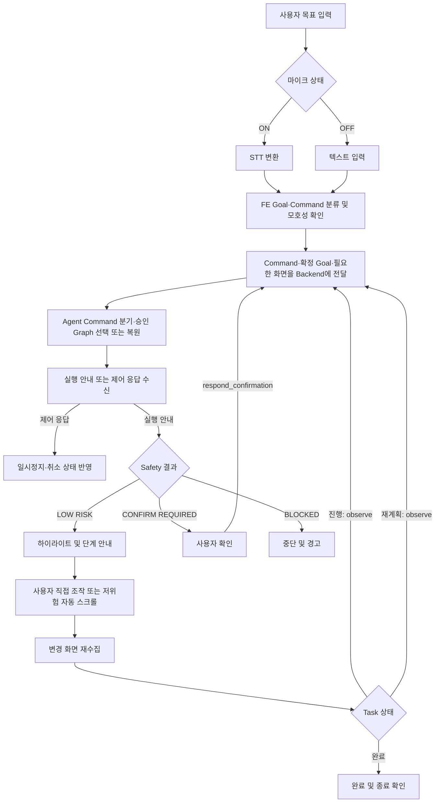

# Frontend 전체 구조

## 1. 문서 목적

이 문서는 Click Android Frontend의 화면 구조, 핵심 서비스, 데이터 흐름과 모듈별 책임을 정의한다. Frontend는 Click 앱 내부 화면과 다른 앱 위에서 동작하는 Agent Overlay를 제공하며, Accessibility Tree 수집, 사용자 안내, 음성 입출력, Backend 연동을 담당한다.

AI Agent의 판단 파이프라인과 Task별 State/Transition은 별도 문서에서 관리한다.

- FE Goal·Command 정의와 전달: [입력 계약](./fe-goal-command-contract.md)
- Agent 구조: [AI Agent 전체 구조](./ai-agent-architecture.md)
- Task 상세: [Android 설정 앱에서 글자 크기 확대](./tasks/font-size-increase.md)

## 2. Frontend 목표

- 사용자가 음성 또는 텍스트로 목표를 입력할 수 있게 한다.
- 음성 입력을 STT 모델로 Raw 텍스트로 변환하고, Agent 안내 문장을 TTS 모델로 출력한다.
- 현재 화면의 Accessibility Tree를 수집해 Backend에 전달한다.
- Agent가 선택한 UI 요소를 화면 위에서 명확하게 강조한다.
- 한 번에 하나의 행동을 텍스트 또는 음성으로 안내한다.
- 사용자 행동 후 변경된 화면 정보를 다시 전달한다.
- 위험하거나 민감한 화면에서는 안내를 제한하고 사용자에게 알린다.
- 앱 내부에서 권한, 온보딩, 기록, 설정을 관리한다.

MVP에서는 사용자가 직접 화면을 조작하는 Human-in-the-loop 방식을 기본으로 한다. 결제, 송금, 인증번호 입력 등 고위험 행동은 자동 수행하지 않는다.

Frontend의 STT·TTS는 음성과 텍스트 사이의 형식 변환을 담당한다. 그 뒤 FE 입력 해석 계층이 Goal Type·slots와 실행 제어용 Command Type을 확정한다. AI-Agent(1)은 전달값을 검증하고 승인 Task Graph를 선택하는 단계부터 담당한다. 이 책임 변경은 설계에 반영했으며 현재 raw-goal API·DTO의 구현 전환은 남아 있다.

## 3. Information Architecture

Frontend UI는 앱 외부의 `Agent Overlay`와 앱 내부의 `Click App`으로 구분한다.

### 3.1 앱 외부 — Agent Overlay

```text
Agent Overlay
├─ 진입 및 상태
│  ├─ Agent 호출 아이콘
│  ├─ 마이크 on/off 표시
│  └─ 드래그 종료 영역
├─ 목표 입력
│  ├─ 텍스트 입력
│  ├─ 음성 입력(STT)
│  └─ 모호한 요청 재확인
├─ 화면 안내
│  ├─ 대상 UI 하이라이트
│  ├─ 텍스트 말풍선 또는 TTS 안내
│  ├─ 진행 단계 표시
│  └─ 재계획 상태 표시
├─ 확인 및 경고
│  ├─ 행동 결과 사전 설명
│  ├─ 위험 행동 확인
│  └─ 민감 화면 중단 안내
├─ 오류
│  ├─ 대상 UI 탐색 실패
│  ├─ 지원 불가 화면
│  ├─ Agent 응답 실패
│  └─ 네트워크 연결 실패
└─ 완료 및 종료
   ├─ Task 완료 안내
   └─ Agent 종료 확인
```

### 3.2 앱 내부 — Click App

```text
Click App
├─ 인증
│  ├─ 회원가입
│  └─ 로그인
├─ 권한 설정
│  ├─ 오버레이 표시 권한
│  ├─ 접근성 권한
│  └─ 마이크 권한
├─ 온보딩
│  ├─ 서비스 소개
│  ├─ 아이콘 탭·드래그 안내
│  └─ 첫 사용 가이드
├─ 홈
│  ├─ Agent 상태
│  ├─ 바로가기
│  └─ 최근 이용 요약
├─ 설정
│  ├─ 안내 상세도
│  ├─ 권한 관리
│  └─ 계정 관리
├─ 이용 기록
│  ├─ 완료 Task 목록
│  └─ Task 상세
└─ 피드백 및 문의
```

## 4. 핵심 인터랙션

### 4.1 Agent 아이콘

| 입력 | 동작 |
| --- | --- |
| 탭 | 마이크 on/off 전환 |
| 드래그 | 종료 영역을 표시하고, 드롭 시 Agent 종료 |
| "클릭 꺼져" 음성 명령 | 마이크가 켜진 상태에서 Agent 종료 |

드래그 외에 별도 종료 버튼을 제공할지는 접근성 검토 후 확정한다.

### 4.2 안내 출력 모드

안내 출력은 별도 음성 안내 설정이 아니라 현재 마이크 상태를 따른다.

| 마이크 상태 | 입력 | 안내 및 질문 |
| --- | --- | --- |
| `OFF` | 텍스트 입력 | 텍스트 말풍선 |
| `ON` | STT 음성 입력 | TTS 음성 출력 및 음성 응답 수신 |

시각적 하이라이트와 진행 상태는 두 모드에서 공통으로 표시한다.

### 4.3 Task 종료

1. Agent가 완료 상태를 전달한다.
2. Frontend가 완료 메시지와 "Click을 종료할까요?" 질문을 출력한다.
3. 사용자의 응답에 따라 Agent를 종료하거나 대기 상태로 유지한다.

### 4.4 자동 조작 범위

- 자동 탭은 제공하지 않으며 사용자가 직접 수행한다.
- Target UI 탐색에 필요한 저위험 스크롤만 자동으로 수행할 수 있다.
- 자동 스크롤은 AI-Agent의 `LOW_RISK` 판정과 Scroll Command가 있을 때만 실행한다.
- 스크롤 중에는 자동 조작 상태를 시각적으로 표시한다.
- 민감 화면 또는 사용자의 확인이 필요한 상태에서는 자동 스크롤을 중단한다.

## 5. 전체 런타임 흐름



## 6. 계층 및 폴더 구조

```text
Frontend/
├─ app/
│  └─ src/
│     ├─ main/
│     │  ├─ java/com/click/
│     │  │  ├─ core/
│     │  │  │  ├─ permission/       # 권한 확인 및 요청
│     │  │  │  └─ error/            # 공통 오류 모델과 처리
│     │  │  ├─ data/
│     │  │  │  ├─ remote/           # Backend API와 네트워크 DTO
│     │  │  │  └─ repository/       # Repository 구현
│     │  │  ├─ domain/
│     │  │  │  ├─ model/            # Goal, Guide, Screen, Task 모델
│     │  │  │  ├─ repository/       # 데이터 접근 계약
│     │  │  │  └─ usecase/          # 화면별 독립 비즈니스 동작
│     │  │  ├─ service/
│     │  │  │  ├─ accessibility/    # UI Tree 수집과 화면 변경 감지
│     │  │  │  ├─ overlay/          # 시스템 Overlay 생명주기와 좌표 처리
│     │  │  │  └─ speech/           # STT·TTS 세션과 상태 관리
│     │  │  ├─ ui/
│     │  │  │  ├─ auth/             # 로그인과 회원가입
│     │  │  │  ├─ onboarding/       # 권한 설정과 튜토리얼
│     │  │  │  ├─ home/             # 홈과 Agent 상태
│     │  │  │  ├─ history/          # 이용 기록
│     │  │  │  ├─ settings/         # 안내, 권한, 계정 설정
│     │  │  │  ├─ feedback/         # 피드백과 문의
│     │  │  │  ├─ overlay/          # 아이콘, 입력, 안내, 경고 UI
│     │  │  │  └─ common/           # 공통 컴포넌트와 테마
│     │  │  └─ util/                # 공통 확장과 도우미
│     │  ├─ res/                     # Android UI 리소스
│     │  └─ assets/                  # 로컬 정적 자산
│     ├─ test/                       # 단위 테스트
│     └─ androidTest/                # 기기 통합 및 UI 테스트
└─ docs/                             # Frontend 구현 상세 문서
```

## 7. 모듈별 책임

### 7.1 Core

- 오버레이, 접근성, 마이크 권한 상태 확인
- 권한 거부 및 재요청 흐름 관리
- 공통 오류 타입과 사용자 노출 메시지 정의

### 7.2 Data

- Backend API 요청·응답 변환
- 확정 Goal·Command, 화면 정보, 사용자 응답 전송
- 안내 결과와 Task 상태 수신
- 네트워크 오류 및 재시도 처리

### 7.3 Domain

- UI 계층이 사용하는 모델과 Repository 계약 정의
- Agent 시작, 화면 관찰, 안내 표시, 종료 등 Use Case 분리
- Android 프레임워크 세부 구현과 화면 상태의 결합 최소화

### 7.4 Accessibility Service

- 현재 앱의 package와 Accessibility Node 정보 수집
- 화면 변경 이벤트 감지
- 원본 속성을 유지한 채 수집 데이터를 전송 가능한 Screen Snapshot으로 직렬화
- 비밀번호, 인증번호 등 민감 Node 감지 시 수집·전송 제한
- AI-Agent의 `LOW_RISK` Scroll Command에 한해 Accessibility scroll action 실행

주요 수집 필드는 Agent 문서의 Accessibility Tree Parser 계약을 따른다. label 병합, role 추론, semantic tag 생성 등 의미 기반 정규화는 AI-Agent가 담당한다.

### 7.5 Overlay Service

- Agent 아이콘과 Overlay의 생성, 위치, 생명주기 관리
- Agent 아이콘 탭 및 드래그 처리
- Agent가 전달한 bounds에 맞춰 Target UI 강조
- 안내, 확인, 오류, 진행 상태를 다른 앱 위에 표시
- 저위험 자동 스크롤 상태 표시
- Tap Command는 자동 실행하지 않고 사용자가 직접 탭하도록 안내

### 7.6 Speech Service

- 마이크 세션 시작과 종료
- STT 모델로 음성을 텍스트로 변환해 FE 입력 해석 계층으로 전달
- AI-Agent가 생성한 안내 문장과 질문을 TTS 모델로 음성 변환 및 재생
- 음성 명령에 의한 Agent 종료 처리
- 녹음, 변환, 재생, 실패 상태를 UI에 노출
- Speech Service 자체는 형식 변환만 담당; Goal/Command 분류는 FE 입력 해석 계층, Task Graph 선택은 AI-Agent(1) 담당

### 7.6.1 FE 입력 해석 계층

- 새 작업·일시정지·재개·취소·교체·확인 응답을 Command Type으로 구분
- 공유 catalog로 Goal Type·target app·필수 slots 확정
- 모호한 목적·부정·명령 의미를 사용자에게 확인
- FE 분류 metadata와 실제 서버 지원 가능 여부 구분
- [FE Goal·Command 계약](./fe-goal-command-contract.md)의 enum·필드·JSON 예시로 직렬화

### 7.7 UI Features

- 앱 내부 인증, 권한, 온보딩, 홈, 기록, 설정, 피드백 화면 제공
- 앱 외부 Overlay의 입력, 안내, 경고, 오류, 완료 상태 표시
- 화면 상태는 Domain Use Case를 통해 변경하고 Data 구현에 직접 의존하지 않음

## 8. Frontend 데이터 계약

### 8.1 Screen Snapshot

```json
{
  "package_name": "com.android.settings",
  "captured_at": "2026-08-25T07:00:00Z",
  "screen_width": 1080,
  "screen_height": 2400,
  "nodes": [
    {
      "node_id": "node_12",
      "text": "디스플레이",
      "content_description": null,
      "resource_id": "android:id/title",
      "class_name": "android.widget.TextView",
      "bounds": [24, 320, 1056, 408],
      "clickable": true,
      "enabled": true,
      "selected": false,
      "scrollable": false,
      "checkable": false
    }
  ]
}
```

### 8.2 Guide Command

```json
{
  "task_id": "MVP-01",
  "step": 2,
  "total_steps": 4,
  "message": "디스플레이를 눌러주세요.",
  "target_node_id": "node_12",
  "target_bounds": [24, 320, 1056, 408],
  "safety_level": "LOW_RISK",
  "task_status": "IN_PROGRESS"
}
```

Backend와 필드명, 좌표계, 이벤트 전송 주기, 재시도 정책은 API 명세 확정 시 동기화한다.

## 9. 상태 및 오류 처리

| 상태 | Frontend 처리 |
| --- | --- |
| 권한 없음 | 필요한 권한과 이유를 설명하고 설정 화면으로 안내 |
| 목표 입력 대기 | 마이크 상태에 맞는 입력 UI 표시 |
| Agent 처리 중 | 중복 입력을 막고 진행 인디케이터 표시 |
| 안내 가능 | 대상 bounds 하이라이트와 한 단계 안내 출력 |
| 사용자 확인 필요 | 결과와 위험도를 먼저 설명하고 명시적 응답 수집 |
| 차단 | 자동 진행을 멈추고 사용자가 직접 수행하도록 안내 |
| 대상 UI 없음 | 화면을 다시 수집하고 실패 시 재시도 안내 |
| 네트워크 오류 | 재시도 동작과 연결 상태 표시 |
| 완료 | 완료 메시지와 종료 여부 확인 |

Overlay와 Speech는 별도 상태를 갖더라도 하나의 Agent Session 상태를 기준으로 동기화한다.

## 10. 개인정보 및 접근성 원칙

- 비밀번호, 인증번호, 결제 정보가 포함된 화면은 자동 진행하지 않는다.
- 외부 전송 데이터는 Backend와 합의한 책임 범위에 따라 마스킹한다.
- Vision fallback이 필요한 경우 화면 이미지 사용 전 사용자 동의를 받는다.
- 마이크 사용 여부와 녹음 상태를 항상 시각적으로 표시한다.
- 색상만으로 상태를 구분하지 않고 텍스트 또는 아이콘을 함께 제공한다.
- 하이라이트는 실제 Target bounds와 정렬하고 시스템 제스처 영역을 가리지 않는다.
- 안내는 한 번에 한 행동만 제시하고 TTS 중단·재생 제어를 제공한다.

## 11. 테스트 범위

- 아이콘 탭, 드래그, 종료 영역 동작
- 마이크 상태에 따른 텍스트/STT 입력 전환
- 텍스트/TTS 출력 모드 전환
- Accessibility Tree 수집과 좌표 변환
- Target bounds와 하이라이트 정렬
- 권한 허용, 거부, 영구 거부 흐름
- 화면 변경 후 Snapshot 재전송
- 저위험 Scroll Command 실행과 자동 스크롤 상태 표시
- Tap Action이 자동 실행되지 않는지 검증
- 네트워크 실패와 Agent 재계획 표시
- 위험 및 민감 화면에서 중단 처리
- Task 완료 후 종료 또는 대기 분기
- 화면 크기, 글자 크기, 제조사별 Android 환경 대응

## 12. 확정 필요 사항

- 드래그 종료 외 별도 종료 버튼 제공 여부
- Android UI 기술 스택과 최소 지원 버전
- STT·TTS API 또는 온디바이스 모델
- Vision fallback 동의 UI
- Frontend와 Backend 사이 개인정보 마스킹 책임
- Backend API 스키마와 실시간 통신 방식
