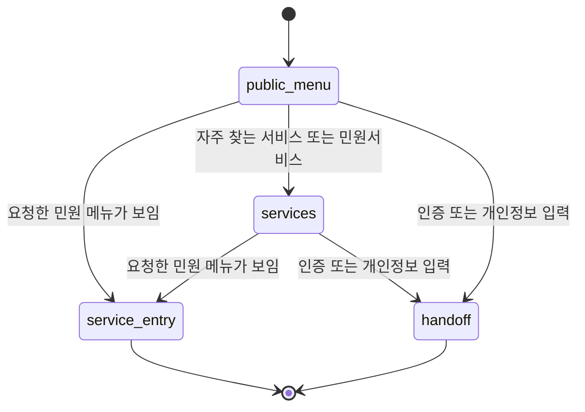

# 정부24 기본 작업 그래프 6개

기본 그래프는 실제 성공 기록이 없어도 첫 요청부터 공개 메뉴의 다음 위치를 안내한다.
실제로 연결된 이동이 누적되면 기존 AI-Agent2 작업자가 경로를 생성하고 성과 기준으로 개선 후보를 고른다.

정의: `AI-Agent/goal_catalog/gov24_task_graphs.json`
검사·실행: `Backend/app/task_graphs/gov24.py`, `Backend/app/services/gov24_navigation.py`
공유 메뉴 표현: `AI-Agent/goal_catalog/gov24_login_policy.json`

| 목표 | 기본 그래프 |
| --- | --- |
| 주민등록등본 | `GOV24-BASE-RESIDENT-COPY` |
| 주민등록초본 | `GOV24-BASE-RESIDENT-EXTRACT` |
| 건축물대장 | `GOV24-BASE-BUILDING-REGISTER` |
| 토지·임야대장 | `GOV24-BASE-LAND-REGISTER` |
| 전입신고 | `GOV24-BASE-MOVE-IN` |
| 자동차등록원부 | `GOV24-BASE-VEHICLE-REGISTER` |

## 기본 상태와 전이

각 메뉴는 현재 AX 화면의 고유한 실제 클릭 영역과 연결될 때만 후보가 된다.
직접 대상 메뉴를 우선하고, 화면에 없을 때 공개 서비스 목록을 안내한다.
서비스 목록에서 대상이 보이지 않으면 화면 이동·스크롤을 요청한다. 임의 좌표나 확인하지 않은 검색·입력은 만들지 않는다.

완료는 해당 민원의 독립적인 제목과 신청/발급 진입 버튼이 함께 관측된 경우다.
등본·초본은 정부24의 공통 등·초본 안내 화면도 허용한다. 다른 민원의 제목이나 발급 버튼만으로 완료하지 않는다.
실제 신청서 작성·인증·민원 제출을 완료했다고 표시하지 않는다.

## 앱과 서버 연결

기존 카탈로그 전용이던 초본·건축물대장·토지대장·전입신고·자동차등록원부를 `public_guide`로 연결했다.
`public_graph_id`가 실제 기본 그래프를 가리키며, Android 설정용 native task graph로 잘못 등록하지 않는다.
구버전 v3 앱의 `gov24_civil`은 기존 등본 안내만 지원한다. 새 앱의 `gov24_services` 선언이 있을 때 6개 안내를 제공한다.
요청·준비·세션 복원·공개 화면 가이드가 모두 같은 목표 타입 집합을 사용한다.

정부24 홈에서 비어 있는 검수된 검색 필드는 공개 메뉴 탐색을 막지 않는다.
브랜드와 서비스 문맥을 확인하며, 채워진 검색어·다른 입력 필드·인증 화면은 계속 비공개로 처리한다.
메뉴 이름이 실제 부모 버튼에 들어 있으면 그 버튼 ID·영역으로 연결한다. 제목을 서비스 완료 표식으로 오인하지 않는다.

진단 자료에는 `stage=gov24_baseline`, `baseline_graph_id`, `graph_state`, `target_present`가 남는다.
상태는 `public_menu → services → service_entry`로 확인할 수 있다.

## 배포·검증

진단 v4: `versionCode=4`, `versionName=1.0.3`, compile/target SDK 36.
v3는 이 6개 메뉴와 검색창 처리를 포함하지 않으므로 서버 변경과 v4 앱 업데이트가 함께 필요하다.
기존 업로드 키로 미서명 AAB를 서명하고 같은 내부 테스트 트랙에 게시한다.
새 버전에서는 최신 develop의 설명형 튜토리얼·접근성 복귀 개선도 유지한다.

자동 검증은 6개 직접 진입·서비스 목록 경유·잘못된 목적지 제외·학습 연결·구버전 앱 안내와
Android 메뉴 필터·검색창 경계·부모 버튼 연결·세션 복원을 다룬다.
현재 연결된 기기가 없어 6개 민원의 실제 정부24 화면을 모두 확인한 상태는 아니다.
그래프 정의의 `device_validation=NOT_ASSESSED`를 유지하며, 새 앱의 진단 자료로 실기기 도달 여부를 확인해야 한다.
