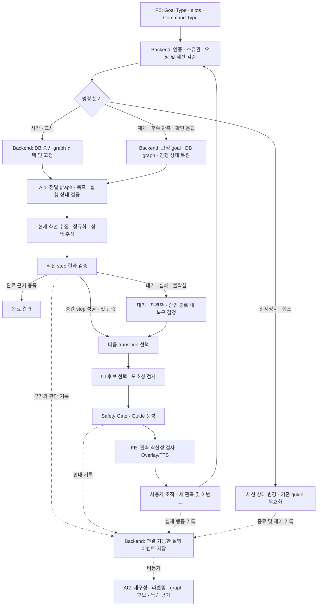

# AI-Agent(1) 흐름 및 두 에이전트 책임 검토

> 이 문서는 수정 전 감사 기록이다. 2026-09-12 후속 수정·현재 제한·회귀 테스트는 [AI1 실행 정책](../ai-agent-1-runtime-policy.md)에 정리했다. 아래 재현 스크립트는 수정 전 결함을 기대하므로 현재 통과 기준으로 실행하지 않는다.

검토 기준: 2026-09-12, 커밋 `565c11f85bc56ccffe7f6e3efbf4287b556e602b`. 문서의 목표 설계, 현재 구현, 재현한 동작을 구분한다. 이 문서는 구현을 수정한 결과가 아니라 코드 리뷰와 개선 제안이다. 후속 회의에서 **DB Task Graph 선택은 Backend, 전달 graph 실행은 AI1**으로 확정했으므로 아래 목표 흐름·책임·개선 제안에 반영했다. 재현 결과와 코드 비판은 명시한 기준 커밋의 기록이다.

**판정: 온라인 실행과 오프라인 graph 개선의 분리는 타당하다. 현재 우선 과제는 완료 판정의 정확성, FE/Backend 계약 연결, 관측과 행동의 연결이다.** AI-Agent(1)의 현재 실행 범위는 `settings.font_size.increase` → `MVP-01` 하나다. 여러 모듈이 있는 것과 여러 독립적인 추론 에이전트가 동작하는 것은 구분해야 한다. 현재는 승인 graph를 사용하는 상태 유지형 실행 workflow로 설명하는 것이 정확하다. [현재 graph registry][registry]

검토 방법과 한계:

- 기존 Python 테스트: AI-Agent 54개, Backend 94개 통과. 이 수치는 실제 사용자 작업 성공률이 아니다.
- [재현 스크립트](./evidence/agent_review_repros.py)와 [관측 결과](./evidence/agent_review_repros.json)에 R1~R8의 입력 조건과 결과를 남겼다. 스크립트의 assert는 당시 결함이 존재함을 확인하는 용도이며, 수정 후 통과해야 하는 회귀 테스트가 아니다.
- 재현은 인공 Accessibility snapshot, 명시적인 keyword scorer, 메모리 SQLite, FastAPI TestClient를 사용한다. R7은 인증·checkpoint·출력 검증을 포함한 HTTP 애플리케이션 경로다. 외부 서비스나 실제 Android 기기를 호출한 결과는 아니다.
- Android 기기별 발생 빈도, 지연시간, OCR/VLM 성능, 실제 사용자 성공률은 이번 검토에서 측정하지 않았다. 정적 코드 위험을 실기기 장애 발생 사실로 확대하지 않는다.

## 1. 합의한 AI-Agent(1)의 흐름

FE가 Goal Type과 Command Type을 확정하고 Backend가 DB에서 Task Graph를 선택·복원해 전달한다. AI-Agent(1)은 전달된 graph·목표·실행 상태를 검증하고 현재 화면의 실행 판단부터 담당한다. 원문을 다시 Goal Typing하는 책임은 없다. 이는 현재 문서의 합의이며, 코드 전환은 남아 있다. [FE 계약](../fe-goal-command-contract.md), [runtime 문서](../ai-agent-1-runtime.md)

위 그림은 책임과 순서를 요약한다. 대기·재관측 결정에서는 새 target 안내 없이 반환할 수 있다. 일시정지/취소는 화면 분석과 graph 재선택을 요구하지 않는다. 재개 시에는 새 화면을 확인해야 하며 이전 좌표를 그대로 재사용하지 않는다.

현재 `engine.handle_turn()`은 `raw_goal → type_goal → graph lookup → Normalize → Classify → 이전 transition 검증 → 실패 횟수/제외 후보 갱신 → Re-plan → Match → 필요 시 Vision 재시도 → Guide → Session/Trace` 순서다. **직전 guide를 이번 관측으로 검증하고, 이번 guide는 다음 관측에서 검증한다.** 같은 turn의 verification과 새 guide를 학습 정답 쌍으로 묶으면 안 된다. [engine][engine], [AI2의 연결 규칙](../ai-agent-2-graph-proposal.md)

## 2. 각 주체의 역할과 평가

| 주체 | 소유해야 하는 역할 | 현재 평가 |
| --- | --- | --- |
| FE 입력 처리 | Goal/Command 분류, slot 보완 질문, 사용자 확인 의사 전달 | 책임 이관은 문서에 반영됨. 현재 Java 요청 모델과 Python 엔진은 기존 raw goal 계약을 사용한다. |
| FE 화면/실행 | 원본 UI 관측, 좌표 변환, 최신 화면에 guide 표시, 실제 행동 이벤트 수집 | 좌표 변환 개선은 타당하다. 응답의 최신성 검사 순서와 자체 탐색 로직은 정리가 필요하다. |
| Backend | DB graph 선택·전달·복원, 명령 제어, 인증·소유권·멱등성·세션·승인·이벤트 저장 | 요청/세션/승인 경계는 구현되어 있다. FE 연결과 AI2용 이벤트 저장은 별도 미완성 항목이다. |
| AI-Agent(1) | 전달 graph·목표·상태 검증, 현재 state/target 판단, 온라인 검증, graph 내부 복구 | 현재 한 개 task를 수행하는 모듈형 workflow다. 완료·실패 판정에서 재현 가능한 오류가 있다. |
| AI-Agent(2) | episode 재구성, 증거에 기반한 라벨 확정, dataset 및 graph 변경 후보, 독립 평가 | 책임 분리와 import 경계는 구현됨. 실제 데이터 처리·후보 생성·평가는 골격 수준이다. |
| graph 배포 주체 | 검증된 후보 승인, 버전 발행, 기존 세션 호환성, rollback | AI2의 후보 생성과 별도 권한이어야 한다. 현재 version manager는 실제 발행을 수행하지 않는다. |

AI1과 AI2를 분리하는 이유는 **판단의 시간 범위와 변경 권한**이다. AI1은 현재 사용자를 돕기 위해 승인된 경로 안에서 선택을 바꾼다. AI2는 여러 실행의 증거로 이후 세션에 적용할 변경을 제안한다. 이 분리가 곧 두 서비스 배포나 모든 모듈의 LLM agent화를 요구하지는 않는다. 절차가 명확한 작업에는 예측 가능한 workflow부터 사용하고 복잡성은 측정된 이득으로 정당화하라는 Anthropic의 설계 지침과도 일치한다. 이는 설계 지침이지 이 저장소의 성능을 입증하는 실험은 아니다. [Building effective agents](https://www.anthropic.com/engineering/building-effective-agents)

AI-Agent(1) 내부의 역할은 다음처럼 나누는 것이 적절하다.

| 모듈 | 입력 → 출력 | 객관적인 평가와 책임 경계 |
| --- | --- | --- |
| Runtime Input Validator / Graph Receiver | Backend graph·goal·상태 → 실행 입력 | AI1은 정합성만 검사한다. Goal/Command 검증·DB graph 선택은 Backend로 이관한다. |
| 전달 Graph / State Manager | 고정 graph + 관측·이력 → 가능한 transition | 전달 graph 내부 선택과 실행 상태를 관리한다. DB 검색이나 정의 수정은 수행하지 않는다. |
| Parser / Normalizer | 원본 tree → 의미·형태 속성이 보존된 nodes | 화면 사실을 보존해야 한다. label과 실제 조작 부모 연결은 적절하지만, 의미 추정과 원본 근거를 구분해야 한다. |
| State Classifier | nodes + graph + 이력 → 현재 state 후보 | 현재는 문자열 state만 반환한다. 판정 근거와 모호성을 전달할 계약이 필요하다. |
| Verifier | 직전 step + 전후 관측 → 성공/대기/실패/불확실 | 다음 계획보다 먼저 검증하는 순서는 맞다. 완료 판정이 task·target에 묶이지 않는 현재 구현은 최우선 결함이다. |
| State Manager / Replanner | 검증 결과 + 이력 → 유지/재관측/복구 경로 | 현재는 재시도 사유와 node 제외 중심이다. 불확실한 관측을 실패 시도로 집계하면 복구를 오히려 방해한다. |
| UI Matcher | 가능한 transition + 현재 nodes → target 후보와 근거 | 의미·role·맥락을 함께 확인해야 한다. 현재 slider 특례와 동점 처리가 잘못된 확신을 만든다. |
| Safety Gate / Guide | 선택된 행동 + 승인 상태 → 표시 가능한 command | Backend의 강제 검증은 유지해야 한다. 안내의 안전성 검사가 목표 달성의 정확성까지 보증하지는 않는다. |
| Trace Producer | 관측·결정·행동·검증 → 연결 가능한 events | 온라인 판단을 기록하는 역할이다. 학습용 정답 확정은 AI2에 둔다. 현재 diagnostics는 이 입력을 대체하지 못한다. |

Backend의 Typed Validator/Command Router/DB Graph Selector는 AI1 외부의 선택·제어 모듈이다. [선택·실행 전달 계약](../backend-task-graph-dispatch.md)을 따른다. 위 평가는 아래 코드 근거와 재현 결과에 연결된다. 각 모듈을 독립 LLM으로 만들 필요성은 현재 증거로 확인되지 않았다.

## 3. 우선순위별 비판

P0는 목표 정확성 또는 현재 기본 연동을 막는 문제, P1은 신뢰성 및 데이터 기반을 손상시키는 문제, P2는 확장 전에 해결할 구조적 제약으로 사용한다. 보안 취약점 등급이나 실제 발생 빈도 점수가 아니다.

### C1 · P0 · 완료 판정이 목표와 무관한 변화에도 성공한다

**재현:** 글자 크기 증가를 요청하고 `디스플레이` 제목과 `밝기` slider만 보냈다. 밝기 값이 3에서 4로 바뀌자 `S5_FONT_SIZE_CHANGED`, `SUCCESS`, `done`이 나왔다. 두 관측 모두 글자 크기 control은 없었고 사용자 행동 이벤트도 없었다. Backend 전체 경로에서도 HTTP 200, `task_status=COMPLETED`가 반환됐다. [R1·R7 결과](./evidence/agent_review_repros.json)

**원인:** `verify_transition()`은 pending transition 검사보다 먼저 모든 slider의 증가를 확인한다. `_slider_value_increased()`는 같은 node ID의 값이 증가했는지만 본다. task의 setting, 선택한 target, 요청 방향과 연결하지 않는다. engine은 이 SUCCESS의 expected state를 유효 state로 사용하며 adapter가 완료 응답으로 연결한다. [verification 17행·89행][verification], [engine의 state 대체][effective-state], [adapter 완료 조건][adapter-completion]

**수정 기준:** transition별 검증 조건을 두고, 목표 setting에 해당하는 target의 전후 값 및 신선한 관측을 확인해야 한다. 상대 목표인 “늘리기”에는 기준값이 필요하다. 처음부터 만족한 절대 목표는 별도 사전 판정으로 다룰 수 있지만, 확인되지 않은 행동이 성공했다고 기록해서는 안 된다. 완료 근거가 부족하면 `UNKNOWN` 또는 재관측으로 남긴다.

AndroidWorld는 task 성공 보상을 실제 시스템 상태에서 계산한다. 이를 우리 설계에 적용하면 “안내한 화면처럼 보이는가”와 “요청한 setting이 실제로 바뀌었는가”를 분리해야 한다는 평가 기준이 된다. 이 benchmark가 우리 코드의 오류를 증명하는 것은 아니며, 위 재현이 직접 근거다. [AndroidWorld 공식 연구 페이지](https://google-research.github.io/android_world/)

### C2 · P0 · FE → Backend → AI1 계약 전환이 끝나지 않았다

**확인:** 신규 typed payload를 현재 HTTP 모델에 넣으면 `contract_version`, `command_type`, `goal`이 `extra_forbidden`으로 거절된다. 현재 engine에는 `type_goal()` 호출이 남아 있다. 이는 문서에 명시된 전환 과제이므로 문서가 적용 완료를 주장한다고 비판하는 것은 부정확하다. [R6 결과](./evidence/agent_review_repros.json), [HTTP 모델][http-request], [Goal 처리][goal-resolve]

그와 별개로 현재 Java gateway에는 `Authorization` 헤더가 없고, 요청 DTO에는 `expected_version`과 `confirmation_id`가 없다. Backend는 인증을 요구하고 첫 turn 이후에는 저장된 session version과의 일치를 검사한다. 승인 확인에는 confirmation ID도 검사한다. 인증 없는 API 요청이 401인 것은 R8로 확인했다. 따라서 저장소의 현재 FE gateway로 이 Backend를 직접 호출하는 연결은 우선 정합성을 맞춰야 한다. [gateway][gateway], [FE DTO][fe-request], [인증 endpoint][endpoint], [세션 버전 검사][session-version], [확인 검증][confirmation]

**수정 기준:** FE의 입력/응답 DTO, 인증 전달, 세션 버전 갱신, 확인 ID, Backend schema/adapter/checkpoint, Backend DB graph 선택·주입과 AI1 실행 입력을 하나의 수직 연동 작업으로 전환한다. 시작 → 후속 관측 → 확인 응답 → 일시정지 → 재개 → 취소 시나리오가 실제 같은 계약으로 통과해야 한다. AI1에 Goal Typing을 다시 넣어 불일치를 숨기지 않는다.

현재 FE의 “멈춰/잠깐 기다려”는 session ID를 지우고 새 요청을 기다리는 로컬 중단으로 모인다. 서버의 pause/resume 의미와 같지 않다. 이미 진행 중인 서버 요청의 결과와 이후 학습용 종료 라벨을 정합하게 만들려면 명시적 제어 이벤트가 필요하다. [FE 중단 처리][interrupt]

### C3 · P1 · 관측 횟수를 실제 행동 실패 횟수로 취급한다

**재현:** 설정 화면과 정상 `디스플레이` 버튼을 동일하게 세 번 전달했다. 사용자 행동은 0회였다. 첫 안내 이후 두 관측이 `NO_CHANGE`로 집계되어 attempts가 2가 되었고 정상 버튼이 제외됐다. [R2 결과](./evidence/agent_review_repros.json)

**원인:** verifier는 전후 fingerprint가 같으면 행동 여부 확인 없이 NO_CHANGE를 반환한다. state manager는 NO_CHANGE뿐 아니라 UNKNOWN도 실패 횟수에 더한다. [verification 62행][verification], [실패 집계][attempts]

**수정 기준:** guide 발행, 사용자 조작 증거, 그 이후 관측을 연결한다. `waiting_for_action`, `waiting_for_observation`, `attempt_failed`를 구분하고 실제 평가 가능한 시도만 집계한다. 행동 이벤트가 누락되더라도 검증 가능한 목표 상태 변화는 별도로 판단할 수 있지만, 단순 무변화만으로 실패를 단정해서는 안 된다.

현재 FE는 일반적인 동일 fingerprint 전송을 억제한다. 따라서 이 결과는 “정상 FE가 항상 세 번 보내서 실패한다”는 주장이 아니다. 재관측·강제 전송·다른 클라이언트가 들어와도 runtime 자체가 무조작과 실패를 구분해야 한다는 결함이다. [FE 중복 관측 억제][observation-send]

### C4 · P1 · Matcher의 높은 점수는 올바른 target의 증거가 아니다

**재현 A:** 글자 크기 slider를 찾는 state에서 밝기 slider 하나를 주면 confidence `0.82`로 선택한다. slider라는 role만 맞으면 최소 점수가 0.82가 되는 특례가 있으며 채택 기준은 0.7이다. [R4 결과](./evidence/agent_review_repros.json), [matcher][matcher]

**재현 B:** 동일한 이름·속성의 버튼 두 개를 주면 둘 다 최고점 1.0의 후보인데 입력 순서에 따라 선택 target이 바뀐다. 모호성 fallback은 없다. 이 실험은 어느 버튼이 실제 정답인지를 정하지 않았으며, 동일 증거에서 순서로 선택하면서 확신하는 동작을 보여준다. [R3 결과](./evidence/agent_review_repros.json)

추가로 Backend의 `state_confidence` 필드에는 classifier 점수가 아니라 matcher 점수가 들어간다. 현재 classifier는 state 문자열만 반환한다. 화면 판정의 신뢰도와 target 매칭 점수를 분리해야 진단도 가능하다. [classifier][classifier], [응답 confidence][state-confidence]

**수정 기준:** setting 의미·package/window·resource ID·조작 가능성·부모/주변 맥락으로 후보를 제한하고, top-2 간격 및 후보 충돌을 처리한다. 역할만으로 채택 기준을 넘기는 특례를 제거한다. 현재 합산값은 우선 `match_score`로 표현하고 state와 target의 근거를 따로 기록한다. 확률로 노출하려면 정답이 있는 별도 평가 데이터에서 검증해야 한다.

Guo 등의 calibration 연구는 신뢰도가 실제 정답 가능성을 반영하는지 별도로 평가해야 함을 보여준다. 연구 대상은 신경망이며 이 저장소의 규칙 점수를 직접 실험한 논문은 아니다. 따라서 특정 calibration 기법을 그대로 적용해야 한다는 결론이 아니라, 점수 0.82를 성공 확률 82%로 읽으면 안 된다는 평가 기준으로 사용한다. [ICML 2017 원문](https://proceedings.mlr.press/v70/guo17a.html)

### C5 · P1 · 좌표 정확성과 화면 최신성은 별도 검증이 필요하다

screen 좌표를 overlay의 실제 origin으로 변환하고 target 범위를 보존하는 현재 `GuideOverlayView` 수정 방향은 타당하다. 하지만 FE 응답 callback은 `renderGuide(response)`를 호출한 뒤 최신 화면 fingerprint를 확인한다. 응답 대기 중 화면이 바뀌면 이전 관측의 bounds가 먼저 표시될 수 있다. 이는 코드 순서로 확인한 위험이며 실제 기기에서의 표시 시간/빈도는 측정하지 않았다. [좌표 변환][geometry], [렌더링 순서][render-order]

**수정 기준:** 응답의 observation ID/화면 버전과 현재 화면을 먼저 비교하고, 맞을 때만 표시한다. 같은 세션이라는 사실은 같은 화면이라는 보장이 아니다. 위치·크기 오류를 줄이는 우선순위는 올바른 조작 node 선택, 좌표계 변환, 최신 관측과의 결합이다. UI의 모양을 모델이 예측해야만 해결되는 문제로 규정할 근거는 없다.

### C6 · P1 · 현재 FE의 Vision payload는 독립된 화면 관측이 아니다

`AgentVisionSnapshot.fromScreen()`은 기존 Accessibility nodes를 `elements`로 복사하며 provider는 `frontend_tree`다. screenshot 인식이나 OCR 추출을 수행하지 않는다. 빈 tree에서 이 함수가 호출되면 elements도 비므로 tree에 없는 UI 증거를 새로 제공하지 못한다. [FE Vision 변환][vision]

**수정 기준:** runtime이 외부 element/OCR 입력을 받아들이는 인터페이스와 실제 Vision 관측 구현의 상태를 구분한다. 지금 변환을 독립 fallback 성능으로 집계하지 않는다. 신규 관측이 필요하면 지원되는 수집 경로를 구현하고, 정보가 없을 때에는 명시적으로 재관측/사용자 도움을 요청한다. Vision 추가 전에 C1~C5의 논리·연결 문제부터 해결해야 한다.

### C7 · P1 · AI2를 분리했지만 AI2가 재평가할 근거가 아직 연결되지 않는다

**재현:** TraceLogger에 request/session/step/guide/target ID를 전달해도 저장 결과에는 guide 종류와 verification 상태 정도만 남는다. 현재 allowlist는 이러한 연결 ID를 보존하지 않는다. 저장소는 메모리 최대 100개, TTL 900초이며 Backend는 매 turn runtime을 새로 만든다. DB checkpoint가 존재하는 것과 전체 실행 이벤트가 내구성 있게 저장되는 것은 다르다. [R5 결과](./evidence/agent_review_repros.json), [TraceLogger][trace], [turn 생성/저장][turn-service]

**영향:** 이 diagnostics만으로 “어느 안내를 보고 사용자가 무엇을 했으며 그 결과가 어떤 관측인가”를 복원할 수 없다. AI2의 라벨링 입력이라고 보기에는 부족하다. 개인정보 최소화를 위해 diagnostics를 줄인 선택 자체는 타당하며, 이를 이유로 원문 화면 전체를 무제한 저장하자는 제안은 아니다.

**수정 기준:** 별도 이벤트 계약에 가명 episode/step/observation/action ID, graph reference, 시간/순서, 선택 target의 검증 가능한 특징, 검증 근거의 제한된 reference, 중단 사유를 저장한다. 원문/이미지의 수집·보존은 별도 정책을 적용한다. API 거절·timeout·취소처럼 engine 정상 trace 밖의 사건도 생산 주체에서 기록해야 한다.

AI2가 AI1의 SUCCESS를 그대로 정답으로 사용하면 C1의 오판이 데이터로 굳어질 수 있다. **이는 아직 구현되지 않은 학습 파이프라인의 설계 위험이며 실제 학습 오염을 관측한 주장은 아니다.** 이미 AI2 문서가 독립 근거와 UNKNOWN을 요구하므로, 이를 코드와 평가 gate의 조건으로 구현하면 된다. [AI2 라벨 계약](../ai-agent-2-graph-proposal.md)

### C8 · P2 · AI2는 현재 실행 가능한 학습·평가 파이프라인이 아니다

`GraphLearner`는 입력을 버리고 빈 목록을 반환하고, dataset builder는 빈 samples를 반환한다. `GraphValidator`는 실제 replay 없이 NEEDS_DATA를 반환한다. Version manager는 이름 문자열만 반환한다. 모듈 분리는 되었지만 graph가 자동으로 개선되고 검증·발행되는 상태는 아니다. [learner][learner], [dataset builder][dataset], [validator][validator], [version manager][version-manager]

특히 validator가 평가를 수행하지 않고도 `has_regression=False`를 넣는 것은 표현상 문제다. 상위 decision은 NEEDS_DATA이므로 승인된 것으로 단정할 수 없지만, 향후 소비자가 이 bool만 읽으면 미평가를 무회귀로 오해할 수 있다. `evaluation_status=not_evaluated`, 회귀 결과 null 등으로 명시하는 것이 적절하다.

AI2 내부 흐름은 **Ingest/Reconstruct → Evidence Labeler → Dataset Builder → Proposal Generator → Independent Evaluator → 승인 요청**으로 나누는 것이 맞다. Labeler는 실패 원인을 구분하고, Generator는 후보와 필요한 추가 증거를 제시하며, Evaluator는 후보 생성에 사용하지 않은 사례로 평가해야 한다. 현재 데이터에서 한 번도 관측하지 못한 앱 경로의 완전한 graph를 런타임 로그만으로 보장할 수는 없다. 미지원 수요 발견과 실행 가능한 graph 검증을 분리하고, 필요하면 별도 조사/탐색 자료를 요구해야 한다.

### C9 · P2 · Re-plan과 graph versioning은 MVP 범위에 묶여 있다

현재 replan은 상태별 사유와 후보 제외를 돌려주고 matcher는 정의 순서상 먼저 기준을 넘는 transition을 택한다. 승인 graph에 다른 transition이 있으면 대체 경로를 고를 수 있으므로 “대체 경로가 전혀 없다”는 비판은 틀리다. 다만 여러 경로의 비용·복구 가능성을 비교하는 일반적인 planner로 보기는 어렵다. [replanner][replanner], [matcher][matcher]

또한 checkpoint 호환성은 선택한 graph가 아니라 전체 TASK_GRAPHS의 hash로 판단한다. 무관한 graph 추가도 기존 세션을 비호환 처리할 수 있다. checkpoint의 slots도 현재 graph의 고정 required_slots로 덮어쓴다. 지금의 단일 고정 목표에는 맞지만, 다양한 FE parameter를 보존하는 확장에는 부족하다. [checkpoint][checkpoint], [호환성 차단][turn-service]

FE는 첫 turn 이전에 설정 앱을 찾기 위해 최대 8번 홈 화면을 자체 이동할 수 있다. 현재 task graph의 transition들은 allow_scroll=false다. 따라서 실제 탐색 정책 일부가 AI1 밖에 존재한다. 이 탐색을 FE의 명시적인 bootstrap capability로 계약화하거나 AI1의 제한된 탐색 정책으로 옮겨서 누가 중단·재시도·기록을 소유하는지 정해야 한다. [FE 탐색][home-scan], [MVP graph][mvp-graph]

**수정 기준:** task별 검증 조건과 복구 정책을 DB graph에 두고, Backend가 선택한 artifact의 version/hash를 episode에 고정해 AI1에 전달한다. 검증된 typed slots를 그대로 복원한다. 다중 앱·OS 변형을 추가할 때마다 graph를 복제하기보다 명시적인 공통 구조와 variant 차이를 관리하되, 새 추상화는 실제 두 번째 task로 검증한다.

## 4. 유지할 설계와 실행 순서

유지할 근거가 있는 부분:

- AI1/AI2 분리는 실제 import 경계 테스트가 있다. 온라인 경로가 AI2 구현을 직접 불러오지 않는 제약을 유지한다. [경계 테스트][boundaries]
- Backend의 중복 요청 처리, checkpoint 복원, 소유권/버전 검증, 확인 ID·화면 hash·만료·target 일치 검사는 실제 구현되어 있다. 이 검사를 FE와 맞추고 확장해야 한다. [turn service][turn-service], [confirmation/output safety][confirmation]
- 좌표 변환과 실제 조작 부모 bounds 보존은 별도의 명시적 규칙으로 유지할 가치가 있다. [overlay][geometry], [normalizer][normalizer]
- AI2 문서가 성공/실패 외 UNKNOWN·CANCELLED 등을 구분하고 온라인 판정을 정답으로 복사하지 않는 점은 적절하다. 이를 구현 완료로 혼동하지 않으면 된다. [AI2 문서](../ai-agent-2-graph-proposal.md)

| 순서 | 소유자 | 구체적인 완료 조건 |
| --- | --- | --- |
| 1A | AI1 | 다른 setting의 변화로 완료되지 않음. target/goal 검증 근거가 없는 완료를 차단하고 R1/R7을 회귀 사례로 전환. |
| 1B | FE + Backend + AI1 | 인증·typed 계약·Backend DB graph 선택/전달, session version, confirmation ID가 일치하는 실제 다중 turn 시나리오 통과. pause/resume/cancel 의미가 일치. |
| 2 | AI1 + FE | 무조작·대기·UNKNOWN이 실패 횟수로 누적되지 않음. 오래된 관측 응답을 렌더링하지 않음. |
| 3 | AI1 | 잘못된 종류의 slider와 동점 target을 확신해 선택하지 않음. state 근거와 match 점수를 별도 출력. |
| 4 | Backend + FE + AI1 + AI2 | 최소 이벤트로 episode를 재구성할 수 있고 직전 guide와 다음 observation을 정확히 연결함. |
| 5 | AI2 + Backend/배포 주체 | 실제 독립 라벨·held-out 평가·승인·DB 버전 게시·Backend 선택·rollback을 구현. 그 다음 task 범위를 확장. |

효과는 테스트 개수보다 다음 지표로 판단한다: 독립 기준의 task 성공률, **완료라고 표시한 사례 중 실제 미완료 비율**, 정답 target 선택률/잘못된 target 안내율, 불확실성 처리 비율, 사용자 행동당 재시도 횟수, 오래된 guide 표시율, 이벤트 재구성 가능 비율. IoU 같은 위치 지표는 동일한 정답 UI를 선택한 사례에서 별도로 측정한다. 다른 UI를 정확하게 둘러싼 것은 성공으로 세지 않는다.

평가에는 동일 label의 복수 버튼, 여러 slider, 조작 없이 대기, 화면 전환 중 응답, 수동 이동, tree 누락, 세션 재개, 서로 다른 OS/앱 변형을 포함한다. 목표/화면 조건 변화에 따라 성능이 달라지는지는 실제 모바일 benchmark에서도 중요한 평가 축이다. 특정 성공률 목표나 confidence threshold는 이 검토에서 실측 근거 없이 제시하지 않는다. [AndroidWorld의 변형별 평가](https://google-research.github.io/android_world/)

[registry]: https://github.com/Bae-iri/Click/blob/565c11f85bc56ccffe7f6e3efbf4287b556e602b/AI-Agent/src/ai_agent/runtime/tasks/__init__.py#L5
[engine]: https://github.com/Bae-iri/Click/blob/565c11f85bc56ccffe7f6e3efbf4287b556e602b/AI-Agent/src/ai_agent/runtime/engine.py#L66
[effective-state]: https://github.com/Bae-iri/Click/blob/565c11f85bc56ccffe7f6e3efbf4287b556e602b/AI-Agent/src/ai_agent/runtime/engine.py#L550
[verification]: https://github.com/Bae-iri/Click/blob/565c11f85bc56ccffe7f6e3efbf4287b556e602b/AI-Agent/src/ai_agent/runtime/verification.py#L17
[adapter-completion]: https://github.com/Bae-iri/Click/blob/565c11f85bc56ccffe7f6e3efbf4287b556e602b/Backend/app/clients/runtime_agent.py#L118
[http-request]: https://github.com/Bae-iri/Click/blob/565c11f85bc56ccffe7f6e3efbf4287b556e602b/Backend/app/schemas/agent_turn.py#L106
[goal-resolve]: https://github.com/Bae-iri/Click/blob/565c11f85bc56ccffe7f6e3efbf4287b556e602b/AI-Agent/src/ai_agent/runtime/engine.py#L329
[gateway]: https://github.com/Bae-iri/Click/blob/565c11f85bc56ccffe7f6e3efbf4287b556e602b/Frontend/app/src/main/java/com/click/data/remote/AgentTurnGateway.java#L39
[fe-request]: https://github.com/Bae-iri/Click/blob/565c11f85bc56ccffe7f6e3efbf4287b556e602b/Frontend/app/src/main/java/com/click/data/remote/AgentTurnContract.java#L18
[endpoint]: https://github.com/Bae-iri/Click/blob/565c11f85bc56ccffe7f6e3efbf4287b556e602b/Backend/app/api/v1/endpoints/agent_turn.py#L13
[session-version]: https://github.com/Bae-iri/Click/blob/565c11f85bc56ccffe7f6e3efbf4287b556e602b/Backend/app/repositories/agent_sessions.py#L84
[confirmation]: https://github.com/Bae-iri/Click/blob/565c11f85bc56ccffe7f6e3efbf4287b556e602b/Backend/app/services/safety.py#L23
[interrupt]: https://github.com/Bae-iri/Click/blob/565c11f85bc56ccffe7f6e3efbf4287b556e602b/Frontend/app/src/main/java/com/click/service/overlay/ClickOverlayService.java#L484
[attempts]: https://github.com/Bae-iri/Click/blob/565c11f85bc56ccffe7f6e3efbf4287b556e602b/AI-Agent/src/ai_agent/runtime/state_manager.py#L48
[observation-send]: https://github.com/Bae-iri/Click/blob/565c11f85bc56ccffe7f6e3efbf4287b556e602b/Frontend/app/src/main/java/com/click/service/overlay/ClickOverlayService.java#L612
[matcher]: https://github.com/Bae-iri/Click/blob/565c11f85bc56ccffe7f6e3efbf4287b556e602b/AI-Agent/src/ai_agent/runtime/matcher.py#L96
[classifier]: https://github.com/Bae-iri/Click/blob/565c11f85bc56ccffe7f6e3efbf4287b556e602b/AI-Agent/src/ai_agent/runtime/classifier.py#L9
[state-confidence]: https://github.com/Bae-iri/Click/blob/565c11f85bc56ccffe7f6e3efbf4287b556e602b/Backend/app/clients/runtime_agent.py#L144
[geometry]: https://github.com/Bae-iri/Click/blob/565c11f85bc56ccffe7f6e3efbf4287b556e602b/Frontend/app/src/main/java/com/click/ui/overlay/GuideOverlayView.java#L30
[render-order]: https://github.com/Bae-iri/Click/blob/565c11f85bc56ccffe7f6e3efbf4287b556e602b/Frontend/app/src/main/java/com/click/service/overlay/ClickOverlayService.java#L629
[vision]: https://github.com/Bae-iri/Click/blob/565c11f85bc56ccffe7f6e3efbf4287b556e602b/Frontend/app/src/main/java/com/click/data/snapshot/AgentVisionSnapshot.java#L19
[trace]: https://github.com/Bae-iri/Click/blob/565c11f85bc56ccffe7f6e3efbf4287b556e602b/AI-Agent/src/ai_agent/telemetry/trace_logger.py#L6
[turn-service]: https://github.com/Bae-iri/Click/blob/565c11f85bc56ccffe7f6e3efbf4287b556e602b/Backend/app/services/agent_turn.py#L27
[learner]: https://github.com/Bae-iri/Click/blob/565c11f85bc56ccffe7f6e3efbf4287b556e602b/AI-Agent/src/ai_agent/graph_proposal/proposals/graph_learner.py#L9
[dataset]: https://github.com/Bae-iri/Click/blob/565c11f85bc56ccffe7f6e3efbf4287b556e602b/AI-Agent/src/ai_agent/graph_proposal/datasets/dataset_builder.py#L8
[validator]: https://github.com/Bae-iri/Click/blob/565c11f85bc56ccffe7f6e3efbf4287b556e602b/AI-Agent/src/ai_agent/graph_proposal/evaluation/graph_validator.py#L8
[version-manager]: https://github.com/Bae-iri/Click/blob/565c11f85bc56ccffe7f6e3efbf4287b556e602b/AI-Agent/src/ai_agent/graph_proposal/releases/versioning.py#L6
[replanner]: https://github.com/Bae-iri/Click/blob/565c11f85bc56ccffe7f6e3efbf4287b556e602b/AI-Agent/src/ai_agent/runtime/replanner.py#L9
[checkpoint]: https://github.com/Bae-iri/Click/blob/565c11f85bc56ccffe7f6e3efbf4287b556e602b/Backend/app/clients/checkpoint.py#L15
[home-scan]: https://github.com/Bae-iri/Click/blob/565c11f85bc56ccffe7f6e3efbf4287b556e602b/Frontend/app/src/main/java/com/click/service/overlay/ClickOverlayService.java#L594
[mvp-graph]: https://github.com/Bae-iri/Click/blob/565c11f85bc56ccffe7f6e3efbf4287b556e602b/AI-Agent/src/ai_agent/runtime/tasks/mvp_01_font_size_increase.py#L91
[boundaries]: https://github.com/Bae-iri/Click/blob/565c11f85bc56ccffe7f6e3efbf4287b556e602b/AI-Agent/tests/test_agent_boundaries.py#L42
[normalizer]: https://github.com/Bae-iri/Click/blob/565c11f85bc56ccffe7f6e3efbf4287b556e602b/AI-Agent/src/ai_agent/runtime/normalizer.py#L77
