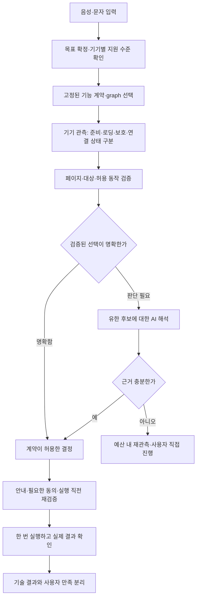

# 클릭 전체 신뢰성 분석과 확장 대응안

> 후속 구현: 사용자가 지정한 공통 계약·화면 상태·자동 메뉴 정책·실행 자산 해시·탐색 예산 수리는 [구현 결과](2026-11-09-shared-capabilities-implementation.md)에 기록했다. 아래 감사 내용은 수정 전 조사 시점의 기록이다.

- 분석일: 2026-11-09, Asia/Seoul.
- 대상: 현재 작업 폴더의 Android 앱·Backend·AI-Agent·공통 catalog·배포 설정·CI와 기존 실기기 검증 기록.
- 이번 조사에서 실제로 실행한 것: 공개 서버 `/version` 조회, 설치 APK 해시 조회, 격리된 메모리 DB/임시 파일 재현, 실제 Android 코드에 대한 임시 JVM 진단 5개.
- 이번 조사에서는 앱 기능·운영 DB·기능 노출·서버 배포를 변경하지 않았다. 운영 사용자 세션·원본 화면·음성·기기명은 수집하거나 외부 전송하지 않았다.

## 1. 결론

**기능 목록을 확장하는 속도에 비해, 실제 Android 실행 능력·복구 계약·배포 검증이 함께 확장되지 않았다.** 여기에 화면 관측·AI 선택·클라이언트 실행·서버 결과 확인이 서로 다른 기준으로 상태를 판단하면서, 국소적인 수정이 다른 작업의 흐름까지 바꿀 수 있다.

확장 기능의 경우 서버가 지원하는 메뉴를 Android 실행기가 거부하거나, 서버가 보낸 새 화면 상태를 앱의 복구기가 모르는 구체적인 불일치를 재현했다. 기존 기능은 같은 화면 판단, 검색 예산, 공유 정책 변경, APK/서버/DB 조합의 영향을 함께 받는다.

따라서 현재 가장 효과적인 대응은 **노출 범위를 실제 검증 수준에 맞추고, 앱·서버·DB 경로·정책을 하나의 출시 단위로 고정한 다음, 검증된 정형 경로와 명시적인 수동 전환을 중심으로 공통 실행 기반을 정리하는 것**이다. 모델의 임계값을 낮추거나 개별 메뉴 이름만 계속 덧붙이는 방식으로는 이 문제를 해결할 수 없다.

다만 재현한 결함이 사용자가 겪은 모든 실패의 원인이라는 뜻은 아니다. 각 결함의 실제 발생 비중과 현재 운영 성공률은 전체 경로 측정이 있어야 알 수 있다.

## 2. 현재 지원 범위의 실제 의미

| 구분 | 수 | 현재 의미와 한계 |
| --- | ---: | --- |
| 전체 catalog | 181 | catalog 2.3.0 기준 |
| `approved` 설정 작업 | 110 | 실행 계약이 있다는 뜻이며 자동 수행·기기 호환 보장이 아님 |
| 설정 변경 | 50 | 시스템 값 조절 6, Wi-Fi 전원 2, native checked 기반 42 |
| 직접 진행 안내 | 39 | 화면 진입 후 사용자가 선택·입력·연결 등을 마무리 |
| 설정 화면 열기 | 21 | 화면 도착을 확인하는 읽기 전용 작업 |
| `catalog_only` | 71 | 아직 실행 승인되지 않은 목록 |

공통 실행 계약의 89개 항목은 모두 `device_validated=false`다. 이는 검증 메타데이터가 출시 허용 조건으로 사용되지 않는다는 근거다. 기존 기록에는 한 삼성 기기에서 글자 크기·밝기·미디어 음량의 증가/감소 여섯 작업을 같은 실행에서 통과한 기록이 있다. 따라서 이 플래그를 보고 ‘기존 작업도 실기기에서 한 번도 성공하지 않았다’고 해석하면 안 된다. **검증 기록과 기능 노출 상태가 연결돼 있지 않은 것**이 문제다.

이번 조사에서 설치 APK는 직전 블루투스 수정본과 같은 `5898a605…fc6596`이었다. 공개 서버는 `9bd993d6…`이고, 운영 소스 해시는 `2278872c…1d263`, 현재 로컬 소스 해시는 `f6f1b194…2c20a`로 달랐다. 정책·어휘 해시는 서로 같았다. 이는 같은 검증 묶음이라는 보장이 없다는 증거이며, 서버가 무조건 더 오래됐다거나 특정 수정이 빠졌다는 단정은 아니다. 운영 커밋의 소스 객체와 활성 DB graph는 직접 확인하지 않았다.

## 3. 재현하거나 코드로 확인한 핵심 문제

P0는 현재 범위를 공개하기 전에 맞춰야 할 실행·출시 계약, P1은 반복 안정성, P2는 환경 재현성의 우선순위를 뜻한다.

| 우선순위 | 문제 | 확인 수준 |
| --- | --- | --- |
| P0 | 새 메뉴·스위치와 Android 자동 실행 능력 불일치 | 실제 정책 코드 재현 |
| P0 | 새 graph 상태명과 스크롤 복구 불일치 | API 및 Android 코드 재현 |
| P0 | 같은 graph 버전의 변경이 기존 DB에서 무시됨 | 격리 DB 재현 |
| P0 | 실행 계약 파일이 출시 소스 해시에서 빠짐 | 임시 파일 변경 재현 |
| P1 | 자동·안내·직접 진행·검증 상태 혼재 | catalog·실행 코드 확인 |
| P1 | 화면 비교와 검색 예산이 무관한 변화에 영향받음 | Android 코드 재현 및 기존 결함 기록 |
| P1 | 운영 모델·실기기 전체 흐름과 CI 관문 간격 | CI·provider 설정 확인 |
| P1 | 앱/서버 대기 시간과 단계 간 진단 연결 미흡 | 코드 확인, 실제 발생 비중 미측정 |
| P2 | CI와 운영 의존성 설치 고정 방식 차이 | 배포 설정 확인, 실제 drift 미확인 |

### F01 · P0: 서버의 기능 목록과 Android 실행 허용 범위가 다르다

Android의 `TouchAutomationPolicy`는 기존 글자 크기·밝기·음량 이동에 맞춘 유한한 메뉴 목록을 사용한다. 임시 검사에서 ‘디스플레이’는 허용하지만 ‘연결·블루투스·Wi-Fi·배터리·알림’은 같은 정상 메뉴 형태여도 거부하는 것을 확인했다.

또한 `checkable`, Switch, Radio 등 값 변경 컨트롤은 일반 자동 탭 경로에서 차단한다. 자동 슬라이더 조절은 `SettingsAdjustment`의 기존 세 설정 종류에 한정된다. 따라서 서버가 새 스위치의 동의를 받고 올바르게 하이라이트해도, 자동 모드는 그 스위치를 조작할 능력이 없다.

이 보호 정책 자체를 해제해야 한다는 뜻은 아니다. **사용자에게 노출하는 능력과 실제 실행기가 허용하는 능력이 다르다.** 확장 작업은 자동 가능·안내 가능·직접 진행을 구분해야 한다. 서버의 `approved`를 Android 자동 조작 허가로 그대로 해석해서는 안 된다.

근거: `Frontend/app/src/main/java/com/click/service/accessibility/TouchAutomationPolicy.java:14`, `Frontend/app/src/main/java/com/click/service/accessibility/TouchAutomationPolicy.java:23`, `Frontend/app/src/main/java/com/click/service/overlay/ClickOverlayService.java:3243`.

### F02 · P0: 확장된 화면 상태를 앱의 스크롤 복구가 모른다

서버의 새 공통 graph는 `S_CATEGORY`, `S_INTERMEDIATE`를 사용한다. 앱의 `navigationMenu()`는 기존 `S2_CATEGORY`, `S2_DISPLAY_MENU` 등 다섯 이름만 허용한다.

같은 `TARGET_NOT_VISIBLE / manual_navigation` 복구라도 기존 `S2_CATEGORY`에서는 스크롤 탐색을 허용하고 새 상태 두 개에서는 거부하는 것을 Android 코드로 재현했다. 로컬 API에서도 블루투스 항목이 없는 ‘연결’ 화면의 응답이 `S_CATEGORY`임을 확인했다.

현재 승인 graph 중 **82개가 `S_CATEGORY`를 포함하고, 그중 28개는 `S_INTERMEDIATE`도 포함한다.** 해당 작업이 전부 항상 실패한다는 뜻은 아니다. 목표가 보이는 정상 경로는 진행할 수 있지만, 그 상태에서 항목이 화면 밖에 있을 때 공통 복구가 끊길 수 있다는 뜻이다.

근거: `Frontend/app/src/main/java/com/click/service/overlay/ObservationRecovery.java:53`, `Backend/app/task_graphs/settings_navigation.py:53`, `Backend/app/task_graphs/settings_actions.py:80`.

### F03 · P0: 같은 버전의 graph 변경은 재배포해도 기존 DB에 반영되지 않을 수 있다

`seed_mvp()`는 `task_id:version`이 없을 때만 graph를 삽입한다. 기존 ID가 있으면 새 코드의 graph hash·승인 상태·우선순위와 비교하지 않고 넘어간다. 여러 생성형 설정 graph는 계속 `1.0.0`으로 배포된다.

격리된 메모리 DB에 기존 블루투스 graph를 넣은 뒤 같은 버전의 안내 내용을 바꾸고 다시 seed했다. 새 graph의 hash는 달라졌지만 DB hash는 그대로였고, 시작 시 오류도 나지 않았다. 별도 `register()`는 같은 변경을 `GRAPH_RELEASE_IMMUTABLE`로 거부하므로 **등록 경로와 시작 시 동기화 경로의 규칙도 다르다.**

이 때문에 ‘소스 고쳤고 재배포했다’와 ‘사용자 세션이 실제로 새 graph를 쓴다’가 다를 수 있다. 매 테스트에서 새 메모리 DB를 만드는 검사는 이 배포 갱신 문제를 놓치기 쉽다.

대응은 기존 DB를 무조건 덮어쓰는 것이 아니다. 내용이 바뀌면 버전을 올리고 검증·활성 전환을 거쳐야 하며, 같은 버전에 다른 내용이 들어오면 시작 검증에서 명확히 실패해야 한다. 기존 세션의 고정 graph와 신규 세션의 선택 경로를 함께 관리해야 한다.

근거: `Backend/app/repositories/task_graphs.py:30`, `Backend/app/task_graphs/settings_actions.py:80`, `Backend/app/task_graphs/settings_navigation.py:53`. 운영 DB에 실제로 어떤 과거 graph가 남아 있는지는 미확인이다.

### F04 · P0: 현재 버전 확인만으로는 같은 실행 구성을 증명할 수 없다

`source_digest()`는 Backend app/migrations와 AI-Agent/src를 해시하지만 **AI-Agent/goal_catalog는 포함하지 않는다.** 실제 실행에 사용하는 `settings_execution.json`을 임시 복사본에서 변경해도 소스 해시가 그대로인 것을 재현했다. 별도 관측 계약은 정책·어휘 해시만 제공한다.

일반 앱은 OpenAPI에서 지원 명령과 스키마를 읽고 캐시한다. 앱 APK·실행 계약·DB 활성 graph 집합·모델/임계값을 하나의 호환 출시 묶음으로 비교하는 일반 런타임 절차는 없다. 검증 전용 환경 manifest와 APK/서버 대조 도구는 이미 있지만 일반 사용 경로 전체에 적용된 보장은 아니다.

따라서 ‘같은 소스 해시’, ‘같은 API 스키마’, ‘같은 모델 이름’ 중 하나만으로 같은 동작 조건이라고 볼 수 없다. 로컬 소스·운영 서버가 다르다는 사실도 수정 포함 여부의 직접 증명은 아니다.

근거: `Backend/app/core/validation.py:30`, `Backend/app/main.py:103`, `Frontend/app/src/main/java/com/click/data/remote/AgentTurnGateway.java:96`, `Backend/app/core/validation.py:40`.

### F05 · P1: 자동 실행·화면 안내·직접 진행·기기 검증을 하나의 승인 상태로 표현한다

`isExecutable()`은 `execution_status == approved`만 확인한다. 공통 계약의 기기 검증 여부는 이 판정에 연결돼 있지 않다. 실제 완료의 의미도 작업마다 다르다.

- 화면 열기: 해당 페이지에 도착했는가.
- 스위치: native checked 또는 독립 시스템 상태가 목표인가.
- 블루투스 연결: 켜짐, 페어링됨, 실제 연결됨이 서로 다르다.
- 직접 진행 안내: 사용자가 해결됐다고 답했는가. 시스템적으로 검증된 성공과 동일하지 않다.

한 번의 공통 스위치 템플릿으로 작업을 많이 생성할 수 있지만, 제조사마다 버튼·라디오·하위 페이지·확인 대화상자가 다를 수 있다. catalog 확장은 구현 및 검증의 완료가 아니다.

근거: `Frontend/app/src/main/java/com/click/domain/goal/GoalCatalogClassifier.java:37`, `Backend/app/task_graphs/settings_actions.py:80`, `AI-Agent/goal_catalog/settings_execution.json`.

### F06 · P1: 화면 동일성과 재시도 예산의 기준이 목적별로 정리되지 않았다

여러 곳이 전체 노드·위치·모든 적용 설정값·window/path를 비교한다. 임시 검사에서는 동일한 설정 목록에서 무관한 Wi-Fi 상태만 바뀌어도 `sameNavigationScreen()`이 false가 됐다.

런처 탐색에서는 경로 변경으로 예산이 초기화되는 문제를 앞서 고쳤지만, 설정 목록 탐색의 scope에는 여전히 window와 `containerId`가 들어간다. 같은 페이지의 컨테이너 경로만 계속 바꾸는 검사에서 **100번 연속 MOVE**가 나왔다. 검색기가 초기화돼 진행 없음과 방문 이력을 누적하지 못했기 때문이다. SETTINGS 모드에는 런처와 같은 절대 이동 상한도 없다.

직전 블루투스 수정 역시 같은 종류였다. 직접 진행 안내를 표시하기 전에 관측 중단 플래그를 먼저 켰고, 검색 목록 변화로 응답이 폐기되면 새 관측도 막힐 수 있었다. 해당 순서는 수정됐지만, 비슷한 상태 조합을 만드는 공통 구조가 남아 있다.

추가 위험으로 접근성 이벤트는 마지막 이벤트 후 300ms에만 캡처하는 형태다. 이벤트가 끊임없이 그보다 짧은 간격으로 오면 자동 캡처가 미뤄질 수 있다. 명시적 fresh read 경로는 따로 있으므로 모든 관측이 중단된다는 뜻은 아니다. 이 현상을 실제 사용자 실패 원인으로 측정하지는 않았다.

제안: 페이지 정체성·대상 정체성·관측 시점·조작 결과 값을 분리하고, 재시도 예산은 의미 있는 작업 단계에 묶는다. 실제 실행 직전에는 native 창·대상·컨트롤의 엄격한 재검증을 유지한다. Android도 노드가 실제 view tree에서 사라져 무효가 될 수 있음을 명시한다. [Android AccessibilityNodeInfo](https://developer.android.com/reference/android/view/accessibility/AccessibilityNodeInfo)

근거: `Frontend/app/src/main/java/com/click/service/overlay/ClickOverlayService.java:3691`, `Frontend/app/src/main/java/com/click/data/snapshot/ScreenSnapshot.java:167`, `Frontend/app/src/main/java/com/click/service/accessibility/ClickAccessibilityService.java:134`, `Frontend/app/src/main/java/com/click/service/overlay/ClickOverlayService.java:2747`.

### F07 · P1: 테스트 통과와 실제 사용자 경로의 성공을 연결하는 출시 관문이 부족하다

운영은 Jev가 화면 단계와 대상을 선택한다. 로컬 Backend의 기본 provider는 rules다. Jev 경로 검사도 존재하지만 많은 사례는 제공자 응답을 고정한다. CI는 Android JVM·APK build·HTTP 계약 재생을 실행하며, 실제 기기/에뮬레이터의 전체 사용자 흐름과 실제 Jev를 결합한 성공을 필수 조건으로 삼지 않는다.

따라서 582개의 Android 회귀 검사나 수천 개 서버 검사는 중요하지만, 현재 APK에서 음성/문자 입력 → 요청 확인 → 홈 탐색 → 설정 이동 → 승인 → 조작 → 실제 값 확인 → 플로팅 결과까지 통과했다는 뜻이 아니다. 기존 실기기 검증 도구와 한 기기의 여섯 작업 성공 기록은 유용하나, 모든 변경 뒤 반복 성공률 및 예외 경로를 보장하는 관문은 아니다. Android 공식 가이드도 JVM으로 검증할 수 없는 통합·전체 흐름은 기기에서 검사하도록 구분한다. [Android 테스트 범위](https://developer.android.com/training/testing/fundamentals/what-to-test)

정형 메뉴도 매번 원격 판단에 의존하면 관측의 작은 차이·후보 집합·제공자 응답에 영향을 받는다. 현재 일부 저위험 선택을 유지하는 장치는 있지만, 단계 전체 후보를 보내 모델이 단계도 다시 고른다. `0.8`은 실제 앱의 정확도 80%나 통계적 유의성이 아니다. 코드도 신뢰도를 정규화된 선택 점수로 취급한다.

이 때문에 목표 문장만 같다고 모델 입력·실행 조건까지 같다고 볼 수 없다. 사용자에게 같은 화면으로 보이는 두 시점도 노드 구조·값·세션·후보 집합이 다를 수 있다. 반대로 입력을 완전히 고정한 반복 측정도 아직 없으므로 모든 변동을 모델 탓으로 확정할 수 없다.

근거: `Backend/app/clients/runtime_agent.py:32`, `Backend/app/services/screen_jev.py:50`, `.github/workflows/backend.yml:22`, `Backend/tests/test_settings_stability_matrix.py`.

### F08 · P1: 클라이언트와 서버의 지연 예산이 맞물리지 않는다

앱 기본 HTTP read timeout은 15초, 서버 실행 timeout 기본값은 20초다. 서버가 처리 중인데 앱이 응답을 못 받은 것으로 판단할 수 있는 구성이다. 기존 요청 ID·서버 idempotency·세션 동기화는 보호 장치지만, 사용자는 실패 후 다시 시도해야 하는 상태에 빠질 수 있다.

read timeout은 네트워크 전체 시간과 같은 개념은 아니므로 단순히 모든 15초 이상 작업이 실패한다고 단정하지 않는다. 실제 모델 지연 분포·timeout 비율은 이번 조사에서 측정하지 않았다. 공개 `/version` 응답 속도를 AI 처리 속도로 사용해서도 안 된다.

대응은 앱 timeout만 크게 늘리는 것이 아니라 서버 작업 예산 < 앱 대기 예산을 명시하고, timeout 뒤 기존 operation 결과를 조회해 실행/미실행을 구분하는 것이다. 대기 중 재실행하지 않고 중단 의도를 우선 처리해야 한다.

근거: `Frontend/app/src/main/java/com/click/data/remote/AuthenticatedHttpClient.java:13`, `Backend/app/services/agent_turn.py:30`, `Backend/app/clients/turn_executor.py`.

### F09 · P2: 운영 build와 CI의 Python 의존성 고정 방식이 다르다

CI는 `constraints-ci.txt`를 사용한다. Dockerfile은 버전 범위가 있는 Backend 패키지를 constraints 없이 설치하며 base image도 가변 태그다. 같은 소스 재빌드라도 의존성 조합이 달라질 수 있다. 운영 dependency inventory를 확인하지 않았으므로 실제 원인이라고 단정하지 않는다.

설치 버전·해시와 이미지 digest를 출시 구성에 포함하고 CI에서 검사한 동일 이미지를 승격해야 한다. [pip 재현 가능한 설치](https://pip.pypa.io/en/stable/topics/repeatable-installs/)

근거: `Backend/Dockerfile:6`, `.github/workflows/backend.yml`, `Backend/constraints-ci.txt`.

### F10 · P1: 서버 사건 기록만으로는 사용자 화면에서 무엇이 일어났는지 복원하기 어렵다

서버에는 runtime event 저장, 동작 상관관계, graph hash, 기술 결과와 검증 전용 진단이 이미 있다. 관측성이 전혀 없다는 진단은 부정확하다.

그러나 로컬 개인정보 필터에서 전송을 막은 이유, 응답이 도착했지만 freshness 검사에서 폐기된 이유, 실제 UI가 어떤 안내를 표시했는지, native 동작이 dispatch 후 성공했는지를 같은 사건으로 묶는 경로가 불완전하다. HTTP 200과 모델 선택만으로 사용자 성공을 판단할 수 없다.

원문을 더 모으는 방식 대신, 허용된 enum·수치·해시와 단계별 시간만 기록하는 최소 진단이 필요하다. 새 수집 항목은 기존 개인정보 계약과 동의 범위에 맞게 별도로 검토해야 한다.

근거: `Backend/app/repositories/agent_sessions.py:227`, `AI-Agent/src/ai_agent/telemetry/execution_events.py`, `Backend/app/core/validation.py`.

## 4. 기존 기능도 함께 흔들리는 이유

기존 여섯 작업과 확장 작업이 관측 수집기·개인정보 필터·역할 추론·정규화·목표 해석·모델 후보 구성·화면 비교·복구·플로팅 서비스 코드를 공유한다. 새 기능을 위해 공통 라벨/역할/필터를 바꾸면 기존 경로의 후보와 화면 지문도 달라진다.

Android 오버레이 서비스는 현재 약 4,053줄이며 boolean 필드 31개, 지연 callback 지점 21개, fresh read 호출 지점 20개다. 이 숫자 자체가 오류의 증명은 아니다. 다만 입력·큐·세션·재시도·동의·실행·결과·음성·창 배치를 한 서비스가 조정하고, 실제 블루투스 플래그 순서 문제까지 발생했다는 점에서 상태 조합을 관리하기 어렵다는 판단을 뒷받침한다.

‘설정 읽기 실패 → 미지원 앱’, ‘같은 화면인데 새 선택’, ‘확인되지 않은 메뉴를 찾겠다며 반복 이동’, ‘팝업이 없는데 닫기 안내’ 같은 사용자 증상은 서로 다른 단계의 실패를 하나의 화면 판단으로 합칠 때 발생하기 쉽다. 각각의 실제 사건은 해당 로그가 있어야 확정할 수 있다.

성공은 단계 전체의 결합이다. 예를 들어 여섯 단계가 각각 95%로 성공하고 독립이라고 가정하면 전체는 약 73.5%다. 이는 클릭의 측정 성공률이 아니라, 각 부분이 얼핏 잘 되는 것과 전체 성공이 다른 이유를 설명하는 수학적 예시다.

## 5. 가장 권장하는 대응 구조

**검증된 정형 작업은 native 근거와 명시적인 계약으로 안정적으로 실행하고, AI는 그 계약 안에서 의도와 불명확한 후보를 해석하도록 범위를 정한다. 관측이 부족하면 이유를 구분해 다시 읽거나 직접 진행으로 전환한다.** 기존 동의·결과 검증·중복 방지·개인정보 보호는 유지한다.

이 방식은 현재 ‘Jev가 최종 선택한다’는 정책을 바꾸는 설계 제안이다. 기존 모델이 보류한 결과를 그 자리에서 규칙으로 몰래 강행하라는 뜻이 아니다. 검증된 기능에 대해 별도 버전의 결정 방식을 도입하고, 엄격한 native 대상 검증과 실제 결과 확인을 거친 뒤 적용해야 한다.

### 5.1 기능 계약을 한 곳에서 관리

각 작업은 최소한 다음을 명시한다.

| 항목 | 내용 |
| --- | --- |
| 기능/버전 | goal, graph hash, 실행 계약 hash |
| 지원 환경 | 제조사·OS/설정 앱 범위·언어·실측 검증 묶음 |
| 지원 수준 | unavailable / navigation / guided / automatic / assisted |
| 화면 인식 | 독립 제목·리소스·구조·필수 native 상태 |
| 허용 동작 | 메뉴 이동, 스크롤, 값 변경, 직접 진행 |
| 실행 조건 | 현재 상태·대상·동의·기기 능력·신선도 |
| 성공 조건 | 페이지 도착, 실제 시스템 값, checked, 사용자 보고 중 무엇인지 |
| 복구 | 로딩·화면 밖·빈 목록·미발견·보호 화면·연결 끊김별 절차와 한도 |
| 출시 근거 | 실제 기기 검사 결과·날짜·APK/서버/DB 묶음 |

여기서 앱의 메뉴/자동 조작 범위, 서버 graph, 공개 지원 목록, 문구, 계약 검사를 생성한다. 새 상태명을 Android 코드에 따로 추가해야만 동작하는 구조를 줄인다. 서버가 준 권한을 앱이 무조건 신뢰하지 않고 기기에서 다시 검증하는 원칙은 유지한다.

현재 사용자와 확정한 설정 진입 순서인 **보이면 하이라이트 → 없으면 옆 페이지 탐색 → 실패하면 설정 열기**도 이 계약의 불변 조건으로 둔다. 확장 편의를 위해 임의로 ‘항상 바로 설정 열기’로 바꾸지 않는다.

### 5.2 작업 상태와 화면 상태의 소유권 정리

- 서버: 확정 목표, graph/출시 버전, 동의, 작업 단계, 기술 결과, idempotency의 기준.
- 기기: 현재 native 관측, 실행 가능 여부, 동작 수행/실패, 중단 의도의 즉각 반영.
- UI: 검증된 작업 상태를 표시하고 사용자 선택을 전달. UI 접기/펼치기가 작업 수행 상태를 바꾸지 않음.

관측·판단·승인·실행·결과 확인을 명시적인 상태로 표현하고, event를 통해 상태를 전환한다. ‘관측을 중단한다’는 부수 효과는 안내를 실제로 표시할 수 있는지 확인한 다음 적용한다. session/episode/generation 취소 장치는 유지한다. 4,000줄 서비스를 한 번에 다시 쓰기보다 이 상태 조정 부분부터 작은 모듈로 추출한다.

### 5.3 관측 의미와 예산 통일

- `READY`, `LOADING`, `EMPTY_CONTENT`, `DISCONNECTED`, `LOCKED`, `PROTECTED`, `UNSUPPORTED_APP`를 내부적으로 구분한다.
- 개인정보 필터로 제거된 노드가 없다고 실제 기기가 없다고 추정하지 않는다. 블루투스 목록의 비어 있음·가려짐·검색 중 상태는 기기에서 확인할 수 있는 범위만 사용하고, 모르면 unknown으로 둔다.
- 페이지 정체성은 의미 있는 제목/구조, 대상 정체성은 리소스·역할·관계, 조작 직전 신선도는 실제 창/위치/상태, 결과는 해당 설정의 실제 값으로 판단한다.
- 재시도·검색 예산은 episode와 의미 있는 단계에 묶고, window/path 변경으로 환불하지 않는다. 페이지/시간/진행 없음의 한도를 함께 둔다.
- 이벤트 합치기에는 최대 대기 시간을 둔다. 값을 바꾸는 동작은 화면이 갱신돼도 결과 근거 없이 반복하지 않는다.

### 5.4 출시를 하나의 묶음으로 고정

APK hash, Backend/AI 이미지 digest, 의존성 lock, 기능 계약·catalog·vocabulary·privacy policy hash, 활성 graph 집합, 모델/프롬프트·임계값·feature flags를 `release_id`에 묶는다. 앱은 전체 동일성만 강제하기보다 승인된 호환 조합을 확인한다. 호환이 깨진 신규 작업은 제한하고 검증된 기존 작업은 유지할 수 있어야 한다.

같은 graph 버전의 다른 내용은 오류로 처리하고, 새 버전 활성화는 검증·단계적 공개·되돌리기를 거친다. 검증 APK 한 쌍과 CI가 만든 동일 컨테이너를 사용한다. 운영 중인 DB를 테스트 DB처럼 초기화하거나, 현재 graph를 조용히 덮어써서 세션 근거를 바꾸면 안 된다. 긴급 중단은 기존 세션에도 새 조작을 막는 별도 정책으로 설계한다.

이 방향은 재현 가능한 빌드·작은 변경·제한된 배포로 영향을 비교하는 출시 원칙과 맞는다. [Google SRE 출시·canary 지침](https://sre.google/workbook/canarying-releases/)

## 6. 대응안 비교

| 선택 | 장점 | 남는 문제 | 판단 |
| --- | --- | --- | --- |
| 더 큰 모델/더 많은 재호출 | 일부 모호한 화면 개선 가능 | 상태명·실행 권한·DB 갱신·배포 불일치를 해결하지 못하고 지연 증가 | 먼저 할 조치 아님 |
| 신뢰도 임계값 하향 | 보류 감소 가능 | 잘못된 선택 증가 여부를 알 수 없고 실행 계약 불일치는 그대로 | 실제 평가 없이 적용하지 않음 |
| 메뉴 이름을 각 파일에 계속 추가 | 특정 증상 빠르게 완화 | 서로 다른 허용 목록과 상태 규칙이 계속 갈라짐 | 단기 수리 후 공통 계약으로 통합 |
| 전체 재작성 | 경계를 다시 만들 수 있음 | 기존 동의·중복 방지·결과 검증 자산을 다시 검증해야 함 | 일주일 일정에 부적합 |
| **검증 범위 축소 + 공통 계약 + 정형 경로 안정화 + 제한된 AI + 출시 관문** | 사용자에게 약속하는 기능과 실제 실행 능력을 일치시킴 | 초기에는 공개 기능 수가 줄고 기기별 검증 필요 | **가장 권장** |

## 7. 실행 우선순위와 일주일 적용 계획

아래는 사용 가능한 테스트 기간이 일주일이라는 기존 조건에 맞춘 제안이다. 담당 인력이 부족하거나 기존 기능의 검증이 늦어지면 확장 공개를 다음 주로 넘긴다. 일정 때문에 안전·결과 판정을 완화하지 않는다. 분석만 요청받은 이번 작업에서는 아래 조치를 실행하지 않았다.

| 시점 | 할 일 | 완료 기준 |
| --- | --- | --- |
| D1 | 테스트 기기/릴리스 고정, 기존 여섯 작업을 우선 후보로 선정, 새 기능은 지원 수준에 맞춰 제한하는 안 확정 | APK·서버·DB graph·계약 묶음 확인, 기능별 자동/안내/직접 진행 목록 |
| D1~D2 | F01/F02 계약 불일치와 F03/F04 graph·자산 검증부터 수리 | 지원 작업의 상태·대상·복구·자동 실행 허용이 양쪽에서 일치. 같은 버전 다른 내용 거부. 기존 DB를 재사용한 갱신 검사 통과 |
| D2~D3 | F06 검색 예산과 상태 전환 수리, timeout/진단 최소 연결 | 경로 변경에도 예산 유지. stale 응답·빈 목록·서비스 끊김에서 교착/중복 실행 없음 |
| D3 | 고정 버전으로 기존 여섯 작업 전체 경로 반복 측정, 코드 동결 | 아래 핵심 검사 통과. 실패하면 사용자 시험에 노출할 기능을 더 축소 |
| D4 | 소수 파일럿, 확장 후보 최대 1~2개만 별도 승인 | 사용자 흐름 확인 및 각 후보의 빈 목록/반대 상태/화면 밖/실패 복구 확인 |
| D5~D6 | 고정 버전 사용자 시험, 실패 원인 기록 | 중간 버전 변경 없이 전후 값·완료·도움·시간 기록. 수정이 필요하면 별도 파일럿 군으로 분리 |
| D7 | 실패 분모를 포함한 결과 분석과 다음 확장 결정 | 성공률·실패 유형·미검증 범위를 보고. 일주일 결과로 모든 기기 신뢰성을 주장하지 않음 |

큰 서비스의 전체 상태 머신 전환·모든 제조사 adapter·전체 110개 검증은 별도 후속 단계다. 이번 주는 계약 불일치 제거와 기존 기능 재현성 확보를 먼저 끝내야 한다.

## 8. 실제 출시 전에 필요한 검사와 데이터

### 8.1 작지만 전체를 잇는 검사

1. **기존 여섯 작업 60회**: 6작업 × 안내/자동 2모드 × 5반복. 적어도 홈 진입과 설정 직접 진입을 포함해 사전 배분한다. 음성/문자 입력·확인 UI·native 이동·실제 값·결과 UI까지 실행하며, 각 시작값을 복원한다.
2. **필수 예외 24회**: 6작업 × 뒤로 이동·응답 지연 중 화면 변경·중지/재개·접근성 재연결 4종. 오류 후 새 자동 동작 및 중복 조작이 없는지 확인한다.
3. **새 작업은 1~2개씩**: 정상, 이미 목표 상태, 화면 밖, 목록 비어 있음, 로딩, native 근거 없음, 사용자 직접 진행, 취소/실패를 기능별로 정의한다. 블루투스 전원과 실제 기기 연결은 별도 작업이다.
4. **의미 고정 반복 평가**: 같은 검증된 관측과 같은 session 조건에서 실제 제공자 선택을 반복해 선택 변경·보류·지연을 측정한다. 관측 고정 실험과 실제 기기 반복은 구분한다. 추가 외부 전송이 필요한 자료는 기존 동의 범위와 개인정보 계약을 지킨다.
5. **기존 DB 갱신 검사**: 과거 release를 가진 DB를 재사용해 새 배포를 적용한다. 새 메모리 DB에서만 테스트하지 않는다.
6. **출시 조합 검사**: 구 APK/신 서버, 신 APK/구 서버, graph/계약 불일치, 캐시된 OpenAPI의 호환 결과를 명시한다.

이 수는 일주일 안에 결함을 잡기 위한 최소 제안이며 통계적 신뢰성 보장을 위한 표본 수가 아니다. 실패 사례를 ‘환경 문제’라고 제외하지 말고 사전 규칙으로 유형을 나눠 남긴다. 부정확한 조작 0회 관측이 미래의 위험 0을 뜻하지 않는다.

### 8.2 수집해야 하는 최소 데이터

| 묶음 | 필드 예시 | 이유 |
| --- | --- | --- |
| 실행 구성 | release_id, APK/이미지/graph/계약 hash, 모델·임계값, OS·기기 종류, 모드 | 어제/오늘이 정말 같은 조건인지 확인 |
| 요청 해석 | 선택 goal, 추가 질문 여부, 지원 수준, 최종 확정 여부 | 이해 실패와 실행 실패 분리 |
| 로컬 관측 | 내부 상태 enum, 관측/창 revision, 허용 구조 hash, 필터 결과 enum | 로딩·보호·연결 끊김과 미지원 구분 |
| 결정 | 제한된 후보 수, 결정 방식, 선택/보류 reason, 점수, 소요시간 | 모델/규칙/계약/지연 원인 분리 |
| UI 수신 | guide 수신·표시·폐기, 폐기 enum, collapse/expand 및 사용자 선택 | 서버 성공과 실제 안내 표시를 연결 |
| 실행 | operation ID, 동의 ID의 해시, dispatch·확인 결과, 스크롤 진행·예산 | 수행과 안내, 반복과 진행을 구분 |
| 결과 | 독립 확인 가능한 전후 값/상태, 확인 가능 여부, 사용자 만족, 수동 도움 | 기술 성공·사용자 보고·연구자 도움 구분 |
| 시간 | 단계별 경과 시간, 전체 시간, timeout·재시도·중지 시점 | 느림과 멈춤의 위치 확인 |

원음·원본 화면·자유 입력·기기명·계정명·토큰을 기본 로그로 남기지 않는다. hash는 재현성과 개인정보 보호의 전부를 해결하지 않으므로 식별자 연결·접근·보존 기간도 함께 제한한다.

### 8.3 성공 지표와 공개 조건

- 전체 성공률: 사전에 지원으로 정한 실제 시작 건수 전체를 분모로 하고, 독립 결과를 확인한 성공과 사용자 보고 해결을 따로 보고한다.
- 잘못된 대상/방향, 확인되지 않은 성공 선언, 취소 뒤 새 자동 동작: 발견되면 해당 기능의 공개를 중단하고 재검증한다.
- 막힘: 작업/단계의 시간·이동 예산 안에 진행도 없이 종료되거나 연구자 도움이 필요했는지 기록한다.
- 판단 일관성: 의미가 고정된 관측에서 선택/직접 진행/보류가 어떻게 바뀌는지 측정한다. 정상적인 화면 전환에 따른 변화는 오류로 세지 않는다.
- 지연: 전체 및 단계별 p50/p95를 보고하고 timeout·실패를 성공 시간 표본에서 조용히 제거하지 않는다.
- 지원 범위: 요청 전체 중 지원 가능 비율도 별도로 공개한다. 기능을 제한해 성공률만 높여 보이는 효과를 숨기지 않는다.

구체적인 수치 목표는 D1~D3 파일럿에서 정하고, 본실험 전에 고정한다. 목표를 넘기기 위해 시험 중 임계값·기능 목록·시작 조건을 바꾸지 않는다.

## 9. 보존해야 할 기반과 최종 판단

현재 코드에는 유지할 가치가 있는 보호가 있다. 원본 입력/기기명을 제한하는 유한 정책, native 대상과 실행 직전 재검증, 동의·세션/episode 상관관계, 중복 요청 처리, 실제 결과와 사용자 보고의 분리, DB graph 불변성 검사, runtime event 저장, 실기기 검증 도구다.

이 기반을 활용해 **기능 계약과 실제 실행 가능 범위를 일치시키고, 출시와 검증을 통합하는 것**이 가장 현실적인 대책이다. 이후 검증된 기능을 한두 개씩 늘리면 된다. 단기적으로는 자동 모드가 실제 수행할 수 없는 기능까지 같은 수준으로 안내하지 않도록 공개 범위를 정리하는 것이 우선이다.

사용자에게 약속해야 하는 것은 ‘많은 goal 이름을 알아듣는다’가 아니라, ‘이 기기의 이 기능을 이 수준까지 안내/수행하고 실패하면 정해진 방식으로 멈춘다’이다.

## 10. 근거 파일과 재현 방법

- [구조화 진단 결과](evidence/2026-11-09-system-reliability-audit.json)
- [격리 재현 스크립트](evidence/system_reliability_audit_repros.py): `Backend`에서 `PYTHONPATH=.:../AI-Agent/src python3 ../docs/reviews/evidence/system_reliability_audit_repros.py`. 메모리 DB와 임시 복사본만 사용하며 provider를 rules로 강제해 외부 모델을 호출하지 않는다.
- [Android 진단 코드](evidence/SystemAuditGapProbeTest.java.txt): 임시 테스트 소스에서 실제 `ObservationRecovery`, `AutomaticScrollSearch`, `TouchAutomationPolicy`를 실행했다. 현재의 결함 동작을 기록하는 assertion이므로 **5개 PASS를 출시 검사 통과로 해석하면 안 된다.** 수리할 때는 반대의 기대 결과를 가진 정식 회귀 검사로 전환해야 한다.
- 과거 582 Android / 393 AI / 관련 Backend 261 / Bluetooth 7개 검사는 직전 작업의 기록이다. 이번 감사에서 전체를 다시 실행한 결과로 합산하지 않는다.
- 최초 사용자 실패 순간의 전체 세션, 운영 DB 활성 graph, 현재 운영의 전체 성공률 및 반복 Jev 결과는 미확인이다. 이 보고서는 위 불확실성을 근거 없는 수치로 채우지 않는다.
