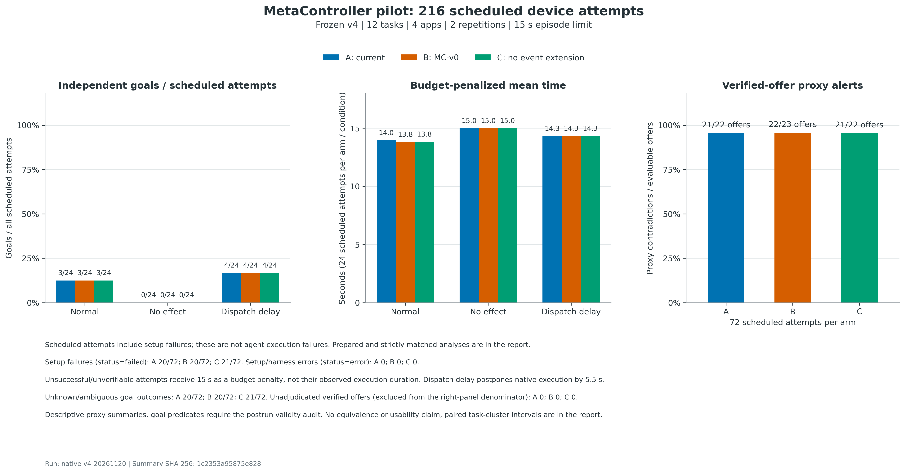

# MetaController 적용 기술 파일럿 결과 — 2026-11-20

**현재 MC-v0의 기본 적용은 NO-GO다. 공통 관찰·완료 계약을 수정한 뒤 추가 효과를 재실험하는 방향을 권한다.**

연결된 Galaxy Note20(SM-N981N, Android 13)과 실제 Gemini 3.8 Flash 설정으로 216회 예약 시도를 실행했다. A/B/C 각각 72회다. 후보 정책·모델·요청·목표 조건을 고정한 최종 v4만 집계했다. 개발·중단 자료는 별도 보존했다.

이것은 **공개 화면 탐색·스크립트 승인·15초 예산의 비루팅 MC-v0 파일럿**이다. 원래 제안한 252회 제품 실험, 설정값 변경 108회, 학습형 reflector D, 미사용 앱 검증, 중장년층 사용자 실험은 수행하지 않았다. UIAnchor 전체 재현이나 해당 논문의 효과를 기각한 결과로 해석하지 않는다.

시험 조작자는 `AppTaskController.execute → AppTaskExecutor` 경로를 사용했다. 실제 사용자가 화면을 직접 누르고 수동 TAP 이벤트로 진행하는 경로와 상호작용 시간이 같다고 보지 않는다. 실행 계약 결함의 적용 범위도 이 자동 도구 경로와 구분해야 한다.

## 비교 결과

| 조건 | 구성 | 목표 확인/예약 시도 | 준비 완료 시도만의 목표 확인 | 예산 페널티 평균 | 실제 모델 호출 |
|---|---|---:|---:|---:|---:|
| A | 현재 실행 정책·기존 안전/완료 검증 유지 | 7/72, 9.7% | 7/52, 13.5% | 14.43초 | 59회 |
| B | A + 작업 내 기억·화면 이벤트 대기·제한된 재관찰 | 7/72, 9.7% | 7/52, 13.5% | 14.39초 | 66회 |
| C | B에서 새 이벤트에 따른 대기 연장만 제외 | 7/72, 9.7% | 7/51, 13.7% | 14.40초 | 64회 |

실패·미확인·준비 실패에는 15초를 부여했다. 이 평균은 실제 사용자 소요 시간이 아니다. 준비 완료 시도만의 집계는 보조 분석이며, 전체 분모를 대체하지 않는다. **B는 목표 확인 수가 늘지 않았고 모델 호출은 A보다 7회, 11.9% 늘었다.**

| 배정 조건 | A 목표 확인 | B 목표 확인 | C 목표 확인 | A/B/C 예산 페널티 평균 |
|---|---:|---:|---:|---|
| 정상 | 3/24 | 3/24 | 3/24 | 13.96 / 13.82 / 13.84초 |
| 첫 유효 TAP 무반응 | 0/24 | 0/24 | 0/24 | 15.00 / 15.00 / 15.00초 |
| 첫 유효 TAP 실행 5.5초 지연 | 4/24 | 4/24 | 4/24 | 14.33 / 14.34 / 14.35초 |

지연은 **네이티브 dispatch 지연**이며 앱 렌더링 지연과 다르다. 배정된 장애까지 도달하지 못한 시도도 표에 남겼다. 실제 장애 주입은 A 8/48, B 8/48, C 7/48로 적었다. 따라서 무반응/지연을 일반적으로 해결하지 못한다고 단정할 수는 없다.

엄격한 대응 비교에서 B−A는 52쌍·9개 작업군이다. 목표 확인율 차이는 0%p, 예산 페널티 시간 차이는 −0.060초, 작업군 bootstrap 95% 구간은 [−0.179, 0.000]초였다. C−B는 51쌍에서 +0.011초, 구간 [−0.060, +0.096]초였다. **속도 향상이나 이벤트 입력의 추가 이득을 입증하지 못했다.** 실패가 많고 작업군이 적으므로 같은 성공/실패 패턴에서 나온 [0, 0] 성공률 차이 구간을 동등성 입증으로 보지 않는다.

그래프는 원래 대리지표의 기술적 집계다. 아래 정답 타당성 감사와 확인된 목표만의 민감도 분석을 함께 읽어야 한다.

## 연구 질문에 대한 답

| 연구 질문 | 이번에 답할 수 있는 범위 | 판단 |
|---|---|---|
| RQ1. 완료율이 높아지는가? | 현재 파이프라인에서 A/B/C 모두 7회 확인. B의 재관찰 8회 중 이후 목표 확인 4회가 있었지만, 같은 지연 조건에서 A도 4회 확인했다. | **추가 개선 근거 없음.** 공통 앞단 결함과 낮은 개입 노출 때문에 MetaController 개념 전체의 무효를 뜻하지 않는다. |
| RQ2. 더 빨라지는가? | 실패 포함 시간 차이는 작고 구간이 0을 포함. B 호출 수는 증가했다. 실제 사람의 속도·금전 비용·매 단계 reflector 대비 효과는 미측정. | **속도 이득 확인 못함.** 단순 시간 초과 후 재계획보다 개입 이유·대기 상태를 구분해야 한다. |
| RQ3. 여러 앱에 일반화되는가? | Chrome에서만 목표 확인이 발생했다. 설정·시계는 공통 완료/실행 경로에서 막혔고, YouTube는 준비 단계가 완료되지 않았다. | **범용성 입증 불가.** 4개 앱을 예약한 사실과 4개 앱에서 유효한 평가를 마쳤다는 주장은 다르다. |

## 반드시 분리해야 하는 실패와 정답 타당성

216회 중 준비 실패가 61회였다. YouTube 54회는 홈 시작 컨트롤 복원 실패, 시계 7회는 로컬 facade 준비 응답 실패였다. 전자는 앱의 저장된 탐색 상태를 초기화하는 fixture의 한계이며, 후자도 실험 인프라 가용성 문제다. **이를 MC나 앱 조작의 실패라고 해석하지 않는다.** 준비 실패의 목표 정답은 미평가(null)로 보존했다. 모델 로그 189행은 모두 에피소드에 결합됐으며, 5회에서는 서버 작업이 에피소드 종료 밖으로 이어져 시간 해석을 분리했다.

사후 양성 대조에서는 고정된 공개 컨트롤을 모델 없이 직접 눌렀다. 12개 중 7개 목표의 판정을 확인했고, 나머지는 시작 상태 미준비 1개, 예상 TAP 미수락 1개, TAP 수락 후 목표 미확인 3개였다. **나머지 5개의 정답 조건이 틀렸다고 확정한 것이 아니며, 동작 선택·전환·표출·판정 기준을 추가 검토해야 한다.** 점수나 정답 조건은 사후에 바꾸지 않았다.

전체 대리지표에서 독립 목표와 모순된 VERIFIED 제시 경보는 A 21회, B 22회, C 21회였다. 미확인된 5개 목표도 포함하므로 이 전체 수를 확정적인 의미 오류율로 쓰지 않는다. 다만 **양성 대조가 확인된 7개 목표만의 사후 민감도 분석에서도 A/B 각각 12회, C 13회 경보가 남았다.** 이 부분집합은 각 조건 42회이며, 주 216회 점수를 대체하거나 효과를 주장하기 위해 선택한 분석이 아니다.

특히 설정 메뉴의 항목 존재를 목적 화면 도달의 증거로 받아들이면, 동작 전에 VERIFIED 결과 확인을 제안할 수 있다. 결과를 자동으로 사용자 확인 처리하지 않았으므로, 이는 사용자 확인 후 DONE와 구분한다. 이 실험에서 DONE=0이라는 사실도 안전성을 증명하지 않는다.

## 확인한 공통 결함과 개선 우선순위

**P0 — 완료 의미와 화면 투영 계약을 먼저 맞춘다.**

1. **GoalContract와 ActionExpectation 분리.** ‘디스플레이’ 메뉴가 보인다는 사실은 ‘디스플레이 설정 화면을 열었다’는 증거가 아니다. 탐색 목적 화면, 원하는 선택 상태, 실제 설정값처럼 요청의 최종 상태를 검증한다. 같은 잘못된 조건을 두 번 읽는 것으로 해결되지 않는다.
2. **동일한 ProjectionSpec으로 관찰·실행 검증.** 컨트롤러는 결과 label을 우선 정렬하고 정적 증거를 추가하지만 실행기는 기본 관찰로 재검사한다. 같은 화면도 fingerprint가 달라 거부될 수 있음을 별도 검사 3개로 재현했다. fingerprint를 무시하거나 learningKey로 대체하지 않고, 동일한 불변 투영 조건을 사용해야 한다. 실기기 거부 전체를 이 한 원인으로 단정하지는 않는다.
3. **실험 fixture와 oracle를 먼저 통과시킨다.** 각 앱의 저장된 화면·키보드·메뉴 상태를 동일하게 복원하고, 각 목표의 양성·음성 대조를 사전에 확인한다. 관측 불가는 부재와 구분한다. 이번 사후 감사의 YouTube 복원은 주 성능 점수를 수정하는 데 사용하지 않았다.

상세 재현과 권장 구조는 [source-audit.md](source-audit.md)에 있다.

**P1 — 정상 경로는 로컬 Supervisor, 모호한 경우에만 모델 진단.**

권장 구조는 `GoalContract → 기존 Planner → ProjectionSpec으로 묶인 네이티브 실행 → 동작별 이벤트 이력 → 로컬 Supervisor → 필요한 경우 모델 진단`이다. 발생/수신 시각, 요청 수락과 실제 효과, 로딩과 무반응, 내부 계약 오류를 구분한다. 단순 시간 초과를 새 계획 호출로 바꾸는 정책은 이번 지연 조건에서 추가 목표 확인을 만들지 못했다. 읽기 전용 탐색의 제한된 재시도와 되돌리기 등도 동작의 성격에 따라 구분해 검증한다.

한 번의 관찰을 상태 표시와 판단에서 일관되게 공유하고 실행 직전에 새 관찰을 확인하는 방향으로 비용을 줄인다. 정상 경로에 추가 모델 호출을 두지 않는 것을 목표로 하되, 그 최적화 효과는 별도 측정해야 한다. FE 레이아웃이나 새 MetaController 버튼을 추가할 이유는 없다.

## go / no-go와 다음 실행 순서

| 대상 | 판정 | 다음 조건 |
|---|---|---|
| 현재 MC-v0 기본 적용 | **NO-GO** | 완료 확인 경보와 공유 실행 계약 문제를 해결하고 추가 이득을 재검증 |
| 공통 계약 수정 개발 | **GO** | 동일 화면 통과·실제 화면 변경 거부·잘못된 완료 조건 거부를 함께 검증 |
| 범용성/속도 개선 주장 | **NO-GO / 추가 근거 필요** | 유효한 앱 fixture, 미사용 앱·다른 기기, 더 긴 복합 과제 |
| 중장년층 사용자 실험 | **현재 보류** | 잘못된 완료 확신 제시와 기본 실행 신뢰성을 먼저 수정 |

다음 비교는 관찰 계약을 양쪽 공통으로 고친 뒤 `완료 계약 현재/수정 × MC OFF/ON`의 2×2가 적절하다. 예를 들어 새로 잠근 6개 목표 × 정상/무반응/지연 × 2반복 × 4조합 = 144회로 목표 검증 개선과 MC의 추가 기여를 분리한다. dispatch 지연과 실제 결과 표출 지연을 같은 조건으로 합치지 않는다. 이후 동일 모델·입력에서 선택적 진단과 매 단계 진단을 비교한다.

중장년층 평가에서는 화면·버튼을 동일하게 두고 도움 없이 완료, 반복 클릭, 대기 이해, 중도 포기, 실제 결과와 완료 확신의 일치를 살핀다. 이번 스크립트 결과로 사람의 사용 시간이나 이해도가 개선됐다고 주장하지 않는다.

## 산출물과 검증

- [전체 집계·조건·앱·대응 비교](results/pilot-summary.md), [원본 216회](native-episodes.jsonl), [정규화 자료](results/episodes-normalized.jsonl)
- [모델 로그 결합 감사](results/join-audit.json), [정답 양성 대조](oracle-positive-controls.json), [확인된 목표만의 민감도 분석](results/oracle-validated-sensitivity.json)
- [고정 소스·APK hash·환경](measurement-context.json), [프로토콜](pilot-protocol.md), [개발·중단 이력](development/README.md)
- Android 단위 검사 104개와 Lint 통과. 이 중 3개는 현재 결함의 characterization 검사로, 수정 완료를 뜻하지 않는다. Backend 검사 73개 통과.

실험 기능은 명시적 실험 생성자에서만 활성화되며 기존 기본 생성자는 CURRENT를 유지한다. 기존 FE 레이아웃·버튼은 변경하지 않았다.
