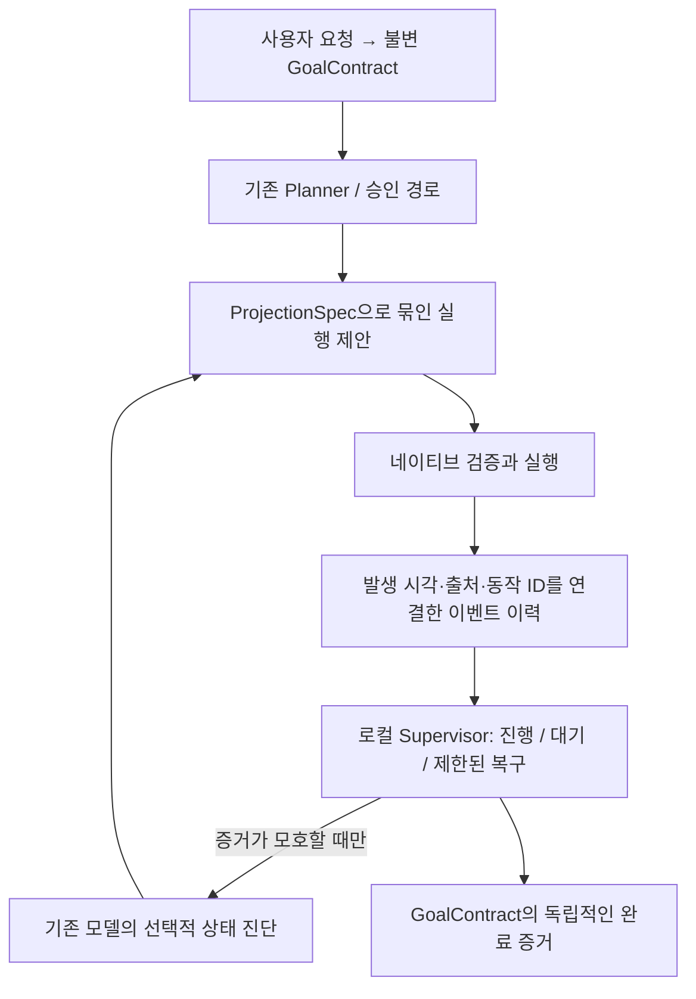

# 성능 해석 전에 분리할 공통 계약 문제

이 문서는 MC-v0의 효과를 단정하는 결과가 아니다. 비교군과 실험군이 공유하는 경로의 소스·단위 검사 결과이며, 실기기 집계와 분리한다. 측정 중인 구현은 고치지 않았다.

## 같은 화면의 실행 거부를 재현한 문제

`AppTaskController.capture()`는 완료 조건과 다음 동작의 기대 label을 `AppTaskObservation.capture(screen, labels)`에 전달한다. 이 함수는 label에 맞는 노드를 앞에 정렬하고, 기본 관찰에 없던 정적 결과 텍스트도 포함한다. `fingerprint`는 이 순서와 노드 집합 전체를 해시한다.

반면 `AppTaskExecutor.execute()`는 같은 화면을 기본 `AppTaskObservation.capture(current)`로 다시 투영한다. `AppTaskPolicy.allowed()`는 두 fingerprint가 같아야 실행을 허용한다. 따라서 화면이 전혀 달라지지 않아도, **투영 조건의 차이가 화면 변화로 취급될 수 있다.**

별도 `AppTaskProjectionContractRegressionTest`의 세 characterization 검사가 현재 결함을 재현했다. 검사 통과는 결함 수정이 아니라 재현 성공을 뜻한다.

1. 같은 snapshot·관찰 ID·시각·learningKey인데 label 우선 정렬만으로 fingerprint가 달라져 실행이 거부된다.
2. 정적 완료 증거 텍스트가 추가되면 순서뿐 아니라 노드 집합과 learningKey도 달라진다.
3. 증거 label이 없는 대조군은 통과하고, 실제 화면 변경은 계속 거부된다.

증거: [projection-contract-proof.json](projection-contract-proof.json), [characterization 검사](../../../Frontend/app/src/test/java/com/click/service/accessibility/AppTaskProjectionContractRegressionTest.java).

이 재현은 결함의 존재를 확인한다. 실기기의 모든 `native_rejections`를 이 원인으로 단정하지 않는다. 실행기 로그의 `observation_or_policy_changed`도 실제 화면 변화와 내부 투영 차이를 구분하지 못한다.

이 문제는 `AppTaskExecutor`를 사용하는 자동 도구 경로의 검사다. 사용자의 실제 수동 TAP을 별도로 추적하는 경로까지 동일하게 실패한다는 결론은 내리지 않는다.

수정 방향은 제안 시점에 공개 label·projection 버전을 담은 **불변 ProjectionSpec**을 봉인하고, 컨트롤러와 실행기가 동일한 조건으로 새 화면을 투영하게 하는 것이다. 실행용 canonical 관찰과 완료 증거를 분리하는 경우에도 실제로 의존한 증거·창·bounds·시각의 검증은 유지해야 한다. fingerprint 비교 삭제, label 정렬만 수정, bounds를 생략하는 learningKey로 대체하는 방식은 권하지 않는다.

## 목표 상태와 조작 대상의 구분

메뉴 항목이 있다는 증거와 그 메뉴의 목적 화면에 도달했다는 증거는 다르다. 현재 완료 조건은 모델이 고른 공개 label/resource/role/선택 상태를 바탕으로 한다. 조건 자체가 요청의 최종 상태를 표현하지 못하면 같은 조건을 두 번 관찰해도 의미 오류는 남는다.

실기기에서는 `runtime_verified_offer`, 독립 목표 확인, 첫 조작 수를 별도로 기록했다. 최종 판정에는 관측 가능한 명확한 부재만 사용하며, root를 읽지 못한 경우나 중복 목표는 UNKNOWN이다. 결과 자동 확인도 수행하지 않는다. 따라서 잘못된 VERIFIED 제시와 사용자 확인 후 DONE를 구분해야 한다.

다음 구조에서는 **GoalContract**가 요청의 최종 상태를, **ActionExpectation**이 개별 조작의 효과를 표현해야 한다. 탐색 목표는 목적 화면·역할·맥락을, 선택 목표는 원하는 selected/checked 상태를, 설정 조절은 독립적인 실제 값을 사용한다. 조작 대상 버튼이 보인다는 사실을 탐색 목표 완료로 대체하지 않는다.

## 권장 구조와 다음 비교

공통 계약을 먼저 수정한 뒤, `현재/수정 GoalContract × MC OFF/ON`의 2×2 비교로 목표 검증 개선 효과와 MC의 추가 효과를 분리한다. 다음으로 같은 모델·입력에서 선택적 진단과 매 단계 진단을 비교한다. 현재 D 조건은 구현·측정하지 않았다.

속도를 위해서는 한 번의 관찰을 UI 상태 표시·도구 가용성·계획 판단에서 일관되게 공유하고, 실제 실행 직전에만 새 관찰을 검사하는 방향을 검증할 필요가 있다. 현재처럼 짧은 간격의 서로 다른 투영을 반복해서 읽으면 비용과 내부 불일치가 함께 늘 수 있다. 이것은 향후 개선 가설이며 이번 파일럿에서 최적화 효과를 측정한 것은 아니다.

사용자 화면에는 새로운 MetaController 버튼을 추가할 필요가 없다. 실제 증거 수준에 맞는 진행·대기·수동 전환 문구를 기존 흐름에서 보여주면 된다. 중장년층 평가 전에 잘못된 완료 확신을 주는 제시와 관측 불가 처리를 먼저 검증해야 한다.
