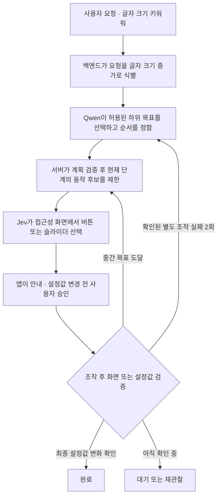

# Android 설정 하위 목표 플래너 비교

2026-11-21, 앱 기준 커밋 `08e6773`. Qwen3.8-Flash 일반 OpenRouter 경로가 현재 설정 실험의 플래너다. 아래 수치는 사용자가 Qwen ZDR 실험 종료를 요청하기 전에 끝난 호출 결과다. 앱과 계정의 설정은 그대로 유지했고, 추가 실행 도구에서 Qwen은 기존 Flash 일반 경로만 제공한다.

## 현재 앱에서 누가 무엇을 정하는가

Qwen이 받는 정보는 목표 유형, 승인된 하위 목표 목록, 현재 화면의 등록된 이름, 관찰된 목표 ID, 이미 마친 목표와 최근 실패 유형이다. 원문과 AX 트리 전체를 Qwen에 전달하지 않는다. 예를 들어 글자 크기 증가에서 Qwen은 디스플레이 → 글자 관련 메뉴 → 조절 화면 → 글자 크기 확대를 선택할 수 있다. 서버는 최대 8개의 중복 없는 허용 ID와 마지막 단계 등을 검증한다. 문법·ID 검사를 통과해도 필요한 중간 메뉴가 빠질 수 있어 이번 실험에서는 계획의 의미도 별도로 채점했다. [플래너](../../../Backend/app/services/settings_planner.py#L181) · [설정 실행기](../../../Backend/app/services/settings_experiment.py#L98)

Jev가 보류하거나 확신도가 낮으면 앱은 자동 조작을 보류하고 재관찰 또는 사용자 확인으로 넘어간다. 실제 조작 두 번에서 값이 그대로이거나 다른 상태에 도달했다고 확인하면, 완료된 단계를 보존하고 Qwen에 남은 경로를 다시 요청한다. 로딩·승인 대기는 실패 횟수에 포함하지 않는다. 비교 모드에서는 잘못된 계획이나 공급자 장애가 발생한 턴에 해당 계획을 실행하지 않는다. 유효·무효 계획 응답 합계 예산은 에피소드당 3회이며 공급자 장애는 별도로 센다. [Jev 복구](../../../AI-Agent/docs/jev-ui-selection.md) · [실험 모드](../../settings-planning-experiment.md)

## 플래너 단독 비교

글자 크기·밝기·미디어 음량의 증가와 감소를 사용했다. 한 묶음은 설정 홈에서 시작하는 6건, 이미 조절 화면에 있는 3건, 중간 메뉴에서 두 번 실패한 후 재계획하는 3건이다. 그룹 안에서 모델 호출 순서를 순환했다. 1차는 Flash·27B·35B, 2차는 과제 순서를 뒤집고 nano·27B·Flash였다. 서로 다른 조건은 총 12개다.

모든 모델이 앱의 플래너 프롬프트·스키마·검증기와 8초 예산을 사용했다. 출력 상한은 192토큰, 요청한 추론 수준은 `none`이었다. 실제 HTTP 응답을 썼고 고객 데이터는 사용하지 않았다. 합성 화면의 승인 그래프에서 기대 경로를 구해 남은 모든 단계와 순서가 맞으면 정답으로 셌다. 앱이 현재 화면을 이미 인식해 건너뛸 수 있는 선두 단계 하나는 허용했다. 계획의 형식 오류와 순서 오류를 모두 분모에 포함했다. 비용은 OpenRouter 응답의 `usage.cost`이며, 지연은 계획 호출 시작부터 파싱·검증까지의 중앙값이다.

| 모델 · 라우트 | 홈 | 조절 화면 | 실패 후 재계획 | 계획 정답 | 호출 중앙값 | 플래너 실험 비용 |
|---|---:|---:|---:|---:|---:|---:|
| Qwen3.8-Flash · 일반 | 12/12 | 6/6 | 3/6 | 21/24 | 1.311초 | $0.001665 |
| Qwen3.8-27B · Wafer FP8 ZDR | 8/12 | 6/6 | 2/6 | 16/24 | 0.526초 | $0.002184 |
| Qwen3.6-35B-A3B · DeepInfra FP8 ZDR | 4/6 | 3/3 | 2/3 | 9/12 | 2.479초 | $0.000818 |
| GPT-5.4-nano · Azure ZDR | 6/6 | 3/3 | 2/3 | 11/12 | 1.451초 | $0.001349 |

27B는 계획 시간이 Flash보다 약 60% 짧았지만 글자 크기 과제에서 중간 메뉴를 반복해서 생략했다. 같은 2차 12건만 비교하면 nano는 11/12·1.451초, Flash는 10/12·1.412초였다. nano는 음량 증가 재계획 한 건에서 앱 검증을 통과하지 못했다. 표본 세 가지 설정에서 얻은 결과로, 다른 앱의 속도와 정답률은 평가하지 않았다. [1차 36건](planner.jsonl) · [2차 36건](planner-repeat.jsonl)

## 실제 Jev와 연결한 합성 화면 검증

추가 18회에서는 목표를 이미 식별한 상태에서 홈 화면부터 시작해 실제 플래너와 실제 Jev 1.14.0을 호출했다. Android 화면, 탭·드래그 이벤트, 시스템 설정값은 기존 재생기로 제공했다. 앱이 요청한 방향으로 값이 변한 것을 검증한 경우만 완료로 셌다. 이 재생기는 기대 동작 대신 사용자 확인이나 화면 재관찰이 나오면 그 지점에서 종료한다. 이후 사용자의 수동 복구까지 평가한 수치는 아니다.

| 모델 | 밝기 −/+ | 글자 크기 −/+ | 음량 −/+ | 완료 | Jev 호출 | 완료된 과제의 모델 대기 중앙값 | 6건의 모델 이용료 |
|---|---|---|---|---:|---:|---:|---:|
| Qwen3.8-Flash | 성공/성공 | 성공/성공 | 보류/보류 | 4/6 | 16 | 2.090초 | $0.001367 |
| Qwen3.8-27B | 성공/성공 | 중단/중단 | 보류/성공 | 3/6 | 12 | 1.341초 | $0.001403 |
| GPT-5.4-nano | 성공/성공 | 성공/성공 | 보류/성공 | 5/6 | 16 | 1.986초 | $0.001638 |

세 모델 모두 음량 감소에서 Jev가 조절 대상에 충분한 확신을 얻지 못했다. 최종 선택 신뢰도는 Flash 조건 0.68, 27B 0.74, nano 0.78이었다. Flash 조건의 음량 증가도 같은 사유로 보류됐다. 27B의 글자 크기 두 건은 첫 탭 다음에 기대한 두 번째 탭을 안내하지 못했다. 모델 대기는 각 과제의 플래너 지연과 Jev HTTP 왕복의 합이다. 완료한 과제 구성이 서로 다르고 폰의 화면 전환·사용자 승인 시간은 제외하므로 이 열로 전체 사용자 속도의 순위를 정할 수 없다. [18회 과제별 결과](integrated.jsonl)

전체 90회 플래너 호출에서 OpenRouter가 보고한 비용은 $0.007846이다. Jev 44회에서 보고된 입력 61,366토큰에 공식 단가 $0.042/백만 토큰을 적용하면 $0.002577이다. 합계는 약 **$0.01042**다. ZDR 대체 모델 중 후속 실기기 비교 후보는 nano다. 현 시점에는 메인 모델을 유지하고 공통 실패인 미디어 음량 슬라이더 식별을 먼저 점검할 근거가 있다. [Jev 단가](https://help.typesafe.ai/articles/5187202169-how-much-does-jev-cost)

## 자연어와 보관 정책

설정 플래너 앞단에서 목표 해석이 필요할 때는 Jev가 사용자 문장의 정제된 복사본을 받을 수 있다. 전화번호·이메일·URL·긴 숫자열과 명시적으로 표시된 이름·주소·인증정보를 마스킹한다. 표식 없이 문장에 섞인 사람 이름이나 주소는 놓칠 수 있다. 백엔드로 들어오는 원문과 외부 모델별 입력은 서로 다르다. 인증 화면에서는 화면 판단을 위한 외부 호출을 차단한다. [요청 마스킹](../../../Backend/app/services/goal_input_privacy.py) · [화면 필터](../../../AI-Agent/src/ai_agent/runtime/privacy.py)

2026-11-21 OpenRouter 공개 목록에서 Flash의 일반 공급자는 Alibaba였고, 동일 모델의 공유 ZDR 엔드포인트는 확인되지 않았다. 앱의 Flash 요청은 `store: false`이며 요청별 `provider.zdr`를 지정하지 않는다. 이번 후보 실험은 공식 ZDR 목록에 있는 정확한 공급자 태그 중 `safety_retention: false`인 경로만 선택하고, 해당 태그로 고정해 `zdr: true`, `allow_fallbacks: false`를 보냈다. OpenRouter의 ZDR은 처리 뒤 프롬프트·응답의 통상적 보관에 관한 정책이다. 사용량 메타데이터와 법적 예외가 있고, Jev와 우리 서버의 보관 정책은 각각 별도로 적용된다. TypeSafe는 조직 단위 ZDR을 제공하며 이번 실험에서는 CLICK 조직의 활성화 상태를 확인하지 않았다. [Flash 공급자](https://openrouter.ai/api/v1/models/qwen/qwen3.8-flash/endpoints) · [공개 ZDR 목록](https://openrouter.ai/api/v1/endpoints/zdr) · [OpenRouter 정책](https://openrouter.ai/docs/guides/features/zdr) · [TypeSafe 정책](https://help.typesafe.ai/articles/9520184411)
