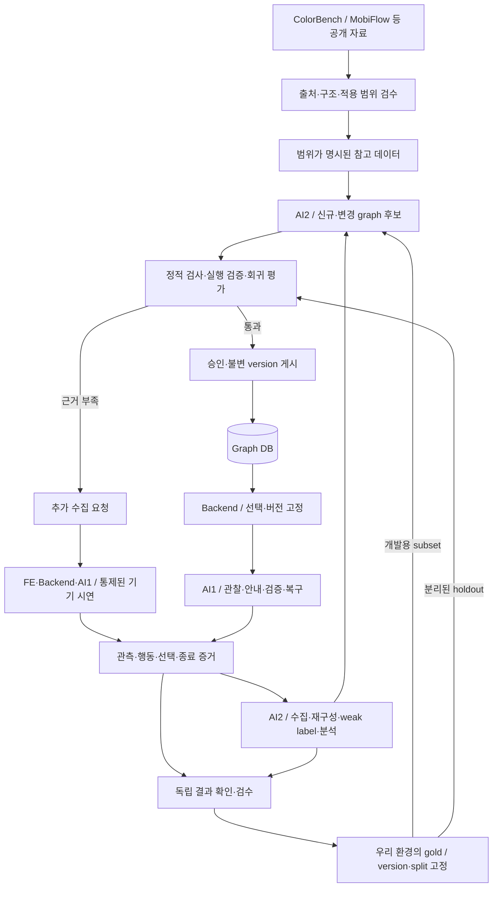

# Task Graph 정답 데이터와 AI-Agent 개발 계획

2026-10-27 구현 현황: [Agent 2 실행 문서](../AI-Agent/src/ai_agent/graph_proposal/README.md). manifest 검사·DB 이벤트 처리·재구성·실패 분석·기존 경로 우선순위 후보·replay 평가·승인/롤백을 구현했다. 실제 기기 증거·제품 gold·독립 holdout 구축과 신규 경로 검증은 남아 있다. 아래는 데이터 채택·정답 검수의 설계 기준이며 합성 테스트를 실제 성능 근거로 삼지 않는다.

## 1. 확정한 방향

1. **ColorBench는 검수한 부분을 화면 전이·경로·복구 평가의 보조 기준으로 사용한다.** 여러 작업이 공유하는 UI 환경 graph이며, 우리 승인 graph catalog 중 무엇을 선택할지에 대한 정답표는 아니다.
2. **MobiAgent의 MobiFlow는 작업 의존관계·AND/OR 분기·완료 조건의 설계 참고로 사용한다.** 공개 rule과 판정 코드를 검수하고, 우리 완료 판단에 필요한 실제 대상·행동·값 변화 증거를 별도로 정의한다.
3. **제품용 정답은 실제 지원 기기·앱·목표에서 확인한 근거와 독립 검수로 만든다.** 공개 benchmark 라벨, 자동 weak label, AI2의 graph 후보를 자동으로 제품 정답으로 승격하지 않는다.
4. **AI2의 역할을 유지한다.** 실행 데이터 수집·재구성·라벨링·dataset 생산·graph 후보 생성/갱신·회귀 평가를 담당한다. 원천 화면과 행동은 FE, 요청·graph 선택은 Backend, 실행 판단은 AI1이 생산한다.
5. **Backend가 승인 graph를 선택하고 AI1은 전달 graph를 실행한다.** AI2 분석은 사용자 응답과 비동기로 처리한다. 별도 LLM 두 개나 별도 서버 두 개를 반드시 운영한다는 결정은 아니다.

초기 MVP-01 graph는 코드에 작성된 seed다. 이를 특정 공개 dataset에서 추출했거나 실기기 전체 검증을 마친 graph로 표현하지 않는다. 운영 사용 승인, 데이터 정답 검수, 새 graph release 승인은 각각의 근거를 가진 별도 상태다.

## 2. 데이터와 산출물의 구분

| 구분 | 내용 | 사용할 수 있는 범위 |
| --- | --- | --- |
| 공개 참고 자료 | 원본 graph·시연·평가 규칙과 출처 | 원래 benchmark의 범위 및 검수한 연구 실험 |
| 합성 fixture | 사람이 설계하거나 코드로 만든 경계 사례 | 계약·알고리즘 회귀 검사. 실기기 성공률의 근거로 집계하지 않음 |
| 실제 실행 기록 | 실제 기기에서 수집한 관측·행동·종료 사실 | 라벨과 graph 후보를 만드는 원천 증거 |
| Weak label | 규칙/모델/runtime 출력으로 만든 잠정적인 정답 후보 | 검토·오류 분석·명시적으로 허용한 학습용 데이터 |
| 제품용 gold | 목표·환경·판정 단위에 맞는 독립 근거와 검수 이력이 있는 정답 | 해당 범위의 선택·경로·완료 평가 및 holdout |
| Graph candidate | AI2가 제안한 신규 graph 또는 patch | 정적 검사·실행 검증·회귀 평가 대상 |
| 승인 graph artifact | 검증·승인 참조가 연결된 불변 graph version | Backend가 선택해 AI1에 전달할 운영 자산 |

`label_status=final`은 해당 라벨 revision이 확정됐다는 뜻이다. weak label도 final일 수 있으므로 이를 gold 여부로 사용하지 않는다. `source_kind`, `label_method`, `review_status`, `evidence_refs`, `review_revision`을 분리해 관리한다. AI2 실행 manifest는 source/review/group/split/evidence 메타데이터를 검사한다. 세부 제품 평가 레코드는 별도 품질 평가 계약을 따른다.

## 3. 평가 단계별 정답 계약

| 평가 | 입력 | 기대 정답 | 평가 주체 |
| --- | --- | --- | --- |
| Goal/Command 분류 | 발화·context | goal·slots·command 또는 clarification | FE; AI2는 검수 데이터 제공 |
| Graph 선택 | 확정 goal·slots·환경·후보 catalog snapshot·선택 정책 | 호환 후보, 정책상 허용 선택 집합 또는 미지원/모호성/추가 확인 | Backend; AI2는 선택 fixture 제공 |
| Graph 내부 경로·복구 | graph·목표·현재 관측·이력 | 허용 transition/target 집합, 재관측 또는 지원 불가 | AI1 |
| Graph 후보 검증 | candidate·base graph·적용 환경 | 구조적 유효성, 전이·완료 근거, 회귀 및 데이터 부족 | AI2 평가 workflow |
| 실행·완료 검증 | before/action/after·task predicate | step/task별 success·fail·unknown 등 | AI1 판단을 독립 gold와 비교; AI2가 평가 자료 구성 |

### 3.1 선택용 gold

각 사례에 아래 정보를 기록한다. 선택 모델의 출력이나 현재 selector의 결과를 그대로 정답으로 복사하지 않는다.

- `case_id`, 확정 goal·slots 및 환경: package, 앱/OS 버전, 제조사, locale, capability, 필요한 시작 상태.
- `catalog_snapshot_ref`, `selection_policy_version`, `candidate_graph_refs`: 후보의 ID·version·hash와 호환 조건.
- `compatible_graph_refs`: 실제 적용 가능한 후보 집합.
- `acceptable_selection_refs`: 호환성 검사와 선언된 선택 정책을 적용했을 때 허용되는 선택 집합. 여러 정답이 가능한 경우 집합으로 보존한다.
- `expected_decision`: `select`, `needs_clarification`, `unsupported`, `ambiguous`. 선택하지 않는 사례는 그 사유와 누락 정보도 기록한다.
- `evidence_refs`, `review_method`, 검수 revision. 어느 후보가 맞는지 검수할 근거가 없으면 미확정으로 남긴다.

같은 goal이더라도 비호환 앱 버전, 필수 capability 누락, 승인되지 않은 graph, 목표 방향 불일치를 구분한다. 현재 정책이 동점 거절이면 그 사례의 기대값은 `ambiguous`다. 실제 catalog에 graph가 하나뿐인 동안에는 지원/미지원·목표/slot 불일치·모호성·버전 고정을 먼저 평가한다. 합성으로 여러 후보를 만든 테스트는 실제 다중 graph 선택 성능과 따로 보고한다.

선택 알고리즘의 첫 비교 기준은 **호환 조건 필터 → 필수 선행조건·목표 도달성 검사 → 남은 후보에 명시적 정책 적용**이다. 현재 우선순위 방식과 비교할 평가 자료를 먼저 만든다. 데이터 검증 없이 특정 수학적 방법이 최선이라고 결정하지 않는다.

### 3.2 경로·graph용 gold

- 화면 상태와 작업 단계 노드의 의미를 구분하고, 전이마다 실제 관측 근거와 적용 환경을 연결한다.
- UI 전이 graph에는 뒤로 가기·복구 순환을 허용할 수 있다. MobiFlow의 단계 DAG 제약을 UI graph 전체에 그대로 적용하지 않는다.
- 하나의 시연을 유일한 정답 경로로 고정하지 않는다. 검증된 대체 경로·target 집합을 보존하고 미실행 대안은 미판정으로 둔다.
- 후보에 새 행동이 추가됐으면 과거 trace의 다음 화면을 그 행동의 결과로 재사용하지 않는다. 추가 관측 또는 기기 재현이 필요한 edge로 표시한다.

### 3.3 실행·완료용 gold

`episode/step/attempt/guide`와 전후 observation ID·시각, 실제 action, 원래 target과 window, 기준값과 변경값, task predicate, 독립 판정 근거를 묶는다. 중간 단계의 성공과 최종 task 성공은 분리한다.

MVP-01에서는 글자 크기 control의 실제 전후 값과 수행 방향을 검수한다. 화면 방문, 안내 문구, terminal state 이름만으로 증가 성공을 확정하지 않는다. 실기기 설정값 또는 별도 관측 검수로 기준을 확정하고, 동일 AI1 verifier 출력을 다시 정답으로 사용하지 않는다.

관측 누락으로 실제 완료 여부가 미상인 사례는 이진 성공률에 섞지 않는다. 대신 그 입력에서 `unknown`/재관측을 반환해야 한다는 검증 fixture를 구성할 수 있다. 자동 라벨이 unknown을 반환했다는 이유만으로 그 fixture가 독립 gold가 되는 것은 아니다.

## 4. 공개 자료 도입 계획

| 자료 | 채택 범위 | 사용 전 확인할 항목 | 현재 상태 |
| --- | --- | --- | --- |
| ColorBench | 정적 UI graph의 경로·복구 평가 보조 | 원본 task JSON 문법, milestone 참조, 이미지·행동 매핑, simulator 재현, 누락 case 제외 사유 | 원본 구조·집계 함수 검사 완료. 검수 subset·Click 연동·기기 평가 미완료 |
| MobiAgent / MobiFlow | 의존관계·분기·완료 규칙 참고와 검증 실험 | YAML·참조·조건 파싱, AND/OR 의미, 판정기 오류 사례, 우리 task predicate 대응 | rule 59개와 함수 수준 검사 완료. 제품용 판정기 정확도·Click 연동 미검증 |
| AndroidWorld | 지원 task의 상태 기반 evaluator 및 격리 실험 참고 | 대상 task 정의·초기화·관측/행동 어댑터·실제 재생 | 코드·제한된 모킹 검사. emulator/Click 통합 미실행 |
| AITW / AndroidControl / PixelHelp | 시연·화면·대상 정보의 보조 자료 | 대상 앱·기기·언어 범위, 누락 필드, 이용 조건, 행동과 결과의 차이 | [기존 감사](reviews/2026-09-20-task-graph-data-revalidation.md)의 범위 유지 |
| TaskBench / CaptainCook4D·DTGL | 도구 graph 예측·절차 graph 학습 연구 | 원래 도메인·정답 단위·split 유지 | 제품용 Android gold와 분리 |
| DroidTask / Mobile3M 등 | 후속 탐색 후보 | 미다운로드 archive·평가 코드·실제 범위 검증 | 제품 채택 보류 |

ColorBench의 원본 task JSON 문법 오류·milestone 참조 문제와 MobiFlow의 로딩·참조·조건 문제는 [실행 증거](reviews/evidence/task-graph-gold-semantics.json)와 [구조 감사](reviews/evidence/alternative-task-graph-audit.json)에 남아 있다. 공개 파일 전체를 자동 통과 처리하지 않는다. 여기서 MobiFlow는 **IPADS-SAI/MobiAgent의 하위 프로젝트**이며 별도 2026 MobiFlow/MobiBench와 구분한다.

외부 데이터 반입 시 source URL·commit/revision·파일 hash·원본 ID·이용 범위, 변환 코드 version·수정 내용·제외 사유를 manifest에 기록한다. 원본은 보존하고 수정한 graph는 파생 자산으로 관리한다. 없는 행동 ID·기준값·실기기 결과를 생성해 제품 필드를 채우지 않는다.

공개 그래프와 milestone을 평가 정답으로 사용하는 실험에서는 입력 공개 범위를 고정한다. graph 자체를 입력으로 주는 planner 평가인지, 관측으로 graph를 복원하는 평가인지 구분한다. 숨겨야 할 경로·완료 라벨을 모델 입력에 누출하지 않는다.

## 5. 역할과 데이터 흐름

독립 검수는 관측 증거·task predicate·검토 이력으로 라벨을 확정하는 경계다. 모든 건을 별도 LLM에게 다시 묻는다는 뜻은 아니다. AI2는 검수 자료를 준비하고 불일치를 추적하며, 자신의 candidate나 자동 판정을 단독으로 gold로 승격하지 않는다.

## 6. 개발 순서와 완료 조건

기간·표본 수·정확도 목표는 실제 수집 환경과 baseline을 확인한 뒤 정한다. 아래 순서는 선행조건에 따른 계획이며 임의의 성공률 목표를 두지 않는다.

| 단계 | 담당 | 작업과 산출물 | 다음 단계로 넘어갈 조건 | 현재 상태 |
| --- | --- | --- | --- | --- |
| P0 평가 계약 | AI2 + Backend/AI1 담당 | 선택·경로·완료 정답 단위, MVP 환경 목록, source/review/split manifest | 입력·정답·판정 불가·근거·평가 소유자 명시 | manifest schema·source/review/group/split/evidence 검사 구현 |
| P1 실제 증거 확보 | FE·Backend·AI1 생산, AI2 수집 | 통제된 MVP-01 시연과 원천 event·episode/attempt 연결 | 정상·실패·무변화·관측 부족 사례의 실제 증거와 재처리 가능한 snapshot | 영속 DB 처리·단계 재구성 구현. 실기기 수집 미완료 |
| P2 제품 gold·baseline | AI2 + 독립 검수 | 선택/경로/완료 gold, 개발/holdout 분리, 현재 선택기·verifier 결과 | 실제 근거·검수·split 추적, unknown과 합성 사례 분리 보고 | 구축 예정 |
| R1 공개 참고 실험 | AI2 연구 workflow | ColorBench 검수 subset, MobiFlow 유효 rule·어댑터·제한 보고 | 원본/파생 구분, 결함 제외·수정 기록, 해당 benchmark 내 재현 | 구조·함수 감사만 완료. P1과 병행 가능 |
| P3 첫 graph 개선 | AI2 | 실제 실패 근거로 selector/전이 후보와 정확한 diff 생성 | base hash·환경·반례·독립 holdout 회귀·필요한 기기 전이 확인 | 기존 경로 우선순위 후보·실제 replay adapter 구현. 독립 holdout 미확보 |
| P4 승인·소비 연결 | AI2 release + Backend + AI1 | 승인 artifact 게시, 새 episode 선택, 고정 version 실행·rollback | 공개 자료나 candidate의 무승인 게시 없음, 기존 세션 일관성 확인 | 평가 hash 결합·원자적 승인/활성·audit·rollback 구현. 실제 제품 release 미실행 |
| P5 범위 확장 | 각 역할 담당 | 새 제조사·앱 버전·쿠팡·정부24 task의 별도 gold와 graph | 해당 목표의 실제 경로·완료 predicate·catalog·회귀 근거 확보 | 후속 범위 |

R1의 대용량 다운로드나 전체 benchmark 연동은 P1 시작의 선행조건이 아니다. 새 graph를 얻기 전에도 통제된 시연과 미지원 요청 사례로 데이터 수집을 시작할 수 있다. 초기 graph는 검토한 seed를 사용하고 새 후보의 성능은 별도 holdout으로 평가한다.

### MVP-01 우선 수집·평가 사례

| 사례 | 확인할 정답 |
| --- | --- |
| 확정된 글자 크기 확대 목표 | 호환 범위에서 MVP-01 선택, 실제 해당 값 증가 시 완료 |
| 화면 배율·밝기·글자 크기 감소 목표 | 확대 graph와 혼동하지 않음; 목표에 따라 재질문/미지원 |
| 필수 환경·slot 정보 부족 또는 graph 정책상 동점 | 추가 확인 또는 모호성; 임의 선택 없음 |
| 글자 크기 화면에 도착했지만 미조작 | 화면 진행과 최종 완료를 구분 |
| 조작했지만 같은 값 / 감소 / 밝기만 증가 | 목표 미충족. 관측이 충분한 경우와 부족한 경우를 분리 |
| 행동 또는 기준값 누락 / 오래된 화면 재전송 | 근거 부족에 맞는 unknown·대기·재관측 |
| 이미 최대값 / 사용자 취소 / 동의 거절 | 증가 성공으로 집계하지 않고 원인을 구분 |
| 다른 유효 경로로 이동 / 중간 관측 누락 | 검증된 대체 경로 수용, 관측하지 않은 edge 추정 확정 금지 |
| 제조사·OS·앱 버전 변경 | 해당 환경에서 적용 가능한 graph와 완료 증거를 별도 확인 |

## 7. 평가와 정답 승격 기준

- 선택은 호환 후보 포함 여부, 정책상 허용 선택, 미지원·모호성·추가 확인 처리, 잘못된 실행 개시를 따로 평가한다. 선택 보류율과 판정 coverage도 함께 보고한다.
- 경로는 허용 전이·target 집합, 선행조건, 실제 복구 결과를 평가한다. 구조 참조가 유효하다는 사실과 실제 실행 가능성은 별도 결과다.
- 완료는 독립 gold와 비교한 false DONE·미탐지·unknown/coverage 및 환경별 회귀를 보고한다. 공개 benchmark, 합성 fixture, 제품 기기 결과를 하나의 성공률로 합치지 않는다.
- 학습·튜닝·candidate 생성에 쓴 원본과 파생본은 같은 split에 둔다. 같은 episode·시연·유사 화면을 train/test에 나누지 않는다. 최종 holdout을 사용해 수정하면 그 결과는 개발 평가로 다시 분류한다.
- 제품 gold에는 대상 환경·판정 단위·evidence·독립 검수·revision이 필요하다. 사람이 봤다는 표시만 있고 실제 행동 결과가 없는 자료를 완료 gold로 확정하지 않는다.
- graph의 제품 적용 판정은 `PASS`, `FAIL`, `NEEDS_DATA`, `ERROR`로 구분한다. 공개 benchmark 통과만으로 제품 적용 `PASS`를 부여하지 않는다.

## 8. 현재 구현과 문서 연결

[Backend selector](../Backend/app/repositories/task_graphs.py)는 DB 본문·schema/hash·목표를 검증하고 고정 version을 복원한다. [AI2 구현·제약](../AI-Agent/src/ai_agent/graph_proposal/README.md)에 수집·dataset·후보·평가·release와 실행 명령을 정리했다. 실제 gold·holdout·실기기 검수는 수행 전이며 승인 artifact와 자동 weak label을 제품 정답으로 동일시하지 않는다.
