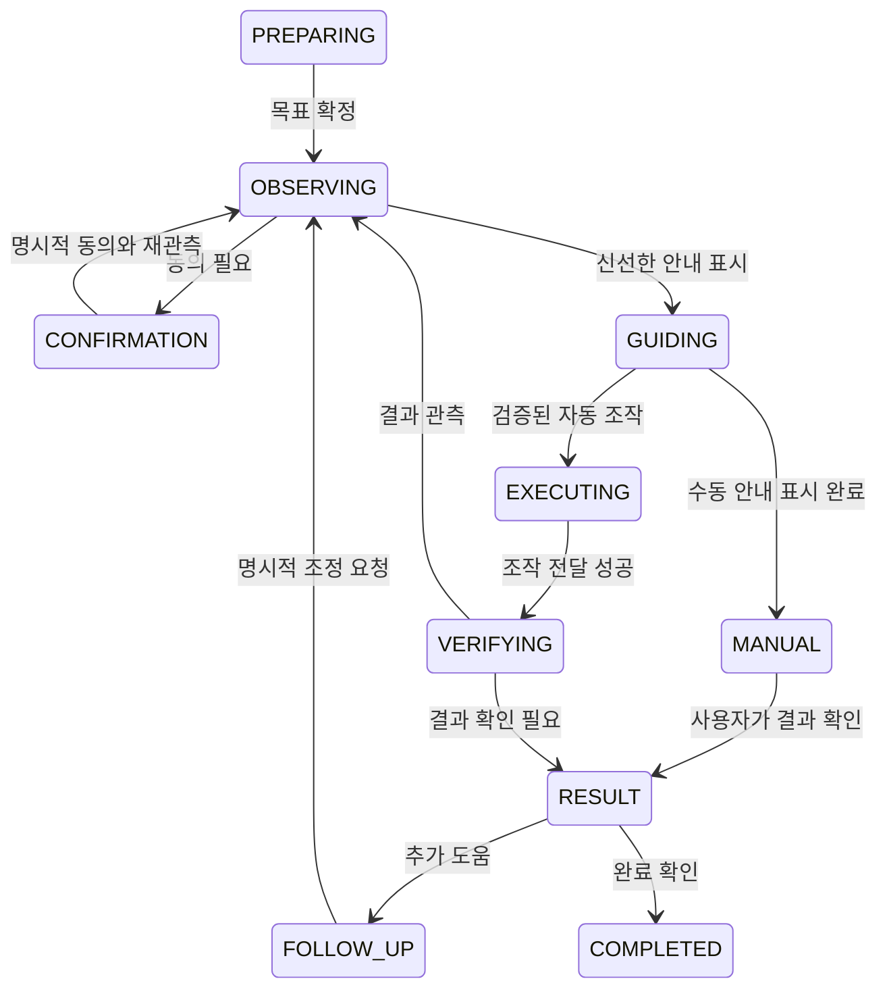

# 작업 관측, 성공 증거와 실행 상태

## 동일성은 용도별로 비교한다

| 비교 대상 | 의미와 기준 | 이 비교만으로 허용하지 않는 일 |
| --- | --- | --- |
| 페이지 | 동일 앱의 독립 native 제목. 클릭 행·스크롤 목록·설명은 제목에서 제외한다. 제목을 읽지 못하면 미확정이다. 목록·값·창 번호가 달라져도 페이지 자체는 같을 수 있다. | 기존 좌표에 탭, 동의 재사용, 변경 완료 선언 |
| 탐색 화면 | 페이지 내부 native 목록·노드·위치·창·역할·상호작용 구조. 관련 없는 시스템 설정값과 checked/selected/숫자 진행값을 제외한다. | 다른 창/다른 대상의 좌표 재사용, 최종 값 조작 승인 |
| 실행 대상 | 현재 창, native ID·resource·라벨·위치와 하위 행의 정체성. `GuideFreshness`, `TouchAutomationPolicy`, 서버의 target_key와 선택 바인딩을 다시 확인한다. | 대상으로 보이는 텍스트가 같다는 이유만으로 실행 |
| 동의 관측 | `sameNativeContent`의 정확한 native payload와 설정값, 서버 challenge·기한. 재관측할 때 시간·관측 ID만 새로 발급한다. | 페이지 제목만 같다는 이유로 승인 승계 |
| 결과 관측 | 작업에 해당하는 실제 값·native checked·관측 시각과 조작 기록. 전체 관측 지문은 관련 값 변경도 포함한다. | 주변 메뉴·클릭 이벤트·선택 장식만으로 성공 선언 |

Android는 `ScreenIdentity`에서 페이지/탐색 의미를 정의한다. 전체 `ScreenSnapshot` 지문은 SHA-256으로 변경해 32비트 Java 문자열 해시 충돌로 대상을 동일하다고 판단하지 않는다. Python checkpoint는 page_fingerprint와 navigation_fingerprint를 별도로 저장하며 이전 checkpoint는 기본값 None으로 복구한다. 기존 native 지문이 없는 checkpoint는 이전 선택을 유지하지 않고 새로 선택한다. 앱과 서버의 native 모델이 다르므로 지문 문자열 자체를 상호 비교하지 않는다.

Jev가 이미 선택한 **저위험 메뉴 이동**은 탐색 화면과 해당 대상의 바인딩이 유지될 때만 재사용한다. 값 조작·동의·결과 검증에는 이 완화된 비교를 사용하지 않는다. 새로운 모델의 선택 보류를 규칙으로 덮어쓰지 않는다.

## 목표에 묶인 성공

`settings_capabilities.json`의 110개 승인 목표에 성공 종류, setting, direction, requested_state를 생성한다. 서버와 앱은 동일한 계약 및 공통 golden 사례로 검증한다.

| 종류 | 기술적 성공 기준 |
| --- | --- |
| page_opened | 해당 navigation 설정의 OPENED + settings_page_visible + 실제 관측 ID |
| persisted_value | 해당 설정의 기기 적용값이 요청 방향으로 변경됨. 원래 값·현재 값과 방향별 reason이 일치해야 한다. |
| native_checked | 해당 스위치의 실제 Boolean checked가 요청 상태와 일치함. ALREADY_SET은 이미 일치하는 native 증거가 필요하다. 다크 모드의 native 선택 카드는 시스템 모드 값(라이트 1/다크 2)으로 별도 확인한다. |
| adapter_power | 와이파이 master checked와 adapter 값(켜짐 3/꺼짐 1)이 일치함. 전환 중 값은 성공이 아니다. 네트워크 연결 성공을 뜻하지 않는다. |
| user_report | 블루투스 기기 연결·배경화면 적용 등 현재 직접 검증하지 못하는 작업. 페이지 진입·전원 켜짐·버튼 누름은 기술적 성공이 아니다. |

CHANGED는 attempt_id·guide_command_id·target_key·event_key와 서로 다른 전후 observation_id를 요구한다. 시간 순서는 baseline < action <= verification이어야 한다. 단순 CHANGED 문자열·다른 setting·반대 방향·전후 동일 값·조작 전 관측은 완료 증거가 아니다. Bluetooth enable과 Bluetooth connect는 같은 setting을 써도 서로 다른 성공 계약이다.

Backend `normalize_technical`은 목표에 맞지 않는 성공 주장을 UNVERIFIABLE로 낮추며 task_outcome에 goal_type을 저장한다. 사용자의 ‘완료’ 응답은 technical과 별도로 보관한다. 증거가 맞을 때는 ACHIEVED, 사용자가 직접 확인했지만 앱이 검증하지 못한 경우는 USER_REPORTED_RESOLVED다. Android도 이전 서버의 근거 없는 완료를 재검사하고, 결과 질문이 잘못된 성공을 단정하면 중립적인 확인 문구로 바꾼다.

## 상태 전환의 단일 소유자

`TaskExecutionController`가 오버레이의 핵심 작업 상태와 관측/자동 실행 권한을 소유한다. 서비스의 음성·UI 배치·native 증거 수집 데이터는 그대로 두되, 콜백이 개별 실행 플래그를 바꿔 작업을 재시작하지 않는다.

- PAUSED는 기존 단계를 보관한다. 명시적 재개 없이 늦은 IN_PROGRESS·WAITING_RESULT 응답이 작업을 풀지 못한다. 중단/완료는 새 작업 초기화가 필요하다.
- MANUAL·RESULT·FOLLOW_UP에서는 화면 이벤트만으로 관측/자동 조작을 재시작하지 않는다. RESULT/FOLLOW_UP에서 실행으로 돌아가려면 실제 adjust_task 응답이 필요하다.
- 재개 시 수동/복구 페이지는 새로 관측한 뒤 안내를 다시 만든다. RESULT/FOLLOW_UP은 해당 사용자 질문을 유지한다.
- RECOVERY의 재시도와 PAUSED의 재개를 구분하며, 중첩 순서가 바뀌어도 이전 단계로 복구한다.
- request token은 generation + 단조 증가 sequence + command로 구성한다. 동일 callback은 한 번만 소비하고, 교체 작업·이전 동기화·중복 응답은 UI/조작 전에 폐기한다.
- 수동 안내는 UI 표시가 끝난 뒤 MANUAL을 확정한다. 표시 예외가 발생하면 RECOVERY와 재시도 UI로 전환하므로 안내가 없는 상태에서 관측만 차단하지 않는다.

Transport busy, 보류 control, 일회성 관측 요청은 컨트롤러 안의 별도 통신 상태다. 오디오·스크린샷·레이아웃 등 자체 비동기 처리는 서비스에 남아 있다. 이 변경은 프로세스 종료 후 실행 상태를 영구 저장하는 기능을 추가하지 않는다.

## 배포와 확인

앱과 서버의 공통 JSON 해시가 달라지므로 같은 변경 묶음으로 빌드/배포한다. 서버 소스만 수정하거나 앱만 설치한 것을 전체 반영 완료로 보지 않는다. 검증은 외부 모델 호출이나 사용자 설정 변경 없이 공통 성공 사례, API 결과 흐름, 실제 오버레이 gateway callback, 이전 checkpoint 복원, native 대상 교체/값 변경 회귀 검사로 수행한다.

## 실제 페이지 이동 후 재판단

하이라이트를 따르지 않고 다른 페이지로 이동하는 것은 조작 실패가 아니다. 독립 native 제목이 실제로 바뀌면 OBSERVING/GUIDING/CONFIRMATION/VERIFYING/RECOVERY에서 기존 복구를 끝내고 관측을 재개할 수 있다. 일시정지·결과 질문·수동 개인 선택은 유지한다. 다른 목표 범위의 설정 페이지는 로컬 뒤로가기 안내로 복구한다. 자세한 동작과 네트워크 경합 처리는 `reviews/2026-11-10-settings-page-navigation.md`에 기록한다.
