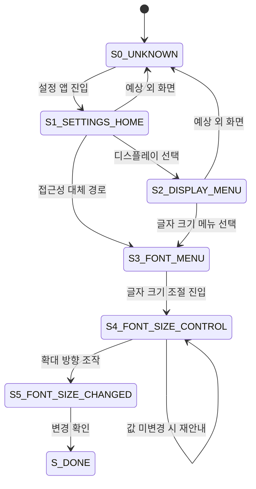
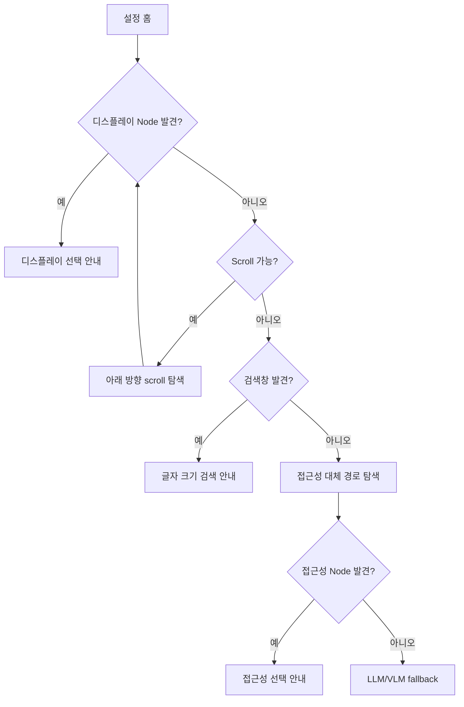

# Task: Android 설정 앱에서 글자 크기 확대

2026-10-10 현재 완료 판정은 귀속된 행동·새 관측·동일 slider 값과 `FONT_SCALE`의 목표 방향 변화를 요구한다. 화면 도착이나 안내만으로 완료하지 않는다. `화면` 부분 문자열로 다른 메뉴를 선택하는 결함은 [재검증](../reviews/2026-10-10-ui-highlight-revalidation.md)에서 미해결로 확인했다. [제품 gold·인수 기준](../ai-quality-evaluation.md)이 평가 기준이다.

2026-09-20 정답 데이터·수집 순서는 [Task Graph 데이터 계획](../task-graph-data-plan.md)을 따른다. 이 문서의 graph 설계와 현재 코드 seed가 실기기 검수 gold를 의미하지 않는다. 실행 가능한 기능과 제한은 [AI1 실행 정책](../ai-agent-1-runtime-policy.md)이 기준이다.

## 1. Task 정의

| 항목 | 내용 |
| --- | --- |
| Task ID | `MVP-01` |
| 연결 Goal Type | `settings.font_size.increase` |
| Task 이름 | Android 설정 앱에서 글자 크기 확대 |
| 사용자 목표 | 휴대폰 글자가 작아서 더 크게 보고 싶다 |
| 대상 앱 | Android 설정 앱 |
| Task 유형 | 설정 변경형 |
| Agent 역할 | 설정 앱에서 글자 크기 조절 화면까지 안내하고, 사용자가 직접 글자 크기를 확대하도록 돕는다 |
| 자동 클릭 여부 | 없음 |
| 자동 스크롤 여부 | 현재 MVP-01 비활성. 아래 제한적 scroll 경로는 후속 설계 |
| Graph 업데이트 방식 | runtime trace 기반 후보 생성 후 검증/승인 |

## 2. FE Goal·Command 입력과 Graph 연결

Goal Typing과 Command Typing은 FE가 담당한다. 실제 발화 예시, 필수 slots, 분류·clarification,
전체 요청 JSON은 [FE Goal·Command 계약](../fe-goal-command-contract.md)에서 관리한다.
Backend는 `start_task` 또는 `replace_task`의 확정 Goal로 DB에서 다음 매핑에 맞는 graph를 선택한다. AI1은 graph 본문·reference·목표·실행 상태를 받아 이 Task의 안내·검증·Re-plan을 수행한다.

| FE 입력 | 값 |
| --- | --- |
| `goal.goal_type` | `settings.font_size.increase` |
| `goal.target_app` | `android_settings` |
| `goal.slots` | `setting=font_size`, `direction=increase` |
| Backend DB 선택 결과 | `task_id=MVP-01`, `task_type=settings_change` |

AI1은 원문을 분류하거나 graph를 선택·수정하지 않는다. 감소 목적을 확대 graph로 바꾸지 않는다. 후속 `observe`·`resume_task`에서는 Backend가 저장된 Goal과 고정 graph·실행 상태를 복원해 AI1에 전달하는 것이 목표 계약이다. graph에 없는 경로가 필요하면 AI1은 Backend에 재선택/지원 불가 처리를 요청한다. [Graph 전달 계약](../backend-task-graph-dispatch.md)을 따른다. 현재 typed 선택·주입 일부는 연결되어 있으며 범용 version loader와 legacy raw-goal 경로 정리는 후속 작업이다.

## 3. 사용자 발화와 Goal 분류 참조

이 Task를 요청하는 대표 발화는 “글자 크기 키우고 싶어”다. “화면 크게”처럼 글자 크기와
화면 배율이 모호하면 FE에서 먼저 확인한다. 발화 목록·canonical enum·필수값의 기준은
[FE 계약의 실제 Goal 목록](../fe-goal-command-contract.md#3-실제-goal-type-목록)이다.

## 4. 완료 조건

Agent의 완료 판정에는 다음 근거가 필요하다. 화면 방문과 실제 설정 변경을 구분한다.

- 현재 화면이 글자 크기 조절 화면이거나 글자 크기 설정 변경 후 상태이다.
- 확정 목표가 확대이며, 안내한 원래 글자 크기 target의 실제 행동과 전후 관측이 연결된다.
- 같은 의미의 control/window에서 기준값과 변경값을 확인하고 변경값이 증가했다.
- 변경 후 관측이 행동 전 화면의 재사용이 아니며 새 결과를 확인할 수 있다.

기준값·행동 귀속·새 결과가 없으면 대기 또는 판단 불가로 처리한다. 완료 안내는 검증 이후의 출력이며 완료 근거에 포함하지 않는다. 제품 gold는 이 verifier 출력과 별도로 실제 값과 증거를 검수해 만든다.

완료 안내 예시:

- "글자 크기가 더 크게 변경되었어요."
- "설정이 적용된 것 같아요. 화면 글자가 커졌는지 확인해보세요."

## 5. State 정의

| State ID | State 이름 | 화면 특징 | 주요 판별 근거 |
| --- | --- | --- | --- |
| `S0_UNKNOWN` | 알 수 없는 화면 | 설정 앱이 아니거나 현재 화면 판단 실패 | package mismatch, keyword 부족 |
| `S1_SETTINGS_HOME` | 설정 홈 | 설정 카테고리 목록 | "설정", "디스플레이", "접근성", "연결" |
| `S2_DISPLAY_MENU` | 디스플레이 메뉴 | 화면/밝기/글자 관련 메뉴 | "디스플레이", "밝기", "글자 크기", "화면 크기" |
| `S3_FONT_MENU` | 글자 관련 메뉴 | 글자 크기 또는 글꼴 항목 | "글자 크기와 스타일", "글꼴 크기", "Font size" |
| `S4_FONT_SIZE_CONTROL` | 글자 크기 조절 화면 | 슬라이더, 단계 옵션, 미리보기 | "글자 크기", slider role, preview text |
| `S5_FONT_SIZE_CHANGED` | 글자 크기 변경됨 | 조절 값이 확대 방향으로 변경됨 | slider value 증가, 큰 단계 선택 |
| `S_DONE` | 완료 | 변경 확인 완료 | verifier done |

## 6. Transition 정의

| From | Action | Target UI 후보 | To | Safety | Scroll |
| --- | --- | --- | --- | --- | --- |
| `S0_UNKNOWN` | 설정 앱 열기 안내 | "설정" 앱 아이콘 또는 앱 검색 결과 | `S1_SETTINGS_HOME` | LOW_RISK | 불필요 |
| `S1_SETTINGS_HOME` | 디스플레이 메뉴 진입 | "디스플레이", "화면", "Display" | `S2_DISPLAY_MENU` | LOW_RISK | 허용 |
| `S1_SETTINGS_HOME` | 접근성 대체 경로 진입 | "접근성", "시인성 향상" | `S3_FONT_MENU` | LOW_RISK | 허용 |
| `S2_DISPLAY_MENU` | 글자 크기 메뉴 진입 | "글자 크기와 스타일", "글꼴 크기", "Font size" | `S3_FONT_MENU` | LOW_RISK | 허용 |
| `S3_FONT_MENU` | 조절 화면 진입 | "글자 크기", "글꼴 크기", slider area | `S4_FONT_SIZE_CONTROL` | LOW_RISK | 허용 |
| `S4_FONT_SIZE_CONTROL` | 확대 방향 조작 안내 | 슬라이더 오른쪽, 큰 단계 옵션 | `S5_FONT_SIZE_CHANGED` | CONFIRM_REQUIRED | 불필요 |
| `S5_FONT_SIZE_CHANGED` | 변경 확인 | 미리보기 텍스트, slider value | `S_DONE` | LOW_RISK | 불필요 |



## 7. Keyword / Synonym Dictionary

### 7.1 State 판별 키워드

| State | Required | Optional |
| --- | --- | --- |
| `S1_SETTINGS_HOME` | 설정 | 디스플레이, 접근성, 연결, 알림, 배터리 |
| `S2_DISPLAY_MENU` | 디스플레이 | 밝기, 글자 크기, 화면 크기, 다크 모드 |
| `S3_FONT_MENU` | 글자 또는 글꼴 | 스타일, 크기, 폰트, Font |
| `S4_FONT_SIZE_CONTROL` | 글자 크기 또는 글꼴 크기 | slider, 미리보기, 작게, 크게 |

### 7.2 UI Matching 동의어

| 개념 | 동의어 |
| --- | --- |
| display | 디스플레이, 화면, Display, screen |
| accessibility | 접근성, 시인성, 보기 편하게, visibility |
| font_size | 글자 크기, 글꼴 크기, 폰트 크기, Font size, text size |
| increase | 크게, 확대, 키우기, 오른쪽, 큰 글자 |

## 8. UI Matching 전략

UI Matching은 LLM을 기본으로 사용하지 않는다.

우선순위:

1. 현재 State의 Transition 후보 조회
2. target keyword와 normalized node label 비교
3. synonym dictionary 적용
4. resourceId 또는 className 보조 확인
5. label embedding similarity 계산
6. role과 actionable 여부 확인
7. confidence 산출
8. target이 없고 scrollable container가 있으면 scroll 탐색 후보 생성

Target Node 예시:

```json
{
  "state": "S1_SETTINGS_HOME",
  "next_state": "S2_DISPLAY_MENU",
  "action_type": "tap",
  "target_node_id": "node_12",
  "target_label": "디스플레이",
  "match_method": "keyword+embedding",
  "confidence": 0.91
}
```

Fallback 조건:

- `confidence < 0.7`
- 후보 Node가 0개
- 상위 후보 2개의 score 차이가 `0.1` 미만
- Node label이 비어 있음
- slider 조작 방향을 판단할 수 없음

Scroll 탐색 조건:

- 현재 Transition의 `Scroll` 값이 허용
- 현재 viewport에서 target keyword/embedding 후보가 발견되지 않음
- `scrollable=true`인 list/container가 발견됨
- 화면 하단 또는 상단에 잘린 item이 있어 추가 항목 가능성이 있음
- 동일 방향 scroll 횟수가 `max_attempts` 미만
- Safety Gate 결과가 `LOW_RISK`

Scroll 탐색은 target을 찾기 위한 행동일 뿐이다. target 발견 후에도 Agent는 자동 tap을 하지 않고 FE에 Guide Command를 보내 사용자가 직접 누르게 한다.

## 9. Safety Gate

`MVP-01`은 대부분 낮은 위험도이지만, 실제 설정 값을 바꾸는 순간에는 사용자 확인을 요구한다.

| Action | 판정 | 처리 |
| --- | --- | --- |
| 설정 앱 열기 | LOW_RISK | 바로 안내 |
| 디스플레이 메뉴 선택 | LOW_RISK | 바로 안내 |
| 글자 크기 메뉴 선택 | LOW_RISK | 바로 안내 |
| 메뉴 탐색 scroll | LOW_RISK | 제한 횟수 내 자동 scroll 가능 |
| 글자 크기 확대 | CONFIRM_REQUIRED | 확인 후 안내 |
| 설정 초기화 | BLOCKED | 안내 중단 |
| 접근성 고급 설정 변경 | CONFIRM_REQUIRED | 확인 후 안내 |

확인 문장 예시:

- "글자 크기 설정이 바뀔 수 있어요. 계속 크게 조정할까요?"

## 10. Guide Command / FE Overlay

Agent는 Guide Command를 생성하고, FE는 실제 Overlay를 렌더링한다. Agent는 렌더링 의도와 좌표를 전달할 뿐이며 tap은 수행하지 않는다.

| State | 안내 문구 |
| --- | --- |
| `S0_UNKNOWN` | "설정 앱을 열어주세요." |
| `S1_SETTINGS_HOME` | "디스플레이를 눌러주세요." |
| `S2_DISPLAY_MENU` | "글자 크기와 스타일을 눌러주세요." |
| `S3_FONT_MENU` | "글자 크기를 눌러주세요." |
| `S4_FONT_SIZE_CONTROL` | "글자를 크게 하려면 슬라이더를 오른쪽으로 움직여주세요." |
| `S5_FONT_SIZE_CHANGED` | "글자 크기가 더 크게 변경되었어요." |

Tap Guide Command 예시:

```json
{
  "guide_command_id": "guide_display_001",
  "command_type": "highlight",
  "action_type": "tap",
  "target_node_id": "node_12",
  "target_label": "디스플레이",
  "target_bounds": [24, 320, 1056, 408],
  "message": "디스플레이를 눌러주세요.",
  "requires_user_action": true,
  "safety_level": "LOW_RISK",
  "render_policy": {
    "avoid_covering_target": true,
    "preferred_position": "below_target"
  }
}
```

Scroll Guide Command 예시:

```json
{
  "guide_command_id": "guide_scroll_001",
  "command_type": "gesture_hint",
  "action_type": "scroll",
  "direction": "down",
  "message": "아래쪽에서 글자 크기 메뉴를 찾아볼게요.",
  "target_hint": {
    "keywords": ["글자 크기와 스타일", "글꼴 크기", "Font size"]
  },
  "manual_override_allowed": true,
  "safety_level": "LOW_RISK"
}
```

FE Overlay 책임:

- `target_bounds` 기준 highlight를 렌더링한다.
- 안내 문구가 target UI를 가리지 않도록 배치한다.
- `action_type=tap`일 때 실제 tap을 실행하지 않는다.
- `action_type=scroll`일 때 탐색 중 상태와 방향 cue를 보여준다.
- 사용자가 직접 조작하면 Overlay를 유지하되 Agent의 다음 Observe 결과에 따라 갱신한다.

BE Scroll Command 예시:

```json
{
  "scroll_command_id": "scroll_font_menu_001",
  "task_id": "MVP-01",
  "state_id": "S2_DISPLAY_MENU",
  "transition_id": "S2_TO_S3_FONT_MENU",
  "scrollable_node_id": "node_list_01",
  "direction": "down",
  "scroll_amount": "half_page",
  "max_attempts": 3,
  "stop_condition": ["target_found", "end_of_list", "max_attempts"],
  "target_hint": {
    "keywords": ["글자 크기와 스타일", "글꼴 크기", "Font size"],
    "embedding_threshold": 0.78
  }
}
```

BE Scroll 결과:

```json
{
  "scroll_command_id": "scroll_font_menu_001",
  "success": true,
  "attempt": 1,
  "moved": true,
  "end_of_list": false,
  "accessibility_tree_ref": "tree_after_scroll_001"
}
```

## 11. Verification

검증은 사용자 행동 이후 새 Accessibility Tree를 다시 수집해 수행한다.

| 단계 | 성공 조건 | 실패 처리 |
| --- | --- | --- |
| 설정 앱 진입 | package가 설정 앱 | 설정 앱 열기 재안내 |
| 디스플레이 진입 | `S2_DISPLAY_MENU` 판별 | 접근성 또는 검색 경로 탐색 |
| 글자 메뉴 진입 | `S3_FONT_MENU` 판별 | 후보 Node 재매칭 |
| 조절 화면 진입 | slider 또는 글자 크기 preview 발견 | VLM fallback 검토 |
| 메뉴 탐색 scroll | 새 후보 Node 발견 또는 list 위치 변화 | 반대 방향 또는 검색 경로 탐색 |
| 크기 확대 | slider value 증가 또는 큰 옵션 선택 | 조작 방향 재안내 |
| 완료 | 변경 상태 유지 | 재관찰 또는 사용자 확인 |

검증 결과 enum:

- `SUCCESS`
- `DONE`
- `NO_CHANGE`
- `WRONG_STATE`
- `UNKNOWN`

## 12. Re-plan 전략

### 12.1 디스플레이 메뉴가 없는 경우

1. 현재 화면의 scrollable container 탐색
2. scroll이 가능하면 `max_attempts=3` 범위에서 아래 방향 탐색
3. 그래도 없으면 설정 앱 검색창 탐색
4. 검색창이 있으면 "글자 크기" 검색 안내
5. 검색창이 없으면 "접근성" 경로 탐색
6. 접근성 경로도 없으면 LLM/VLM fallback 또는 사용자 확인



### 12.2 화면 변화가 없는 경우

- 같은 Target Node를 다시 강조
- 사용자가 누른 위치와 Target Node bounds 차이 확인
- 2회 실패 시 다른 후보 Node 선택

### 12.3 예상 외 팝업이 등장한 경우

- 팝업 텍스트를 Accessibility Tree로 분석
- 닫기/뒤로가기/확인 버튼의 위험도 판단
- 설정 변경과 무관한 팝업이면 닫기 안내
- 위험하거나 의미가 불명확하면 사용자 확인 요청

### 12.4 Scroll 실패 또는 끝 도달

- `moved=false`가 2회 반복되면 해당 방향 탐색을 중단한다.
- `end_of_list=true`이면 반대 방향 탐색 또는 검색 경로로 전환한다.
- scroll 후 같은 State가 유지되고 후보가 없으면 다음 대체 Transition을 선택한다.
- scroll 중 target 후보가 발견되면 즉시 자동 tap 없이 Guide Command를 생성한다.

## 13. Task Graph 학습 / 업데이트

이 Task Graph는 사람이 처음 seed를 만들고, AI-Agent(1)이 실행 trace를 생산하며, AI-Agent(2)가 실제 실행·시연을 수집·재구성·라벨링해 업데이트 후보를 생성한다. 공개 참고 자료도 활용하되 우리 대상 환경의 독립 gold로 검증한다. 사용자가 매번 markdown을 직접 고치는 구조로 두지 않는다.

이 절은 Task별 개선 사례다. 공통 라벨링·평가·승인 정책은 [AI-Agent(2) 상세 설계](../ai-agent-2-graph-proposal.md)를 기준으로 한다. 아래 `Graph Learner`는 AI-Agent(2)의 후보 생성 모듈을 뜻하며, 현재 자동 개선 기능은 구현할 목표다.

### 13.1 수집 trace

| Trace | 목적 |
| --- | --- |
| FE 정책상 허용된 입력·확정 Goal·분류 metadata | FE Goal/Command Typing 개선용 데이터 |
| app package, OS version, 제조사 | 제조사/버전별 graph 분기 |
| state sequence | 실제 이동 경로 학습 |
| transition sequence | 성공/실패 transition 분석 |
| normalized node labels | keyword/synonym 보강 |
| target candidate scores | matching threshold 조정 |
| Guide Command | 어떤 안내가 나갔는지 재현 |
| user action result | 안내 후 사용자가 성공했는지 검증 |
| scroll command/result | scroll policy 조정 |
| verifier result | 완료/실패 라벨의 입력 신호; 실제 관측·완료 predicate로 별도 검증 |
| user-corrected path | 기존 graph에 없는 성공 경로 발견 |

### 13.2 업데이트 후보 생성 기준

| 상황 | 생성 후보 |
| --- | --- |
| 같은 실패가 반복됨 | target selector 또는 synonym 보강 |
| 사용자가 다른 메뉴를 눌러 성공함 | 새 Transition 후보 |
| 기존 State와 다른 화면이 반복 등장 | 새 State 후보 |
| 특정 제조사에서만 경로가 다름 | device/app variant branch |
| scroll 후에만 target이 발견됨 | `scroll_policy` 보강 |
| top-1/top-2 후보가 자주 흔들림 | confidence threshold 또는 score weight 조정 |
| "화면 크게" 발화가 자주 혼동됨 | FE 입력 처리팀에 clarification 개선 데이터 전달 |

### 13.3 승인 정책

- 초기에는 synonym, target keyword, non-risk selector 보강도 offline 검증 후 내부 검토한다. 향후 명시적 allowlist와 평가 정책을 갖추면 자동 승인을 검토할 수 있다.
- 새 State 또는 새 Transition 추가는 사람이 검토한다.
- `CONFIRM_REQUIRED`, `BLOCKED` safety 변경은 별도 정책 검토 대상이며 graph 성공률만으로 자동 완화하지 않는다. 자동 tap 금지 정책을 유지한다.
- Graph Learner는 runtime 중 현재 사용자 세션의 production graph를 즉시 바꾸지 않는다.
- 승인된 변경만 `graph_version`을 올려 배포한다.
- 문제가 생기면 이전 graph version으로 rollback한다.

### 13.4 업데이트 로직 상세

MVP-01에서 Graph Learner는 아래 순서로 Task Graph 업데이트 후보를 만든다.

1. 실패 유형 분류
   - `target_not_found`: 디스플레이, 글자 크기, 접근성 후보를 찾지 못한 경우
   - `wrong_state`: 안내한 메뉴를 눌렀지만 예상 State로 이동하지 않은 경우
   - `no_change`: 사용자가 눌렀지만 화면이 바뀌지 않은 경우
   - `end_of_list`: scroll 끝까지 갔지만 target을 찾지 못한 경우
   - `ambiguous_goal`: 글자 크기와 화면 확대 의도가 섞인 경우

2. 사용자 우회 성공 path 추출
   - Agent 안내가 실패한 뒤 사용자가 직접 이동하고 실제 글자 크기 증가 등 목표 완료 근거가 확인된 trace를 찾는다. `S4_FONT_SIZE_CONTROL` 또는 `S_DONE` 판별만으로 최종 성공 라벨을 확정하지 않는다.
   - 사용자가 실제 누른 node sequence를 기존 transition과 비교한다.
   - 기존 graph에 없는 edge가 반복되면 새 Transition 후보로 만든다.

3. label/synonym 후보 생성
   - 성공 trace에서 target으로 사용된 node label을 수집한다.
   - 기존 dictionary에 없는 label이 반복되면 synonym 후보로 만든다.
   - 예: "글자 및 화면 스타일", "폰트 크기", "텍스트 크기"가 반복 등장하면 `font_size` synonym 후보가 된다.

4. selector 후보 생성
   - label이 비어 있거나 제조사별 label이 다른 경우 resourceId, className, role, parent label을 selector 후보로 묶는다.
   - 같은 selector가 성공 trace에서 반복되면 transition의 보조 selector로 제안한다.

5. scroll policy 후보 생성
   - target 발견 직전 scroll 방향과 횟수를 기록한다.
   - 특정 화면에서 항상 1-2회 아래 scroll 후 target이 발견되면 해당 transition의 `allow_scroll=true`, `max_attempts` 조정 후보를 만든다.
   - `end_of_list`가 자주 발생하면 검색 경로 우선순위를 높이는 후보를 만든다.

6. device/app variant 후보 생성
   - Samsung, Pixel, Xiaomi 등 제조사별로 성공 path가 다르면 variant branch를 만든다.
   - 예: Samsung은 `디스플레이 -> 글자 크기와 스타일`, Pixel은 `디스플레이 -> 표시 크기 및 텍스트`로 갈 수 있다.

7. offline replay
   - 후보 graph를 저장된 Accessibility Tree dataset에 replay한다.
   - 기존 성공 path가 깨지면 proposal을 폐기하거나 human review로 보낸다.
   - target top-1 confidence와 top-2 gap이 기준 미만이면 자동 승인하지 않는다.

### 13.5 이 Task에서 학습이 필요한 위치

| 위치 | 학습 대상 | 예시 | 모델 구현 필요성 |
| --- | --- | --- | --- |
| FE Goal Typing | 글자 크기 vs 화면 크기 구분 | "화면 크게 해줘" | 필요 |
| FE Slot Extraction | `direction=increase` 추출 | "좀 더 잘 보이게" | 초기 rule, 이후 모델 가능 |
| State Classification | 설정 홈/디스플레이/글자 메뉴 구분 | 제조사별 설정 화면 | 필요 |
| UI Matching | 메뉴 label과 target node 매칭 | "표시 크기 및 텍스트" | 필요 |
| Scroll Policy | target이 아래에 있는지 판단 | 디스플레이 메뉴 하단의 글자 항목 | 초기 rule, 이후 통계/모델 |
| Re-plan | 디스플레이 실패 후 접근성/검색 경로 선택 | 검색창 우선 vs 접근성 우선 | 이후 필요 |
| Graph Update | 새 State/Transition 제안 | Pixel 전용 경로 추가 | 필요 |

### 13.6 필요한 모델/비모델 컴포넌트

| 컴포넌트 | 입력 | 출력 | MVP 구현 | 학습 데이터 |
| --- | --- | --- | --- | --- |
| FE Goal Retriever | raw 발화 | top-k `goal_type` | embedding index | 발화와 확인·검수된 goal; 완료 여부만으로 의도 정답 추정 금지 |
| FE Slot Rule Extractor | raw 발화 | `setting`, `direction` | dictionary/rule | clarification 결과 |
| State Classifier | normalized tree | `state_id` | rule + embedding | 화면 snapshot, 정답 state |
| UI Target Ranker | transition + node list | target ranking | score fusion | 후보 node와 독립 검수한 유효 target 집합·실제 결과 |
| Scroll Policy Estimator | state + scroll history | 방향/횟수 | rule + 통계 | scroll result, target 발견 여부 |
| Transition Miner | before/after state + action | edge 후보 | sequence mining | user-corrected success trace |
| Graph Validator | proposal + 독립 평가 dataset | PASS/FAIL/NEEDS_DATA/ERROR | 구현할 목표; 현재 골격은 NEEDS_DATA | 실제 전이·완료 gold와 분리된 holdout |

Goal Retriever·Slot Extractor는 FE 입력 처리이며 Agent(1)은 State Classifier·UI Target Ranker부터 담당한다. trace를 수집한 뒤 독립 평가로 Scroll Policy Estimator·Transition Miner의 효과를 확인한다. 데이터량 증가만으로 정확도 향상을 가정하지 않는다.

### 13.7 학습 데이터 라벨링 기준

| 관측 신호 | 라벨 후보와 필요한 근거 |
| --- | --- |
| verifier가 완료 반환 | success 후보. 실제 글자 크기 증가의 독립 근거 없으면 gold 아님 |
| 사용자가 다른 node로 우회 후 완료 | 최종 결과 검수 후 task success. 실제 관측한 경로만 positive edge |
| target 후보 조작 후 `NO_CHANGE` | 실제 시도와 충분한 새 관측으로 미변화를 확인한 경우 fail 후보; 증거 부족은 unknown |
| 예상과 다른 State로 이동 | planned step과 실제 복구 결과 분리. 다른 유효 경로를 일괄 negative 처리하지 않음 |
| 허용된 scroll 후 target 발견 | 관측된 탐색 결과만 라벨링; 미실행 방향 결과는 미판정 |
| scroll 후 target 없음 | 현재 관측 범위와 탐색 결과 표시; 관측 부족을 실패로 확정하지 않음 |
| 사용자가 clarification에 답함 | FE goal/slot 정답 후보. task 완료 정답과 구분 |

자동 생성한 라벨은 weak label로 표시한다. 실제 환경·근거·독립 검수·revision을 갖춘 subset을 제품 gold로 확정하고 개발/holdout을 분리한다. `final` 라벨, runtime 완료, 공개 milestone 일치만으로 gold를 만들지 않는다. 판정 단위별 데이터셋을 구성한다.

- FE Goal dataset: `source_text -> goal_type, slots` (FE 분류 개선용)
- Backend 선택 dataset: `goal, 환경, catalog, 정책 -> 허용 graph 집합 / 미지원 / 모호성 / 추가 확인`
- State dataset: `normalized node summary -> state_id`
- UI matching dataset: `(transition, candidate nodes) -> selected node`
- Scroll dataset: `(state, viewport, history) -> direction, stop`
- Re-plan dataset: `(failure context) -> next transition`

### 13.8 운영 업데이트 예시

예시 1: Samsung에서 label이 다르게 나오는 경우

- 기존 target keyword: "글자 크기와 스타일"
- trace에서 반복 발견: "글자 및 화면 스타일"
- verifier 결과: 해당 node tap 후 `S3_FONT_MENU` 도달률 0.90
- proposal: `S2_TO_S3_FONT_MENU.target_keywords`에 "글자 및 화면 스타일" 추가
- 승인: 초기에는 offline replay 통과 후 내부 검토. 향후 승인된 synonym allowlist 정책 안에서 자동 승인 검토 가능

예시 2: Pixel에서 새로운 경로가 필요한 경우

- 기존 path: `S1_SETTINGS_HOME -> S2_DISPLAY_MENU -> S3_FONT_MENU`
- user-corrected path: `S1_SETTINGS_HOME -> S2_DISPLAY_MENU -> S4_FONT_SIZE_CONTROL`
- 반복 trace: Pixel Android에서 "표시 크기 및 텍스트"를 누르면 바로 조절 화면으로 이동
- proposal: Pixel variant에 `S2_DISPLAY_MENU -> S4_FONT_SIZE_CONTROL` Transition 추가
- 승인: 새 Transition이므로 human review 필요

예시 3: scroll policy 변경

- 실패 원인: `target_not_found`
- trace 분석: 디스플레이 메뉴에서 아래로 1회 scroll 후 target 발견 비율 0.78
- proposal: `S2_TO_S3_FONT_MENU.allow_scroll=true`, `max_attempts=2`, `scroll_amount=half_page`
- 승인: 초기에는 replay 통과 후 내부 검토. 향후 명시적인 적용 범위와 평가 정책을 갖추면 자동 승인 검토 가능

### 13.9 배포 지표

Graph version별로 아래 지표를 비교한다.

- `task_success_rate`
- `avg_step_count`
- `target_not_found_rate`
- `wrong_state_rate`
- `scroll_success_rate`
- `fallback_rate`
- `clarification_rate`
- `user_cancel_rate`
- `rollback_trigger_count`

새 graph version은 canary 배포에서 기존 version보다 `task_success_rate`가 낮거나 `wrong_state_rate`가 높으면 full rollout하지 않는다.

Graph Update Proposal 예시:

```json
{
  "proposal_id": "graph_proposal_font_001",
  "task_id": "MVP-01",
  "base_graph_version": "1.0.0",
  "proposal_type": "add_transition",
  "change": {
    "from": "S1_SETTINGS_HOME",
    "to": "S3_FONT_MENU",
    "action_type": "tap",
    "target_keywords": ["접근성", "시인성 향상"]
  },
  "evidence": {
    "trace_count": 31,
    "success_rate_after_user_correction": 0.82,
    "device_family": "samsung_android"
  },
  "proposal_confidence": 0.84,
  "requires_human_review": true
}
```

## 14. 필요한 Accessibility Tree Dataset

| Dataset | 목적 |
| --- | --- |
| 설정 앱 홈 | `S1_SETTINGS_HOME` 판별 |
| 설정 앱 홈 스크롤 후 화면 | off-screen 메뉴 탐색 검증 |
| 디스플레이 메뉴 | `S2_DISPLAY_MENU` 판별 |
| 디스플레이 메뉴 스크롤 후 화면 | 글자 메뉴 off-screen 탐색 검증 |
| 글자 크기와 스타일 화면 | `S3_FONT_MENU` 판별 |
| 글자 크기 조절 화면 | `S4_FONT_SIZE_CONTROL` 판별 |
| 슬라이더 조작 전 화면 | baseline value 저장 |
| 슬라이더 조작 후 화면 | 확대 여부 검증 |
| 설정 앱 검색 화면 | 대체 경로 검증 |
| 접근성 메뉴 화면 | 대체 경로 검증 |
| 예외 팝업 화면 | Re-plan/fallback 검증 |
| 사용자 우회 성공 trace | graph update proposal 검증 |

### 14.1 공개 참고 자료와 자체 정답의 범위

ColorBench의 검수한 경로와 MobiFlow의 유효한 의존관계 rule은 설계·연구의 보조 자료다. 해당 공개 화면·rule을 삼성/한국어 설정의 정답 경로나 글자 크기 증가 결과로 재명명하지 않는다. 공개 자료의 결함·미검증 범위는 [재재검증 보고서](../reviews/2026-09-20-task-graph-gold-fitness-audit.md)에 있다.

이 Task의 제품 gold에는 실제 대상 단말의 환경·원래 target·전후 관측·실제 행동·값 변화와 독립 검수 revision을 연결한다. 선택 fixture는 확대와 감소·밝기·화면 배율 혼동, 미지원 환경, 모호한 요청을 포함한다. 완료 fixture는 증가·무변화·반대 방향·다른 slider·미조작·stale 관측·값 누락·최대값·취소를 포함한다. 성공·실패 경로를 개발/holdout으로 분리하고 없는 action 결과는 확정하지 않는다.

기존 `mvp01_episodes.jsonl` 20건은 합성 회귀 사례다. 실제 단말에서 수집·독립 검수한 정답으로 집계하지 않는다. AI2는 위 실제 증거로 후보를 만들고 별도 holdout으로 회귀 검증한 후 승인된 새 graph version을 제안한다.

## 15. 성공 기준

- FE가 목표·slots를 확정하고 Backend가 검수된 선택 사례에 맞는 승인 graph를 전달한다. 감소·다른 설정·모호성을 확대 목표와 구분한다.
- Accessibility Tree로 현재 설정 화면을 수집한다.
- UI Normalizer가 label, role, bounds를 안정적으로 정규화한다.
- Screen State Classifier가 `S1`부터 `S4`까지 판별한다.
- UI Matching이 keyword 및 embedding 기반으로 Target Node를 선택한다.
- 글자 크기 변경 전 Safety Gate가 사용자 확인을 요구한다.
- Agent가 Guide Command를 생성하고 FE가 하이라이트와 짧은 문장 Overlay를 렌더링한다.
- 자동 tap은 수행하지 않는다.
- target이 viewport 밖에 있으면 허용된 범위에서 scroll 탐색 후 재관찰한다.
- Verification이 글자 크기 확대 결과를 확인하며, 그 정확도를 실제 대상 환경의 독립 gold로 평가한다.
- 실패 시 Re-plan이 scroll, 검색 또는 접근성 대체 경로를 제시한다.
- 실행 trace를 기반으로 Task Graph 업데이트 후보를 생성한다.
- 승인된 업데이트만 graph version을 올려 배포한다.
